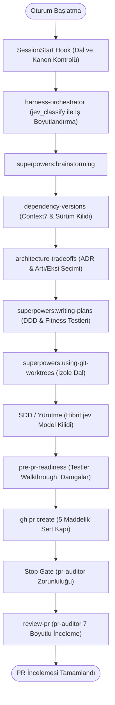

# Alps AGY Engineering Harness (`alps-agy-harness` — `v1.3.2`)

Google Antigravity (AGY) ortamı için kurumsal düzeyde deterministik mühendislik harness eklentisi.

Bu eklenti, yapay zeka ajanlarının rastgele davranışlarını, katman sızıntılarını, bağlam çürümesini (*context rot*), aşırı mühendisliği (*overengineering*) ve sinsi üretim hatalarını engellemek amacıyla endüstri standardı **Engineering Harness** prensipleriyle tasarlanmıştır.

`alps-agy-harness`, köklü `superpowers` (`v7.0.0`+) geliştirme çerçevesini **değiştirmeden ve dosyalarını kopyalamadan** sarmalar; Antigravity'nin yerel yaşam döngüsü kancaları (*hooks*), `jev` olasılıksal değerlendirme motoru, `context7` sürüm kilidi, üç parçalı yaşayan alan kanonu (*Domain Canon*), çok platformlu Clean Architecture kuralları ve derin PR denetim kapıları ekler.

---

## 1. Neden "Engineering Harness"?

Büyük dil modelleri tek başlarına bırakıldığında kapsam kaymasına (*scope creep*), gereksiz soyutlama üretmeye (*enterprise mimicry*) ve bağlam doldukça kuralları unutmaya meyillidir.

**Engineering Harness**, ajanın etrafına kurulan fiziksel güvenlik ve kalite çemberidir:
- **Fiziksel Kancalar (`hooks.json`):** `main` dalına doğrudan kod yazılmasını, doğrulanmamış paket kurulmasını ve eksik denetimle PR açılmasını kabuk düzeyinde engeller.
- **Gemini 4 & İki Fazlı `Orchestrator` Duyarlı Model ve Efor Kilidi (`overwrite`):** Ana oturumun modelini (`HOOK_INPUT.modelName`: Neon, Carbon, Hydrogen, `Orchestrator (Neon|Carbon)`, `Claude Opus/Sonnet 5.5`) algılayarak alt ajan ve `run_workflow` katmanlarını (`inherit`, `pro`, `flash`, `flash_lite`) ve efor bütçelerini (`LOW`, `MEDIUM`, `HIGH`, `XHIGH` [`Extra`], `MAX`) kilitler; `Orchestrator` yürütme turunda denetçileri `pro` katmanına yükselterek `Hydrogen` miras almasını engeller ve `2026-11-30` emeklilik uyarılarını `SessionStart` ile bildirir.
- **Sessiz Başarı Kalkanı (`run-quiet.sh`):** Binlerce satırlık derleme ve test loglarını süzerek bağlam penceresini korur.
- **Sıfır-Context Ön-Eleme (`jev`):** Geçmiş dersleri ve PR diff dosyalarını ana modelin context'ini kirletmeden sunucuda değerlendirir.
- **Sıfır Gecikmeli Arka Plan Daemon'ı (`sidecars/harness-daemon/`, `v1.1.0`):** `graphify` güncellemelerini asenkron single-flight kuyruğuna alır; `harness-doctor`, `codeTreeSha` damgaları, spec paketleri, walkthrough doğrulaması ve iOS `.ips` crash raporlarını `.harness/cache/*.json` altında önceden hazırlar. Hem global hem proje bazlı (`.agents/plugins/`) kurulumlarda `HARNESS_AUTO_START_DAEMON=1` varsayılanıyla soket yokken kancalar daemon'ı arka planda (stdio/pipe ayrık, `daemon.lock` tekilliğiyle) otomatik başlatır; daemon kapalıysa tüm kancalar sessizce yerel fallback'e (`scripts/lib/harness_core.py`) düşer (`HARNESS_DISABLE_DAEMON=1` ile devre dışı bırakılabilir).
- **Paralel Git Worktree & İzole Oturum Desteği:** Ana çalışma alanı `main` dalındayken kardeş Git worktree'lerde (`cd <worktree>`, `git -C <worktree>`, harici dosya yolu) çalışan paralel oturumlar otomatik olarak etkin worktree köküne ve dalına çözümlenir; `subagent-dispatch.json` yazma/tüketim işlemleri `fcntl.flock` ile kilitlenir, `stop-gate.sh` ise `conversationId` ayrımıyla yalnızca PR açan oturumu durdurur. `.gitignore` kapsamındaki yerel `docs/walkthroughs/*.md` dosyaları da `Ne`/`Neden` ve sözlük doğrulamasından geçirilerek desteklenir.
- **Koşullu UI Kalite ve Anti-Slop Kapısı (`Impeccable`, `ui-pass.json`):** Web (`.html`, `.tsx`, `.css`, `.scss`, `.component.ts`) veya Native UI (`.xaml`, SwiftUI, Jetpack Compose) dosyaları değiştiğinde ve ortamda `impeccable` kurulu olduğunda `stamp-gate.sh ui` (`impeccable detect --json`, `P0=0, P1=0`, `DO_NOT_TRACK=1`, `IMPECCABLE_LIVE_COPY_AGENT=chat|off`) üzerinden `ui-pass.json` PR/merge kapısını devreye alır; saf backend projelerinde tamamen pasiftir.
- **Antigravity Swarm Orkestrasyon Desteği (`/swarm`):** Çoklu ajan çalışmalarında koordinatörü tek bir `feat/*` entegrasyon dalında tutar, yazıcı işçileri izole `workspace: "share"` / `"branch"` kopyalarına ve kararlı `detached-wt-*` slug'ına bağlar; `pre-subagent-guard.sh` üzerinden engellemeden `[SWARM_WORKER_CONTRACT]` ve `[SWARM_BRANCH_GUARD]` sözleşmelerini enjekte eder (detaylar: `§7 Antigravity Swarm ile Kullanım`).
- **Claude Code CLI (`claude -p`) Spec/Plan & TDD İncelemesi + 30 sn `agy` Fallback (`v1.3.0`, `tdd-pass.json`):** Spec/Plan incelemelerini birincil olarak salt-okunur `claude -p` (`opus`/`medium`), TDD birim test kapsam denetimlerini `claude -p` (`sonnet`/`high`) ile yürütür. `claude` erişilemediğinde sessiz fallback yapmadan `exit 42` ve sebep JSON'ı döner; orkestratör kullanıcıya sorup 30 sn `schedule` sonrası `agy --mode plan --print=<prompt>` (`claude-opus-5-5-medium`/`gemini-4-carbon-high` veya `claude-sonnet-5-5-high`/`gemini-4-neon-medium`) ile devam eder. Kod/betik değişikliği veya silmesi içeren dallarda `tdd-pass.json` PR/merge öncesi fiziksel olarak zorunludur.

---

## 2. Kurulum Modları

Eklenti dinamik çalışma alanı tespiti (`$WORKSPACE_ROOT`) ile çalışır ve iki kurulum modunu tam olarak destekler:

### Seçenek A: Global Kurulum (Önerilen)
Tüm Antigravity oturumlarında eklentiyi tek merkezden etkinleştirmek için eklentiyi kullanıcı yapılandırma dizinine kurun:

```bash
mkdir -p ~/.gemini/config/plugins
cd ~/.gemini/config/plugins
git clone https://github.com/aparlak88/alps-agy-harness.git alps-agy-harness
```

#### Global Kurulumda `.harness-ignore` Kaçışı
Global kurulum etkin olduğunda kişisel hobi, deneme veya tek seferlik betik klasörlerinizi harness kısıtlamalarından muaf tutmak için çalışma alanının kök dizinine boş bir `.harness-ignore` dosyası eklemeniz yeterlidir:
```bash
touch .harness-ignore
```
Bu dosya mevcut olduğunda tüm hook'lar sessizce pasif geçer (`decision: allow` / `{}`).

---

### Seçenek B: Proje Bazlı Kurulum
Eklentiyi yalnızca belirli bir ekip projesine dahil etmek için projenin `.agents/plugins/` dizinine yerleştirin — Antigravity `.agents/plugins/alps-agy-harness` dizinini ek bir manifesto gerektirmeden **otomatik keşfeder**:

```bash
mkdir -p .agents/plugins
git submodule add https://github.com/aparlak88/alps-agy-harness.git .agents/plugins/alps-agy-harness
```

Eklentiyi standart `.agents/plugins/` dışında özel/paylaşılan bir dizinde barındırıyorsanız `.agents/plugins.json` dosyasını Antigravity'nin `entries` şemasıyla tanımlayın:
```json
{
  "entries": [
    {
      "path": "tools/agents/plugins"
    }
  ]
}
```

> [!NOTE]
> Proje bazlı (`.agents/plugins/`) kurulumlarda IDE yerleşik sidecar yöneticisi daemon'ı otomatik başlatmasa bile, `session-start.sh` ve kanca istemcileri (`HARNESS_AUTO_START_DAEMON=1` varsayılanıyla) `sidecars/harness-daemon/daemon.py` sürecini stdin/stdout/stderr'den tamamen ayrık biçimde (`daemon.lock` tekilliği korunarak) otomatik başlatır. Devre dışı bırakmak için `HARNESS_DISABLE_DAEMON=1` ayarlayın.

---

## 3. Ön Gereksinimler

Harness kurulumundan önce geliştirme makinenizde aşağıdaki araçların kurulu olması gerekir:

1. **Sistem Araçları:**
   - POSIX `bash`, `jq`, `git`, `python3`, `uv`, `node` (`>= 20`).
   - GitHub CLI: `gh` (ve `gh auth status` ile doğrulanmış oturum).
2. **Superpowers Eklentisi:**
   - `agy plugin install https://github.com/obra/superpowers` (en az sürüm `v7.0.0`).
3. **Marketplace Eklentileri:**
   - **Chrome DevTools (Zorunlu):** `antigravity-plugins-official/plugin/chrome-devtools-plugin`
   - **Firebase:** `antigravity-plugins-official/plugin/firebase`
   - **Postman:** `antigravity-plugins-partners/plugin/postman`
   - **Android CLI (Önerilen):** `antigravity-plugins-official/plugin/android-cli-plugin`
   - **Impeccable (Opsiyonel — UI/Frontend Projeleri İçin Önerilen):** `npx impeccable install --scope=global` (kuruluysa ve dalda UI dosyası değişirse `ui-pass.json` sert PR/merge kapısı otomatik devreye girer; saf backend projelerinde tamamen pasiftir).

---

## 4. MCP Sunucuları Yapılandırması (`mcp_config.json`)

Tüm 8 zorunlu MCP sunucusunu ve macOS/iOS geliştiricileri için opsiyonel `XcodeBuildMCP` sunucusunu aşağıdaki şablonu `~/.gemini/config/mcp_config.json` dosyanıza kopyalayarak yapılandırın:

```json
{
  "mcpServers": {
    "jev": {
      "command": "/bin/bash",
      "args": ["-c", "$HOME/.config/typesafe/run-jev-mcp.sh"]
    },
    "context7": {
      "command": "npx",
      "args": ["-y", "@upstash/context7-mcp"]
    },
    "csharp-lsp": {
      "command": "csharp-lsp-mcp",
      "args": []
    },
    "typescript-lsp": {
      "command": "npx",
      "args": ["-y", "@mizchi/lsmcp", "-p", "typescript"]
    },
    "playwright": {
      "command": "npx",
      "args": ["-y", "@playwright/mcp@latest"]
    },
    "graphify": {
      "command": "graphify",
      "args": ["serve"]
    },
    "revenuecat": {
      "url": "https://mcp.revenuecat.ai/mcp"
    },
    "filesystem": {
      "command": "npx",
      "args": ["-y", "@modelcontextprotocol/server-filesystem", "/Users"]
    },
    "XcodeBuildMCP": {
      "command": "npx",
      "args": ["-y", "xcodebuildmcp@latest", "mcp"]
    }
  }
}
```

---

## 5. Güvenli `TYPESAFE_API_KEY` Kurulumu

`jev` olasılıksal değerlendirme motoru TypeSafe API anahtarına ihtiyaç duyar. Düz metin anahtarların repoya veya komut geçmişine sızmasını önlemek için güvenli sarmalayıcı desenini uygulayın:

1. Anahtarınızı yalnızca sizin erişebileceğiniz güvenli dosyaya yazın:
   ```bash
   mkdir -p ~/.config/typesafe
   echo "<YOUR_TYPESAFE_API_KEY>" > ~/.config/typesafe/key
   chmod 600 ~/.config/typesafe/key
   ```
2. Güvenli sarmalayıcı betiğini oluşturun (`~/.config/typesafe/run-jev-mcp.sh`):
   ```bash
   cat << 'EOF' > ~/.config/typesafe/run-jev-mcp.sh
   #!/usr/bin/env bash
   set -euo pipefail
   KEY_FILE="$HOME/.config/typesafe/key"
   if [ -f "$KEY_FILE" ]; then
     export TYPESAFE_API_KEY="$(cat "$KEY_FILE" | tr -d '[:space:]')"
   fi
   exec npx -y jev-mcp "$@"
   EOF
   chmod 700 ~/.config/typesafe/run-jev-mcp.sh
   ```

> [!CAUTION]
> Asla gerçek gizli anahtarınızı kaynak koda, dokümanlara veya genel kanallara eklemeyin.

---

## 6. Ortam Doğrulaması (`harness-doctor`)

Kurulumu tamamladıktan sonra tüm bileşenlerin ve MCP sunucularının sağlıklı olduğunu doğrulamak için `harness-doctor` çalıştırın:

```bash
./scripts/harness-doctor.sh
```

Makine tarafından okunabilir JSON çıktısı için:
```bash
./scripts/harness-doctor.sh --json
```

Herhangi bir eksiklik olduğunda `harness-doctor` doğrudan kopyala-yapıştır hazır düzeltme komutları sunar.

---

## 7. Yaşam Döngüsü ve Mimari Akış



### Antigravity Swarm ile Kullanım

Antigravity Swarm (`/swarm` veya çoklu ajan iş akışı) kullanılırken harness hem koordinatörü sıkı biçimde koordine rolünde tutar hem de uzun soluklu 5 saatlik / haftalık kota kesintilerinde kesintisiz otomatik bekleme ve devam sağlar:

- **Sıkı Coordinator-Only Koruması (`swarm-coordinator.json`):** `/swarm` başlatıldığında veya `swarm(action="title|add")` çalıştırıldığında koordinatör `conversationId` değeri dal-bağımsız `.harness/state/swarm/swarm-coordinator.json` içinde kaydedilir. Koordinatör aktifken `pre-edit-guard.sh` tüm çalışma alanı dosya yazmalarını, `pre-command-guard.sh` derleme/test/git mutasyonu/`gh pr create` komutlarını (yalnız salt-okunur inceleme ve `stamp-gate.sh` koordinasyon alt komutları serbesttir), `pre-subagent-guard.sh` ise doğrudan `invoke_subagent` ve `run_workflow` çağrılarını fiziksel olarak reddeder. Tüm işler uzman Swarm işçilerine (`planner`, `implementer-*`, `verifier`, `integrator`) devredilir.
- **Tek Entegrasyon Dalı ve `integrator` İşçisi (`feat/*`):** İşçi dalları tamamlandığında uzman **`integrator` Swarm işçisi** (`[SWARM_INTEGRATOR_CONTRACT]`) dalları tek `feat/<konu>` entegrasyon dalında birleştirir; ardından tek bütünleşik `docs/walkthroughs/*.md` rehberini, `canon-auditor`, `security-reviewer`, `tdd-pass.json`, koşullu `ui-pass.json`, `gh pr create` ve `pr-auditor` adımlarını yürütür.
- **İzole Yazıcı Kopyaları (`workspace: "share"` + alt dal):** Kod yazan veya derleme/test çalıştıran işçiler `workspace: "share"` (veya tam izole klon için `"branch"`) ile başlatılır ve koda dokunmadan önce kendi alt dallarını (`git checkout -b feat/<konu>-<işçi>`) açar. `workspace: "share"` kullanabilmek için çalışma alanının oturum başlamadan önce geçerli bir Git deposu olması gerekir (aksi halde IDE `VCS type Unknown` hatası dönebilir). Salt-okunur inceleme ve keşif işçileri ise `workspace: "inherit"` kullanır.
- **`invoke_subagent|swarm|run_workflow` Kancası (`pre-subagent-guard.sh`):** `hooks.json` içindeki `PreToolUse` eşleştiricisi `invoke_subagent|swarm|run_workflow` desenini izler. `swarm(action="add")` çağrılarında işlemi engellemeden (`non-blocking overwrite`) `brief` başına `[EFFORT_PROFILE: ...]`, `[SWARM_WORKER_CONTRACT ...]` (veya `integrator` için `[SWARM_INTEGRATOR_CONTRACT ...]`) ve `share`/`branch` modlarında `[SWARM_BRANCH_GUARD ...]` başlıklarını ekler (yerleşik `monitor`/`monitor-N` ve `narrator`/`narrator-N` sistem rolleri muaf tutulur); `run_workflow` çağrılarında ise doğrudan `subprocess`/`os.system` atlatmalarını, gizli anahtarları ve geçersiz `model=...` katmanlarını reddeder. Aynı `Role` için paralel dispatch kayıtları `pendingQueues` ve `conversationId` yakınlığıyla çakışmasız tüketilir. Not: `PreToolUse` araç yürütülmeden önce çalıştığı için başarısız olan bir `swarm(action="add")` çağrısında da ilgili `subagent-dispatch.json` kaydı tükenmiş sayılır; yeniden denemede `stamp-gate.sh dispatch` tekrar çalıştırılmalıdır.
- **5 Saatlik & Haftalık Saf Bekleme Kota Kurtarma (`swarm-quota-wait.json`):** Uzun soluklu Swarm oturumlarında kota dolduğunda işçiler **öldürülmez** ve model **değiştirilmez** (`swarm(action="model|kill")` aktif bekleme sırasında `force_ask` ile korunur). Koordinatör `swarm(action="models")` ile `quota_resets` zamanını okuyup `stamp-gate.sh swarm-quota pause` ve yerel `schedule` ile bekler; koordinatörün kendisi kotaya çarpıp `Stop(ERROR)` ile durursa `stop-gate.sh` sıfır-token arka plan bekleyicisi **`harness-daemon`**'ı uyandırır. Daemon çalışma alanını TTL temizliğinden muaf tutar ve sıfırlama anında `agy --conversation <id> --print=...` ile oturumu otomatik uyandırarak işçileri kaldığı yerden devam ettirir.
- **Kararlı `detached-wt-*` Slug'ı:** Linked Git worktree'lerde `detached HEAD` durumunda `common.sh` ve `harness_core.py`, commit hash'ine bağlı değişen `detached-<7sha>` yerine worktree dizin adına sabitlenen `detached-wt-*` (`detached-wt-<ad>`) slug'ını üretir. Böylece işçi yeni commit attığında `.harness/state/detached-wt-<ad>/` altındaki `context7` ve diğer damgalar bozulmaz.
- **Global Kurulum Önerisi:** Swarm'ın `workspace: "share"` ve `"branch"` modlarında oluşturduğu çalışma kopyalarının kancaları ve arka plan daemon'ını kesintisiz devralması için **Global Kurulum** (`~/.gemini/config/plugins/alps-agy-harness`) önerilir. Proje bazlı `.agents/plugins/` kurulumu kullanılıyorsa `./scripts/harness-doctor.sh` çıktıya `INFO` seviyesinde `swarm_install_advisory` uyarısı ekleyerek global kurulumu veya işçi klonlarında `--recurse-submodules` (`git submodule update --init --recursive`) kullanımını hatırlatır.

---

## 8. Bileşenler Özeti

| Kategori | Bileşen | Açıklama |
| :--- | :--- | :--- |
| **Kancalar (`hooks.json`)** | `session-start.sh` | Oturum başında dal, aktif model ailesi (`modelName`), kanon ve araç durumunu enjekte eder; soket yoksa `harness-daemon`'ı arka planda başlatır. |
| | `pre-edit-guard.sh` | `main` dalı kod kilidi, kardeş worktree çözümlemesi, doküman sonu sözlük kapısı ve güvenlik süzgeci. |
| | `pre-command-guard.sh` | `cd`/`git -C` worktree çözümlemesi, paket kurulum doğrulaması, logcat koruması ve `.gitignore` uyumlu sert PR açma kapısı. |
| | `pre-subagent-guard.sh` | `invoke_subagent\|swarm\|run_workflow` eşleştiricisiyle Gemini 4 & `Orchestrator` duyarlı model/efor `overwrite` kilidi, `swarm(action="add")` `brief` zenginleştirme, `run_workflow` güvenlik kapısı ve `flock`-atomik `pendingQueues` tüketimi. |
| | `post-command-hooks.sh` | Başarılı PR sonrası etkin worktree + `conversationId` kayıtlı denetim bayrağı ve asenkron `graphify` güncellemesi. |
| | `stop-gate.sh` | `conversationId` izolasyonuyla yalnızca PR açan oturumda `pr-auditor` çalıştırılmadan çıkışı engeller; Swarm koordinatörü kota `ERROR` ile durduğunda `swarm-quota-wait.json` oluşturup daemon'ı uyandırır. |
| **Arka Plan Sidecar (`sidecars/`)** | `harness-daemon/sidecar.json` & `daemon.py` | Sıfır gecikmeli Unix socket kanca motoru (`HARNESS_AUTO_START_DAEMON=1` otomatik başlatma), tekil kuyruklu asenkron `graphify`, doktor/damga/spec önbelleği, iOS crash izleyici ve sıfır-token Swarm kota bekleme/uyandırma gözcüsü (`agy --conversation`). |
| **Ortak Çekirdek (`scripts/lib/`)** | `harness_core.py` | `harness-daemon` ile tüm yerel fallback kanca ve teşhis betikleri arasında paylaşılan tek doğruluk kaynağı. |
| **Yardımcı Betikler** | `run-quiet.sh` | Derleme/test loglarını sessize alır; tek satır özet ve log kaydı döner. |
| | `mobile-logs.sh` | iOS Simulator `.ips` crash ve Android Emulator logcat süzgeci. |
| | `stamp-gate.sh` | Kriptografik `codeTreeSha` damgası (`canon`, `security`, koşullu `tdd-pass.json` ve `ui-pass.json`), `claude -p` / `agy -p` (`review`), `swarm-coordinator` / `swarm-quota` durum yöneticisi, `select-model` çözümleyicisi ve subagent dispatch yöneticisi. |
| | `harness-doctor.sh` | 8 MCP, gizli anahtar, koşullu `impeccable_ui` ve ortam sağlığı kontrol aracı. |
| **Alt Ajanlar (`agents/`)** | `canon-auditor.md` | Domain glossary, flows ve Clean Architecture denetçisi (`inherit`/`pro` + `HIGH` taban). |
| | `security-reviewer.md` | PR diff güvenlik açığı ve secret tarayıcısı (frontier `inherit`/`pro` + `MAX`). |
| | `pr-auditor.md` | Niyet çapası ve 7 boyutlu derin mimari denetçi (frontier `inherit`/`pro` + `HIGH`/`MAX`). |
| **Skill'ler (`skills/`)** | 11 Süreç Skill'i | Orkestrasyon, mimari trade-off, sürüm kilidi, E2E, mobil ve RevenueCat. |

---

## 9. İki Dilli Dil ve Doküman Sonu Sözlük Kuralı

- **Kaynak Kod ve Dokümantasyon (`TSDoc`, `XMLDoc`, `DocC`, `KDoc`):** Kesinlikle **İngilizce**.
- **Repo Markdown Dokümanları (`docs/`, PR Walkthrough, Spec, Plan):** Varsayılan olarak **Türkçe**.
- **Doküman Sonu Sözlük Zorunluluğu:** Üretilen tüm teknik Markdown dokümanları (Spec, Plan, Walkthrough, `README.md`, `flows.md`, `lessons.md`) en son `## ` bölümü olarak `## Teknik Terimler Sözlüğü` tablosu içermek zorundadır.

---

## Teknik Terimler Sözlüğü

| Terim | Açıklama |
| :--- | :--- |
| **Bound Context** | Domain-Driven Design (DDD) yaklaşımında bir iş modelinin ve terminolojisinin geçerli olduğu sınırlandırılmış alan. |
| **Clean Architecture** | İş kurallarını (Domain ve Application) veritabanı, UI ve dış kütüphanelerden (Infrastructure) izole eden yazılım mimarisi. |
| **Context Rot (Bağlam Çürümesi)** | Uzun terminal ve derleme çıktılarıyla yapay zeka modelinin çalışma belleğinin dolması ve kuralları unutmaya başlaması sorunu. |
| **Coordinator-Only Modu** | Swarm koordinatörünün dosya düzenleme, derleme/test ve git mutasyonu yapmasının fiziksel kancalarla engellenip yalnızca koordinasyona ayrıldığı çalışma modu. |
| **Engineering Harness** | Yapay zeka ajanlarının hata yapmasını ve kurallardan sapmasını engelleyen kancalar, kurallar ve denetim kapıları çerçevesi. |
| **Flowchart** | Bileşenler arasındaki katman hiyerarşisini ve bağımlılık yönünü gösteren görsel akış şeması. |
| **Idempotency** | Aynı komut veya işlemin defalarca çalıştırıldığında sistemde ilk işlem haricinde ek bir yan etki üretmemesi güvencesi. |
| **Impeccable (Conditional UI Gate)** | UI/Frontend dosyaları değiştiğinde ve Impeccable kurulu olduğunda `stamp-gate.sh ui` (`impeccable detect --json` / `P0=0, P1=0`) ile `ui-pass.json` damgasını zorunlu kılan; `DO_NOT_TRACK=1` ve `IMPECCABLE_LIVE_COPY_AGENT=chat\|off` korumalı opsiyonel modül. |
| **jev (TypeSafe System One)** | Ajan kararlarını ve kod diff'lerini sunucu tarafında bağlam kirletmeden olasılıksal olarak puanlayan değerlendirme motoru. |
| **LSP (Language Server Protocol)** | Derleyici düzeyinde tip kontrolü, referans sorgulama ve sembol tanılamalarını ajana sunan standart protokol. |
| **MCP (Model Context Protocol)** | Yapay zeka ajanlarının harici araçlar, dil sunucuları ve platformlara bağlanmasını sağlayan açık protokol. |
| **Outbox Pattern** | Veritabanı durum değişikliği ile buna bağlı olay bildirimlerinin aynı işlemde atomik olarak kaydedilip güvenle iletilmesi deseni. |
| **Orchestrator (Two-Phase Planner/Executor)** | Salt-okunur Planlama (`Neon`/`Carbon`/`Opus 5.5`) ile hızlı Yürütme (`Hydrogen`/`Sonnet 5.5`) fazları arasında el değiştiren Antigravity oturum modu. |
| **run_workflow** | Python iş akışı betiği üzerinden paralel ve aşamalı ajan orkestrasyonu sağlayan Antigravity aracı. |
| **PreToolUse & PostToolUse** | Antigravity'de bir aracın çalışmasından hemen önce (Pre) ve tamamlanmasından hemen sonra (Post) tetiklenen kancalar. |
| **Sequence Diagram** | İstemci ile sunucu arasındaki mesajlaşma ve metot çağrı sırasını adım adım gösteren zaman eksenli UML diyagramı. |
| **Sidecar (`harness-daemon`)** | Antigravity'nin ana ajandan bağımsız yönettiği, arka plan önbellekleme ve Unix domain socket üzerinden sıcak kanca değerlendirmesi sunan yardımcı süreç. |
| **Subagent Dispatch** | Ana ajanın alt ajan çalıştırmadan önce işin karmaşıklığını puanlayıp uygun model ve efor profilini damgalaması süreci. |
| **Swarm (Antigravity Swarm)** | Koordinatör ajanın ortak mesaj panosu ve izole çalışma alanları (`workspace: "share"` / `"inherit"` / `"branch"`) üzerinden paralel işçi ajanları eşzamanlı koordine ettiği çoklu ajan yürütme mimarisi. |
| **Swarm Kota Bekleme / Otomatik Devam (Pure-Wait Quota Resume)** | 5 saatlik veya haftalık kota dolduğunda işçileri öldürmeden ve model değiştirmeden `schedule` ve `harness-daemon` (`agy --conversation`) aracılığıyla kota açılınca oturumu kaldığı yerden devam ettirme mekanizması. |
| **Ubiquitous Language** | Ekip, dokümanlar ve kaynak kod arasında terim karmaşasını önlemek için kullanılan ortak ve tekil alan dili sözlüğü. |
| **Walkthrough** | Bir PR'ın mimari kararlarını, değişen katmanlarını ve doğrulama kanıtlarını görsel diyagramlarla anlatan rehber doküman. |
