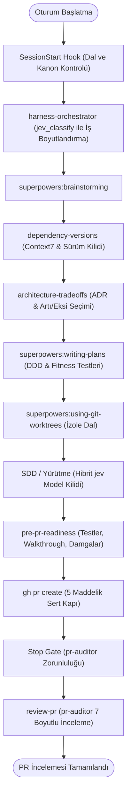

# Alps AGY Engineering Harness (`alps-agy-harness`)

Google Antigravity (AGY) ortamı için kurumsal düzeyde deterministik mühendislik harness eklentisi.

Bu eklenti, yapay zeka ajanlarının rastgele davranışlarını, katman sızıntılarını, bağlam çürümesini (*context rot*), aşırı mühendisliği (*overengineering*) ve sinsi üretim hatalarını engellemek amacıyla endüstri standardı **Engineering Harness** prensipleriyle tasarlanmıştır.

`alps-agy-harness`, köklü `superpowers` (`v7.0.0`+) geliştirme çerçevesini **değiştirmeden ve dosyalarını kopyalamadan** sarmalar; Antigravity'nin yerel yaşam döngüsü kancaları (*hooks*), `jev` olasılıksal değerlendirme motoru, `context7` sürüm kilidi, üç parçalı yaşayan alan kanonu (*Domain Canon*), çok platformlu Clean Architecture kuralları ve derin PR denetim kapıları ekler.

---

## 1. Neden "Engineering Harness"?

Büyük dil modelleri tek başlarına bırakıldığında kapsam kaymasına (*scope creep*), gereksiz soyutlama üretmeye (*enterprise mimicry*) ve bağlam doldukça kuralları unutmaya meyillidir.

**Engineering Harness**, ajanın etrafına kurulan fiziksel güvenlik ve kalite çemberidir:
- **Fiziksel Kancalar (`hooks.json`):** `main` dalına doğrudan kod yazılmasını, doğrulanmamış paket kurulmasını ve eksik denetimle PR açılmasını kabuk düzeyinde engeller.
- **Gemini 4 & `Orchestrator` Duyarlı Model ve Efor Kilidi (`overwrite`):** Ana oturumun modelini (`HOOK_INPUT.modelName`: Carbon, Argon, Hydrogen, `Orchestrator`) algılayarak alt ajan katmanlarını (`inherit`, `pro` [Argon], `flash`, `flash_lite`) ve efor bütçelerini (`LOW`, `MEDIUM`, `HIGH`, `XHIGH`, `MAX`) düşürme kaybı olmadan fiziksel olarak kilitler.
- **Sessiz Başarı Kalkanı (`run-quiet.sh`):** Binlerce satırlık derleme ve test loglarını süzerek bağlam penceresini korur.
- **Sıfır-Context Ön-Eleme (`jev`):** Geçmiş dersleri ve PR diff dosyalarını ana modelin context'ini kirletmeden sunucuda değerlendirir.

---

## 2. Kurulum Modları

Eklenti dinamik çalışma alanı tespiti (`$WORKSPACE_ROOT`) ile çalışır ve iki kurulum modunu tam olarak destekler:

### Seçenek A: Global Kurulum (Önerilen)
Tüm Antigravity oturumlarında eklentiyi tek merkezden etkinleştirmek için eklentiyi kullanıcı yapılandırma dizinine kurun:

```bash
mkdir -p ~/.gemini/config/plugins
cd ~/.gemini/config/plugins
git clone https://github.com/aparlak88/alps-agy-harness.git alps-agy-harness
```

#### Global Kurulumda `.harness-ignore` Kaçışı
Global kurulum etkin olduğunda kişisel hobi, deneme veya tek seferlik betik klasörlerinizi harness kısıtlamalarından muaf tutmak için çalışma alanının kök dizinine boş bir `.harness-ignore` dosyası eklemeniz yeterlidir:
```bash
touch .harness-ignore
```
Bu dosya mevcut olduğunda tüm hook'lar sessizce pasif geçer (`decision: allow` / `{}`).

---

### Seçenek B: Proje Bazlı Kurulum
Eklentiyi yalnızca belirli bir ekip projesine dahil etmek için projenin `.agents/plugins/` dizinine yerleştirin veya takım manifestosuna (`.agents/plugins.json`) kaydedin:

```bash
mkdir -p .agents/plugins
git submodule add https://github.com/aparlak88/alps-agy-harness.git .agents/plugins/alps-agy-harness
```

Takım manifestosu (`.agents/plugins.json`):
```json
{
  "plugins": [
    {
      "name": "alps-agy-harness",
      "path": "./.agents/plugins/alps-agy-harness"
    }
  ]
}
```

---

## 3. Ön Gereksinimler

Harness kurulumundan önce geliştirme makinenizde aşağıdaki araçların kurulu olması gerekir:

1. **Sistem Araçları:**
   - POSIX `bash`, `jq`, `git`, `python3`, `uv`, `node` (`>= 20`).
   - GitHub CLI: `gh` (ve `gh auth status` ile doğrulanmış oturum).
2. **Superpowers Eklentisi:**
   - `agy plugin install https://github.com/obra/superpowers` (en az sürüm `v7.0.0`).
3. **Marketplace Eklentileri:**
   - **Chrome DevTools (Zorunlu):** `antigravity-plugins-official/plugin/chrome-devtools-plugin`
   - **Firebase:** `antigravity-plugins-official/plugin/firebase`
   - **Postman:** `antigravity-plugins-partners/plugin/postman`
   - **Android CLI (Önerilen):** `antigravity-plugins-official/plugin/android-cli-plugin`

---

## 4. MCP Sunucuları Yapılandırması (`mcp_config.json`)

Tüm 8 zorunlu MCP sunucusunu ve macOS/iOS geliştiricileri için opsiyonel `XcodeBuildMCP` sunucusunu aşağıdaki şablonu `~/.gemini/config/mcp_config.json` dosyanıza kopyalayarak yapılandırın:

```json
{
  "mcpServers": {
    "jev": {
      "command": "/bin/bash",
      "args": ["-c", "$HOME/.config/typesafe/run-jev-mcp.sh"]
    },
    "context7": {
      "command": "npx",
      "args": ["-y", "@upstash/context7-mcp"]
    },
    "csharp-lsp": {
      "command": "csharp-lsp-mcp",
      "args": []
    },
    "typescript-lsp": {
      "command": "npx",
      "args": ["-y", "@mizchi/lsmcp", "-p", "typescript"]
    },
    "playwright": {
      "command": "npx",
      "args": ["-y", "@playwright/mcp@latest"]
    },
    "graphify": {
      "command": "graphify",
      "args": ["serve"]
    },
    "revenuecat": {
      "url": "https://mcp.revenuecat.ai/mcp"
    },
    "filesystem": {
      "command": "npx",
      "args": ["-y", "@modelcontextprotocol/server-filesystem", "/Users"]
    },
    "XcodeBuildMCP": {
      "command": "npx",
      "args": ["-y", "xcodebuildmcp@latest", "mcp"]
    }
  }
}
```

---

## 5. Güvenli `TYPESAFE_API_KEY` Kurulumu

`jev` olasılıksal değerlendirme motoru TypeSafe API anahtarına ihtiyaç duyar. Düz metin anahtarların repoya veya komut geçmişine sızmasını önlemek için güvenli sarmalayıcı desenini uygulayın:

1. Anahtarınızı yalnızca sizin erişebileceğiniz güvenli dosyaya yazın:
   ```bash
   mkdir -p ~/.config/typesafe
   echo "<YOUR_TYPESAFE_API_KEY>" > ~/.config/typesafe/key
   chmod 600 ~/.config/typesafe/key
   ```
2. Güvenli sarmalayıcı betiğini oluşturun (`~/.config/typesafe/run-jev-mcp.sh`):
   ```bash
   cat << 'EOF' > ~/.config/typesafe/run-jev-mcp.sh
   #!/usr/bin/env bash
   set -euo pipefail
   KEY_FILE="$HOME/.config/typesafe/key"
   if [ -f "$KEY_FILE" ]; then
     export TYPESAFE_API_KEY="$(cat "$KEY_FILE" | tr -d '[:space:]')"
   fi
   exec npx -y jev-mcp "$@"
   EOF
   chmod 700 ~/.config/typesafe/run-jev-mcp.sh
   ```

> [!CAUTION]
> Asla gerçek gizli anahtarınızı kaynak koda, dokümanlara veya genel kanallara eklemeyin.

---

## 6. Ortam Doğrulaması (`harness-doctor`)

Kurulumu tamamladıktan sonra tüm bileşenlerin ve MCP sunucularının sağlıklı olduğunu doğrulamak için `harness-doctor` çalıştırın:

```bash
./scripts/harness-doctor.sh
```

Makine tarafından okunabilir JSON çıktısı için:
```bash
./scripts/harness-doctor.sh --json
```

Herhangi bir eksiklik olduğunda `harness-doctor` doğrudan kopyala-yapıştır hazır düzeltme komutları sunar.

---

## 7. Yaşam Döngüsü ve Mimari Akış



---

## 8. Bileşenler Özeti

| Kategori | Bileşen | Açıklama |
| :--- | :--- | :--- |
| **Kancalar (`hooks.json`)** | `session-start.sh` | Oturum başında dal, aktif model ailesi (`modelName`), kanon ve araç durumunu enjekte eder. |
| | `pre-edit-guard.sh` | `main` dalı kod kilidi, doküman sonu sözlük kapısı ve güvenlik süzgeci. |
| | `pre-command-guard.sh` | Paket kurulum doğrulaması, logcat koruması ve sert PR açma kapısı. |
| | `pre-subagent-guard.sh` | Gemini 4 & `Orchestrator` duyarlı alt ajan modeli (`inherit`/`pro`/`flash`/`flash_lite`) ve efor (`LOW`–`MAX`) `overwrite` kilidi. |
| | `post-command-hooks.sh` | Başarılı PR sonrası denetim bayrağı ve `graphify` güncellemesi. |
| | `stop-gate.sh` | `pr-auditor` çalıştırılmadan oturumun kapanmasını engeller. |
| **Yardımcı Betikler** | `run-quiet.sh` | Derleme/test loglarını sessize alır; tek satır özet ve log kaydı döner. |
| | `mobile-logs.sh` | iOS Simulator `.ips` crash ve Android Emulator logcat süzgeci. |
| | `stamp-gate.sh` | Kriptografik `codeTreeSha` damgası, `select-model` çözümleyicisi ve subagent dispatch yöneticisi. |
| | `harness-doctor.sh` | 8 MCP, gizli anahtar ve ortam sağlığı kontrol aracı. |
| **Alt Ajanlar (`agents/`)** | `canon-auditor.md` | Domain glossary, flows ve Clean Architecture denetçisi (`inherit`/`pro` + `HIGH` taban). |
| | `security-reviewer.md` | PR diff güvenlik açığı ve secret tarayıcısı (frontier `inherit`/`pro` + `MAX`). |
| | `pr-auditor.md` | Niyet çapası ve 7 boyutlu derin mimari denetçi (frontier `inherit`/`pro` + `HIGH`/`MAX`). |
| **Skill'ler (`skills/`)** | 11 Süreç Skill'i | Orkestrasyon, mimari trade-off, sürüm kilidi, E2E, mobil ve RevenueCat. |

---

## 9. İki Dilli Dil ve Doküman Sonu Sözlük Kuralı

- **Kaynak Kod ve Dokümantasyon (`TSDoc`, `XMLDoc`, `DocC`, `KDoc`):** Kesinlikle **İngilizce**.
- **Repo Markdown Dokümanları (`docs/`, PR Walkthrough, Spec, Plan):** Varsayılan olarak **Türkçe**.
- **Doküman Sonu Sözlük Zorunluluğu:** Üretilen tüm teknik Markdown dokümanları (Spec, Plan, Walkthrough, `README.md`, `flows.md`, `lessons.md`) en son `## ` bölümü olarak `## Teknik Terimler Sözlüğü` tablosu içermek zorundadır.

---

## Teknik Terimler Sözlüğü

| Terim | Açıklama |
| :--- | :--- |
| **Bound Context** | Domain-Driven Design (DDD) yaklaşımında bir iş modelinin ve terminolojisinin geçerli olduğu sınırlandırılmış alan. |
| **Clean Architecture** | İş kurallarını (Domain ve Application) veritabanı, UI ve dış kütüphanelerden (Infrastructure) izole eden yazılım mimarisi. |
| **Context Rot (Bağlam Çürümesi)** | Uzun terminal ve derleme çıktılarıyla yapay zeka modelinin çalışma belleğinin dolması ve kuralları unutmaya başlaması sorunu. |
| **Engineering Harness** | Yapay zeka ajanlarının hata yapmasını ve kurallardan sapmasını engelleyen kancalar, kurallar ve denetim kapıları çerçevesi. |
| **Flowchart** | Bileşenler arasındaki katman hiyerarşisini ve bağımlılık yönünü gösteren görsel akış şeması. |
| **Idempotency** | Aynı komut veya işlemin defalarca çalıştırıldığında sistemde ilk işlem haricinde ek bir yan etki üretmemesi güvencesi. |
| **jev (TypeSafe System One)** | Ajan kararlarını ve kod diff'lerini sunucu tarafında bağlam kirletmeden olasılıksal olarak puanlayan değerlendirme motoru. |
| **LSP (Language Server Protocol)** | Derleyici düzeyinde tip kontrolü, referans sorgulama ve sembol tanılamalarını ajana sunan standart protokol. |
| **MCP (Model Context Protocol)** | Yapay zeka ajanlarının harici araçlar, dil sunucuları ve platformlara bağlanmasını sağlayan açık protokol. |
| **Outbox Pattern** | Veritabanı durum değişikliği ile buna bağlı olay bildirimlerinin aynı işlemde atomik olarak kaydedilip güvenle iletilmesi deseni. |
| **PreToolUse & PostToolUse** | Antigravity'de bir aracın çalışmasından hemen önce (Pre) ve tamamlanmasından hemen sonra (Post) tetiklenen kancalar. |
| **Sequence Diagram** | İstemci ile sunucu arasındaki mesajlaşma ve metot çağrı sırasını adım adım gösteren zaman eksenli UML diyagramı. |
| **Subagent Dispatch** | Ana ajanın alt ajan çalıştırmadan önce işin karmaşıklığını puanlayıp uygun model ve efor profilini damgalaması süreci. |
| **Ubiquitous Language** | Ekip, dokümanlar ve kaynak kod arasında terim karmaşasını önlemek için kullanılan ortak ve tekil alan dili sözlüğü. |
| **Walkthrough** | Bir PR'ın mimari kararlarını, değişen katmanlarını ve doğrulama kanıtlarını görsel diyagramlarla anlatan rehber doküman. |
