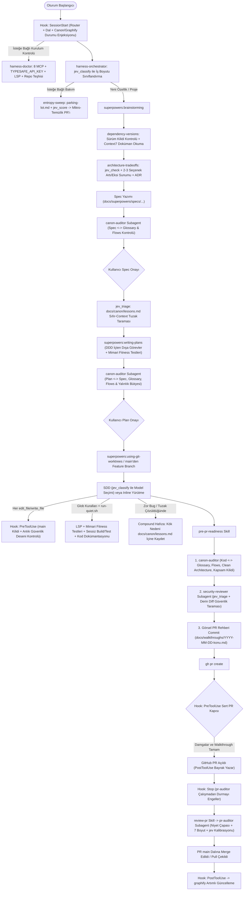

# `alps-agy-harness` — Antigravity Takım Geliştirme Harness Eklentisi Tasarım Dokümanı

**Tarih:** 2026-11-12  
**Hedef Platform:** Google Antigravity (`agy` CLI, Antigravity IDE, Antigravity 2.0)  
**Paket Biçimi:** Dağıtılabilir Yerel Antigravity Eklentisi (`plugin.json` tabanlı)  
**Temel Metodoloji:** `superpowers` (`v7.0.0`+) etrafında deterministik hook kapıları, `jev` kalibrasyon motoru ve çok platformlu mimari yönetişim

---

## 1. Amaç ve Neden (Intent & Why)

Antigravity (`agy`) kullanan ekip üyelerinin her projede aynı mühendislik kalitesi, mimari disiplin ve araç zinciriyle çalışmasını sağlayacak **tek bir dağıtılabilir Antigravity eklentisi (`alps-agy-harness`)** oluşturmak.

`superpowers` eklentisi güçlü bir temel iş akışı (`brainstorming` → `writing-plans` → `subagent-driven-development` / `executing-plans` → `finishing-a-development-branch`) sunar; ancak tek başına bırakıldığında şu boşluklar kalır:
1. Antigravity'de `superpowers`'ın Claude şemasındaki `hooks.json` dosyası yüklenmediği için (`hooks: false`) oturum başlangıç yönlendirmesi ve kural kapıları tamamen modelin inisiyatifine kalır.
2. Modeller eğitim kesim tarihinden kalma eski paket sürümlerini önerebilir (greenfield) veya mevcut projede kilitlenmiş bir sürümü bozacak yeni API'ler üretebilir (brownfield).
3. Dokümanlar (Spec, Plan) ve kod arasında alan terimleri (*glossary*) ve iş akışı adımları (*canonical flows*) zamanla sessizce farklılaşır.
4. Mimari karar noktalarında alternatifler artı/eksileriyle sunulmadan tek bir yaklaşım varsayılır.
5. DDD & Clean Architecture sınırları, derleme/test zamanı mimari fitness testleri, üretim kodu dokümantasyonu (XMLDoc/TSDoc/DocC/KDoc), PR öncesi güvenlik taraması, PR sonrası çok boyutlu denetim ve Junior geliştirici odaklı görsel PR rehberi (Mermaid) zorunlu ve fiziksel olarak denetlenen adımlar değildir.
6. Ajanlar sıkı mimari ve inceleme kuralları altında karşıt bir **orantılılık ve kapsam freni** olmadığında basit işler için aşırı soyutlama üretir (*overengineering*), görev dışı komşu dosyaları kurcalar (*drive-by refactoring / scope creep*), uzun derleme/test çıktıları yüzünden bağlam çürümesi (*context rot*) yaşayıp asıl amacı unutur (*goal drift*) ve çözülen zor hatalardan kalıcı ders çıkarmaz.

`alps-agy-harness`, bu boşlukları **Antigravity yaşam döngüsü hook'ları (`hooks.json`)**, **zorunlu `jev` olasılıksal değerlendirme araçları**, **orantılılık, karmaşıklık bütçesi ve context kalkanı kuralları**, **bileşik ders hafızası (`lessons.md`)**, **özelleştirilmiş alt ajanlar (`agents/*.md`)**, **süreç ve teşhis skill'leri (`skills/*/SKILL.md`)** ve **dosya desenine duyarlı kurallar (`rules/*.md`)** ile kapatır.

---

## 2. Hedefler, Kapsam Dışı Olanlar ve Anti-Hedefler

### 2.1. Hedefler (Goals)
1. **Tek Komutla Takım Dağıtımı ve Ortam Teşhisi (`harness-doctor`):** Takım arkadaşlarının `README.md` içindeki ön gereksinimleri (`superpowers`, zorunlu MCP'ler, Marketplace eklentileri) kurduktan sonra `agy plugin install <repo-url>` ile yükleyebileceği ve `harness-doctor` ile tüm ortam/proje hazırlığını 3 saniyede doğrulayabileceği bağımsız bir eklenti paketi sunmak.
2. **Deterministik Yaşam Döngüsü Kapıları (`hooks.json`):** `main` dalında doğrudan üretim kodu yazılmasını, sürümü doğrulanmamış paket kurulmasını, plan kapsamı dışı dosyalara izinsiz dokunulmasını, güvenlik/kanon/walkthrough adımları tamamlanmadan PR açılmasını (`gh pr create`) ve PR sonrası denetim (`pr-auditor`) bitmeden oturumun kapanmasını fiziksel olarak engellemek; `main`'e merge/pull sonrası `graphify` bilgi grafiğini otomatik güncellemek.
3. **Zorunlu `jev` Karar & Ön-Eleme Katmanı:** Context penceresini şişirmeden dosya ve öğrenilmiş ders ön-elemesi (`jev_triage`), tek geçişte çoklu kanon/mimari/yalınlık kontrolü (`jev_ask`, `jev_check`), görev/boyut sınıflandırması (`jev_classify`), spekülatif inceleme yorumu elemesi (`jev_check`) ve bulgu/teknik borç öncelik kalibrasyonu (`jev_score`) yapmak.
4. **Sürüm ve Dokümantasyon Yönetişimi (`context7`):** Brownfield projelerde sabitlenmiş sürümleri korumak; greenfield veya yeni paket seçimlerinde güncel kararlı sürümü doğrulayıp `context7` dokümantasyonunu okumadan Spec/Plan yazılmasını önlemek.
5. **Üç Parçalı Proje Kanonu (`glossary` + `flows` + `lessons`):** Alan terimlerinin (`customer_subscription_tier`, `ClientWorkAddress` vb.) ve iş akışı adımlarının (`Request -> Log -> Validate -> DB Write` vb.) Spec, Plan ve Kod genelinde birebir tutarlı kalmasını sağlamak; çözülen sinsi bug ve platform tuzaklarını `lessons.md` içinde biriktirip sonraki işlerde sıfır context maliyetiyle (`jev_triage`) hatırlatmak.
6. **Mimari Karar & Trade-off Sunumu:** Önemli tasarım kararlarında uygulanabilir 2–3 yaklaşımı kazanç/kayıp matrisiyle kullanıcıya sunup seçilen kararı ADR olarak Spec'e kaydetmek.
7. **Çok Platformlu DDD, Clean Architecture, Mimari Fitness Testleri, LSP ve Kod Dokümantasyonu:** `.NET (C#/XAML)`, `Angular (TypeScript)`, `iOS (Swift/SwiftUI)` ve `Android (Kotlin/Jetpack Compose)` için katman sınırlarını hem inceleme aşamasında hem de derleme/test zamanı **Mimari Fitness Testleri + Düzeltme Enjeksiyonu (*Remediation Injection*)** ile korumak; ilgili LSP araçlarını ve üretim kodunda anlamlı dokümantasyonu (`XMLDoc`, `TSDoc`, `Swift DocC`, `KDoc`) zorlamak.
8. **PR Öncesi Güvenlik, Görsel Walkthrough ve PR Sonrası 7 Boyutlu Denetim:** PR açılmadan önce `security-reviewer` taraması ve repo içine (`docs/walkthroughs/`) Junior geliştirici seviyesinde bol Mermaid şemalı rehber üretimi; PR açıldıktan sonra `pr-auditor` ile derin inceleme; Web UI tarafında `@playwright/mcp` destekli E2E test akışı; RevenueCat, Firebase ve Postman iş akışı entegrasyonu.
9. **Anti-Overengineering, Context Kalkanı ve Entropi Temizliği:** İş boyutuna göre mimari orantılılık uygulamak, plan dışı dosya değişikliklerini engellemek (yan fikirleri `docs/parking-lot.md` dosyasına yönlendirmek), uzun derleme/test loglarını `run-quiet.sh` ile süzerek context çürümesini önlemek, inceleyicilerde önce kullanıcı niyetini doğrulamak (*Intent Backtranslation*) ve isteğe bağlı `entropy-sweep` moduyla otoparktaki teknik borcu özellik PR'larından ayrı mikro-PR'larla eritmek.

### 2.2. Kapsam Dışı Olanlar (Non-Goals)
- `superpowers` eklentisini git subtree/submodule olarak paketin içine gömmek (`README.md` ön gereksinimi olarak kurulacak).
- Global MCP sunucularını eklentinin kendi `mcp_config.json` dosyasında tanımlayıp kişisel API anahtarlarını veya makineye özel dosya yollarını eklenti deposuna taşımak (`README.md` içinde standart kurulum şablonu verilecek).
- Birim/entegrasyon/E2E **test dosyalarında** (`*Tests.cs`, `*.spec.ts`, `*Tests.swift`, `*Test.kt` vb.) kod içi XMLDoc/TSDoc/DocC/KDoc zorunluluğu aramak (yalnızca üretim kodunda zorunludur).
- PR anlatım dokümanını zorunlu olarak GitHub PR gövdesine (PR body) basmak (doküman repo içerisinde `docs/walkthroughs/` altında saklanacaktır).

### 2.3. Anti-Hedefler (Anti-Goals — Teknik Olarak Çalışsa Bile Başarısızlık Sayılacak Durumlar)
- Mevcut bir projede üzerinde uzlaşılmış sürümü (ör. Angular 19) ezip üst sürüm (Angular 22) API'si üretmek veya sıfırdan başlayan bir projede eski sürüm önermek.
- Sadece kuralı geçmek için metot ismini tekrarlayan "papağan dokümantasyon" (`GetUser` → `Gets the user`) üretmek veya bayatlamış yorumları yakalamamak.
- `Domain` katmanına ORM attribute'ları, HTTP istemcileri, UI çerçeveleri veya 3. parti SDK tipleri (Firebase, RevenueCat vb.) sızdırmak.
- Kritik kapıları yalnızca `SKILL.md` metnine bırakıp ajanın yoğun bağlamda adımları atlayarak doğrudan PR açmasına izin vermek.
- Basit veya küçük kapsamlı işler için tek kullanımlık arayüzler (`IFooHelper`), gereksiz `Factory`/`AbstractBase` sınıfları veya *"ileride lazım olur"* bayrakları üretmek; görev kapsamı dışındaki dosyalara *drive-by refactoring* yapmak veya inceleme turlarında asıl kullanıcı amacından kopup spekülatif soyutlamalar dayatmak.

---

## 3. Kısıtlar, Ortam Varsayımları ve Ön Gereksinimler (`README.md` Sözleşmesi)

### 3.1. Çalışma Ortamı, Git Akışı ve Dil Standardı
- **Kaynak Kontrol & PR Platformu:** GitHub (`gh` CLI üzerinden kimlik doğrulaması yapılmış).
- **Dal Stratejisi:** `main` ana dalından özellik dalı (feature branch) veya git worktree açılarak çalışılır; `main` üzerinde doğrudan geliştirme yapılmaz ve PR açılmadan doğrudan yerel birleştirme/push yapılmaz.
- **İşletim Sistemi / Kabuk:** macOS ve Linux üzerinde POSIX `bash` + `jq` + `git` + `python3` *(Windows Git Bash uyumluluğu için betiklerde standart POSIX araçları kullanılır — [Builder Call])*.
- **Dil Standardı:**
  - **Kaynak Kod ve Kod İçi Dokümantasyon (`XMLDoc`, `TSDoc`, `Swift DocC`, `KDoc`) + Mimari Fitness Testi `REMEDIATION:` Mesajları:** **İngilizce** (`docs/canon/glossary.md` içindeki kanonik İngilizce tip/alan tanımlayıcılarıyla birebir uyumlu).
  - **Repo İçi Markdown Dokümanları (`docs/walkthroughs/`, `docs/canon/{glossary,flows,lessons}.md` açıklamaları, `docs/superpowers/specs & plans`, `docs/parking-lot.md`) ve Sohbet İletişimi:** Varsayılan olarak **Türkçe** *(Brownfield bir projede mevcut repo dokümanlarında yerleşik başka bir dil standardı varsa o projenin diline uyulur)*.

### 3.2. `README.md` İçinde Belgelenecek Zorunlu Ön Gereksinimler
Takım üyeleri `alps-agy-harness` eklentisini kurmadan önce aşağıdaki bileşenleri kurar (`jev` dahil tamamı zorunludur, fallback yoktur):

1. **Superpowers Eklentisi:**
   - `agy plugin install https://github.com/obra/superpowers`
2. **Antigravity Marketplace Eklentileri:**
   - **Firebase:** `antigravity-plugins-official/plugin/firebase`
   - **Postman:** `antigravity-plugins-partners/plugin/postman`
3. **Zorunlu Global MCP Sunucuları (`~/.gemini/config/mcp_config.json`):**
   - **`jev` (Zorunlu):** `npx -y jev-mcp` — her ekip üyesi `TYPESAFE_API_KEY` alır (`~/.config/typesafe/key` veya güvenli ortam değişkeni sarmalayıcısı ile; düz metin anahtar repoya girmez).
   - **`context7`:** `npx -y @upstash/context7-mcp`
   - **`csharp-lsp`:** `dotnet tool install -g csharp-ls && dotnet tool install -g csharplspmcp` (`command: "csharp-lsp-mcp"`)
   - **`typescript-lsp`** *(Builder Call — tek komutla çalışan aktif TypeScript LSP MCP köprüsü)*: `npx -y @mizchi/lsmcp -p typescript`
   - **`playwright`:** `npx -y @playwright/mcp@latest`
   - **`graphify`:** `uv tool install graphifyy` + `/graphify` skill kurulumu ve proje bazlı/global `graphify.serve` MCP yapılandırması
   - **`revenuecat`:** Streamable HTTP uzak MCP (`"url": "https://mcp.revenuecat.ai/mcp"`, OAuth / API v2 anahtarı ile)
   - **`filesystem`:** `npx -y @modelcontextprotocol/server-filesystem <projeler-kök-dizini>`
4. **CLI Araçları:** `gh` (GitHub CLI), `jq`, `node` (`>=20`), `uv` / `python3`.

---

## 4. Eklenti Paket Yapısı (`alps-agy-harness`)

Antigravity native plugin kuralları gereği `plugin.json` ve `hooks.json` doğrudan depo kökünde yer alır *(böylece `agy plugin install <git-url>` doğrudan `~/.gemini/config/plugins/alps-agy-harness/` olarak yükler — [Builder Call])*:

```text
alps-agy-harness/
├── plugin.json                        # Eklenti manifestosu
├── hooks.json                         # Antigravity yaşam döngüsü kancaları (kökte zorunlu)
├── README.md                          # Ön gereksinimler, MCP şablonları ve takım kurulum rehberi
├── assets/
│   └── logo.svg                       # Eklenti logosu [Builder Call]
├── scripts/
│   ├── hooks/
│   │   ├── common.sh                  # JSON stdin ayrıştırma, git/tree-SHA ve durum yardımcıları
│   │   ├── session-start.sh           # SessionStart: router + proje durumu + ön gereksinim kontrolü
│   │   ├── pre-edit-guard.sh          # PreToolUse (write_file|edit_file): main kilidi + tehlikeli desen kapısı
│   │   ├── pre-command-guard.sh       # PreToolUse (run_command): paket kurulum kilidi + sert PR kapısı
│   │   ├── post-command-hooks.sh      # PostToolUse (run_command): PR açıldı bayrağı + graphify --update
│   │   └── stop-gate.sh               # Stop: PR sonrası pr-auditor çalışmadan durmayı engelleme
│   ├── stamp-gate.sh                  # Alt ajanların .harness/state/<branch>/ damgası yazma/doğrulama aracı
│   ├── harness-doctor.sh              # 8 MCP, TYPESAFE_API_KEY, LSP, superpowers ve repo kanon teşhis aracı
│   └── run-quiet.sh                   # Context çürümesi kalkanı: uzun build/test loglarını süzüp tek satır özet döndürür
├── rules/
│   ├── AGENTS.md                      # Always-on ana orkestrasyon sözleşmesi (<8 KB bütçe dostu)
│   ├── dotnet-clean-arch.md           # trigger: glob (**/*.cs, **/*.xaml, **/*.csproj, **/*.sln, **/*.slnx)
│   ├── angular-typescript.md          # trigger: glob (**/*.ts, **/*.tsx, **/*.html, **/angular.json)
│   ├── ios-swift.md                   # trigger: glob (**/*.swift, **/Package.swift)
│   └── android-kotlin.md              # trigger: glob (**/*.kt, **/*.kts, **/libs.versions.toml)
├── agents/
│   ├── canon-auditor.md               # Glossary + Flow + DDD/Clean Architecture denetçi subagent
│   ├── security-reviewer.md           # PR öncesi diff güvenlik tarama subagent'ı
│   └── pr-auditor.md                  # PR sonrası 7 boyutlu derin inceleme + niyet çapası subagent'ı
└── skills/
    ├── harness-orchestrator/          # jev tabanlı iş boyutlandırma ve SDD model seçimi protokolü
    │   └── SKILL.md
    ├── harness-doctor/                # Kurulum ve ortam hazırlığını tek komutla doğrulama + onarım rehberi
    │   └── SKILL.md
    ├── architecture-tradeoffs/        # Mimari karar seçenekleri (artı/eksi) ve ADR yazım skill'i
    │   └── SKILL.md
    ├── dependency-versions/           # Brownfield/Greenfield sürüm kilidi ve Context7 doğrulama skill'i
    │   └── SKILL.md
    ├── domain-canon/                  # docs/canon/{glossary,flows,lessons}.md yönetimi + şablonları
    │   ├── SKILL.md
    │   └── templates/
    │       ├── glossary-template.md
    │       ├── flows-template.md
    │       └── lessons-template.md
    ├── pre-pr-readiness/              # Kanon + Güvenlik + Junior Mermaid Walkthrough hazırlık akışı
    │   ├── SKILL.md
    │   └── templates/
    │       └── walkthrough-template.md
    ├── review-pr/                     # Açık PR için pr-auditor + jev orkestrasyonu
    │   └── SKILL.md
    ├── entropy-sweep/                 # İsteğe bağlı otopark (parking-lot.md) ve teknik borç mikro-PR temizliği
    │   └── SKILL.md
    ├── playwright-e2e/                # @playwright/mcp ile keşif + kalıcı @playwright/test E2E yazımı
    │   └── SKILL.md
    └── revenuecat-integration/        # RevenueCat MCP + iOS/Android/Backend Clean Architecture entegrasyonu
        └── SKILL.md
```

---

## 5. Uçtan Uca Çalışma Akışı ve Superpowers Entegrasyonu

Harness, `superpowers` skill'lerini silmez veya kopyalamaz; `rules/AGENTS.md`, `hooks.json` ve ek skill'ler aracılığıyla her `superpowers` aşamasının önüne/arkasına zorunlu kapılar ekler:



### 5.1. İş Boyutuna Göre Aşama Matrisi (`harness-orchestrator`) — *[Builder Call]*
Yukarıdaki hazırlık adımları işin boyutuna göre orantılı ölçeklenir; ancak **PR sınır kapıları (`pre-pr-readiness` + `gh pr create` Hook Kapısı + `pr-auditor`) sıfır istisna ile her PR'da zorunludur**:

| Sınıf (`jev_classify`) | Spec (`brainstorming`) | Plan (`writing-plans`) | Yürütme | PR Kapıları (`canon-auditor`, `security-reviewer`, 2-Mermaid Walkthrough, `pr-auditor`) |
| :--- | :--- | :--- | :--- | :--- |
| **`full_project`** | Zorunlu | Zorunlu | SDD veya Inline | **Zorunlu** (kapsamlı Walkthrough) |
| **`small_change`** | Atlanır *(mimari trade-off yoksa)* | Kısa Plan (`<= 5` görev) | Inline veya SDD | **Zorunlu** (değişiklik boyutuyla orantılı öz Walkthrough, min. 2 Mermaid) |
| **`quick_fix`** | Atlanır | Mikro-kapsam (`allowedFiles` doğrudan `canon-pass.json`'a yazılır) | Feature dalında doğrudan TDD | **Zorunlu** (1 sayfalık öz Walkthrough, min. 2 Mermaid) |
| **`bug_investigation`** | Atlanır (`systematic-debugging` zorunlu) | Kök neden sonrası kısa düzeltme planı + sinsi tuzaksa `lessons.md` kaydı | Feature dalında TDD | **Zorunlu** (kök neden + düzeltme akışı Walkthrough'u, min. 2 Mermaid) |
| **`entropy-sweep`** *(isteğe bağlı)* | Atlanır (`jev_score` seçimi) | Mikro-plan (`<= 5` dosya) | İzole temizlik dalı | **Zorunlu** (temizlik özeti Walkthrough'u, min. 2 Mermaid) |
| **`pr_review`** | Atlanır | Atlanır | Atlanır | Doğrudan mevcut PR üzerinde `review-pr` (`pr-auditor`) çalışır |

---

## 6. Bileşenlerin Detaylı Teknik Spesifikasyonu

### 6.1. Durum, Log ve Damga Yönetimi (`.harness/`) — *[Builder Call]*
Hook betiklerinin alt ajan denetimlerini deterministik doğrulayabilmesi ve `run-quiet.sh` sarmalayıcısının ham derleme/test çıktılarını saklayabilmesi için hedef çalışma alanında git-ignored `.harness/` dizini kullanılır (`.harness/state/<branch-slug>/` damgalar için, `.harness/logs/` sessiz test/build günlükleri için; `.git/info/exclude` veya `.gitignore` üzerinden izlenmez):
- **`code-tree-sha` hesabı:** Walkthrough dokümanı (`docs/walkthroughs/`) veya V2 otopark notları (`docs/parking-lot.md`) commit edildiğinde `HEAD` değişeceği için tavuk-yumurta döngüsü oluşmaması adına damgalar `git rev-parse HEAD` yerine **`docs/walkthroughs/` ve `docs/parking-lot.md` hariç çalışma ağacı özetini** (`git ls-tree -r HEAD | grep -Ev $'\tdocs/(walkthroughs/|parking-lot\\.md$)' | git hash-object --stdin`) `codeTreeSha` olarak kaydeder (`docs/canon/lessons.md` ise kanonik kural parçası olduğu için `canon-pass.json` öncesinde güncellenir ve ağaca dahildir). Üretim veya test kodunda tek bir satır bile değişse `codeTreeSha` değişir ve eski damgalar otomatik geçersiz olur.
- Damga dosyaları (`scripts/stamp-gate.sh` ile yazılır ve doğrulanır):
  - `canon-pass.json`: `{"verdict":"PASS","codeTreeSha":"...","planPath":"...","allowedFiles":["..."],"timestamp":"..."}`
  - `security-pass.json`: `{"verdict":"PASS","codeTreeSha":"...","criticalCount":0,"importantCount":0,"timestamp":"..."}`
  - `context7-verified.json`: `{"packages":{"<pkg>":{"version":"...","source":"locked|greenfield-latest","timestamp":"..."}}}`
  - `pr-audit-pending.json`: `{"prUrl":"...","stopRetries":0}`

### 6.2. Yaşam Döngüsü Hook'ları (`hooks.json`)
Antigravity'nin `hooks.json` şemasına uygun olarak eklenti kökünde tanımlanır (`camelCase` JSON girdi/çıktı kontratı):

1. **`SessionStart` (`scripts/hooks/session-start.sh`):**
   - `workspacePaths[0]` içinde aktif git dalını, `docs/canon/{glossary,flows,lessons}.md` ve `graphify-out/graph.json` varlığını, ayrıca temel CLI ön gereksinimlerini (`gh`, `jq`) kontrol eder; eksik ön gereksinim görürse `harness-doctor.sh` çalıştırılmasını hatırlatır.
   - `injectSteps` → `systemMessage` ile `using-superpowers` + `alps-agy-harness` yönlendirme kurallarını (`run-quiet.sh` kullanımı dahil) ve çalışma alanı durum özetini ilk turdan bağlama enjekte eder.

2. **`PreToolUse` — `write_file|edit_file` (`scripts/hooks/pre-edit-guard.sh`):**
   - **`main` / `master` Üretim Kodu Kilidi:** Hedef dosya çalışma alanı içindeyse, depoda en az bir commit varsa (`git rev-parse --verify HEAD`) ve aktif dal `main` veya `master` ise üretim kodu ve uygulama yapılandırma dosyalarının yazılmasını `"decision": "deny"` ile reddeder (*İstisna [Builder Call]:* `docs/superpowers/specs/` ve `docs/canon/` altındaki tasarım dokümanları brainstorming sırasında `main` üzerinde taslaklanabilir; kodlamaya geçmeden feature branch/worktree zorunludur).
   - **Anlık Tehlikeli Desen Kapısı (`security-guidance` Per-Edit):** Yazılan içerikte deterministik yüksek risk kalıpları (`eval(`, `dangerouslySetInnerHTML`, Angular `bypassSecurityTrust*`, SQL string birleştirme, `-----BEGIN .* PRIVATE KEY-----` gibi açık anahtar blokları) yakalanırsa `"decision": "deny"` (meşru kullanım şüphesinde gerekçeli `"decision": "force_ask"`) döner.

3. **`PreToolUse` — `run_command` (`scripts/hooks/pre-command-guard.sh`):**
   - **PR-Only `main` / `master` Koruma Kapısı *[Builder Call]*:** Depoda uzak sunucu (`git remote`) tanımlıysa, PR kapılarının etrafından dolaşılmasını (`superpowers:finishing-a-development-branch` Seçenek 1 yerel birleştirme bypass'ını) önlemek için `git push` ile doğrudan `main`/`master` dalına itme veya aktif dal `main`/`master` iken yerel bir özellik dalını `git merge` ile birleştirme girişimlerini `"decision": "deny"` ile reddeder (`git pull --ff-only` ve `gh pr merge` serbesttir; henüz `git remote` tanımlanmamış tamamen yerel prototip depolarda ise yerel `git merge` ancak aşağıdaki PR damgaları ve Walkthrough tamamsa izin alır).
   - **Paket Kurulum Kapısı:** Komut yeni bir 3. parti paket ekliyorsa (`npm i <pkg>`, `npm install <pkg>`, `pnpm add`, `yarn add`, `dotnet add package`, `uv add`, `pod install` vb.; çıplak kilit kurulumu `npm ci` / `npm install` / `dotnet restore` hariç), paketin mevcut Spec `Global Constraints` içinde veya `.harness/state/<branch>/context7-verified.json` dosyasında kaydı yoksa `"decision": "deny"` döner ve önce `dependency-versions` skill'iyle sürüm + `context7` doğrulaması yapılmasını ister.
   - **Sert PR Açma Kapısı (`gh pr create`):** Komut `gh pr create` içeriyorsa sırasıyla şunları doğrular:
     1. Aktif dal `main`/`master` değil ve `git status --porcelain` tamamen temiz.
     2. `origin/main..HEAD` (veya `main..HEAD`) commit farkında `docs/walkthroughs/` altında en az bir `.md` dosyası eklenmiş/güncellenmiş ve bu dosyada en az **2 adet ```` ```mermaid ````** diyagram bloğu mevcut.
     3. `canon-pass.json` ve `security-pass.json` mevcut, her ikisinin `verdict` değeri `"PASS"` ve `codeTreeSha` değeri güncel ağaçla birebir eşleşiyor.
     4. **Dosya Kapsam Kilidi (Scope Allowlist Kontrolü):** Aktif bir uygulama planı mevcutsa (`canon-pass.json` içindeki `allowedFiles` listesi), `origin/main..HEAD` aralığında değişen her dosya (`git diff --name-only`) ya planın `Files` izin listesinde ya da izinli meta-doküman yollarında (`docs/superpowers/`, `docs/canon/`, `docs/walkthroughs/`, `docs/parking-lot.md`) yer almalıdır; plan dışı *drive-by* değiştirilmiş dosya varsa `"decision": "deny"` döner.
     Eksik varsa `"decision": "deny"` ve hangi adımın eksik olduğunu söyleyen net bir `reason` döner.

4. **`PostToolUse` — `run_command` (`scripts/hooks/post-command-hooks.sh`):**
   - **`gh pr create` Başarılı Olduğunda:** `error` alanı boşsa `.harness/state/<branch>/pr-audit-pending.json` dosyasını oluşturur.
   - **`main` Merge / Güncelleme Sonrası Graphify Otomasyonu:** Komut `gh pr merge` içeriyorsa **veya** aktif dal `main`/`master` iken `git merge` / `git pull` başarıyla çalıştıysa ve projede `graphify-out/` dizini varsa artımlı güncellemeyi (`--update --no-viz`) çalıştırır (`graphify-out/.graphify_python` varsa kayıtlı yorumlayıcıyla, yoksa `graphify` CLI ile; hata oluşursa ana akışı kırmadan günlük dosyasına yazar).

5. **`Stop` (`scripts/hooks/stop-gate.sh`):**
   - `terminationReason == "NO_TOOL_CALL"` iken `pr-audit-pending.json` mevcutsa ve `stopRetries < 2` ise sayacı artırıp `"decision": "continue"` ve `"reason": "PR açıldı; oturumu kapatmadan önce review-pr skill'ini kullanarak pr-auditor değerlendirmesini çalıştır."` döner.

---

### 6.3. Zorunlu `jev` Kullanım Noktaları

| Akış Noktası | Kullanılan `jev` Aracı | Ne Yapar? | Eşik / Kural *[Builder Call]* |
| :--- | :--- | :--- | :--- |
| **İstek Sınıflandırma** | `jev_classify` | İlk kullanıcı mesajını `quick_fix`, `small_change`, `full_project`, `bug_investigation`, `pr_review` olarak sınıflandırır. | `act_above: 0.80`; altında kalırsa güvenli yol olan `brainstorming` seçilir. |
| **Mimari Trade-off Kontrolü** | `jev_check` | Spec yazılırken birden fazla geçerli mimari desen barındıran ve kullanıcıya artı/eksi tablosuyla sorulmamış karar noktası olup olmadığını denetler. | `yes_at_or_above: 0.65`; `yes` veya `uncertain` ise trade-off sunulmadan Spec kapatılamaz. |
| **Öğrenilmiş Dersler Ön-Elemesi** | `jev_triage` + `jev_ask` | Planlama ve hata ayıklama öncesinde `docs/canon/lessons.md` dosyasını context penceresini kirletmeden tarar ve yalnızca mevcut görevle ilgili geçmiş tuzakları seçer. | İlgililik olasılığı `>= 0.50` (`yes` veya `uncertain`) olan dersler doğrudan Plan veya görev brief'ine enjekte edilir. |
| **Plan Yalınlık & Soyutlama Testi** | `jev_ask` | Plan onayı öncesinde planlanan arayüz/katman sayısının hedefi çözmek için en yalın yol olup olmadığını veya tek-kullanımlık soyutlama şişkinliği barındırıp barındırmadığını puanlar. | Şişkinlik olasılığı `>= 0.60` ise `canon-auditor` gereksiz soyutlamaların budanmasını zorunlu tutar. |
| **SDD Görev Model Seçimi** | `jev_classify` | Her SDD görev brief'ini `mechanical_single_file` (`flash`), `multi_file_integration` (`inherit`) veya `complex_architecture` (`pro`) olarak sınıflandırır. | `act_above: 0.75`; belirsizse `inherit` kullanılır. |
| **Kanon & Akış Denetimi** | `jev_ask` + `jev_triage` | `jev_ask` Spec/Plan metnini tek prefill ile tüm kanonik akış ve sözlük kurallarına göre puanlar; `jev_triage` 50'ye kadar kod dosyasını context kirletmeden tarar. | İhlal olasılığı `>= 0.50` (`yes` veya `uncertain`) olan her madde `canon-auditor` tarafından satır kanıtıyla incelenir. |
| **Güvenlik & PR Ön-Elemesi** | `jev_triage` | PR farkındaki tüm üretim dosyalarını güvenlik riski, katman sızıntısı, aşırı mühendislik ve "papağan/bayat dokümantasyon" açısından context dışında tarar. | Yalnızca şüpheli çıkan dosyalar ve kritik sınır dosyaları derin incelemeye alınır; küçük PR'larda (`<= 8` dosya) tüm diff ayrıca okunur. |
| **Spekülatif İnceleme Yorumu Filtresi** | `jev_check` | İnceleyicinin ürettiği her aday bulgunun somut bir bug, güvenlik açığı, kanon sapması veya katman yönü ihlali mi yoksa spekülatif genişletilebilirlik/stil önerisi mi olduğunu sınar. | Somut kanıt olasılığı `< 0.70` olan spekülatif soyutlama önerileri bloklayıcı listeden otomatik düşürülür. |
| **Bulgu & Entropi Ciddiyeti Kalibrasyonu** | `jev_score` | Somut inceleme bulgularını `[Minor, Important, Critical]` ölçeğinde; `entropy-sweep` adaylarını ise `[Low_Value, High_ROI_Micro_Fix, Needs_Full_Spec]` ölçeğinde puanlar. | İncelemede `Important`/`Critical` geçişi bloklar; temizlikte yalnız `High_ROI_Micro_Fix` adayları mikro-PR'a alınır. |

---

### 6.4. Sürüm Güncelliği ve `context7` Protokolü (`dependency-versions`)
1. **Adım 1 — Mevcut Sürüm Kilidi Tespiti (Brownfield Önceliği):**
   - Ajan teknoloji veya paket önermeden önce çalışma alanındaki bildirim/kilit dosyalarını (`package.json`, `package-lock.json`, `pnpm-lock.yaml`, `*.csproj`, `Directory.Packages.props`, `Package.swift`, `Package.resolved`, `gradle/libs.versions.toml`, `build.gradle.kts`, `pyproject.toml`, `uv.lock`) ve mevcut Spec'in `Global Constraints` bölümünü okur.
   - **Sürüm zaten tanımlıysa:** Mevcut ana/alt sürüm **kesinlikle korunur** (ör. proje Angular 19 ise Angular 19 kalır, kullanıcı açıkça yükseltme istemedikçe 22 önerilmez veya 22 API'si yazılmaz). `context7` (`resolve-library-id` → `query-docs`) sabitlenmiş sürüme karşılık gelen dokümantasyon için sorgulanır.
2. **Adım 2 — Sıfırdan Proje veya Yeni Paket (Greenfield):**
   - Paket projede henüz yoksa modelin kendi eğitim hafızasından sürüm numarası veya API imzası yazması **yasaktır**.
   - Önce resmi paket kayıt defteri (`npm view <pkg> version`, `dotnet package search`, resmi yayın sayfası / `search_web`) üzerinden **güncel kararlı (latest stable)** sürüm doğrulanır; hemen ardından `context7` ile o güncel sürümün dokümantasyonu okunur.
3. **Adım 3 — Sabitleme:**
   - Doğrulanan sürüm hem Spec'in `Global Constraints` bölümüne hem de `.harness/state/<branch>/context7-verified.json` dosyasına kaydedilir (böylece `pre-command-guard.sh` paket kurulumuna izin verir).

---

### 6.5. Mimari Seçenek & Trade-off Protokolü (`architecture-tradeoffs`)
`superpowers:brainstorming`'in seçenekleri arka planda eleyip tek öneriyle ilerleme eğilimini ezer:
- Önemsiz uygulama detayları dışındaki her mimari kararda (kimlik doğrulama/yetkilendirme, state yönetimi, önbellekleme, mesajlaşma, veritabanı şema stratejisi, modüller arası iletişim, hata kurtarma deseni vb.) ajan **en az 2, en fazla 3 uygulanabilir yaklaşım** çıkarır.
- Her yaklaşım için somut **Ne Kazanırız / Ne Kaybederiz** (karmaşıklık, güvenlik, performans, test edilebilirlik, Clean Architecture uyumu, bakım maliyeti) tablosu ve bağlama özel **net önerisini** sunar (`ask_question` aracı veya yapılandırılmış karşılaştırma ile).
- Kullanıcının seçtiği karar, elenen alternatifler ve elenme nedenleriyle birlikte Spec içindeki `## Architectural Decisions (ADR)` bölümüne kaydedilir.

---

### 6.6. Üç Parçalı Proje Kanonu: Glossary, Flows ve Bileşik Öğrenilmiş Dersler (`domain-canon` + `canon-auditor`)
Her hedef projede `docs/canon/` altında yaşayan üç kanonik kaynak tanımlanır *(projede henüz yoksa ilk Spec aşamasında mevcut kod tabanı taranarak ilklendirilir — [Builder Call])*:
1. **`docs/canon/glossary.md` (Ubiquitous Language Sözlüğü):**
   - Tablo yapısı: `Kavram | Kanonik Kod/Tip Adı (ör. ClientWorkAddress) | Kanonik Veri/API Alanı (ör. customer_subscription_tier) | Yasaklı Eş Anlamlılar (Aliases) | Bağlam (Bounded Context)`.
   - Spec, Plan, Kod ve Kod İçi Dokümantasyon yorumlarında aynı kavram için kanonik isim dışında bir eş anlamlı kullanılması bloklayıcı hatadır.
2. **`docs/canon/flows.md` (Kanonik İş Akışı Sözleşmeleri):**
   - Her kritik iş akışı için: `Akış Kimliği`, `Tetikleyici`, **sıralı zorunlu adımlar** (ör. `1. Request Alınır -> 2. Loglanır -> 3. Valide Edilir -> 4. DB'ye Yazılır`) ve `Değişmez Kurallar (Invariants)`.
   - Başka bir Spec, Plan veya kod değişikliği bu akışa atıfta bulunurken herhangi bir adımı atlar veya sırasını değiştirirse, kullanıcıdan **açık kanon revizyon onayı** alınmadıkça `canon-auditor` geçişi reddeder.
3. **`docs/canon/lessons.md` (Bileşik Öğrenilmiş Dersler Hafızası — *Compound Lessons*):**
   - Tablo/kayıt yapısı (`lessons-template.md`): `Ders Kimliği (ör. LSN-004) | Tarih | Platform / Modül | Sinsi Tuzak ve Kök Neden | Zorunlu Önleyici Kural | Kanıt Dosyası`.
   - **Gürültü Önleyici Yazım Kuralı:** Basit sözdizimi hataları, tek seferlik yazım yanlışları veya sıradan tip uyuşmazlıkları `lessons.md` içine **yazılamaz**; yalnızca `superpowers:systematic-debugging` ile çözülen sinsi kök nedenler veya PR incelemesinde yakalanan tekrarlanabilir mimari/SDK/platform tuzakları (ör. EF Core tracking tuzağı, Angular signal yarış durumu, RevenueCat webhook sıra bağımlılığı) 3–5 satırlık somut kural olarak kaydedilir.
   - **Sıfır-Context Okuma Protokolü:** `lessons.md` zamanla büyüdükçe ana modelin context penceresine ham olarak yüklenmez; planlama (`writing-plans`) ve hata ayıklama öncesinde `jev_triage` (veya tek dosya üzerinde `jev_ask`) ile taranır, yalnızca o anki görevle ilgililik olasılığı `>= 0.50` çıkan dersler planın `Global Constraints` / görev brief'ine enjekte edilir.
4. **3 Denetim Noktası:** (1) Spec onayı öncesi, (2) Plan onayı öncesi, (3) PR açılışı öncesi (`canon-pass.json` üretimi).

---

### 6.7. Orantılılık, Kapsam Kilidi ve Anti-Overengineering Protokolü
Ajanın DDD/Clean Architecture ve derin inceleme kurallarını bahane ederek gereksiz kod şişirmesini (*Enterprise Mimicry*), komşu dosyaları kurcalamasını (*Scope Creep*) ve incelemede asıl amacı unutmasını (*Goal Drift*) aşağıdaki 5 kural engeller:

1. **Orantılılık Matrisi ("Tören Değil Sınır"):**
   - Clean Architecture'ın bağlayıcı kuralı **dosya/klasör çoğaltmak değil, bağımlılık yönünü korumaktır** (`Domain` dışarıyı bilmez).
   - `jev_classify` çıktısı `quick_fix` veya `small_change` olduğunda mevcut dosya yapısına cerrahi müdahale yapılır; yeni katman, yeni paket veya yeni soyutlama açılması **yasaktır**.
   - `full_project` ölçeğinde dahi **Rule of Three** geçerlidir: dış sınırlar (Repository, harici API/SDK adaptörü) haricinde tek bir somut uygulaması olan sınıflar için `IFooHelper` arayüzü, `AbstractBase`, `Factory` veya *"ileride lazım olur"* yapılandırma bayrakları üretmek **bloklayıcı (`Important`) kusurdur**.
2. **Planlarda Açık Karmaşıklık Bütçesi (`writing-plans` + `canon-auditor`):**
   - Her uygulama planının başına (a) oluşturulacak/değiştirilecek toplam dosya sayısı bütçesi, (b) eklenecek her yeni arayüz/soyutlama için **tek cümlelik zorunluluk gerekçesi** ve (c) **"Açıkça Kapsam Dışı (Out-of-Scope)"** maddeleri yazılır. `canon-auditor` bu bütçeyi `jev_ask` yalınlık testiyle doğrular ve onaylanan `Files` listesini `canon-pass.json` içine yazar.
3. **Dosya İzin Listesi Kilidi ve "V2 Otoparkı" (`docs/parking-lot.md`):**
   - Yürütme sırasında planlanan `Files` listesi dışındaki dosyalarda temizlik, yeniden adlandırma veya biçimlendirme (*drive-by refactoring*) yapılması yasaktır (`pre-command-guard.sh` PR kapısında `git diff --name-only` ile fiziksel olarak denetlenir; zorunlu sapma varsa ledger'da açık `Ruling:` kaydı gerekir).
   - Ajan çalışırken görev dışı bir iyileştirme veya teknik borç fark ederse koda dokunmaz; bulguyu tek satır halinde `docs/parking-lot.md` dosyasına kaydedip mevcut göreve devam eder.
4. **İnceleyicilerde "Niyet Çapası" (Intent Backtranslation) ve Fazlalık Cezası:**
   - Hem `canon-auditor` hem `pr-auditor`, tek bir bulgu listelemeden önce raporunun en başında diff'e bakarak **"Bu değişiklik gerçekte hangi kullanıcı amacını çözüyor?"** sorusunu 2 cümleyle yanıtlar ve Spec'in `Intent` / `Non-Goals` bölümleriyle karşılaştırır.
   - İstenmeyen özellik, ölü kod veya gereksiz soyutlama eklemek, eksik kod bırakmakla eşdeğer ağırlıkta (`Important`) bloklayıcı kusur olarak puanlanır.
5. **`jev_check` ile Spekülatif İnceleme Yorumu Süzgeci:**
   - İnceleme döngülerinin kodu karmaşıklaştırmasını önlemek için `pr-auditor` aday bulgularını raporlamadan önce `jev_check` süzgecinden geçirir; somut bir hata, güvenlik açığı, kanon sapması veya katman yönü ihlali kanıtlamayan *"gelecekte genişletilebilirlik için soyutla"* tarzı önerilerin PR bloklaması otomatik engellenir.

---

### 6.8. Çok Platformlu DDD, Clean Architecture, Mimari Fitness Testleri, LSP ve Kod Dokümantasyonu (`rules/*.md`)

`rules/AGENTS.md` yalnızca evrensel orkestrasyon kurallarını taşır; teknolojiye özgü kurallar context bütçesini (`20,000` token) korumak için `trigger: glob` ile yalnızca ilgili dosyalara dokunulduğunda yüklenir:

| Kural Dosyası | Glob Deseni | Clean Architecture & DDD Kuralları *[Builder Call — Web Best-Practice Sentezi]* | Mimari Fitness Testi & Zorunlu LSP / Kod Dokümantasyonu |
| :--- | :--- | :--- | :--- |
| `dotnet-clean-arch.md` | `**/*.cs, **/*.xaml, **/*.csproj, **/*.sln, **/*.slnx, **/Directory.Packages.props` | **Domain:** Saf C#; sıfır EF Core / JSON / ASP.NET bağımlılığı ve data annotation; zengin Aggregate Root + `record` Value Object + `IDomainEvent`. **Application:** CQRS (Command/Query ayrımı), use-case handler, FluentValidation, repository/servis arayüzleri. **Infrastructure:** `IEntityTypeConfiguration<T>`, dış servis adaptörleri, dayanıklılık (Polly). **Presentation:** İnce Minimal API / Controller, merkezi `IExceptionHandler` (`RFC 7807`). | **Fitness Testi:** `NetArchTest.Rules` veya `ArchUnitNET` (`ArchitectureTests.cs`). **LSP:** `csharp-lsp` (`csharp_diagnostics`, `csharp_references`, `csharp_rename`, XAML `xaml_validate` / `xaml_find_binding_errors`). Üretim kodunda anlamlı **XMLDoc** (`/// <summary>`, `<param>`, `<returns>`, `<exception>`). |
| `angular-typescript.md` | `**/*.ts, **/*.tsx, **/*.html, **/angular.json, **/tsconfig*.json` | Bounded Context (özellik) bazlı dilimleme: **`model/` (Domain):** Saf TypeScript tipleri ve doğrulama kuralları; sıfır `@angular/*` veya `HttpClient`. **`application/`:** Signal tabanlı feature store / use-case facade (`signal`, `computed`). **`infrastructure/`:** API adaptörleri + DTO→Domain mapper. **`presentation/`:** Standalone bileşenler (`NgModule` yasak), `@if/@for/@defer`, yalın şablonlar. | **Fitness Testi:** `@softarc/sheriff` veya `eslint-plugin-boundaries` katman kuralı. **LSP:** `typescript-lsp` tanılaması ve sembol analizi; UI akışlarında `playwright-e2e`. Üretim kodunda (`*.spec.ts`, `*.test.ts` hariç) anlamlı **TSDoc** (`/** ... @param @returns */`). |
| `ios-swift.md` | `**/*.swift, **/Package.swift, **/*.xcodeproj/**` | Yerel **Swift Package Manager (SPM)** modül sınırları: **`Domain` paketi:** Saf Swift (`struct` Entity/ValueObject, UseCase, Repository `protocol`); sıfır `SwiftUI`/`UIKit`/ağ kütüphanesi. **`Data` paketi:** Somut repository + DTO mapper. **`Features` paketleri:** `@Observable` ViewModel + yalın SwiftUI View (`Data` modülünü doğrudan import edemez). **`App`:** Composition Root (DI bağlantısı). | **Fitness Testi:** `Package.swift` target bağımlılık grafiği + `Domain`/`Features` yasaklı `import` XCTest/Swift Testing kontrolü. Üretim kodunda (`*Tests.swift` hariç) anlamlı **Swift DocC** (`///`, `- Parameters:`, `- Returns:`, `- Throws:`). |
| `android-kotlin.md` | `**/*.kt, **/*.kts, **/libs.versions.toml` | Çok modüllü Gradle + Google App Architecture + DDD: **`:domain` modülü:** Saf Kotlin (`kotlin("jvm")`, sıfır `android.*` bağımlılığı; Entity, ValueObject, `operator fun invoke` UseCase, Repository `interface`). **`:data` modülü:** Room/Retrofit/Firebase + DTO→Domain mapper + Hilt `@Binds`. **`:features:*` modülleri:** Tek yönlü veri akışı (UDF `StateFlow`), `collectAsStateWithLifecycle()`, stateless Jetpack Compose (`:data` modülüne doğrudan bağımlı olamaz). | **Fitness Testi:** Gradle modül izolasyonu + Konsist / JUnit paket sınır testi. Üretim kodunda (`*Test.kt` hariç) anlamlı **KDoc** (`/** ... @param @return @throws */`). |

> **Derleme/Test Zamanı Mimari Fitness Testleri ve Düzeltme Enjeksiyonu (*Remediation Injection*):**
> - **Greenfield projelerde** ilk iskelet kurulurken (`writing-plans` ilk görevi) ilgili platformun mimari fitness testini eklemek **zorunludur**; **brownfield projelerde** test zaten mevcutsa korunup çalıştırılır, mevcut değilse `architecture-tradeoffs` adımında eklenmesi kullanıcıya önerilir.
> - Yazılan her mimari fitness testinin hata mesajı yalnızca `"Test failed"` döndürmek yerine ajana doğrudan nasıl düzelteceğini söyleyen **İngilizce `REMEDIATION:`** öneki taşımalıdır *(ör. `"REMEDIATION: Domain layer must not reference Infrastructure or EF Core types. Define the abstraction in Domain/Application and move the concrete adapter to Infrastructure."`)*. Böylece derleme/test kırıldığında ajan insan müdahalesine gerek kalmadan doğru katman sınırına geri döner.
>
> **Kod İçi Dokümantasyon Kalite Kuralı:** Tüm platformlarda yalnızca public/internal sınıf, arayüz, record/struct, use-case ve metotların üstünde **İngilizce** doküman bloğu (`XMLDoc`/`TSDoc`/`Swift DocC`/`KDoc`) bulunması yetmez; yorum metni metot/sınıf adını tekrar etmek yerine **iş amacını, önemli ön koşulları/değişmezleri ve fırlatılabilecek hataları** `docs/canon/glossary.md` içindeki kanonik İngilizce tanımlayıcılarla tutarlı biçimde açıklamalıdır.

---

### 6.9. PR Öncesi Hazırlık (`pre-pr-readiness`) ve Görsel PR Rehberi
Bir planın tüm görevleri tamamlanıp PR açma aşamasına gelindiğinde (`finishing-a-development-branch` içinde PR seçeneği çalıştırılmadan hemen önce) şu 3 adım sırayla zorunludur:
1. **`canon-auditor` Son Kontrolü:** Üretilen kodun `glossary.md`, `flows.md`, Clean Architecture katman kuralları ve planın dosya izin listesine (`allowedFiles`) tam uyumu doğrulanır → `canon-pass.json` yazılır.
2. **`security-reviewer` Taraması:** `main..HEAD` farkındaki tüm dosyalar önce `jev_triage` ile taranır, ardından kimlik doğrulama/yetkilendirme, girdi doğrulama, secret sızıntısı, güvensiz serileştirme, Firebase güvenlik kuralları ve mobil güvenli depolama (Keychain / EncryptedSharedPreferences-Keystore) açısından incelenir; `Critical` veya `Important` bulgu sıfırlanmadan `security-pass.json` üretilmez.
3. **Junior Geliştirici Odaklı Görsel PR Rehberi (`docs/walkthroughs/YYYY-MM-DD-<konu>.md`):**
   - Dala yeni eklenen bir geliştiriciye anlatır gibi sade, öğretici bir dille yazılır ve repo içine commit edilir.
   - Zorunlu bölümler:
     1. **Neyi ve Neden Değiştirdik?** (İş problemi ve özet)
     2. **Mimari ve Katman Haritası (`mermaid` `flowchart`):** Değişen bileşenlerin `Domain`, `Application`, `Infrastructure/Data`, `Presentation/UI` katmanlarındaki yerleşimi ve bağımlılık yönü.
     3. **Uçtan Uca Çalışma Senaryosu (`mermaid` `sequenceDiagram` veya `stateDiagram-v2`):** Bir isteğin veya kullanıcı etkileşiminin adım adım akışı.
     4. **Kod Okuma Rehberi:** *"İncelemeye hangi dosyadan ve neden başlamalısın?"* sıralı okuma listesi + alınan önemli tasarım kararları ve dikkat edilecek köşe durumlar.

---

### 6.10. PR Sonrası Derin İnceleme (`review-pr` + `pr-auditor`) ve Diğer Uzman Skill'ler
- **`review-pr` & `pr-auditor`:** PR açıldıktan hemen sonra (`Stop` hook zorlamasıyla otomatik) veya mevcut bir GitHub PR'ı için çağrıldığında önce **Niyet Çapası (Intent Backtranslation)** özetini çıkarır, ardından `gh pr diff` ve değişen dosyaları `jev_triage` + `jev_check` (spekülatif yorum süzgeci) + `jev_score` desteğiyle **7 boyutta** denetler:
  1. **Kod Dokümantasyonu & Papağan/Bayat Yorum Analizi**
  2. **Test Kapsamı & Eksik Kenar Durumlar**
  3. **Tip Tasarımı & Arayüz Kontratları**
  4. **Hata Yönetimi & Sessiz Hata (Silent Failure) Analizi**
  5. **DDD & Clean Architecture Sınır Denetimi (Bloklayıcı):** Katman sızıntısı, Anemic model ve iş kuralı kaçakları `Important`/`Critical` olarak işaretlenir.
  6. **Fazlalık, Kapsam Kayması & Overengineering Cezası (Bloklayıcı):** Tek kullanımlık gereksiz soyutlamalar, istenmeyen ek özellikler ve kapsam dışı dosya değişiklikleri `Important` olarak işaretlenir.
  7. **Okunabilirlik, Basitleştirme & Glossary Uyumu**
  *(İnceleme raporu oturumda sunulur ve `pr-audit-pending.json` bayrağı temizlenir; kullanıcı isterse `gh pr comment` ile PR'a da eklenir — [Builder Call]).*
- **`playwright-e2e`:** Web / Angular arayüz akışlarında `@playwright/mcp` ile canlı sayfanın erişilebilirlik ağacını (*accessibility snapshot*) inceleyerek kırılgan CSS seçiciler yerine rol/etiket tabanlı (`getByRole`, `getByLabel`), Page Object Model yapısında kalıcı `@playwright/test` E2E testleri üretir ve gerçek tarayıcıda doğrulamadan görevi kapatmaz.
- **`revenuecat-integration`:** `RevenueCat/ai-toolkit` yaklaşımını Clean Architecture ile birleştirir; ürün/offering/entitlement yapılandırmasını RevenueCat MCP (`https://mcp.revenuecat.ai/mcp`) üzerinden doğrular, iOS/Android/Web SDK çağrılarını daima `Data/Infrastructure` katmanındaki bir `SubscriptionRepository` / `BillingGateway` adaptörü arkasına hapseder (`Domain` ve `Presentation` katmanlarına doğrudan RevenueCat SDK tipi sızmasını yasaklar). Firebase ve Postman kullanımlarında da aynı dış-katman izolasyonu korunur.

---

### 6.11. Ortam Teşhisi (`harness-doctor`), Context Çürümesi Kalkanı (`run-quiet`) ve Entropi Temizliği (`entropy-sweep`)

1. **`harness-doctor` Kurulum ve Ortam Teşhis Aracı (`scripts/harness-doctor.sh` + `skills/harness-doctor/SKILL.md`):**
   - Takım üyeleri eklentiyi kurduğunda veya yeni bir çalışma alanına geçtiğinde tüm hazırlığı tek komutla (`harness-doctor.sh [--workspace <path>] [--json]`) 3 saniye içinde doğrular:
     1. **CLI Araçları & Kimlik:** `git`, `jq`, `node >= 20`, `python3`, `uv` ve `gh auth status`.
     2. **Eklenti Bağımlılıkları:** `~/.gemini/config/plugins/superpowers` kurulum durumu ve Marketplace ön gereksinim kontrolü.
     3. **8 Zorunlu Global MCP:** `~/.gemini/config/mcp_config.json` içinde `jev`, `context7`, `csharp-lsp`, `typescript-lsp`, `playwright`, `graphify`, `revenuecat`, `filesystem` anahtarlarının varlığı.
     4. **`jev` Anahtar Hazırlığı (Gizlilik Korumalı):** `TYPESAFE_API_KEY` ortam değişkeninin, `~/.config/typesafe/key` dosyasının veya yapılandırılmış `jev` başlatıcı betiğinin varlığını doğrular (**gizli anahtar değerini asla ekrana veya loglara basmaz**, yalnızca `[OK] present` / `[FAIL] missing` yazar).
     5. **LSP & Graphify İkilileri:** `csharp-ls`, `csharp-lsp-mcp`, `graphify` erişilebilirliği.
     6. **Aktif Proje Sağlığı:** `.gitignore`/`.git/info/exclude` içinde `.harness/` kaydı, `docs/canon/{glossary,flows,lessons}.md` ve `graphify-out/graph.json` durumu.
   - Çıkış kodu tüm zorunlu kontroller geçtiğinde `0`, zorunlu ön gereksinim eksikliğinde `1` döner; her `[FAIL]` / `[WARN]` satırı altında kopyala-yapıştır hazır düzeltme komutu (`Fix: ...`) yer alır.

2. **Context Çürümesi Kalkanı — "Sessiz Başarı, Detaylı Hata" (`scripts/run-quiet.sh` + `rules/AGENTS.md`):**
   - Uzun derleme ve test çıktılarının context penceresini doldurup ajanın kuralları/amacı unutmasını (*context rot*) önlemek için `run-quiet.sh <etiket> -- <komut...>` sarmalayıcısı kullanılır:
     - Komutun tüm `stdout` + `stderr` çıktısını `.harness/logs/<timestamp>-<etiket>.log` dosyasına kaydeder ve `.harness/logs/last.log` yolunu günceller.
     - **Komut Başarılıysa (`exit 0`):** Ham çıktıyı bastırır; derleyici/linter uyarılarını (`warning`, `WARN`, `CS[0-9]{4}`, `TS[0-9]{4}`) sayarak modele **tek satırlık özet** döndürür:  
       `✅ PASS [<etiket>] (süre: 4.2s, warnings: 2 — log: .harness/logs/last.log)`
     - **Komut Başarısızsa (`exit != 0`):** Orijinal çıkış kodunu koruyarak (`exit $rc`) ilk/son anlamlı hata ve stack-trace satırlarını (en fazla 80 satır) ve tam log yolunu modele döndürür.
   - `rules/AGENTS.md` kuralı, yüksek hacimli doğrulama komutlarının (`dotnet build/test`, `npm test`, `ng build`, `npx playwright test`, `xcodebuild`, `./gradlew test/check`) `run-quiet.sh` üzerinden çalıştırılmasını standartlaştırır (`verification-before-completion` için çıkış kodu `0` + özet satırı + log referansı geçerli doğrulama kanıtıdır).

3. **İsteğe Bağlı "Otopark & Entropi Temizliği" Modu (`skills/entropy-sweep/SKILL.md`):**
   - **Yalnızca kullanıcı açıkça çağırdığında** devreye girer; özellik geliştirme oturumlarında asla kendiliğinden tetiklenmez.
   - Adımlar:
     1. `docs/parking-lot.md` içindeki birikmiş maddeleri, `graphify` / LSP referans kontrolüyle tespit edilen ölü export'ları ve `docs/canon/` ufak sapmalarını toplar.
     2. Her adayı `jev_score` ile `[Low_Value, High_ROI_Micro_Fix, Needs_Full_Spec]` ölçeğinde puanlar (`Needs_Full_Spec` çıkanlar mikro-temizliğe alınmaz, normal `brainstorming` akışına bırakılır).
     3. Kullanıcıya puanlanmış listeyi sunar; onaylanan `High_ROI_Micro_Fix` maddeleri için özellik PR'larından tamamen ayrı bir dalda, **PR başına en fazla 5 dosyaya dokunan** mikro-temizlik PR'ı yürütür ve tamamlanan maddeleri `docs/parking-lot.md` içinden temizler.

---

## 7. Uygulayıcıya Bırakılan Detaylar (Left to the Builder)

Aşağıdaki iç uygulama detayları bu dokümandaki kontratları değiştirmemek kaydıyla planlayıcı ve uygulayıcıya bırakılmıştır:
- `assets/logo.svg` görsel tasarımı.
- `scripts/hooks/*.sh`, `scripts/harness-doctor.sh` ve `scripts/run-quiet.sh` içindeki yardımcı fonksiyonların iç modülerliği, hata mesajı metin şablonları ve `.harness/` (durum + eski log rotasyonu) temizlik yardımcıları.
- Her `SKILL.md` dosyasının `references/` alt dosyalarına bölünme granülerliği (Antigravity `24 KB` kural sınırı ve progressive disclosure ilkelerine uyulduğu sürece).
- Hook, damga, `harness-doctor` ve `run-quiet` betiklerini doğrulayan otomatik kabuk/entegrasyon test senaryolarının (`tests/`) iç dizin organizasyonu.
