# `alps-agy-harness` — Antigravity Takım Geliştirme Harness Eklentisi Tasarım Dokümanı

**Tarih:** 2026-11-12  
**Hedef Platform:** Google Antigravity (`agy` CLI, Antigravity IDE, Antigravity 2.0)  
**Paket Biçimi:** Dağıtılabilir Yerel Antigravity Eklentisi (`plugin.json` tabanlı)  
**Temel Metodoloji:** `superpowers` (`v7.0.0`+) etrafında deterministik hook kapıları, `jev` kalibrasyon motoru ve çok platformlu mimari yönetişim

---

## 1. Amaç ve Neden (Intent & Why)

Antigravity (`agy`) kullanan ekip üyelerinin her projede aynı mühendislik kalitesi, mimari disiplin ve araç zinciriyle çalışmasını sağlayacak **tek bir dağıtılabilir Antigravity eklentisi (`alps-agy-harness`)** oluşturmak.

`superpowers` eklentisi güçlü bir temel iş akışı (`brainstorming` → `writing-plans` → `subagent-driven-development` / `executing-plans` → `finishing-a-development-branch`) sunar; ancak tek başına bırakıldığında şu boşluklar kalır:
1. Antigravity'de `superpowers`'ın Claude şemasındaki `hooks.json` dosyası yüklenmediği için (`hooks: false`) oturum başlangıç yönlendirmesi ve kural kapıları tamamen modelin inisiyatifine kalır.
2. Modeller eğitim kesim tarihinden kalma eski paket sürümlerini önerebilir (greenfield) veya mevcut projede kilitlenmiş bir sürümü bozacak yeni API'ler üretebilir (brownfield).
3. Dokümanlar (Spec, Plan) ve kod arasında alan terimleri (*glossary*) ve iş akışı adımları (*canonical flows*) zamanla sessizce farklılaşır.
4. Mimari karar noktalarında alternatifler artı/eksileriyle sunulmadan tek bir yaklaşım varsayılır.
5. DDD & Clean Architecture sınırları, üretim kodu dokümantasyonu (XMLDoc/TSDoc/DocC/KDoc), PR öncesi güvenlik taraması, PR sonrası çok boyutlu denetim ve Junior geliştirici odaklı görsel PR rehberi (Mermaid) zorunlu ve fiziksel olarak denetlenen adımlar değildir.

`alps-agy-harness`, bu boşlukları **Antigravity yaşam döngüsü hook'ları (`hooks.json`)**, **zorunlu `jev` olasılıksal değerlendirme araçları**, **özelleştirilmiş alt ajanlar (`agents/*.md`)**, **süreç skill'leri (`skills/*/SKILL.md`)** ve **dosya desenine duyarlı kurallar (`rules/*.md`)** ile kapatır.

---

## 2. Hedefler, Kapsam Dışı Olanlar ve Anti-Hedefler

### 2.1. Hedefler (Goals)
1. **Tek Komutla Takım Dağıtımı:** Takım arkadaşlarının `README.md` içindeki ön gereksinimleri (`superpowers`, zorunlu MCP'ler, Marketplace eklentileri) kurduktan sonra `agy plugin install <repo-url>` ile doğrudan yükleyebileceği bağımsız bir eklenti paketi sunmak.
2. **Deterministik Yaşam Döngüsü Kapıları (`hooks.json`):** `main` dalında doğrudan üretim kodu yazılmasını, sürümü doğrulanmamış paket kurulmasını, güvenlik/kanon/walkthrough adımları tamamlanmadan PR açılmasını (`gh pr create`) ve PR sonrası denetim (`pr-auditor`) bitmeden oturumun kapanmasını fiziksel olarak engellemek; `main`'e merge/pull sonrası `graphify` bilgi grafiğini otomatik güncellemek.
3. **Zorunlu `jev` Karar & Ön-Eleme Katmanı:** Context penceresini şişirmeden dosya ön-elemesi (`jev_triage`), tek geçişte çoklu kanon/mimari kontrol (`jev_ask`, `jev_check`), görev/boyut sınıflandırması (`jev_classify`) ve bulgu ciddiyeti kalibrasyonu (`jev_score`) yapmak.
4. **Sürüm ve Dokümantasyon Yönetişimi (`context7`):** Brownfield projelerde sabitlenmiş sürümleri korumak; greenfield veya yeni paket seçimlerinde güncel kararlı sürümü doğrulayıp `context7` dokümantasyonunu okumadan Spec/Plan yazılmasını önlemek.
5. **Proje Kanonu (`glossary` + `flows`):** Alan terimlerinin (`customer_subscription_tier`, `ClientWorkAddress` vb.) ve iş akışı adımlarının (`Request -> Log -> Validate -> DB Write` vb.) Spec, Plan ve Kod genelinde birebir tutarlı kalmasını sağlamak.
6. **Mimari Karar & Trade-off Sunumu:** Önemli tasarım kararlarında uygulanabilir 2–3 yaklaşımı kazanç/kayıp matrisiyle kullanıcıya sunup seçilen kararı ADR olarak Spec'e kaydetmek.
7. **Çok Platformlu DDD, Clean Architecture, LSP ve Kod Dokümantasyonu:** `.NET (C#/XAML)`, `Angular (TypeScript)`, `iOS (Swift/SwiftUI)` ve `Android (Kotlin/Jetpack Compose)` için katman sınırlarını, ilgili LSP araçlarını ve üretim kodunda anlamlı dokümantasyonu (`XMLDoc`, `TSDoc`, `Swift DocC`, `KDoc`) zorlamak.
8. **PR Öncesi Güvenlik, Görsel Walkthrough ve PR Sonrası 6 Boyutlu Denetim:** PR açılmadan önce `security-reviewer` taraması ve repo içine (`docs/walkthroughs/`) Junior geliştirici seviyesinde bol Mermaid şemalı rehber üretimi; PR açıldıktan sonra `pr-auditor` ile derin inceleme; Web UI tarafında `@playwright/mcp` destekli E2E test akışı; RevenueCat, Firebase ve Postman iş akışı entegrasyonu.

### 2.2. Kapsam Dışı Olanlar (Non-Goals)
- `superpowers` eklentisini git subtree/submodule olarak paketin içine gömmek (`README.md` ön gereksinimi olarak kurulacak).
- Global MCP sunucularını eklentinin kendi `mcp_config.json` dosyasında tanımlayıp kişisel API anahtarlarını veya makineye özel dosya yollarını eklenti deposuna taşımak (`README.md` içinde standart kurulum şablonu verilecek).
- Birim/entegrasyon/E2E **test dosyalarında** (`*Tests.cs`, `*.spec.ts`, `*Tests.swift`, `*Test.kt` vb.) kod içi XMLDoc/TSDoc/DocC/KDoc zorunluluğu aramak (yalnızca üretim kodunda zorunludur).
- PR anlatım dokümanını zorunlu olarak GitHub PR gövdesine (PR body) basmak (doküman repo içerisinde `docs/walkthroughs/` altında saklanacaktır).

### 2.3. Anti-Hedefler (Anti-Goals — Teknik Olarak Çalışsa Bile Başarısızlık Sayılacak Durumlar)
- Mevcut bir projede üzerinde uzlaşılmış sürümü (ör. Angular 19) ezip üst sürüm (Angular 22) API'si üretmek veya sıfırdan başlayan bir projede eski sürüm önermek.
- Sadece kuralı geçmek için metot ismini tekrarlayan "papağan dokümantasyon" (`GetUser` → `Gets the user`) üretmek veya bayatlamış yorumları yakalamamak.
- `Domain` katmanına ORM attribute'ları, HTTP istemcileri, UI çerçeveleri veya 3. parti SDK tipleri (Firebase, RevenueCat vb.) sızdırmak.
- Kritik kapıları yalnızca `SKILL.md` metnine bırakıp ajanın yoğun bağlamda adımları atlayarak doğrudan PR açmasına izin vermek.

---

## 3. Kısıtlar, Ortam Varsayımları ve Ön Gereksinimler (`README.md` Sözleşmesi)

### 3.1. Çalışma Ortamı ve Git Akışı
- **Kaynak Kontrol & PR Platformu:** GitHub (`gh` CLI üzerinden kimlik doğrulaması yapılmış).
- **Dal Stratejisi:** `main` ana dalından özellik dalı (feature branch) veya git worktree açılarak çalışılır; `main` üzerinde doğrudan geliştirme yapılmaz.
- **İşletim Sistemi / Kabuk:** macOS ve Linux üzerinde POSIX `bash` + `jq` + `git` + `python3` *(Windows Git Bash uyumluluğu için betiklerde standart POSIX araçları kullanılır — [Builder Call])*.

### 3.2. `README.md` İçinde Belgelenecek Zorunlu Ön Gereksinimler
Takım üyeleri `alps-agy-harness` eklentisini kurmadan önce aşağıdaki bileşenleri kurar (`jev` dahil tamamı zorunludur, fallback yoktur):

1. **Superpowers Eklentisi:**
   - `agy plugin install https://github.com/obra/superpowers`
2. **Antigravity Marketplace Eklentileri:**
   - **Firebase:** `antigravity-plugins-official/plugin/firebase`
   - **Postman:** `antigravity-plugins-partners/plugin/postman`
3. **Zorunlu Global MCP Sunucuları (`~/.gemini/config/mcp_config.json`):**
   - **`jev` (Zorunlu):** `npx -y jev-mcp` — her ekip üyesi `TYPESAFE_API_KEY` alır (`~/.config/typesafe/key` veya güvenli ortam değişkeni sarmalayıcısı ile; düz metin anahtar repoya girmez).
   - **`context7`:** `npx -y @upstash/context7-mcp`
   - **`csharp-lsp`:** `dotnet tool install -g csharp-ls && dotnet tool install -g csharplspmcp` (`command: "csharp-lsp-mcp"`)
   - **`typescript-lsp`** *(Builder Call — tek komutla çalışan aktif TypeScript LSP MCP köprüsü)*: `npx -y @mizchi/lsmcp -p typescript`
   - **`playwright`:** `npx -y @playwright/mcp@latest`
   - **`graphify`:** `uv tool install graphifyy` + `/graphify` skill kurulumu ve proje bazlı/global `graphify.serve` MCP yapılandırması
   - **`revenuecat`:** Streamable HTTP uzak MCP (`"url": "https://mcp.revenuecat.ai/mcp"`, OAuth / API v2 anahtarı ile)
   - **`filesystem`:** `npx -y @modelcontextprotocol/server-filesystem <projeler-kök-dizini>`
4. **CLI Araçları:** `gh` (GitHub CLI), `jq`, `node` (`>=20`), `uv` / `python3`.

---

## 4. Eklenti Paket Yapısı (`alps-agy-harness`)

Antigravity native plugin kuralları gereği `plugin.json` ve `hooks.json` doğrudan depo kökünde yer alır *(böylece `agy plugin install <git-url>` doğrudan `~/.gemini/config/plugins/alps-agy-harness/` olarak yükler — [Builder Call])*:

```text
alps-agy-harness/
├── plugin.json                        # Eklenti manifestosu
├── hooks.json                         # Antigravity yaşam döngüsü kancaları (kökte zorunlu)
├── README.md                          # Ön gereksinimler, MCP şablonları ve takım kurulum rehberi
├── assets/
│   └── logo.svg                       # Eklenti logosu [Builder Call]
├── scripts/
│   ├── hooks/
│   │   ├── common.sh                  # JSON stdin ayrıştırma, git/tree-SHA ve durum yardımcıları
│   │   ├── session-start.sh           # SessionStart: router + proje durumu + ön gereksinim kontrolü
│   │   ├── pre-edit-guard.sh          # PreToolUse (write_file|edit_file): main kilidi + tehlikeli desen kapısı
│   │   ├── pre-command-guard.sh       # PreToolUse (run_command): paket kurulum kilidi + sert PR kapısı
│   │   ├── post-command-hooks.sh      # PostToolUse (run_command): PR açıldı bayrağı + graphify --update
│   │   └── stop-gate.sh               # Stop: PR sonrası pr-auditor çalışmadan durmayı engelleme
│   └── stamp-gate.sh                  # Alt ajanların .harness/state/<branch>/ damgası yazma/doğrulama aracı
├── rules/
│   ├── AGENTS.md                      # Always-on ana orkestrasyon sözleşmesi (<8 KB bütçe dostu)
│   ├── dotnet-clean-arch.md           # trigger: glob (**/*.cs, **/*.xaml, **/*.csproj, **/*.sln, **/*.slnx)
│   ├── angular-typescript.md          # trigger: glob (**/*.ts, **/*.tsx, **/*.html, **/angular.json)
│   ├── ios-swift.md                   # trigger: glob (**/*.swift, **/Package.swift)
│   └── android-kotlin.md              # trigger: glob (**/*.kt, **/*.kts, **/libs.versions.toml)
├── agents/
│   ├── canon-auditor.md               # Glossary + Flow + DDD/Clean Architecture denetçi subagent
│   ├── security-reviewer.md           # PR öncesi diff güvenlik tarama subagent'ı
│   └── pr-auditor.md                  # PR sonrası 6 boyutlu derin inceleme subagent'ı
└── skills/
    ├── harness-orchestrator/          # jev tabanlı iş boyutlandırma ve SDD model seçimi protokolü
    │   └── SKILL.md
    ├── architecture-tradeoffs/        # Mimari karar seçenekleri (artı/eksi) ve ADR yazım skill'i
    │   └── SKILL.md
    ├── dependency-versions/           # Brownfield/Greenfield sürüm kilidi ve Context7 doğrulama skill'i
    │   └── SKILL.md
    ├── domain-canon/                  # docs/canon/glossary.md ve flows.md yönetimi + şablonları
    │   ├── SKILL.md
    │   └── templates/
    │       ├── glossary-template.md
    │       └── flows-template.md
    ├── pre-pr-readiness/              # Kanon + Güvenlik + Junior Mermaid Walkthrough hazırlık akışı
    │   ├── SKILL.md
    │   └── templates/
    │       └── walkthrough-template.md
    ├── review-pr/                     # Açık PR için pr-auditor + jev orkestrasyonu
    │   └── SKILL.md
    ├── playwright-e2e/                # @playwright/mcp ile keşif + kalıcı @playwright/test E2E yazımı
    │   └── SKILL.md
    └── revenuecat-integration/        # RevenueCat MCP + iOS/Android/Backend Clean Architecture entegrasyonu
        └── SKILL.md
```

---

## 5. Uçtan Uca Çalışma Akışı ve Superpowers Entegrasyonu

Harness, `superpowers` skill'lerini silmez veya kopyalamaz; `rules/AGENTS.md`, `hooks.json` ve ek skill'ler aracılığıyla her `superpowers` aşamasının önüne/arkasına zorunlu kapılar ekler:

```mermaid
flowchart TD
    Start(["Oturum Başlangıcı"]) --> H1["Hook: SessionStart (Router + Dal + Canon/Graphify Durumu Enjeksiyonu)"]
    H1 --> Classify["harness-orchestrator: jev_classify ile İş Boyutu Sınıflandırma"]

    Classify -->|"Yeni Özellik / Proje"| Brainstorm["superpowers:brainstorming"]
    Brainstorm --> DepCheck["dependency-versions: Sürüm Kilidi Kontrolü + Context7 Doküman Okuma"]
    DepCheck --> Tradeoff["architecture-tradeoffs: jev_check + 2-3 Seçenek Artı/Eksi Sunumu + ADR"]
    Tradeoff --> SpecWrite["Spec Yazımı (docs/superpowers/specs/...)"]
    SpecWrite --> Canon1["canon-auditor Subagent (Spec <-> Glossary & Flows Kontrolü)"]
    Canon1 --> SpecApprove{"Kullanıcı Spec Onayı"}

    SpecApprove --> WritePlan["superpowers:writing-plans (DDD & Clean Architecture İçten Dışa Görevler)"]
    WritePlan --> Canon2["canon-auditor Subagent (Plan <-> Spec, Glossary, Flows & Katman Uyumu)"]
    Canon2 --> PlanApprove{"Kullanıcı Plan Onayı"}

    PlanApprove --> Branch["superpowers:using-git-worktrees / main'den Feature Branch"]
    Branch --> Exec["SDD (jev_classify ile Model Seçimi) veya Inline Yürütme"]
    Exec -->|"Her edit_file/write_file"| H2["Hook: PreToolUse (main Kilidi + Anlık Güvenlik Deseni Kontrolü)"]
    Exec -->|"Glob Kuralları"| LangRules[".NET / Angular / iOS / Android: LSP + Katman + Üretim Kodu Dokümantasyonu"]

    Exec --> PrePR["pre-pr-readiness Skill"]
    PrePR --> Gate1["1. canon-auditor (Kod <-> Glossary, Flows, Clean Architecture)"]
    Gate1 --> Gate2["2. security-reviewer Subagent (jev_triage + Derin Diff Güvenlik Taraması)"]
    Gate2 --> Gate3["3. Görsel PR Rehberi Commit (docs/walkthroughs/YYYY-MM-DD-konu.md)"]

    Gate3 --> OpenPR["gh pr create"]
    OpenPR --> H3{"Hook: PreToolUse Sert PR Kapısı"}
    H3 -->|"Damgalar ve Walkthrough Tamam"| PRCreated["GitHub PR Açıldı (PostToolUse Bayrak Yazar)"]
    PRCreated --> StopGuard["Hook: Stop (pr-auditor Çalışmadan Durmayı Engeller)"]
    StopGuard --> PostPR["review-pr Skill -> pr-auditor Subagent (6 Boyut + jev Kalibrasyonu)"]

    PostPR --> Merge["PR main Dalına Merge Edildi / Pull Çekildi"]
    Merge --> H4["Hook: PostToolUse -> graphify Artımlı Güncelleme"]
```



---

## 6. Bileşenlerin Detaylı Teknik Spesifikasyonu

### 6.1. Durum ve Damga Yönetimi (`.harness/state/`) — *[Builder Call]*
Hook betiklerinin alt ajan denetimlerinin gerçekten yapıldığını deterministik doğrulayabilmesi için hedef çalışma alanında git-ignored `.harness/state/<branch-slug>/` dizini kullanılır (`.git/info/exclude` veya `.gitignore` üzerinden izlenmez):
- **`code-tree-sha` hesabı:** Walkthrough dokümanı (`docs/walkthroughs/`) commit edildiğinde `HEAD` değişeceği için tavuk-yumurta döngüsü oluşmaması adına damgalar `git rev-parse HEAD` yerine **`docs/walkthroughs/` hariç çalışma ağacı özetini** (`git ls-tree -r HEAD | grep -v $'\tdocs/walkthroughs/' | git hash-object --stdin`) `codeTreeSha` olarak kaydeder. Üretim veya test kodunda tek bir satır bile değişse `codeTreeSha` değişir ve eski damgalar otomatik geçersiz olur.
- Damga dosyaları (`scripts/stamp-gate.sh` ile yazılır ve doğrulanır):
  - `canon-pass.json`: `{"verdict":"PASS","codeTreeSha":"...","timestamp":"..."}`
  - `security-pass.json`: `{"verdict":"PASS","codeTreeSha":"...","criticalCount":0,"importantCount":0,"timestamp":"..."}`
  - `context7-verified.json`: `{"packages":{"<pkg>":{"version":"...","source":"locked|greenfield-latest","timestamp":"..."}}}`
  - `pr-audit-pending.json`: `{"prUrl":"...","stopRetries":0}`

### 6.2. Yaşam Döngüsü Hook'ları (`hooks.json`)
Antigravity'nin `hooks.json` şemasına uygun olarak eklenti kökünde tanımlanır (`camelCase` JSON girdi/çıktı kontratı):

1. **`SessionStart` (`scripts/hooks/session-start.sh`):**
   - `workspacePaths[0]` içinde aktif git dalını, `docs/canon/glossary.md`, `docs/canon/flows.md` ve `graphify-out/graph.json` varlığını, ayrıca `gh` ve `jq` erişimini kontrol eder.
   - `injectSteps` → `systemMessage` ile `using-superpowers` + `alps-agy-harness` yönlendirme kurallarını ve çalışma alanı durum özetini ilk turdan bağlama enjekte eder.

2. **`PreToolUse` — `write_file|edit_file` (`scripts/hooks/pre-edit-guard.sh`):**
   - **`main` / `master` Üretim Kodu Kilidi:** Hedef dosya çalışma alanı içindeyse, depoda en az bir commit varsa (`git rev-parse --verify HEAD`) ve aktif dal `main` veya `master` ise üretim kodu ve uygulama yapılandırma dosyalarının yazılmasını `"decision": "deny"` ile reddeder (*İstisna [Builder Call]:* `docs/superpowers/specs/` ve `docs/canon/` altındaki tasarım dokümanları brainstorming sırasında `main` üzerinde taslaklanabilir; kodlamaya geçmeden feature branch/worktree zorunludur).
   - **Anlık Tehlikeli Desen Kapısı (`security-guidance` Per-Edit):** Yazılan içerikte deterministik yüksek risk kalıpları (`eval(`, `dangerouslySetInnerHTML`, Angular `bypassSecurityTrust*`, SQL string birleştirme, `-----BEGIN .* PRIVATE KEY-----` gibi açık anahtar blokları) yakalanırsa `"decision": "deny"` (meşru kullanım şüphesinde gerekçeli `"decision": "force_ask"`) döner.

3. **`PreToolUse` — `run_command` (`scripts/hooks/pre-command-guard.sh`):**
   - **Paket Kurulum Kapısı:** Komut yeni bir 3. parti paket ekliyorsa (`npm i <pkg>`, `npm install <pkg>`, `pnpm add`, `yarn add`, `dotnet add package`, `uv add`, `pod install` vb.; çıplak kilit kurulumu `npm ci` / `npm install` / `dotnet restore` hariç), paketin mevcut Spec `Global Constraints` içinde veya `.harness/state/<branch>/context7-verified.json` dosyasında kaydı yoksa `"decision": "deny"` döner ve önce `dependency-versions` skill'iyle sürüm + `context7` doğrulaması yapılmasını ister.
   - **Sert PR Açma Kapısı (`gh pr create`):** Komut `gh pr create` içeriyorsa sırasıyla şunları doğrular:
     1. Aktif dal `main`/`master` değil ve `git status --porcelain` tamamen temiz.
     2. `origin/main..HEAD` (veya `main..HEAD`) commit farkında `docs/walkthroughs/` altında en az bir `.md` dosyası eklenmiş/güncellenmiş ve bu dosyada en az **2 adet ```` ```mermaid ````** diyagram bloğu mevcut.
     3. `canon-pass.json` ve `security-pass.json` mevcut, her ikisinin `verdict` değeri `"PASS"` ve `codeTreeSha` değeri güncel ağaçla birebir eşleşiyor.
     Eksik varsa `"decision": "deny"` ve hangi adımın eksik olduğunu söyleyen net bir `reason` döner.

4. **`PostToolUse` — `run_command` (`scripts/hooks/post-command-hooks.sh`):**
   - **`gh pr create` Başarılı Olduğunda:** `error` alanı boşsa `.harness/state/<branch>/pr-audit-pending.json` dosyasını oluşturur.
   - **`main` Merge / Güncelleme Sonrası Graphify Otomasyonu:** Komut `gh pr merge` içeriyorsa **veya** aktif dal `main`/`master` iken `git merge` / `git pull` başarıyla çalıştıysa ve projede `graphify-out/` dizini varsa artımlı güncellemeyi (`--update --no-viz`) çalıştırır (`graphify-out/.graphify_python` varsa kayıtlı yorumlayıcıyla, yoksa `graphify` CLI ile; hata oluşursa ana akışı kırmadan günlük dosyasına yazar).

5. **`Stop` (`scripts/hooks/stop-gate.sh`):**
   - `terminationReason == "NO_TOOL_CALL"` iken `pr-audit-pending.json` mevcutsa ve `stopRetries < 2` ise sayacı artırıp `"decision": "continue"` ve `"reason": "PR açıldı; oturumu kapatmadan önce review-pr skill'ini kullanarak pr-auditor değerlendirmesini çalıştır."` döner.

---

### 6.3. Zorunlu `jev` Kullanım Noktaları

| Akış Noktası | Kullanılan `jev` Aracı | Ne Yapar? | Eşik / Kural *[Builder Call]* |
| :--- | :--- | :--- | :--- |
| **İstek Sınıflandırma** | `jev_classify` | İlk kullanıcı mesajını `quick_fix`, `small_change`, `full_project`, `bug_investigation`, `pr_review` olarak sınıflandırır. | `act_above: 0.80`; altında kalırsa güvenli yol olan `brainstorming` seçilir. |
| **Mimari Trade-off Kontrolü** | `jev_check` | Spec yazılırken birden fazla geçerli mimari desen barındıran ve kullanıcıya artı/eksi tablosuyla sorulmamış karar noktası olup olmadığını denetler. | `yes_at_or_above: 0.65`; `yes` veya `uncertain` ise trade-off sunulmadan Spec kapatılamaz. |
| **SDD Görev Model Seçimi** | `jev_classify` | Her SDD görev brief'ini `mechanical_single_file` (`flash`), `multi_file_integration` (`inherit`) veya `complex_architecture` (`pro`) olarak sınıflandırır. | `act_above: 0.75`; belirsizse `inherit` kullanılır. |
| **Kanon & Akış Denetimi** | `jev_ask` + `jev_triage` | `jev_ask` Spec/Plan metnini tek prefill ile tüm kanonik akış ve sözlük kurallarına göre puanlar; `jev_triage` 50'ye kadar kod dosyasını context kirletmeden tarar. | İhlal olasılığı `>= 0.50` (`yes` veya `uncertain`) olan her madde `canon-auditor` tarafından satır kanıtıyla incelenir. |
| **Güvenlik & PR Ön-Elemesi** | `jev_triage` | PR farkındaki tüm üretim dosyalarını güvenlik riski, katman sızıntısı ve "papağan/bayat dokümantasyon" açısından context dışında tarar. | Yalnızca şüpheli çıkan dosyalar ve kritik sınır dosyaları derin incelemeye alınır; küçük PR'larda (`<= 8` dosya) tüm diff ayrıca okunur. |
| **Bulgu Ciddiyeti Kalibrasyonu** | `jev_score` | Tespit edilen inceleme bulgularını `[Minor, Important, Critical]` ölçeğinde olasılık ağırlıklı puanlar. | `Important` ve `Critical` bulgular geçişi bloklar; `Minor` bulgular raporlanır. |

---

### 6.4. Sürüm Güncelliği ve `context7` Protokolü (`dependency-versions`)
1. **Adım 1 — Mevcut Sürüm Kilidi Tespiti (Brownfield Önceliği):**
   - Ajan teknoloji veya paket önermeden önce çalışma alanındaki bildirim/kilit dosyalarını (`package.json`, `package-lock.json`, `pnpm-lock.yaml`, `*.csproj`, `Directory.Packages.props`, `Package.swift`, `Package.resolved`, `gradle/libs.versions.toml`, `build.gradle.kts`, `pyproject.toml`, `uv.lock`) ve mevcut Spec'in `Global Constraints` bölümünü okur.
   - **Sürüm zaten tanımlıysa:** Mevcut ana/alt sürüm **kesinlikle korunur** (ör. proje Angular 19 ise Angular 19 kalır, kullanıcı açıkça yükseltme istemedikçe 22 önerilmez veya 22 API'si yazılmaz). `context7` (`resolve-library-id` → `query-docs`) sabitlenmiş sürüme karşılık gelen dokümantasyon için sorgulanır.
2. **Adım 2 — Sıfırdan Proje veya Yeni Paket (Greenfield):**
   - Paket projede henüz yoksa modelin kendi eğitim hafızasından sürüm numarası veya API imzası yazması **yasaktır**.
   - Önce resmi paket kayıt defteri (`npm view <pkg> version`, `dotnet package search`, resmi yayın sayfası / `search_web`) üzerinden **güncel kararlı (latest stable)** sürüm doğrulanır; hemen ardından `context7` ile o güncel sürümün dokümantasyonu okunur.
3. **Adım 3 — Sabitleme:**
   - Doğrulanan sürüm hem Spec'in `Global Constraints` bölümüne hem de `.harness/state/<branch>/context7-verified.json` dosyasına kaydedilir (böylece `pre-command-guard.sh` paket kurulumuna izin verir).

---

### 6.5. Mimari Seçenek & Trade-off Protokolü (`architecture-tradeoffs`)
`superpowers:brainstorming`'in seçenekleri arka planda eleyip tek öneriyle ilerleme eğilimini ezer:
- Önemsiz uygulama detayları dışındaki her mimari kararda (kimlik doğrulama/yetkilendirme, state yönetimi, önbellekleme, mesajlaşma, veritabanı şema stratejisi, modüller arası iletişim, hata kurtarma deseni vb.) ajan **en az 2, en fazla 3 uygulanabilir yaklaşım** çıkarır.
- Her yaklaşım için somut **Ne Kazanırız / Ne Kaybederiz** (karmaşıklık, güvenlik, performans, test edilebilirlik, Clean Architecture uyumu, bakım maliyeti) tablosu ve bağlama özel **net önerisini** sunar (`ask_question` aracı veya yapılandırılmış karşılaştırma ile).
- Kullanıcının seçtiği karar, elenen alternatifler ve elenme nedenleriyle birlikte Spec içindeki `## Architectural Decisions (ADR)` bölümüne kaydedilir.

---

### 6.6. Proje Kanonu: Glossary ve İş Akışı Tutarlılığı (`domain-canon` + `canon-auditor`)
Her hedef projede `docs/canon/` altında yaşayan iki kanonik kaynak tanımlanır *(projede henüz yoksa ilk Spec aşamasında mevcut kod tabanı taranarak ilklendirilir — [Builder Call])*:
1. **`docs/canon/glossary.md` (Ubiquitous Language Sözlüğü):**
   - Tablo yapısı: `Kavram | Kanonik Kod/Tip Adı (ör. ClientWorkAddress) | Kanonik Veri/API Alanı (ör. customer_subscription_tier) | Yasaklı Eş Anlamlılar (Aliases) | Bağlam (Bounded Context)`.
   - Spec, Plan, Kod ve Kod İçi Dokümantasyon yorumlarında aynı kavram için kanonik isim dışında bir eş anlamlı kullanılması bloklayıcı hatadır.
2. **`docs/canon/flows.md` (Kanonik İş Akışı Sözleşmeleri):**
   - Her kritik iş akışı için: `Akış Kimliği`, `Tetikleyici`, **sıralı zorunlu adımlar** (ör. `1. Request Alınır -> 2. Loglanır -> 3. Valide Edilir -> 4. DB'ye Yazılır`) ve `Değişmez Kurallar (Invariants)`.
   - Başka bir Spec, Plan veya kod değişikliği bu akışa atıfta bulunurken herhangi bir adımı atlar veya sırasını değiştirirse, kullanıcıdan **açık kanon revizyon onayı** alınmadıkça `canon-auditor` geçişi reddeder.
3. **3 Denetim Noktası:** (1) Spec onayı öncesi, (2) Plan onayı öncesi, (3) PR açılışı öncesi (`canon-pass.json` üretimi).

---

### 6.7. Çok Platformlu DDD, Clean Architecture, LSP ve Üretim Kodu Dokümantasyon Kuralları (`rules/*.md`)

`rules/AGENTS.md` yalnızca evrensel orkestrasyon kurallarını taşır; teknolojiye özgü kurallar context bütçesini (`20,000` token) korumak için `trigger: glob` ile yalnızca ilgili dosyalara dokunulduğunda yüklenir:

| Kural Dosyası | Glob Deseni | Clean Architecture & DDD Kuralları *[Builder Call — Web Best-Practice Sentezi]* | Zorunlu LSP & Kod Dokümantasyonu (Yalnızca Üretim Kodu) |
| :--- | :--- | :--- | :--- |
| `dotnet-clean-arch.md` | `**/*.cs, **/*.xaml, **/*.csproj, **/*.sln, **/*.slnx, **/Directory.Packages.props` | **Domain:** Saf C#; sıfır EF Core / JSON / ASP.NET bağımlılığı ve data annotation; zengin Aggregate Root + `record` Value Object + `IDomainEvent`. **Application:** CQRS (Command/Query ayrımı), use-case handler, FluentValidation, repository/servis arayüzleri. **Infrastructure:** `IEntityTypeConfiguration<T>`, dış servis adaptörleri, dayanıklılık (Polly). **Presentation:** İnce Minimal API / Controller, merkezi `IExceptionHandler` (`RFC 7807`). | `csharp-lsp` MCP (`csharp_diagnostics`, `csharp_references`, `csharp_rename`, XAML için `xaml_validate` / `xaml_find_binding_errors`). Üretim kodunda anlamlı **XMLDoc** (`/// <summary>`, `<param>`, `<returns>`, `<exception>`). |
| `angular-typescript.md` | `**/*.ts, **/*.tsx, **/*.html, **/angular.json, **/tsconfig*.json` | Bounded Context (özellik) bazlı dilimleme: **`model/` (Domain):** Saf TypeScript tipleri ve doğrulama kuralları; sıfır `@angular/*` veya `HttpClient`. **`application/`:** Signal tabanlı feature store / use-case facade (`signal`, `computed`). **`infrastructure/`:** API adaptörleri + DTO→Domain mapper. **`presentation/`:** Standalone bileşenler (`NgModule` yasak), `@if/@for/@defer`, yalın şablonlar. | `typescript-lsp` MCP tanılaması ve sembol analizi; UI akışlarında `playwright-e2e`. Üretim kodunda (`*.spec.ts`, `*.test.ts` hariç) anlamlı **TSDoc** (`/** ... @param @returns */`). |
| `ios-swift.md` | `**/*.swift, **/Package.swift, **/*.xcodeproj/**` | Yerel **Swift Package Manager (SPM)** modül sınırları: **`Domain` paketi:** Saf Swift (`struct` Entity/ValueObject, UseCase, Repository `protocol`); sıfır `SwiftUI`/`UIKit`/ağ kütüphanesi. **`Data` paketi:** Somut repository + DTO mapper. **`Features` paketleri:** `@Observable` ViewModel + yalın SwiftUI View (`Data` modülünü doğrudan import edemez). **`App`:** Composition Root (DI bağlantısı). | Üretim kodunda (`*Tests.swift` hariç) anlamlı **Swift DocC** (`///`, `- Parameters:`, `- Returns:`, `- Throws:`). |
| `android-kotlin.md` | `**/*.kt, **/*.kts, **/libs.versions.toml` | Çok modüllü Gradle + Google App Architecture + DDD: **`:domain` modülü:** Saf Kotlin (sıfır `android.*` bağımlılığı, JUnit ile emülatörsüz çalışır; Entity, ValueObject, `operator fun invoke` UseCase, Repository `interface`). **`:data` modülü:** Room/Retrofit/Firebase + DTO→Domain mapper + Hilt `@Binds`. **`:features:*` modülleri:** Tek yönlü veri akışı (UDF `StateFlow`), `collectAsStateWithLifecycle()`, stateless Jetpack Compose (`:data` modülüne doğrudan bağımlı olamaz). | Üretim kodunda (`*Test.kt` hariç) anlamlı **KDoc** (`/** ... @param @return @throws */`). |

> **Kod İçi Dokümantasyon Kalite Kuralı:** Tüm platformlarda yalnızca public/internal sınıf, arayüz, record/struct, use-case ve metotların üstünde doküman bloğu bulunması yetmez; yorum metni metot/sınıf adını tekrar etmek yerine **iş amacını, önemli ön koşulları/değişmezleri ve fırlatılabilecek hataları** `docs/canon/glossary.md` terimleriyle açıklamalıdır.

---

### 6.8. PR Öncesi Hazırlık (`pre-pr-readiness`) ve Görsel PR Rehberi
Bir planın tüm görevleri tamamlanıp PR açma aşamasına gelindiğinde (`finishing-a-development-branch` içinde PR seçeneği çalıştırılmadan hemen önce) şu 3 adım sırayla zorunludur:
1. **`canon-auditor` Son Kontrolü:** Üretilen kodun `glossary.md`, `flows.md` ve Clean Architecture katman kurallarına tam uyumu doğrulanır → `canon-pass.json` yazılır.
2. **`security-reviewer` Taraması:** `main..HEAD` farkındaki tüm dosyalar önce `jev_triage` ile taranır, ardından kimlik doğrulama/yetkilendirme, girdi doğrulama, secret sızıntısı, güvensiz serileştirme, Firebase güvenlik kuralları ve mobil güvenli depolama (Keychain / EncryptedSharedPreferences-Keystore) açısından incelenir; `Critical` veya `Important` bulgu sıfırlanmadan `security-pass.json` üretilmez.
3. **Junior Geliştirici Odaklı Görsel PR Rehberi (`docs/walkthroughs/YYYY-MM-DD-<konu>.md`):**
   - Dala yeni eklenen bir geliştiriciye anlatır gibi sade, öğretici bir dille yazılır ve repo içine commit edilir.
   - Zorunlu bölümler:
     1. **Neyi ve Neden Değiştirdik?** (İş problemi ve özet)
     2. **Mimari ve Katman Haritası (`mermaid` `flowchart`):** Değişen bileşenlerin `Domain`, `Application`, `Infrastructure/Data`, `Presentation/UI` katmanlarındaki yerleşimi ve bağımlılık yönü.
     3. **Uçtan Uca Çalışma Senaryosu (`mermaid` `sequenceDiagram` veya `stateDiagram-v2`):** Bir isteğin veya kullanıcı etkileşiminin adım adım akışı.
     4. **Kod Okuma Rehberi:** *"İncelemeye hangi dosyadan ve neden başlamalısın?"* sıralı okuma listesi + alınan önemli tasarım kararları ve dikkat edilecek köşe durumlar.

---

### 6.9. PR Sonrası Derin İnceleme (`review-pr` + `pr-auditor`) ve Diğer Uzman Skill'ler
- **`review-pr` & `pr-auditor`:** PR açıldıktan hemen sonra (`Stop` hook zorlamasıyla otomatik) veya mevcut bir GitHub PR'ı için çağrıldığında `gh pr diff` ve değişen dosyaları `jev_triage` + `jev_score` desteğiyle 6 boyutta denetler:
  1. **Kod Dokümantasyonu & Papağan/Bayat Yorum Analizi**
  2. **Test Kapsamı & Eksik Kenar Durumlar**
  3. **Tip Tasarımı & Arayüz Kontratları**
  4. **Hata Yönetimi & Sessiz Hata (Silent Failure) Analizi**
  5. **DDD & Clean Architecture Sınır Denetimi (Bloklayıcı):** Katman sızıntısı, Anemic model ve iş kuralı kaçakları `Important`/`Critical` olarak işaretlenir.
  6. **Okunabilirlik, Basitleştirme & Glossary Uyumu**
  *(İnceleme raporu oturumda sunulur ve `pr-audit-pending.json` bayrağı temizlenir; kullanıcı isterse `gh pr comment` ile PR'a da eklenir — [Builder Call]).*
- **`playwright-e2e`:** Web / Angular arayüz akışlarında `@playwright/mcp` ile canlı sayfanın erişilebilirlik ağacını (*accessibility snapshot*) inceleyerek kırılgan CSS seçiciler yerine rol/etiket tabanlı (`getByRole`, `getByLabel`), Page Object Model yapısında kalıcı `@playwright/test` E2E testleri üretir ve gerçek tarayıcıda doğrulamadan görevi kapatmaz.
- **`revenuecat-integration`:** `RevenueCat/ai-toolkit` yaklaşımını Clean Architecture ile birleştirir; ürün/offering/entitlement yapılandırmasını RevenueCat MCP (`https://mcp.revenuecat.ai/mcp`) üzerinden doğrular, iOS/Android/Web SDK çağrılarını daima `Data/Infrastructure` katmanındaki bir `SubscriptionRepository` / `BillingGateway` adaptörü arkasına hapseder (`Domain` ve `Presentation` katmanlarına doğrudan RevenueCat SDK tipi sızmasını yasaklar). Firebase ve Postman kullanımlarında da aynı dış-katman izolasyonu korunur.

---

## 7. Uygulayıcıya Bırakılan Detaylar (Left to the Builder)

Aşağıdaki iç uygulama detayları bu dokümandaki kontratları değiştirmemek kaydıyla planlayıcı ve uygulayıcıya bırakılmıştır:
- `assets/logo.svg` görsel tasarımı.
- `scripts/hooks/*.sh` içindeki yardımcı fonksiyonların iç modülerliği, hata mesajı metin şablonları ve `.harness/state/` temizlik yardımcıları.
- Her `SKILL.md` dosyasının `references/` alt dosyalarına bölünme granülerliği (Antigravity `24 KB` kural sınırı ve progressive disclosure ilkelerine uyulduğu sürece).
- Hook ve damga betiklerini doğrulayan otomatik kabuk/entegrasyon test senaryolarının (`tests/`) iç dizin organizasyonu.
