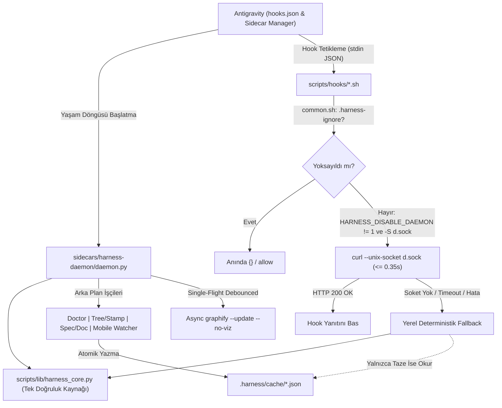

# `alps-agy-harness` — Arka Plan Daemon Sidecar (`harness-daemon`) Tasarım Dokümanı

**Tarih:** 2026-11-19  
**Hedef Platform:** Google Antigravity (`agy` CLI, Antigravity IDE, Antigravity 2.0)  
**Kapsam:** Eklenti içine paketlenen sıfır gecikmeli arka plan daemon sidecar'ı (`sidecars/harness-daemon/`)  
**İlgili Temel Tasarım:** [2026-11-12-alps-agy-harness-design.md](2026-11-12-alps-agy-harness-design.md)

---

## 1. Amaç ve Neden (Intent & Why)

`alps-agy-harness` kancaları (`hooks.json`) ve yardımcı betikleri deterministik güvenlik ile kalite kapıları sağlar; ancak mevcut mimaride tüm kontroller araç çağrısı anında senkron ve soğuk süreç başlatarak çalışır:

1. **Senkron `graphify` Darboğazı (`scripts/hooks/post-command-hooks.sh`):** `gh pr merge` veya `main`/`master` üzerinde `git merge`/`git pull` çalıştırıldığında `graphify --update --no-viz` kanca içinde senkron yürütülür (`hooks.json` üzerinde `30` saniye timeout riski taşır). Ayrıca çalışma dallarında yeni commit atıldıkça `graphify-out/graph.json` bir sonraki merge'e kadar bayat kalır.
2. **Ağır Teşhis Nedeniyle Eksik Oturum Kontrolü (`scripts/harness-doctor.sh` → `scripts/hooks/session-start.sh`):** `harness-doctor.sh`, iOS/Android proje tespiti için çalışma alanını iki kez tarar (`os.walk`), `gh auth status` çalıştırır ve 8 zorunlu MCP ile `TYPESAFE_API_KEY` varlığını denetler. Ağır olduğu için `session-start.sh` açılışta yalnızca `gh` ve `jq` ikililerinin varlığına bakabilir; kopuk MCP veya düşmüş `gh` oturumu iş ortasında fark edilir.
3. **Geç Fark Edilen `codeTreeSha` ve Damga Bayatlaması (`common.sh`, `stamp-gate.sh`):** Yeni commit atıldığında veya branch değiştiğinde `canon-pass.json`, `security-pass.json` ve `pr-audit-pending.json` durumlarının geçerliliği ancak `gh pr create` kapısında anlaşılır.
4. **Tekrarlı Soğuk `python3` Başlatmaları ve Geç Doküman Doğrulaması (`pre-command-guard.sh`, `pre-edit-guard.sh`):** Her `run_command` çağrısında `harness_parse_command_segments` için ve paket kurulum kapısında `docs/superpowers/specs/*.md` içindeki `## Global Constraints` bölümlerini taramak için sıfırdan `python3` başlatılır. Walkthrough (`>= 2` Mermaid + *Ne/Neden* kapsama) ve doküman sonu sözlük kontrolleri yalnızca yazma/PR anında çalıştırılır.
5. **Reaktif Mobil Crash İncelemesi (`scripts/mobile-logs.sh`):** iOS Simulator `.ips`/`.crash` raporları yalnızca `mobile-logs.sh` elle çağrıldığında ayrıştırılır; oturum başında veya crash sonrasında proaktif özet sunulmaz.

Bu makinede ölçülen taban süreç başlatma süreleri şöyledir: `jq` ~`11.1 ms`, `curl` ~`28.6 ms`, `python3` ~`30.7 ms`, `node` ~`76.8 ms`. Tüm ön-hesaplama ve sıcak kanca değerlendirmelerini sürekli ayakta duran bir Python 3 (`stdlib`) daemon sidecar'ına taşıyıp kancalardan tek bir `curl --unix-socket` çağrısı (~`30 ms`) ve atomik `.harness/cache/*.json` okumaları (~`11 ms`) ile tüketmek, hem kanca gecikmesini düşürür hem de tek doğruluk kaynağı ile sıfır mantık sapması sağlar.

---

## 2. Hedefler, Kapsam Dışı Olanlar ve Anti-Hedefler

### 2.1. Hedefler (Goals)
1. **Asenkron Single-Flight ve Debounced `graphify` Kuyruğu:** `gh pr merge`, `git merge`/`git pull` sinyalleri ve `.git/HEAD` / dal ref değişikliklerinde `graphify --update --no-viz` komutunu arka planda tekil kuyrukla ve `3` saniyelik debounce ile çalıştırmak; `post-command-hooks.sh` kancasının milisaniyeler içinde `{}` dönmesini sağlamak.
2. **Ön-Hesaplanmış Ortam Sağlığı Önbelleği (`health.json`):** `harness-doctor` kontrollerini arka planda periyodik olarak ve `mcp_config.json` / `~/.config/typesafe/key` değişikliklerinde önbelleğe almak; `session-start.sh` açılışında sıfır bekleme ile gerçek ortam uyarılarını enjekte etmek.
3. **Anlık `codeTreeSha` ve Damga Tazeliği Takibi (`tree-state.json`):** `.git/HEAD` ve çalışma alanı durumunu izleyerek güncel `codeTreeSha`, `canon-pass.json`, `security-pass.json` ve `pr-audit-pending.json` uyumluluğunu sıcak tutmak; bayat damgaları erken raporlamak.
4. **Ön-İndekslenmiş Spec Paketleri ve Doküman Doğrulama Önbelleği (`spec-packages.json`, `doc-validation.json`):** `docs/superpowers/specs/*.md` içindeki `## Global Constraints` paket tokenlarını ve `docs/walkthroughs/*.md` + teknik Markdown sözlük geçerliliklerini dosya `mtimeNs` değişimine duyarlı olarak önceden doğrulamak.
5. **Unix Domain Socket Üzerinden Sıcak Kanca Motoru:** `session-start`, `pre-command`, `pre-edit` ve `post-command` değerlendirmelerini özel bir yerel HTTP-over-Unix-Socket sunucusuyla sunarak her komuttaki çoklu soğuk `python3` başlatmalarını ortadan kaldırmak.
6. **Koşullu Mobil Crash İzleyici (`mobile-crashes.json`):** Yalnızca iOS/Android tespit edilen çalışma alanlarında aktifleşip `~/Library/Logs/DiagnosticReports` (veya `HARNESS_DIAG_REPORTS_DIR`) altındaki yeni `.ips`/`.crash` dosyalarını özetlemek; mobil olmayan projelerde sıfır ek yük oluşturmak.
7. **Kesintisiz Fail-Safe Fallback, `.harness-ignore` ve Çoklu Çalışma Alanı Desteği:** Daemon kapalı, devre dışı veya zaman aşımında olduğunda tüm kancaların sessizce yerel deterministik yola düşmesini sağlamak; `.harness-ignore` dosyası bulunan çalışma alanlarını tamamen muaf tutmak; aktif çalışma alanlarını TTL ile yönetmek.

### 2.2. Kapsam Dışı Olanlar (Non-Goals)
- **Web Arayüzü / Aux Pane (`has_web_ui`):** Bu sürümde yalnızca başsız (*headless*) arka plan daemon sidecar'ı kurulur; yan panel UI ayrı bir geliştirme adımıdır.
- **Zamanlanmış Cron (`"builtin": "schedule"`) Otomasyonları:** Periyodik `entropy-sweep` otomasyon sidecar'ı bu kapsamın dışındadır.
- **Harici Bağımlılık Kurulumu:** `pip install`, `uv pip install` veya `npm install` gerektiren üçüncü parti paketler kesinlikle kullanılmaz (yalnızca Python 3 standart kütüphanesi).
- **`plugin.json` / `hooks.json` Kırıcı Değişiklikleri:** `plugin.json` üst düzey şeması ve `hooks.json` matcher/timeout değerleri değiştirilmez.
- **Arka Planda Sınırsız `adb logcat` Akışı:** Harness'ın sonsuz log akışı yasağı gereği arka planda sürekli `adb logcat` akışı çalıştırılmaz.

### 2.3. Anti-Hedefler (Anti-Goals — Teknik Olarak Çalışsa Bile Başarısızlık Sayılacak Durumlar)
- Daemon çöktüğünde, soket yanıt vermediğinde veya `curl` zaman aşımına uğradığında korunan bir işlemi **fail-open (`allow`)** bırakmak (kesinlikle yerel deterministik kancaya düşülmelidir).
- Daemon içindeki kural motoru ile yerel fallback kanca mantığı arasında davranış farkı (*logic drift*) oluşması.
- `TYPESAFE_API_KEY` veya herhangi bir gizli anahtar değerinin `.harness/cache/*.json` dosyalarına, daemon loglarına ya da HTTP yanıtlarına yazılması.
- macOS'ta `104` baytlık `AF_UNIX` `sun_path` sınırını aşan uzun soket yolu nedeniyle başlangıç hatası alınması veya `/tmp` üzerinde güvensiz izin/symlink açığı bırakılması.
- Hedef projede `git status` çıktısının kirletilmesi (tüm önbellekler yalnızca git tarafından dışlanan `.harness/cache/` altında tutulur).
- Daemon çalışmıyorken mevcut CI/birim testlerinin (`tests/run-all.sh`) kırılması.

---

## Global Constraints

- **Sıfır Harici Çalışma Zamanı Bağımlılığı:** Yalnızca mevcut harness ön gereksinimleri kullanılır:
  - `Python >= 3.9` (yalnızca `stdlib`: `http.server`, `socketserver`, `threading`, `subprocess`, `json`, `shlex`, `pathlib`, `re`, `os`, `sys`, `time`, `signal`)
  - POSIX `bash`, `jq`, `git`, `curl` (`--unix-socket` destekli; macOS & Linux)
  - `node >= 20` (mevcut ön gereksinim, daemon runtime'ı olarak kullanılmaz)
- **İki Dilli Kodlama ve Dokümantasyon Standardı:**
  - Tüm Python kaynak dosyaları (`scripts/lib/harness_core.py`, `sidecars/harness-daemon/daemon.py`), fonksiyon/sınıf docstring'leri (`Google`/`reST` biçimi değil yalın teknik İngilizce; iş amacı, değişmezler, kenar durumlar ve hata yollarını anlatan) ve CLI/hata mesajları **İngilizce** yazılır; papağan yorumlar yasaktır.
  - Spec, Plan, Walkthrough ve kullanıcı dokümantasyonu **Türkçe** yazılır ve `## Teknik Terimler Sözlüğü` tablosu ile biter.
- **Eklenti Paketi ve Test Bütünlüğü:**
  - `plugin.json` yalnızca izin verilen anahtarları (`name`, `displayName`, `version`, `description`, `logo`, `suggestedPrompts`, `author`, `homepage`, `repository`, `disabled`) korur; sürüm `1.0.0` → **`1.1.0`** olarak güncellenir.
  - `hooks.json` matcher ve timeout kontratları (`SessionStart`, `PreToolUse`, `PostToolUse`, `Stop`) korunur.
  - Eklenti paketine eklenen 4 yeni çekirdek dosya (`scripts/lib/harness_core.py`, `sidecars/harness-daemon/sidecar.json`, `sidecars/harness-daemon/daemon.py`, `tests/test-sidecar-daemon.sh`) ile `tests/test-plugin-bundle.sh` içindeki izlenen çekirdek dosya sayısı `49` → **`53`** olarak güncellenir.

---

## Architectural Decisions (ADR)

### ADR-01: Runtime ve IPC Modeli — Sıfır Bağımlılıklı Python 3 Daemon + Ortak `harness_core.py` + Unix Socket HTTP + Atomik Önbellek
- **Durum:** Onaylandı (`jev_check` kalibrasyonu: `0.92`, karar: `yes`).
- **Bağlam:** Mevcut 5 karmaşık ayrıştırıcı (`shlex` komut tokenizasyonu, walkthrough doğrulaması, spec `## Global Constraints` paket taraması, `harness-doctor` ve `.ips` crash analizi) hâlihazırda Python 3 ile yazılmıştır. Eklenti `git clone` sonrası ek kurulum adımı olmadan çalışmalı ve daemon ile fallback arasında sıfır mantık sapması bulunmalıdır.
- **Karar:** `sidecars/harness-daemon/daemon.py` altında tek bir Python 3 (`stdlib`) daemon süreci ve bu sürecin yerel fallback kancalarıyla doğrudan paylaştığı `scripts/lib/harness_core.py` çekirdek modülü kurulur. İletişim özel bir Unix Domain Socket (`ThreadingUnixStreamServer`) üzerinden hafif HTTP/JSON API ile yapılır; kancalar tek `curl --unix-socket` çağrısı (~`30 ms`) ile yanıt alır ve arka plan önbellekleri `.harness/cache/*.json` altında atomik olarak tutulur.
- **Elenen Alternatifler:**
  1. *Node.js (`>= 20`) Daemon + Native `fs.watch`:* 5 Python ayrıştırıcısının JS'de baştan yazılmasını ve her kural değişiminde iki farklı dilde birebir eşitlik korunmasını gerektirdiği için elendi.
  2. *Soketsiz Yalnızca Dosya Önbelleği Daemon'ı:* Her `run_command` çağrısında yaşanan soğuk `python3` başlatma gecikmesini ortadan kaldırmadığı için elendi.
- **Sonuçlar:** Dosya izleme için harici paket yerine *push-on-hook* anlık geçersizleştirme ve hedefli hafif `mtime` yoklaması (`1.5` saniye aralıklı; yalnız `.git/HEAD`, ref'ler, `docs/`, config ve mobil ise `DiagnosticReports` üzerinde) kullanılır. Tek doğruluk kaynağı ve sıfır dış bağımlılık garantilenir.

### ADR-02: Arka Plan `graphify` Güncelleme Tetikleme Politikası
- **Durum:** Onaylandı.
- **Bağlam:** `post-command-hooks.sh` içinde `graphify --update --no-viz` senkron çalışarak aracı 30 saniyeye kadar kilitleme riski taşır; öte yandan her dosya kaydında grafik güncellemek aktif kodlama sırasında gereksiz CPU/pil tüketir.
- **Karar:** Asenkron, tekil kuyruklu (*single-flight*) ve `3` saniye debounce süreli `graphify` güncellemesi **yalnızca** `.git/HEAD` / aktif dal ref değişimlerinde ve açık `post-command-hooks.sh` olaylarında (`gh pr merge`, `main`/`master` üzerinde `git merge`/`git pull`) tetiklenir.
- **Elenen Alternatifler:** Dosya kaydında `30` sn debounced güncelleme — aktif düzenleme sırasında arka plan CPU/pil yükünü artırmamak için elendi.
- **Sonuçlar:** Bilgi grafiği her commit ve merge sonrasında kancayı bloklamadan taze kalır; commit öncesi düzenlemeler commit anını veya elle `graphify` çağrısını bekler.

### ADR-03: Güvenli ve macOS 104-Bayt Uyumlu Unix Domain Socket Konumu `[Builder Call]`
- **Durum:** Tasarım Kararı (`[Builder Call]` — kullanıcı incelemesine sunulur).
- **Bağlam:** macOS'ta `AF_UNIX` `sun_path` uzunluğu **104 bayt** ile sınırlıdır. `$HOME/.gemini/antigravity/sidecar_data/alps-agy-harness/harness-daemon/daemon.sock` gibi bir yol daha uzun kullanıcı adlarında kolayca 104 baytı aşarak `bind()` hatasına yol açar. Öte yandan doğrudan `/tmp/harness-daemon.sock` kullanmak paylaşımlı `/tmp` ortamında symlink/ele geçirme riski doğurur.
- **Karar:** Soket ve PID dosyası kullanıcıya özel izole bir dizin olan `/tmp/agy-hd-<uid>/` içinde `d.sock` ve `d.pid` olarak tutulur (toplam ~27 bayt). Daemon başlangıçta bu dizinin mevcut kullanıcıya (`os.getuid()`) ait, symlink olmayan gerçek bir dizin olduğunu ve `0700` izinlerine sahip olduğunu doğrular (aksi durumda başlangıcı reddeder); soket dosyası `0600` ile oluşturulur. Kalıcı çalışma alanı kaydı (`workspaces.json`) ve daemon logları ise `HARNESS_DAEMON_DATA_DIR` (varsayılan `$HOME/.gemini/antigravity/sidecar_data/alps-agy-harness-daemon`) altında saklanır. İzole testler için `HARNESS_DAEMON_SOCK` ve `HARNESS_DAEMON_DATA_DIR` ortam değişkenleri tam override destekler.
- **Elenen Alternatifler:** Eklenti veya `$HOME/.gemini` içinde doğrudan soket açmak (macOS 104-bayt limiti nedeniyle kırılgan).
- **Sonuçlar:** Hem macOS/Linux uyumu hem yerel güvenlik sağlanır; test paketleri birbirini etkilemeden paralel veya izole soketlerle çalışabilir.

---

## 4. Sistem Mimarisi ve Bileşen Sözleşmeleri



### 4.1. Sidecar Manifestosu (`sidecars/harness-daemon/sidecar.json`)
Antigravity eklenti sidecar sözleşmesine (`swarm_board/sidecar.json` referansıyla) uygun olarak yalnızca `snake_case` alanlar içerir ve UI alanı (`has_web_ui`) tanımlamaz. Sidecar Manager süreci `sidecars/harness-daemon/` çalışma dizini (`cwd`) ile başlatır; buna ek olarak `daemon.py`, `PLUGIN_ROOT` yolunu `cwd`'ye bağımlı kalmadan `Path(__file__).resolve().parents[2]` üzerinden çözer (`[Builder Call]`):

```json
{
  "display_name": "Alps Harness Daemon",
  "description": "Zero-latency pre-computation, async graphify queue, doctor/stamp/spec caching, and warm hook evaluation for alps-agy-harness.",
  "command": "python3",
  "args": ["daemon.py"],
  "restart_policy": "always"
}
```

### 4.2. Ortak Çekirdek Kütüphane (`scripts/lib/harness_core.py`)
Hem `daemon.py` tarafından doğrudan `import` edilen hem de fallback betikleri tarafından tekil CLI alt komutlarıyla çağrılabilen tek doğruluk kaynağıdır:

| Fonksiyon / Modül Sorumluluğu | Açıklama ve Değişmezler (*Invariants*) |
| :--- | :--- |
| `parse_command_segments(cmd_line)` | `shlex` tabanlı alıntı duyarlı komut ayrıştırma ve `env`/`sudo`/`nohup`/`time` sarmalayıcı temizliği (`common.sh` ile birebir aynı davranış). |
| `extract_install_packages(tokens)` | `npm`, `pnpm`, `yarn`, `dotnet`, `uv`, `cargo` paket kurulum hedefi ayıklama (`pre-command-guard.sh` Gate 3 mantığı). |
| `build_spec_package_index(workspace)` | `docs/superpowers/specs/*.md` dosyalarının `## Global Constraints` bölümlerini `mtimeNs` + `size` metadata'sıyla indeksler. |
| `_check_pkg_in_specs_with_index(workspace, pkg, spec_index)` | Token-sınır regex'i (`(?:^|[^A-Za-z0-9_./@-])...`) ile paket doğrulaması yapar. |
| `has_glossary_section(text)` | Fenced code block dışındaki son `## ` başlığının boş olmayan `Teknik Terimler Sözlüğü` / `Technical Glossary` olduğunu doğrular. |
| `validate_walkthrough(wt_text, diff_files)` | `>= 2` ` ```mermaid ` bloğu, şablon yer tutucu yasağı, `## Dosya Bazlı Değişiklik Analizi` ve her diff dosyası için `>= 25` karakterlik *Ne/Neden* açıklamasını doğrular. |
| `compute_code_tree_sha(workspace)` | `docs/walkthroughs/*` ve `docs/parking-lot.md` hariç deterministik Git tree SHA üretir (`HEAD` yoksa `"UNBORN"`). |
| `compute_tree_and_stamp_state(workspace)` | Aktif `HEAD` OID, `branch`, `slug`, `codeTreeSha`, `canon-pass.json`, `security-pass.json` ve `pr-audit-pending.json` tazelik özetini hesaplar. |
| `parse_ios_crash_report(diag_dir, bundle_id)` | En güncel `.ips`/`.crash` dosyasından process, bundleID, exception, termination ve ilk 25 frame özetini çıkarır (`mobile-logs.sh` ile paylaşılır). |
| `run_doctor_checks(...)` | `harness-doctor.sh` içindeki tüm CLI, plugin, subagent frontmatter, 8 MCP, sıfır-sızıntılı `TYPESAFE_API_KEY`, LSP/mobil ve `harness_daemon` kontrollerini çalıştırır. |
| `build_session_start_payload(workspace, payload, ...)` | Önbellekteki/taze doktor uyarılarını, bayat damga uyarılarını, `graphify` durumunu ve varsa taze mobil crash özetini oturum enjeksiyon metnine dönüştürür. |
| `evaluate_pre_command(workspace, payload, spec_index, doc_cache)` | 4 kapıyı (`mobile log stream`, `PR-only main/master + local merge`, `package install`, `5-point gh pr create`) yerel kurallarla birebir değerlendirir. |
| `evaluate_pre_edit(workspace, payload)` | 3 kuralı (`main/master lock`, `glossary gate`, `dangerous patterns & secret prevention`) birebir değerlendirir. |

**Fallback CLI Arayüzü:** `python3 scripts/lib/harness_core.py <subcommand> ...` (`eval-pre-command`, `eval-pre-edit`, `eval-post-command`, `eval-session-start`, `doctor`, `parse-ios-crash`, `validate-walkthrough`, `parse-segments`) şeklinde çağrıldığında `stdin` üzerinden hook JSON'unu okuyup kancanın beklediği JSON kararını (`emit_allow`/`emit_deny`/`emit_force_ask`/`injectSteps`) üretir.

### 4.3. Çoklu Çalışma Alanı Kaydı, `.harness-ignore` ve Yaşam Döngüsü
- **Kayıt Defteri (`workspaces.json`):** Daemon başlangıçta sabit bir workspace'e bağlı değildir. Kancalardan gelen her istek `workspace` yolunu normalize edip (`os.path.realpath`) `HARNESS_DAEMON_DATA_DIR/workspaces.json` içinde kaydeder veya `lastSeenAt` zaman damgasını günceller.
- **Boşta Kalma Süresi (TTL Eviction):** Son kanca etkileşiminin üzerinden `HARNESS_DAEMON_WORKSPACE_TTL_SEC` (`1800` sn = 30 dakika) geçen çalışma alanları arka plan izleme döngüsünden otomatik çıkarılır (`unregister`).
- **`.harness-ignore` Koruması:** Hem kanca kabuk betikleri en başta `harness_is_ignored` kontrolüyle daemon'ı hiç çağırmaz hem de daemon arka plan yoklamasında `.harness-ignore` görülen çalışma alanının izlenmesini durdurur.
- **Tekil Örnek, Pasif Bekleme ve Eski Soket Kurtarma (`[Builder Call]`):** `restart_policy: "always"` altında ikinci bir örnek çıkış kodu `0` ile sonlanırsa Antigravity'nin sürekli yeniden başlatma döngüsüne girmemesi için `HARNESS_DAEMON_DATA_DIR/daemon.lock` üzerinde `fcntl.flock` danışma kilidi tutulur. İkinci örnek kilidi alamazsa ve mevcut `d.sock` `GET /health` ile sağlıklı yanıt veriyorsa soket/izleyici başlatmadan `5` sn aralıklı pasif bekleme (*standby*) modunda kalır (birincil örnek kapanırsa kilidi devralır). Kilit alınıp `d.sock` bayat kalmışsa soket silinir, yeni soket (`0600`) bağlanır ve `d.pid` yazılır. `SIGTERM`/`SIGINT` sinyallerinde işçi thread'leri düzgün kapatıp soket, kilit ve PID dosyalarını temizler.
- **Başlangıç `PATH` Zenginleştirmesi (`[Builder Call]`):** GUI Antigravity oturumlarından başlatılan sidecar'lar minimal `launchd` `PATH` alabildiği için `daemon.py` açılışta bir kez login kabuğundan (`$SHELL -lc 'printf "%s" "$PATH"'`, `2s` zaman aşımı ve `/opt/homebrew/bin:/usr/local/bin` yedeği ile) eksik ikili yollarını kendi sürecinin `PATH`'ine ekler.
- **Atomik Yazma ve Dışlama:** Tüm `.harness/cache/*.json` yazmaları `.tmp.<pid>.<tid>` + `os.replace` ile atomik yapılır; her yazımda `.harness/` dizininin `.git/info/exclude` içinde kayıtlı olması (`harness_state_dir` mantığıyla uyumlu) garanti edilir.
- **Karar (`agy` CLI Davranışı — `[Builder Call]`):** Antigravity Sidecar Manager, `sidecars/harness-daemon/sidecar.json` yaşam döngüsünün tek sahibidir. Daemon çalışmıyorken (ör. bağımsız `agy` CLI oturumları veya CI/test ortamları) kancalar yetim arka plan süreci üretmeden temiz biçimde soğuk fallback yolundan çalışır; IDE dışında sıcak CLI oturumu isteyen geliştiriciler daemon'ı elle (`python3 sidecars/harness-daemon/daemon.py`) başlatabilir veya açıkça `HARNESS_AUTO_START_DAEMON=1` (varsayılan `0`) ile otomatik başlatma seçebilir.

### 4.4. Unix Domain Socket HTTP API Sözleşmesi
İstemci zaman aşımı varsayılan olarak `HARNESS_DAEMON_TIMEOUT_SEC=0.35` saniyedir (`curl --unix-socket "$sock" --max-time 0.35 -fsS`). İstek gövdeleri ve yanıtları JSON biçimindedir:

| Uç Nokta | Yöntem | Girdi Şeması | Çıktı Şeması ve Davranış |
| :--- | :--- | :--- | :--- |
| `/health` | `GET` | — | `200`: `{status: "ok", pid, uptimeSec, activeWorkspaces, queueDepth}` |
| `/hook/session-start` | `POST` | Antigravity `SessionStart` stdin JSON + `{workspace, envKeyPresent?}` | `200`: `{injectSteps: [{systemMessage: {systemMessage: "..."}}]}` (çalışma alanını kaydeder; gizli anahtar değeri yerine yalnızca boolean `envKeyPresent` ipucunu kabul eder; önbellekteki `health`/`tree-state`/`graphify`/`mobile-crashes` verilerini kullanır; `HARNESS_CHECK_BINS` parite için istemci kancasında kontrol edilir). |
| `/hook/pre-command` | `POST` | Antigravity `PreToolUse` stdin JSON + `{workspace}` | `200`: `{decision: "allow" \| "deny" \| "force_ask", reason?: "..."}` (Gate 1–4; `spec-packages.json` ve `doc-validation.json` cache'ini yalnız `mtimeNs` eşleşirse kullanır). |
| `/hook/pre-edit` | `POST` | Antigravity `PreToolUse` stdin JSON + `{workspace}` | `200`: `{decision: "allow" \| "deny" \| "force_ask", reason?: "..."}` (Rule 1–3; geçerli yazımdan sonra `doc-validation` / `spec-packages` tazelemesini işaretler). |
| `/hook/post-command` | `POST` | Antigravity `PostToolUse` stdin JSON + `{workspace}` | `200`: `{}` — `gh pr create` için `pr-audit-pending.json` yazar; `gh pr merge` veya `main`/`master` üstünde `git merge`/`git pull` görürse `graphify` kuyruğuna atıp **beklemeden** `{}` döner. |
| `/event/graphify` | `POST` | `{workspace, reason}` | `202`: `{queued: true, state: "pending"}` — asenkron single-flight kuyruğuna ekler. |
| `/event/workspace-touch` | `POST` | `{workspace}` | `200`: `{registered: true, ignored: boolean}` — çalışma alanını izlemeye alır ve anlık önbellek ısınmasını başlatır. |

**Fallback Sözleşmesi (`scripts/hooks/common.sh`):**
- `HARNESS_DISABLE_DAEMON=1` ayarlıysa veya soket dosyası (`[ -S "$sock" ]`) yoksa `curl` hiç çağrılmaz (`0 ms` ek yük).
- `curl` başarısız olursa, HTTP `!= 200` dönerse veya JSON yanıtı beklenen şemayı (`decision` veya `injectSteps` alanı) doğrulayamazsa `harness_daemon_call` sıfırdan farklı dönüş kodu verir ve kanca **sessizce** yerel deterministik yola geçer.

### 4.5. Atomik Çalışma Alanı Önbellek Şemaları (`.harness/cache/`)
Tüm dosyalar hedef projenin `.harness/cache/` dizininde saklanır (`.gitignore` / `.git/info/exclude` kapsamında):

1. **`health.json`** (`HARNESS_HEALTH_TTL_SEC=300` yenileme, `600` sn okuma geçerliliği):
   - `{checkedAt, epoch, healthy, summary: {total, ok, warn, info, fail}, failingChecks: [...], warningChecks: [...], keyStatus: "present"|"missing"}`
   - **Güvenlik Kuralı:** `TYPESAFE_API_KEY` değeri asla okunup saklanmaz, yalnızca `"present"` / `"missing"` bilgisi tutulur.
2. **`tree-state.json`**:
   - `{computedAt, headOid, branch, slug, codeTreeSha, canonStampValid, canonStampSha, securityStampValid, securityStampSha, prAuditPending}`
   - **Kriptografik Tazelik Kuralı:** `session-start` ve UI bildirimleri `tree-state.json` içindeki bilgileri yalnızca `headOid == git rev-parse HEAD` (veya `UNBORN` eşleşmesi) sağlanıyorsa kullanır. PR açılışı güvenlik kapısı (`verify_pr_stamps`) ise disk önbelleği manipülasyonuna karşı **asla** yerel disk `tree-state.json` verisine güvenmez ve her zaman canlı `compute_code_tree_sha(workspace)` hesaplar.
3. **`spec-packages.json`**:
   - `{schemaVersion, updatedAt, specs: {"docs/superpowers/specs/foo.md": {mtimeNs, size, sectionText}}}`
   - `pre-command` Gate 3 paket kontrolünde daemon içi bellek önbelleğindeki spec dosyasının `mtimeNs` ve `size` değeri güncel disk durumuyla eşleşirse tekrar diskten okuma ve bölüm ayıklama atlanır.
4. **`doc-validation.json`**:
   - `{schemaVersion, updatedAt, docs: {"docs/walkthroughs/x.md": {mtimeNs, size, hasGlossary, diffKey, walkthroughValid, walkthroughError}}}`
   - `diffKey` olarak `<baseSha>..<headOid>` (kirli ağaçta kullanılmaz) tutulur; PR kapısı için daemon RAM üzerinden doğrulanmış durum sağlar.
5. **`graphify-status.json`**:
   - `{state: "idle"|"queued"|"running"|"succeeded"|"failed"|"missing", lastHeadSha, queuedAt, startedAt, finishedAt, durationMs, exitCode, logPath}`
   - Aynı workspace için aynı anda yalnızca 1 `graphify` alt süreci çalışır (*single-flight*); çalışırken yeni istek gelirse `rerunPending = true` işaretlenip mevcut işlem bitince bir kez daha çalıştırılır ve `3` sn debounce uygulanır.
6. **`mobile-crashes.json`** (Yalnızca mobil çalışma alanlarında oluşturulur):
   - `{platform, updatedAt, latestReportName, latestMtimeNs, summaryLines: [...]}`
   - **Uygulama Eşleştirme ve Tazelik Kuralı (`[Builder Call]`):** iOS çalışma alanlarında `.xcodeproj/project.pbxproj` (`PRODUCT_BUNDLE_IDENTIFIER`, çözümlenmemiş `$(...)` değerler hariç) ve `Info.plist` (`CFBundleIdentifier`/`CFBundleName`) üzerinden uygulama kimliği çıkarılır; `DiagnosticReports` içindeki `.ips`/`.crash` dosyaları yalnız eşleşenlerden seçilir (sabit bundle ID yoksa veya `HARNESS_DIAG_REPORTS_DIR` test için override edilmişse en güncel rapora düşülür). `session-start` enjeksiyonu için raporun `mtime` değeri son `24` saat (`HARNESS_MOBILE_CRASH_MAX_AGE_SEC=86400`) içinde olmalıdır. Mobil olmayan projelerde bu dosya hiç oluşturulmaz ve `DiagnosticReports` izlenmez.
   - **Yalnızca Android Projeler (`[Builder Call]`):** iOS olmayan yalnızca Android (`build.gradle*`/`AndroidManifest.xml`) projelerinde arka plan izleyicisi `mobile-crashes.json` adımlarını ve `adb` yoklamasını atlar (boşta emülatörlerde `adb server` başlatmamak veya alakasız buffer raporlamamak için); Android teşhisi talep üzerine `scripts/mobile-logs.sh --platform android --package <pkg>` ile yürütülür.

### 4.6. Mevcut Betiklerle Entegrasyon Noktaları
- **[scripts/hooks/common.sh](file:///Volumes/SDCARD/Projects/alps-agy-harness/scripts/hooks/common.sh):** `harness_daemon_socket_path()` ve `harness_daemon_call()` yardımcıları eklenir. Mevcut tüm yardımcı fonksiyon imzaları (testlerin doğrudan `source` ettiği `harness_has_glossary_section`, `harness_validate_walkthrough`, `harness_code_tree_sha`, `harness_parse_command_segments` vb.) korunur ve içleri `harness_core.py` çağrısına bağlanır.
- **[scripts/hooks/session-start.sh](file:///Volumes/SDCARD/Projects/alps-agy-harness/scripts/hooks/session-start.sh):** Önce `/hook/session-start` dener. Başarısızsa yerel önbellekten taze (`< 600s`) `.harness/cache/health.json`, `tree-state.json`, `graphify-status.json`, `mobile-crashes.json` dosyalarını güvenli biçimde okuyarak sistem mesajına uyarı/özet ekler ve mevcut `session-start` çıktısını bozmadan sürdürür.
- **[scripts/hooks/pre-command-guard.sh](file:///Volumes/SDCARD/Projects/alps-agy-harness/scripts/hooks/pre-command-guard.sh):** En başta daemon sıcak yolunu dener (`/hook/pre-command`). Fallback durumunda `harness_core.py eval-pre-command` üzerinden 4 kapının tamamını tek Python sürecinde çalıştırır; `stamp-gate.sh` ile tam uyumluluk korunur.
- **[scripts/hooks/pre-edit-guard.sh](file:///Volumes/SDCARD/Projects/alps-agy-harness/scripts/hooks/pre-edit-guard.sh):** Daemon sıcak yolunu dener (`/hook/pre-edit`); fallback durumunda `harness_core.py eval-pre-edit` ile Rule 1–3'ü çalıştırır.
- **[scripts/hooks/post-command-hooks.sh](file:///Volumes/SDCARD/Projects/alps-agy-harness/scripts/hooks/post-command-hooks.sh):** Daemon sıcak yolunu dener (`/hook/post-command`), başarılı olduğunda `graphify` güncellenmesini beklemeden `{}` döner. Daemon yoksa mevcut senkron `trigger_graphify` yolunu kullanır.
- **[scripts/harness-doctor.sh](file:///Volumes/SDCARD/Projects/alps-agy-harness/scripts/harness-doctor.sh):** Kontrolleri `harness_core.py` üzerinden yürütür ve `harness_daemon` kontrolünü ekler:
  - `sidecar.json` geçerli + soket `/health` yanıtı `ok` → `[OK]`
  - `sidecar.json` geçerli + daemon çalışmıyor → `[INFO]` (fail üretmez; fallback aktif olduğu için kurulumu kırmızıya düşürmez)
  - `sidecar.json` eksik veya geçersiz JSON → `[FAIL]`
- **[scripts/mobile-logs.sh](file:///Volumes/SDCARD/Projects/alps-agy-harness/scripts/mobile-logs.sh):** iOS `.ips`/`.crash` ayrıştırma bloğu `harness_core.py parse-ios-crash` ile ortaklaştırılır; tüm CLI bayrakları ve çıktı formatı %100 korunur.
- **[README.md](file:///Volumes/SDCARD/Projects/alps-agy-harness/README.md) & [skills/harness-doctor/SKILL.md](file:///Volumes/SDCARD/Projects/alps-agy-harness/skills/harness-doctor/SKILL.md):** `harness-daemon` sidecar kurulumu, yaşam döngüsü, `HARNESS_DISABLE_DAEMON=1` kaçış bayrağı ve mimari tablo güncellenir.

---

## 5. Güvenlik, Hata Kurtarma ve Doğrulama Stratejisi

### 5.1. Güvenlik Kontrolleri
- **Soket Erişim Sınırları:** `/tmp/agy-hd-<uid>` dizini `0700`, `d.sock` dosyası `0600` izinle açılır. Başlangıçta dizin sahibi (`st_uid == os.getuid()`) ve `not os.path.islink()` doğrulanır; uyuşmazlıkta daemon başlamayı reddeder.
- **IPC Ortam İzolasyonu (`[Builder Call]`):** Soket istemcileri `/hook/*` veya `/event/*` JSON yükleriyle `PATH`, `HARNESS_GRAPHIFY_BIN`, `HARNESS_GH_BIN`, `HARNESS_CONFIG_DIR` ya da `HARNESS_DIAG_REPORTS_DIR` gibi çalıştırılabilir ikili/yol geçersiz kılmaları gönderemez; daemon yalnızca kendi başlatma ortamını kullanır. İzole testler mock ikilileri doğrudan test daemon sürecinin kendi ortamına geçirir.
- **Sıfır Gizli Anahtar Sızıntısı (`[Builder Call]`):** `daemon.py` başlangıçta `TYPESAFE_API_KEY` değişkeninin yalnızca boolean varlığını (`startup_env_key_present`) yakalayıp hemen `os.environ` içinden temizler; sonraki `300s` doktor yenilemeleri yalnızca bu başlangıç bayrağına, kancadan gelen boolean `envKeyPresent` ipucuna, `~/.config/typesafe/key` dosyasına ve `mcp_config.json` yapılandırmasına bakar. `health.json`, `daemon.log` ve HTTP yanıtlarına asla anahtar değeri değil yalnızca `"present"` / `"missing"` yazılır.
- **Hata Kapalı (*Fail-Closed*) Fallback:** Daemon yanıtındaki her ağ, zaman aşımı, HTTP hata kodu veya JSON biçim bozukluğu doğrudan yerel deterministik doğrulamaya düşer; hiçbir koruma kapısı sessizce atlanmaz.
- **Disk Önbelleği Zehirlenmesine Karşı Güven Sınırı:** Zorlayıcı karar yolları (`/hook/pre-command`, soğuk fallback `eval-pre-command` ve daemon içi önbellek tohumlaması) çalışma alanı içindeki `.harness/cache/*.json` dosyalarını diskten okuyup güvenmez; yalnızca daemon'ın kendi belleğinde hesapladığı önbellekler veya canlı Git/dosya kontrolleri esas alınır.

### 5.2. Doğrulama ve Test Planı (`tests/test-sidecar-daemon.sh` — 13 Senaryo + Mevcut 8 Test Paketi)
Uygulama sonrasında mevcut 8 test paketi (`tests/run-all.sh`) korunarak yeni `tests/test-sidecar-daemon.sh` paketi (13 senaryo) eklenir ve 9 paketin tamamı (`bash tests/run-all.sh`) sıfır hata ile doğrulanır:

1. **Manifest ve Başlangıç:** `sidecars/harness-daemon/sidecar.json` alan doğrulaması (`snake_case`, `restart_policy: "always"`, geçerli script yolu), daemon açılışı, `GET /health` yanıtı, tekil örnek/bayat soket kurtarma ve `SIGTERM` temiz kapanış.
2. **Daemon Açık / Kapalı Parite Testleri:** `session-start.sh`, `pre-edit-guard.sh`, `pre-command-guard.sh` ve `post-command-hooks.sh` betiklerinin aynı senaryolarda daemon açıkken ve `HARNESS_DISABLE_DAEMON=1` iken birebir aynı kararları (`allow`/`deny`/`force_ask`) ürettiğinin doğrulanması.
3. **Fail-Safe Fallback Testleri:** Sokete bağlanıp yanıt vermeden uyuyan sahte sunucu (`timeout`) ve bozuk JSON dönen sahte sunucu karşısında `main` dalına yazma, doğrulanmamış paket kurulumu ve eksik PR girişimlerinin yine `deny` döndürmesi.
4. **Asenkron `graphify` Kuyruğu ve Coalescing:** Kendi ortamında `3` sn uyuyan sahte `HARNESS_GRAPHIFY_BIN` ile başlatılmış izole test daemon'ı karşısında `post-command-hooks.sh` çağrısının `< 500 ms` içinde `{}` dönmesi, arka planda `graphify-status.json` durumunun `succeeded` olması ve ardışık tetiklemelerin single-flight birleştirilmesi.
5. **Bayat `codeTreeSha` / Damga Tazeliği:** Yeni commit sonrasında `tree-state.json` önbelleğinin otomatik güncellenmesi ve stale cache enjeksiyonunda kancanın `HEAD` uyumsuzluğunu yakalayıp yeniden hesaplaması.
6. **Spec Paket İndeksi & Doküman Önbelleği:** `spec-packages.json` ve `doc-validation.json` önbelleklerinin `mtimeNs` değişiminde güncellenmesi, paket yasağının ve walkthrough kurallarının korunması.
7. **`.harness-ignore` & Çalışma Alanı TTL Eviction:** `.harness-ignore` bulunan çalışma alanının muaf kalması ve düşük TTL (`HARNESS_DAEMON_WORKSPACE_TTL_SEC=1`) ile kullanılmayan çalışma alanının kayıttan düşmesi.
8. **Koşullu Mobil Crash İzleyici:** Sahte `.xcodeproj` + sahte `HARNESS_DIAG_REPORTS_DIR/*.ips` ile `mobile-crashes.json` oluşması; mobil olmayan çalışma alanında bu dosyanın hiç oluşturulmaması.
9. **`harness-doctor.sh` Güvenlik & Daemon Kontrolü:** Gizli anahtar değerinin ne terminal çıktısına ne de `.harness/cache/health.json` dosyasına yazılmadığının kanıtlanması ve `harness_daemon` `OK`/`INFO`/`FAIL` durumları.
10. **İstemci Soket Güvenliği, Sembolik Bağ & Bağlı Worktree İzleme:** İstemcilerin güvensiz izinli (`0755`) veya symlink soketi reddetmesi, sahte aynı-`headOid` `tree-state.json` zehirlenmesinin soğuk yedek ve daemon'da engellenmesi, `pre-edit` içinde izinli klasör altındaki symlink + `..` yol çözümleme atlatmalarının (`docs/superpowers/specs/sub/../src/evil.ts`) daemon ve soğuk yedekte engellenmesi ve `git worktree add` ile bağlanan worktree'lerin değişimlerinin/asenkron `graphify` tetiklemelerinin izlenmesi.

---

## 6. Uygulayıcıya Bırakılan Detaylar (Left to the Builder)

Bu dokümandaki dış kontratları, soket güvenlik kurallarını ve JSON şemalarını bozmadan aşağıdaki iç detaylar planlama/uygulama aşamasına bırakılmıştır:
- `daemon.py` içindeki işçi thread / kuyruk eşzamanlılık (*locking*) iç tasarımı.
- `HARNESS_DAEMON_DATA_DIR/daemon.log` dosyasının boyut tabanlı döndürme (*log rotation*) üst sınırı.
- `session-start.sh` sistem mesajına eklenecek önbellek uyarı cümlelerinin kesin ifade kalıpları.
- `tests/test-sidecar-daemon.sh` içindeki sahte soket ve sahte zaman/TTL yardımcı fonksiyonlarının düzeni.

---

## Teknik Terimler Sözlüğü

| Terim | Açıklama |
| :--- | :--- |
| **ADR (*Architecture Decision Record*)** | Önemli bir mimari kararın; alternatifleri, ödünleri ve gerekçesiyle kayıt altına alındığı karar notu. |
| **Atomik Yazma (*Atomic Write*)** | Dosyanın önce aynı dizindeki geçici bir dosyaya yazılıp ardından `os.replace` / `mv -f` ile hedef dosya üzerine taşınması; yarım yazılmış JSON okunmasını önler. |
| **`codeTreeSha`** | `docs/walkthroughs/*` ve `docs/parking-lot.md` hariç tutularak hesaplanan deterministik Git ağaç özeti (*hash*). |
| **Fail-Safe Fallback (*Hata Kapalı Yedek Yol*)** | Daemon kapalı, yavaş veya hatalı olduğunda kancanın işlemi izinsiz geçirmek (*fail-open*) yerine yerel deterministik kural motoruna düşmesi garantisi. |
| **Graphify** | Kod tabanını ve dokümanları kalıcı bilgi grafiğine (`graphify-out/graph.json`) dönüştüren araç. |
| **`.ips` Crash Report** | macOS/iOS Simulator tarafından üretilen JSON tabanlı çökme ve yığın izi tanılama raporu. |
| **Push-on-Hook** | Araç kancalarının (`PreToolUse`/`PostToolUse`) gerçekleşen olayı daemon'a anlık bildirerek kör dosya taraması olmadan önbelleği tazelemesi deseni. |
| **Sidecar** | Antigravity ortamında ana ajandan bağımsız olarak eklenti veya kullanıcı konfigürasyonuyla başlatılıp yönetilen arka plan süreci veya yardımcı panel. |
| **Single-Flight & Debounce** | Ardışık tetiklemeleri kısa bir bekleme penceresinde birleştirip (*debounce*) aynı anda en fazla bir arka plan görevi çalıştıran (*single-flight*) kuyruk deseni. |
| **Single Source of Truth (*Tek Doğruluk Kaynağı*)** | Kural ve ayrıştırma mantığının yalnızca tek bir modülde (`harness_core.py`) tanımlanarak daemon ile fallback arasında tutarsızlık oluşmasının önlenmesi. |
| **TTL Eviction** | Belirlenen süre (*Time-To-Live*) boyunca kullanılmayan çalışma alanlarının veya önbellek kayıtlarının bellek/kayıt listesinden otomatik çıkarılması. |
| **Unix Domain Socket (`AF_UNIX`)** | Aynı makinedeki süreçler arasında TCP/IP ağ yığınına girmeden dosya sistemi düğümü üzerinden düşük gecikmeli ve dosya izinleriyle korunan IPC kanalı. |
