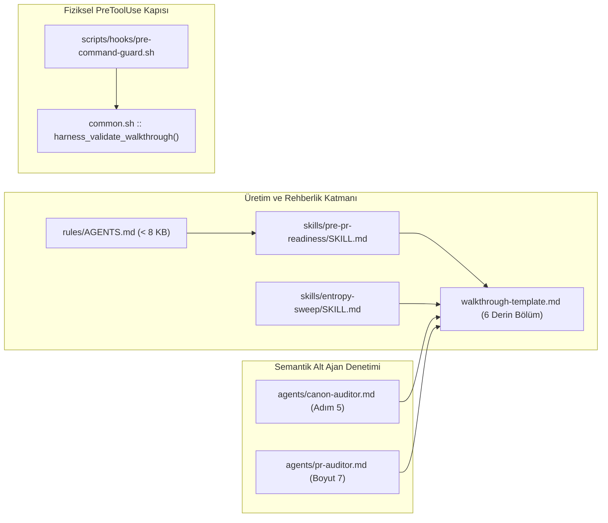
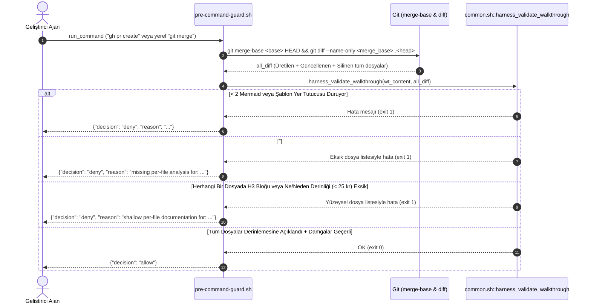

# Pull Request Mühendislik Rehberi: Derin Mühendislik Walkthrough Standardı ve Fiziksel Dosya Kapsama Kapısı

Bu mühendislik rehberi, `alps-agy-harness` eklentisinde PR ve yerel birleştirme (`git merge`) aşamalarında üretilen `docs/walkthroughs/*.md` dokümanlarını yüzeysel özet maddelerinden kurtarıp, **IDE'yi açmadan tüm işi ve her bir dosyadaki değişikliği derinlemesine anlatan kapsamlı bir mühendislik rehberine** dönüştürmek için yapılan şablon, fiziksel kanca (*hook*), kural, denetçi ajan ve test değişikliklerini uçtan uca açıklar.

---

## 1. Problem Bağlamı ve Mimari Kararlar

### Çözülen Gerçek Problem ve Kök Bağlam
Gerçek proje kullanımında (`kedo`) bir özellik planı tamamlandıktan sonra ajanın ürettiği `docs/walkthroughs/*.md` rehberinin yalnızca tek satırlık soyut özet maddelerden oluştuğu gözlemlendi. Bunun üç temel kök nedeni vardı:
1. **Şablon Zafiyeti:** Önceki `walkthrough-template.md` şablonu 5 kısa bölümden oluşuyor, madde işaretli tek satırlık yer tutucular içeriyor ve dalda değişen dosyaların tek tek incelenmesini zorunlu tutmuyordu.
2. **Fiziksel Kanca Eksikliği:** `pre-command-guard.sh` yalnızca `docs/walkthroughs/*.md` dosyasının varlığını, `>= 2` adet ```` ```mermaid ```` kod bloğunu ve sonundaki sözlük tablosunu denetliyordu; dal farkındaki (`git diff --name-only`) dosyaların rehberde anlatılıp anlatılmadığını veya açıklamaların yüzeysel kalıp kalmadığını kontrol etmiyordu.
3. **Denetçi Talimat Boşluğu:** `canon-auditor` ve `pr-auditor` alt ajanları sözlük tablosu ve Mermaid sayısını kontrol ediyor, ancak atlanan dosyaları veya tek cümlelik geçiştirmeleri PR engelleyici (`Important`) kusur olarak sınıflandırmıyordu.

### Seçilen Mimari Yaklaşım ve Gerekçesi
- **Etkilenen Bounded Context ve Katmanlar:** `Templates` (`walkthrough-template.md`), `Skills` (`pre-pr-readiness`, `entropy-sweep`), `Hooks` (`common.sh`, `pre-command-guard.sh`), `Rules & Subagents` (`AGENTS.md`, `canon-auditor.md`, `pr-auditor.md`) ve `Tests`.
- **Yaklaşım Özeti:** Yalnızca prompt düzeyinde uyarı vermekle yetinilmeyip **deterministik fiziksel kapı + semantik ajan denetimi** birlikte kurgulandı. `scripts/hooks/common.sh` içine eklenen `harness_validate_walkthrough` doğrulayıcısı; `git merge-base` üzerinden hesaplanan dal farkındaki (`docs/walkthroughs/*` ve `docs/parking-lot.md` hariç) üretilen, güncellenen ve silinen **her bir dosyanın** `## Dosya Bazlı Değişiklik Analizi` altında kendine ait bir `### ` alt başlığına sahip olmasını ve bu blok içinde en az 25 karakterlik somut **`Ne Değişti / Ne Üretildi / Ne Silindi`** ile **`Neden Değişti / Neden Üretildi / Neden Silindi`** açıklamaları barındırmasını fiziksel ön koşul haline getirir.

### Değerlendirilen Alternatifler ve Ödünleşimler (Trade-offs)

| Yaklaşım / Seçenek | Avantajlar | Dezavantajlar / Riskler | Karar |
| :--- | :--- | :--- | :--- |
| **Seçenek A (Uygulanan):** Ortak `harness_validate_walkthrough` fiziksel doğrulayıcısı (`H3` dosya izolasyonu + `Ne`/`Neden` derinlik kontrolü) + `canon-auditor` / `pr-auditor` semantik denetimi | Eksik dosya ve 1 satırlık özetleri milisaniyeler içinde sıfır LLM maliyetiyle `deny` eder; hem `gh pr create` hem yerel `git merge` kapısını aynı kodla korur. | Yazarın her dosya için yapılandırılmış `### <dosya>` ve `Ne`/`Neden` etiketlerini kullanmasını zorunlu kılar. | **Seçildi** |
| **Seçenek B:** Yalnızca `walkthrough-template.md` ve `SKILL.md` metnini güçlendirmek (fiziksel kanca eklememek) | Sıfır betik karmaşıklığı. | Bağlam penceresi dolduğunda LLM'ler talimatları esnetip tekrar 1 satırlık madde özetlerine dönebilir. | Elendi |
| **Seçenek C:** Yalnızca dosya adının dokümanda herhangi bir yerde (`grep -F`) geçmesini kontrol etmek | Uygulaması çok kısa. | Ajan `git diff --stat` çıktısını dokümana yapıştırıp hiçbir dosyayı açıklamadan kapıyı atlatabilir. | Elendi |

---

## 2. Mimari ve Veri Akışı Diyagramları

### Katman ve Bileşen Bağımlılık Haritası


### `gh pr create` ve Yerel `git merge` Fiziksel Doğrulama Akışı


---

## 3. Dosya Bazlı Değişiklik Analizi

`git diff --name-status origin/main..HEAD` çıktısındaki (`docs/walkthroughs/*` ve `docs/parking-lot.md` hariç) **11 dosyanın tamamı** aşağıda dosya bazında incelenmiştir:

### `skills/pre-pr-readiness/templates/walkthrough-template.md` — [GÜNCELLENDİ] (`Templates / Pre-PR`)
- **Ne Değişti / Ne Üretildi?:** Eski 5 bölümlü yüzeysel şablon tamamen kaldırılarak 6 zorunlu mühendislik bölümünden ve `## Teknik Terimler Sözlüğü` tablosundan oluşan kapsamlı şablona dönüştürüldü: (1) *Problem Bağlamı ve Mimari Kararlar* (alternatifler ve *trade-offs* tablosu dahil), (2) *Mimari ve Veri Akışı Diyagramları* (gerçek sınıf adlarıyla `flowchart LR` ve `sequenceDiagram`), (3) *Dosya Bazlı Değişiklik Analizi* (`### \`<dosya/tam/yolu>\` — [ÜRETİLDİ | GÜNCELLENDİ | SİLİNDİ] (\`<Mimari Katman>\`)`, `Ne Değişti / Ne Üretildi?` ve `Neden Değişti / Neden Üretildi?` alt kırılımları), (4) *Kritik İş Mantığı, Kenar Durumlar ve Hata Yönetimi* tablosu, (5) *Somut Doğrulama Kanıtları* tablosu ve (6) *Kapsam Dışı (`docs/parking-lot.md`) ve Operasyonel Notlar*.
- **Neden Değişti / Neden Üretildi?:** Ajanın şablonu kopyalarken tek cümlelik geçiştirme maddelerine sığınmasını önlemek ve IDE açılmadan okunabilecek derinlikte mimari/kod analizi üretmesini yapısal olarak zorlamak için güncellendi.

### `scripts/hooks/common.sh` — [GÜNCELLENDİ] (`Hooks / Shared Core`)
- **Ne Değişti / Ne Üretildi?:** Ortak kanca kütüphanesine `harness_validate_walkthrough(wt_text, diff_files_raw)` fonksiyonu eklendi. Gömülü Python ayrıştırıcısı; çitli kod bloklarını (```` ``` ````) doğru izleyerek (1) en az 2 adet ```` ```mermaid ```` diyagramını, (2) şablondan kalan değiştirilmemiş yer tutucuların temizlendiğini, (3) `## Dosya Bazlı Değişiklik Analizi` (veya `## File-by-File Change Analysis`) `H2` başlığının varlığını, (4) `docs/walkthroughs/*` ve `docs/parking-lot.md` dışındaki **her bir** fark dosyasının kendine ait bir `### ` (`H3`) alt başlığında yer aldığını ve (5) her dosya bloğunun kod çitleri dışında en az 25 karakterlik somut `Ne` ve `Neden` düzyazısı içerdiğini doğrular.
  ```bash
  # Eksik veya yüzeysel dosyaları tek seferde teşhis eden ortak kanca fonksiyonu:
  harness_validate_walkthrough "$wt_content" "$all_diff"
  ```
- **Neden Değişti / Neden Üretildi?:** Hem `gh pr create` kapısının hem de uzak deposu olmayan projelerdeki yerel `git merge` kapısının kod tekrarı yapmadan birebir aynı deterministik dosya kapsama ve derinlik doğrulamasını çalıştırabilmesi için merkezi kütüphaneye eklendi.

### `scripts/hooks/pre-command-guard.sh` — [GÜNCELLENDİ] (`Hooks / PreToolUse Command Gate`)
- **Ne Değişti / Ne Üretildi?:** `Gate 2` (uzak depo yokken `main`/`master` dalına yerel `git merge`) ve `Gate 4` (`gh pr create` 5 maddelik PR kapısı) içindeki eski `grep -c '```mermaid'` kontrolü kaldırıldı. Yerine `git merge-base` üzerinden silinen (`D`) dosyaları da kapsayan `git diff --name-only "$merge_base..HEAD"` (ve yerel birleştirmede `"$merge_base..$target_branch"`) listesi alınarak `harness_validate_walkthrough` çağrısı bağlandı; hata durumunda eksik veya yüzeysel kalan dosya adlarını açıkça bildiren `emit_deny` mesajları üretildi.
- **Neden Değişti / Neden Üretildi?:** Önceki `--diff-filter=ACMR` filtresi silinen dosyaları göz ardı ediyor ve içerik kontrolü yapmıyordu; tek bir üretilen, güncellenen veya silinen dosya bile walkthrough içinde açıklanmadığında PR açılışını fiziksel olarak durdurmak için güncellendi.

### `skills/pre-pr-readiness/SKILL.md` — [GÜNCELLENDİ] (`Skills / Pre-PR`)
- **Ne Değişti / Ne Üretildi?:** *Adım 2* baştan yazılarak walkthrough üretimi öncesinde `git diff --name-status <base>..HEAD` ve `git diff --stat <base>..HEAD` komutlarının çalıştırılması zorunlu kılındı; her dosyanın `### <dosya>` alt bloğunda `Ne` ve `Neden` sorularıyla detaylandırılması, gerçek sınıf adlarıyla Mermaid çizimi, somut test/komut kanıtları ve `pre-command-guard.sh` fiziksel reddi belgelendi.
- **Neden Değişti / Neden Üretildi?:** Ajanın walkthrough yazmaya başlamadan önce daldaki değişiklik envanterini eksiksiz çıkarmasını ve fiziksel kancaya takılmadan ilk seferde tam kapsamlı mühendislik rehberi üretmesini sağlamak için güncellendi.

### `skills/entropy-sweep/SKILL.md` — [GÜNCELLENDİ] (`Skills / Entropy Sweep`)
- **Ne Değişti / Ne Üretildi?:** Mikro-PR yürütme kurallarındaki 5. maddede yer alan *"öz bir Walkthrough hazırlanır"* ifadesi, dokunulan her dosyayı `## Dosya Bazlı Değişiklik Analizi` altında `Ne` ve `Neden` boyutlarıyla açıklayan eksiksiz walkthrough zorunluluğuyla değiştirildi.
- **Neden Değişti / Neden Üretildi?:** Teknik borç temizliği (`entropy-sweep`) PR'larında ajanın *"öz"* ifadesini yanlış yorumlayıp dosya analizini atlayarak `pre-command-guard.sh` engelleyici kapısına çarpmasını önlemek için güncellendi.

### `rules/AGENTS.md` — [GÜNCELLENDİ] (`Rules / Universal Orchestrator`)
- **Ne Değişti / Ne Üretildi?:** Bölüm 10 (*Pre-PR Readiness & Post-PR Audit Gates*) altındaki PR öncesi kontrol listesi güncellenerek `docs/walkthroughs/YYYY-MM-DD-<topic>.md` dokümanının gerçek sınıf adlı `>= 2` Mermaid diyagramı ve `git diff --name-status` içindeki her dosyayı somut `Ne` ve `Neden` analizleriyle kapsayan `## Dosya Bazlı Değişiklik Analizi` içermesi zorunlu tutuldu; dosya boyutu `7,773` bayt (`< 8,192` bayt sınırı altında) korundu.
- **Neden Değişti / Neden Üretildi?:** Her oturumda aktif olan evrensel orkestrasyon sözleşmesinin yeni derin walkthrough standardını ve 1 satırlık özet yasağını en üst kural seviyesinde bildirmesi için güncellendi.

### `agents/canon-auditor.md` — [GÜNCELLENDİ] (`Agents / Canon & Pre-PR Auditor`)
- **Ne Değişti / Ne Üretildi?:** *Step 5* başlığı *End-of-Document Glossary & Deep Walkthrough Coverage Audit* olarak genişletildi ve çıktı matrisine `Walkthrough Per-File Depth` satırı eklendi. `canon-auditor`, Pre-PR kontrol noktasında `git diff --name-status <base>..HEAD` çıktısını walkthrough ile karşılaştırıp atlanan dosyaları, jenerik diyagram yer tutucularını veya tek satırlık yüzeysel özetleri `Important` (`FAIL`) bulgu olarak işaretleyecek şekilde talimatlandırıldı.
- **Neden Değişti / Neden Üretildi?:** Fiziksel kancanın yapısal kontrollerini semantik kalite denetimiyle tamamlayarak, içerik olarak zayıf veya yanıltıcı açıklamaların `canon-pass.json` damgası almasını engellemek için güncellendi.

### `agents/pr-auditor.md` — [GÜNCELLENDİ] (`Agents / Post-PR 7-Dim Auditor`)
- **Ne Değişti / Ne Üretildi?:** *Step 1* terminolojisi *Engineering Walkthrough* olarak güncellendi; *Boyut 7 (Readability, Naming & Ubiquitous Language)* altına `git diff --name-status` ile `## Dosya Bazlı Değişiklik Analizi` çapraz kontrolü eklendi ve *Step 5 (`jev_score`)* altındaki `Important` tanımına eksik dosya veya 1 satırlık yüzeysel walkthrough kusuru dahil edildi.
- **Neden Değişti / Neden Üretildi?:** PR açıldıktan sonra veya mevcut bir GitHub PR'ı üzerinde `/review-pr` çalıştırıldığında, yüzeysel mühendislik rehberlerinin birleştirme öncesi `CHANGES_REQUESTED` ile yakalanmasını garanti altına almak için güncellendi.

### `tests/test-command-hooks.sh` — [GÜNCELLENDİ] (`Tests / Command Hooks`)
- **Ne Değişti / Ne Üretildi?:** Mevcut `test_hard_pr_gate_all_five_checks` içindeki walkthrough verisi yeni 6 bölümlü yapıya yükseltildi (`allowedFiles` kapsam testi izole tutuldu) ve yeni `test_walkthrough_deep_file_coverage_and_local_merge_gate` uçtan uca test fonksiyonu eklendi. Bu test; (1) eksik `## Dosya Bazlı Değişiklik Analizi` başlığının, (2) unutulan yeni veya **silinen (`[SİLİNDİ]`)** dosyaların (hata mesajında dosya adını doğrulayarak), (3) 1 satırlık madde özetlerinin, (4) tek kelimelik kısmi tembelliğin (`Silindi.` / `Eskiydi.`), (5) unutulmuş şablon yer tutucularının hem `gh pr create` hem de yerel `git merge` kapılarında `deny` aldığını ve tam kapsamlı rehberin `allow` aldığını kanıtlar.
- **Neden Değişti / Neden Üretildi?:** Fiziksel kancadaki her bir ret dalının ve muafiyet kuralının (`docs/walkthroughs/*`, `docs/parking-lot.md`) regresyona karşı otomatik olarak doğrulanması için eklendi.

### `tests/test-plugin-bundle.sh` — [GÜNCELLENDİ] (`Tests / Plugin Bundle & Lifecycle`)
- **Ne Değişti / Ne Üretildi?:** (1) Çekirdek eklenti dosya sayısı (`49` dosya) kontrolündeki filtre `^docs/(superpowers|walkthroughs|canon)/|^docs/parking-lot\.md$` olarak genişletildi, (2) `test_templates_and_readme_glossary_and_mermaid_contracts` testi yeni 6 derin şablon başlığını ve `Ne`/`Neden` alanlarını doğrulayacak şekilde güncellendi ve (3) uçtan uca yaşam döngüsü simülasyonundaki faturalandırma walkthrough örneği `src/Billing.ts` ile `docs/superpowers/specs/billing-spec.md` dosyalarını kapsayacak biçimde derinleştirildi.
- **Neden Değişti / Neden Üretildi?:** Şablon sözleşmesini yeni yapıyla eşleştirmek ve `alps-agy-harness` deposunun kendi `docs/walkthroughs/*.md` mühendislik rehberlerini 49 çekirdek eklenti dosyası bütçesini bozmadan versiyonlayabilmesini sağlamak için güncellendi.

### `tests/test-rules-and-agents.sh` — [GÜNCELLENDİ] (`Tests / Rules & Agents Contracts`)
- **Ne Değişti / Ne Üretildi?:** `rules/AGENTS.md`, `agents/canon-auditor.md` ve `agents/pr-auditor.md` sözleşme testlerine `Dosya Bazlı Değişiklik Analizi` zorunluluğunu doğrulayan `assert_contains` kontrolleri eklendi.
- **Neden Değişti / Neden Üretildi?:** Kural ve alt ajan talimatlarından dosya bazlı walkthrough denetiminin gelecekteki düzenlemelerde yanlışlıkla silinmesini önlemek için eklendi.

---

## 4. Kritik İş Mantığı, Kenar Durumlar (Edge Cases) ve Hata Yönetimi

| Senaryo / Kenar Durum | Sistemin Davranışı ve Korunan Kural (Invariant) | Üretilen Hata / Yanıt Sözleşmesi |
| :--- | :--- | :--- |
| **Silinen (`git rm`) Dosyaların Unutulması:** Dalda bir dosya silinip walkthrough'a yazılmadığında | `--diff-filter=ACMR` yerine tam `git diff --name-only` kullanıldığından silinen dosyalar da zorunlu listeye girer. | `emit_deny`: `missing per-file analysis for: <silinen-dosya>` |
| **Muaf Tutulan Dokümanlar (`docs/walkthroughs/*`, `docs/parking-lot.md`):** | Kendi kendini referanslama döngüsü oluşmaması için bu iki yol zorunlu dosya listesinden filtrelenir. | Döngüsel hata üretilmez (`allow`) |
| **Satır İçi Kod (`\`...\``) veya Kod Bloğu İçinde Şablon Metni Geçmesi:** Kendi PR rehberimizde şablon yer tutucularından bahsedilmesi | `strip_inline_code` ve `in_fence` ayrımı sayesinde kod çitleri veya ters tırnak içindeki örnekler sahte pozitif üretmez; yalnızca gerçek başlık/gövde yer tutucuları reddedilir. | Doğru ayrıştırma (`allow`) |
| **Kısmi Tembellik (2 Dosya Detaylı, 1 Dosya Tek Kelime):** | Her dosya kendi `### ` (`H3`) bloğunda izole olarak denetlenir; diğer dosyalardaki uzun metinler kısa bırakılan dosyayı kurtaramaz. | `emit_deny`: `shallow per-file documentation for: <dosya>` |
| **`origin/main` İlerlediğinde Yanlış Fark Hesabı:** | Doğrudan `$base..HEAD` yerine `git merge-base "$base" HEAD` kullanıldığından yalnızca ilgili dalda yapılan değişiklikler denetlenir. | Yalnızca dal farkı sorumlu tutulur |

---

## 5. Somut Doğrulama Kanıtları

### Test Senaryoları ve Kanıtlanan Davranışlar

| Test Dosyası / Senaryo | Kanıtladığı İş Kuralı veya Mimari Sınır | Sonuç |
| :--- | :--- | :--- |
| `tests/test-command-hooks.sh :: test_walkthrough_deep_file_coverage_and_local_merge_gate` | Eksik başlık, unutulan yeni/silinen dosya, 1 satırlık madde özeti, tek kelimelik `Ne`/`Neden` geçiştirmesi ve şablon yer tutucularının hem `gh pr create` hem yerel `git merge` kapısında `deny` aldığını; tam rehberin `allow` aldığını kanıtlar. | `PASS` |
| `tests/test-command-hooks.sh :: test_hard_pr_gate_all_five_checks` | Kirli çalışma ağacı, eksik Mermaid, eksik sözlük, eksik damga ve `allowedFiles` kapsam dışı dosya kontrollerinin yeni derin walkthrough doğrulayıcısıyla birlikte eksiksiz çalıştığını kanıtlar. | `PASS` |
| `tests/test-plugin-bundle.sh :: test_templates_and_readme_glossary_and_mermaid_contracts` | `walkthrough-template.md` şablonunun 6 zorunlu mühendislik bölümünü, `>= 2` Mermaid diyagramını ve Türkçe sözlük tablosunu barındırdığını kanıtlar. | `PASS` |
| `tests/test-rules-and-agents.sh :: test_agents_md_no_frontmatter_and_under_8kb` | `rules/AGENTS.md` dosyasının YAML ön bilgisi içermediğini, `7,773` bayt ile `< 8,192` bayt sınırında kaldığını ve `Dosya Bazlı Değişiklik Analizi` kuralını içerdiğini kanıtlar. | `PASS` |

### Çalıştırılan Komutlar ve Çıktı Özetleri
- **Tam Test Paketi (8 Test Paketi / 50 Test Senaryosu):**
  - Komut: `./scripts/run-quiet.sh full-suite -- bash tests/run-all.sh`
  - Gerçek Çıktı Özeti: `PASS [full-suite] (süre: 33.2s) — Overall Result: 8 passed, 0 failed, 8 total (50/50 test PASS)`
- **Bayt Bütçesi Doğrulaması:**
  - Komut: `wc -c rules/AGENTS.md agents/*.md skills/pre-pr-readiness/SKILL.md skills/pre-pr-readiness/templates/walkthrough-template.md`
  - Gerçek Çıktı Özeti: `rules/AGENTS.md = 7773 B (< 8192 B)`, tüm ajan ve skill dosyaları `< 11 KB (< 24000 B)`.

---

## 6. Kapsam Dışı (`docs/parking-lot.md`) ve Operasyonel Notlar

- **Kapsam Dışı Bırakılanlar:** Harici proje çalışma alanlarındaki (`.agents/plugins/alps-agy-harness` altındaki proje bazlı kopyalar) yerel güncellemeler, çalışma alanı izolasyonu gereği otomatik değiştirilmemiştir; ilgili projede `git -C .agents/plugins/alps-agy-harness pull --ff-only` komutuyla tek adımda senkronlanabilir.
- **Operasyonel Notlar:** `~/.gemini/config/plugins/alps-agy-harness` yolunda global kurulum bulunmadığı doğrulandı. `codeTreeSha` hesabı `docs/walkthroughs/*` yolunu dışarıda bıraktığından walkthrough güncellemeleri mevcut `canon-pass.json` ve `security-pass.json` damgalarını geçersiz kılmaz.

---

## Teknik Terimler Sözlüğü

| Terim | Açıklama |
| :--- | :--- |
| **Code Tree SHA (`codeTreeSha`)** | `docs/walkthroughs/*` ve `docs/parking-lot.md` hariç tutularak hesaplanan, denetim damgalarının güncel kod ağacıyla eşleştiğini kanıtlayan deterministik Git özeti. |
| **Dogfooding** | Geliştirilen kural ve fiziksel doğrulama kapılarının bizzat eklentinin kendi PR sürecinde çalıştırılarak canlı kanıt üretilmesi yöntemi. |
| **Merge Base (`git merge-base`)** | Hedef ana dal ile özellik dalının ayrıldığı ortak ata commit; dal farkının yalnızca özellik dalındaki gerçek değişiklikleri içermesini sağlar. |
| **PreToolUse Hook** | Antigravity ajanının bir kabuk komutu veya dosya düzenlemesini çalıştırmasından hemen önce devreye girip işlemi `allow` veya `deny` edebilen deterministik güvenlik kancası. |
| **Scope Lock (`allowedFiles`)** | Onaylı planda izin verilen dosyalar dışındaki komşu dosyalarda izinsiz değişiklik (*drive-by refactoring*) yapılmasını engelleyen kapsam kilidi. |
