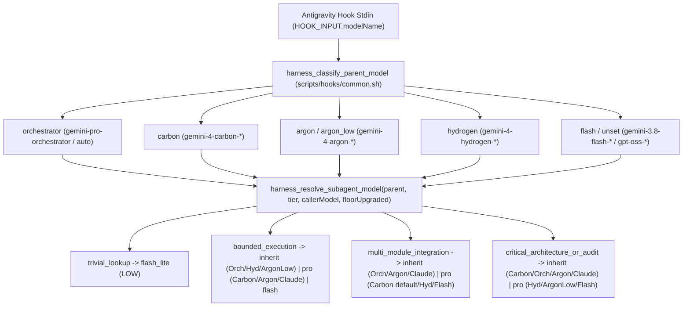
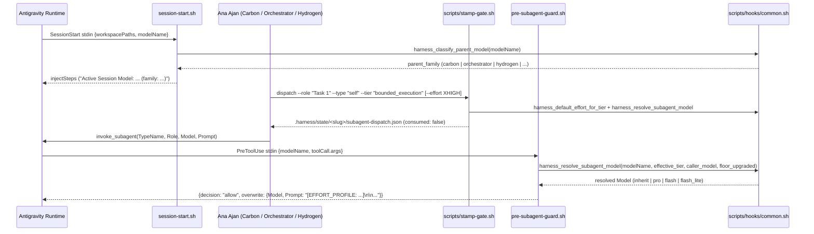

# Pull Request Mühendislik Rehberi: Gemini 4 (Carbon, Argon, Hydrogen) ve Orchestrator Duyarlı Alt Ajan Model Seçicisi

## 1. Problem Bağlamı ve Mimari Kararlar

### Çözülen Gerçek Problem ve İkili (Binary) Doğrulama Bulguları
Google Antigravity çalışma zamanına **Gemini 4** ailesi (`gemini-4-carbon-{low,medium,high}`, `gemini-4-argon-{low,medium,high}`, `gemini-4-hydrogen-{low,medium,high,xhigh}`) ve dinamik oturum yönlendiricisi **`Orchestrator`** (`gemini-pro-orchestrator`) eklendiğinde, `alps-agy-harness` içindeki tek boyutlu alt ajan yönlendiricisi üç kritik uyumsuzluk üretmeye başladı. `agy models`, `agy changelog` (`v1.5.2`–`v1.5.7`) ve `agy plugin validate --strict` ile yapılan doğrudan ikili testler şu çalışma zamanı gerçeklerini kanıtladı:

1. **Sabit 4-Katmanlı `invoke_subagent` Şema Kısıtı:** Hem `invoke_subagent.Model` araç şeması hem de `agents/*.md` yükleyicisi yalnızca `inherit | flash_lite | flash | pro` sabitlerini kabul etmektedir (`carbon`, `argon`, `hydrogen` veya tam model kimliği verildiğinde yükleyici `Invalid model tier` hatası üretir).
2. **Katman Sabitlerinin Gerçek Çözümleme Hedefleri:** Antigravity çalışma zamanında `pro` katmanı **Gemini 4 Argon (Medium)** modeline, `flash` katmanı ise eski nesil **Gemini 3.8 Flash** modeline çözülmektedir; `inherit` ise ana oturumun aktif modelini ve düşünme bütçesini (`Carbon`, `Argon`, `Hydrogen`, `Orchestrator`, `Claude Opus/Sonnet 5.5`) birebir miras alır.
3. **Eski Tek Boyutlu Seçicideki Üç Hata:**
   - **Carbon / `Orchestrator` / `Argon High` Düşürme Tuzağı:** Ana oturum `Gemini 4 Carbon`, `Orchestrator` veya `Gemini 4 Argon (High)` iken `security-reviewer`, `pr-auditor` ve `critical_architecture_or_audit` görevlerini koşulsuz `Model: "pro"` ile ezmek, denetçileri **Carbon / `Orchestrator` / `Argon High` katmanından `Argon (Medium)` katmanına düşürüyordu**.
   - **Hydrogen / `Orchestrator` Kodlama Düşürme Tuzağı:** Ana oturum `Orchestrator` veya `Gemini 4 Hydrogen` iken `bounded_execution` (`self` TDD uygulayıcıları) çağrılarını sabit `flash` yapmak kodlayıcıları **Gemini 4 Hydrogen yerine eski Gemini 3.8 Flash'a düşürüyordu**; ana oturum `Carbon` iken ise kodlayıcıların 3.8 Flash yerine kota dostu Gemini 4 katmanı olan **`pro` (Argon)** üzerinde çalışması gerekiyordu.
   - **Hafif Ana Oturumda Denetçi Zayıflığı:** Ana oturum `Gemini 3.8 Flash` veya `Gemini 4 Hydrogen` iken `multi_module_integration` / `canon-auditor` için koşulsuz `inherit` bırakmak denetçiyi hafif modelde tutuyordu (halbuki `pro` ile **Gemini 4 Argon** katmanına yükseltilmelidir).

### Değerlendirilen Alternatifler ve Mimari Ödünleşimler (Trade-offs)

| Seçenek | Özeti | Neden Seçildi / Neden Elendi? |
| :--- | :--- | :--- |
| **A. `invoke_subagent` Yerine `swarm` Geçişi** | Alt ajanları ortak mesaj panolu `swarm` işçilerine taşımak | **Elendi:** `swarm` aracı `agents/*.md` salt-okunur özel denetçi profillerini (`canon-auditor`, `security-reviewer`, `pr-auditor`) yükleyemez ve ortak Gemini kotasını paralel döngülerle hızla tüketir. |
| **B. Yalnızca `stamp-gate.sh` CLI Parametresiyle Seçim** | Ajanın `dispatch` çağrısında kendi modelini tahmin edip geçmesini beklemek | **Elendi:** LLM kendi `modelName` kimliğini her zaman bilemez ve kullanıcı oturum ortasında `/model` değiştirdiğinde eski `subagent-dispatch.json` kaydı bayat kalır. |
| **C. Canlı `HOOK_INPUT.modelName` Duyarlı 2-Boyutlu Seçici (Seçilen)** | Hem `stamp-gate.sh` (`select-model` / `dispatch`) hem `pre-subagent-guard.sh` içinde `harness_classify_parent_model` + `harness_resolve_subagent_model` çalıştırmak | **Seçildi:** Antigravity her hook çağrısında gerçek `modelName` bilgisini `stdin` üzerinden ilettiği için, çağrı anında sıfır tahminle doğru `inherit | pro | flash | flash_lite` katmanı ve `LOW..MAX` (`XHIGH` dahil) efor başlığı kilitlenir. |

---

## 2. Mimari ve Veri Akışı Diyagramları

### Diyagram 1: 2-Boyutlu Model Sınıflandırma ve Katman Çözümleme Akışı (`common.sh` & `pre-subagent-guard.sh`)



### Diyagram 2: Oturum Başlangıcı, Dispatch Damgalama ve `PreToolUse` Fiziksel Kilitleme Sırası



---

## 3. Dosya Bazlı Değişiklik Analizi

### `scripts/hooks/common.sh` — [GÜNCELLENDİ] (`Shared Hook Runtime Library`)
- **Ne Değişti / Ne Üretildi?:** Ana oturum model adını hem teknik kimlik (`gemini-4-carbon-high`, `gemini-pro-orchestrator`) hem de ekran etiketi (`Gemini 4 Carbon (Medium)`, `Orchestrator`, `Gemini 4 Argon (Low)`) biçimlerinde büyük/küçük harf duyarsız olarak normalize eden `harness_classify_parent_model`, efor doğrulayıcısı `harness_is_valid_effort_profile` (`LOW|MEDIUM|HIGH|XHIGH|MAX`), katman varsayılan efor eşleyicisi `harness_default_effort_for_tier` ve 2-boyutlu karar fonksiyonu `harness_resolve_subagent_model` eklendi:
  ```bash
  harness_resolve_subagent_model() {
    local parent_model="${1:-}" tier="${2:-}" caller_model="${3:-}" floor_upgraded="${4:-false}"
    local family
    family="$(harness_classify_parent_model "$parent_model")"
    ...
  }
  ```
- **Neden Değişti / Neden Üretildi?:** Model sınıflandırma ve katman çözümleme kurallarının `stamp-gate.sh`, `pre-subagent-guard.sh` ve `session-start.sh` arasında kopyalanmadan tek bir deterministik doğruluk kaynağından (*Single Source of Truth*) çalışması için üretildi.

### `scripts/hooks/pre-subagent-guard.sh` — [GÜNCELLENDİ] (`PreToolUse Subagent Lock Hook`)
- **Ne Değişti / Ne Üretildi?:** `HOOK_INPUT.modelName` alanı `parent_model` olarak okundu; `effort_header_for_profile` fonksiyonuna Gemini 4 Hydrogen ile gelen `XHIGH` kademesi eklendi; `security-reviewer` ve `pr-auditor` dallarındaki sabit `"pro"` ataması `harness_resolve_subagent_model "$parent_model" "critical_architecture_or_audit"` çağrısına dönüştürüldü; dinamik alt ajanlarda (`self`, `research`, `canon-auditor`, özel ajanlar) efor doğrulaması `harness_is_valid_effort_profile` ile genişletildi ve `parent_model` mevcut olduğunda canlı ana oturum modeline göre nihai `Model` yeniden hesaplandı.
- **Neden Değişti / Neden Üretildi?:** `Carbon`, `Orchestrator` ve `Argon (High)` oturumlarında denetçilerin yanlışlıkla `Argon (Medium)` katmanına düşürülmesini önlemek, `Carbon` oturumunda `bounded_execution` görevlerini `pro` (Argon) katmanına indirmek ve `Hydrogen` / `3.8 Flash` oturumlarında denetçileri `pro` ile Argon'a yükseltmek için güncellendi.

### `scripts/hooks/session-start.sh` — [GÜNCELLENDİ] (`SessionStart Context Injection Hook`)
- **Ne Değişti / Ne Üretildi?:** `HOOK_INPUT.modelName` okunup `harness_classify_parent_model` ile sınıflandırıldı ve açılış sistem mesajına `- Active Session Model: <model> (family: <family>)` satırı ile ebeveyn-duyarlı Gemini 4 / `Orchestrator` yönlendirme protokolü bilgisi eklendi.
- **Neden Değişti / Neden Üretildi?:** Oturum başladığında ana ajanın hangi model ailesinde (`carbon`, `orchestrator`, `argon`, `hydrogen`, `flash`) çalıştığını ve alt ajanların hangi katmanlara yönlendirileceğini bağlam içinde açıkça görmesi için güncellendi.

### `scripts/stamp-gate.sh` — [GÜNCELLENDİ] (`Deterministic Stamp & Dispatch CLI`)
- **Ne Değişti / Ne Üretildi?:** `dispatch` alt komutuna isteğe bağlı `--parent-model <modelName>` (`$HARNESS_PARENT_MODEL` varsayılanlı) ve `--effort LOW|MEDIUM|HIGH|XHIGH|MAX` bayrakları eklendi; ayrıca verilen görev katmanı ve ana oturum modeli için seçilecek `{tier, parentModel, parentFamily, model, effortProfile}` JSON çıktısını üreten yeni `select-model` (`cmd_select_model`) alt komutu tanımlandı.
- **Neden Değişti / Neden Üretildi?:** Hem `Hydrogen (XHigh)` gibi özel düşünme bütçelerinin `subagent-dispatch.json` içine damgalanabilmesi hem de CLI ve test katmanından model seçici kararlarının doğrudan sorgulanıp doğrulanabilmesi için güncellendi.

### `rules/AGENTS.md` — [GÜNCELLENDİ] (`Always-On Universal Rule Contract`)
- **Ne Değişti / Ne Üretildi?:** Bölüm 7 (`## 7. Hybrid jev & Gemini 4 Parent-Aware Subagent Routing`), `invoke_subagent` katmanlarının Gemini 4 karşılıklarını (`pro` = Argon, `flash` = 3.8 Flash, `inherit` = Carbon/Argon/Hydrogen/`Orchestrator`/Claude), `HOOK_INPUT.modelName` tabanlı düşürme korumasını ve `XHIGH` efor seçeneğini içerecek şekilde `8,192` bayt sınırının altında (`8,172` bayt) kalarak güncellendi.
- **Neden Değişti / Neden Üretildi?:** Her oturumda aktif olan ana orkestrasyon kuralının ajanı eski statik `bounded_execution -> flash` / `security-reviewer -> pro` varsayımlarına yönlendirmesini engellemek için güncellendi.

### `agents/canon-auditor.md` — [GÜNCELLENDİ] (`Canon & Architecture Subagent`)
- **Ne Değişti / Ne Üretildi?:** Bölüm 1.1 (`Honor Injected Effort Profile & Parent-Aware Model Lock`), `pre-subagent-guard.sh` tarafından `HOOK_INPUT.modelName` üzerinden çözülen `inherit` / `pro` model kilidini ve `[EFFORT_PROFILE: XHIGH — ...]` başlığını kapsayacak şekilde güncellendi.
- **Neden Değişti / Neden Üretildi?:** `canon-auditor` alt ajanının hem `HIGH` hem `XHIGH` / `MAX` efor direktiflerini ve ebeveyn-duyarlı model sözleşmesini eksiksiz tanıması için güncellendi.

### `agents/security-reviewer.md` — [GÜNCELLENDİ] (`Pre-PR Security Subagent`)
- **Ne Değişti / Ne Üretildi?:** Bölüm 1.1 içindeki statik `Model: "pro"` ifadesi, `Carbon` / `Orchestrator` / `Argon (Medium/High)` / `Claude` oturumlarında `Model: "inherit"`, `Hydrogen` / `Argon Low` / `3.8 Flash` oturumlarında `Model: "pro"` (Gemini 4 Argon) olarak güncellendi.
- **Neden Değişti / Neden Üretildi?:** Güvenlik denetçisinin dokümante edilen çalışma zamanı sözleşmesini yeni 2-boyutlu seçici davranışıyla birebir uyumlu tutmak için güncellendi.

### `agents/pr-auditor.md` — [GÜNCELLENDİ] (`Post-PR 7-Dimensional Auditor Subagent`)
- **Ne Değişti / Ne Üretildi?:** Bölüm 1.1 içindeki statik `Model: "pro"` açıklaması ebeveyn-duyarlı `inherit` / `pro` model seçimi ve `HIGH` / `XHIGH` / `MAX` efor profillerini yansıtacak şekilde güncellendi.
- **Neden Değişti / Neden Üretildi?:** PR sonrası 7 boyutlu denetçinin `Carbon` ve `Orchestrator` oturumlarında model düşümü olmadan çalışacağını sözleşme düzeyinde kayıt altına almak için güncellendi.

### `skills/harness-orchestrator/SKILL.md` — [GÜNCELLENDİ] (`Primary Orchestration Skill`)
- **Ne Değişti / Ne Üretildi?:** Bölüm 4 (`## 4. Hibrit jev ve Gemini 4 / Orchestrator Duyarlı Alt Ajan Yönlendirme`), `stamp-gate.sh dispatch [--effort ...]` kullanımını ve dört görev profilinin ana oturum modeline göre hangi `invoke_subagent.Model` katmanına çözüldüğünü açıklayacak şekilde genişletildi.
- **Neden Değişti / Neden Üretildi?:** Orkestratör skill yüklendiğinde ajanın görev kayıtlarını ve model beklentilerini yeni Gemini 4 matrisine göre yürütmesi için güncellendi.

### `skills/review-pr/SKILL.md` — [GÜNCELLENDİ] (`Post-PR Audit Skill`)
- **Ne Değişti / Ne Üretildi?:** Giriş özeti ve Adım 2 (`invoke_subagent ile pr-auditor Çağrısı`), `pre-subagent-guard.sh` kancasının `HOOK_INPUT.modelName` değerine göre `inherit` veya `pro` kilidi uyguladığını ve `XHIGH` efor kademesini desteklediğini belirtecek şekilde güncellendi.
- **Neden Değişti / Neden Üretildi?:** `review-pr` akışında eski statik `pro` ifadesinden kaynaklanabilecek dokümantasyon çelişkisini gidermek için güncellendi.

### `README.md` — [GÜNCELLENDİ] (`Plugin Root Documentation`)
- **Ne Değişti / Ne Üretildi?:** Bölüm 1'deki model/efor kilidi maddesi ve Bölüm 8'deki bileşenler tablosu (`session-start.sh`, `pre-subagent-guard.sh`, `stamp-gate.sh` ve `agents/*.md` satırları), Gemini 4 (`Carbon`, `Argon`, `Hydrogen`), `Orchestrator`, `select-model` alt komutu ve `XHIGH` efor kademesini yansıtacak şekilde güncellendi.
- **Neden Değişti / Neden Üretildi?:** Kullanıcıya dönük ana kurulum ve mimari rehberin yeni çalışma zamanı yetenekleriyle tam senkron kalması için güncellendi.

### `tests/test-stamp-and-common.sh` — [GÜNCELLENDİ] (`Unit Tests: Common & Stamp Gate`)
- **Ne Değişti / Ne Üretildi?:** `test_gemini4_and_orchestrator_parent_model_classification_and_selector` testi eklendi; 15 farklı `modelName` girdisi (`slug` ve ekran adı varyantları), `stamp-gate.sh select-model` çıktıları (`Carbon`, `Orchestrator`, `Hydrogen`, `Flash` ve açık `--caller-model inherit` koruması) ve `dispatch --parent-model ... --effort XHIGH` kaydı doğrulandı.
- **Neden Değişti / Neden Üretildi?:** Ortak sınıflandırıcı ve CLI seçici katmanındaki tüm dalların regresyona karşı deterministik birim testleriyle korunması için güncellendi.

### `tests/test-subagent-and-stop-hooks.sh` — [GÜNCELLENDİ] (`Hook Tests: Pre-Subagent & Stop Gate`)
- **Ne Değişti / Ne Üretildi?:** `EXPECTED_XHIGH` sabiti ve `test_gemini4_and_orchestrator_parent_aware_subagent_routing` uçtan uca hook testi eklendi; `Carbon`, `Orchestrator`, `Hydrogen (XHigh)`, `Argon (Low)`, `Argon (High)` ve `3.8 Flash` ana oturumları altında `security-reviewer`, `pr-auditor`, `canon-auditor` ve `self` alt ajanlarının tam beklenen `overwrite.Model` ve `overwrite.Prompt` çıktıları doğrulandı.
- **Neden Değişti / Neden Üretildi?:** Canlı `PreToolUse` kancasının hem yeni Gemini 4 / `Orchestrator` senaryolarında doğru katmanı seçtiğini hem de `modelName` verilmeyen geriye dönük testlerle %100 uyumlu kaldığını kanıtlamak için güncellendi.

### `tests/test-edit-and-session-hooks.sh` — [GÜNCELLENDİ] (`Hook Tests: SessionStart & Pre-Edit`)
- **Ne Değişti / Ne Üretildi?:** `test_session_start_injects_status_and_respects_harness_ignore` içine `modelName: "gemini-4-carbon-high"` verildiğinde `Active Session Model: gemini-4-carbon-high (family: carbon)` satırının üretildiğini doğrulayan kontrol eklendi.
- **Neden Değişti / Neden Üretildi?:** Oturum başlangıç kancasının aktif model ailesini eksiksiz raporladığını otomatik test altına almak için güncellendi.

### `tests/test-rules-and-agents.sh` — [GÜNCELLENDİ] (`Contract Tests: Rules & Agents`)
- **Ne Değişti / Ne Üretildi?:** `test_agents_md_no_frontmatter_and_under_8kb` içine `Orchestrator`, `Carbon`, `Argon`, `Hydrogen` ve `XHIGH` sözleşme anahtarlarının varlığını (`< 8,192` bayt sınırı altında) denetleyen doğrulamalar eklendi.
- **Neden Değişti / Neden Üretildi?:** İleride yapılacak düzenlemelerde `rules/AGENTS.md` içinden Gemini 4 / `Orchestrator` yönlendirme kurallarının yanlışlıkla silinmesini veya boyut sınırının aşılmasını engellemek için güncellendi.

---

## 4. Kritik İş Mantığı, Kenar Durumlar (Edge Cases) ve Hata Yönetimi

1. **Teknik Kimlik (`slug`) ve Görsel Etiket (`Display Name`) Uyumu:** Antigravity sürümüne ve arayüzüne (CLI vs IDE) göre `HOOK_INPUT.modelName` hem `"gemini-4-argon-low"` hem `"Gemini 4 Argon (Low)"` hem de `"auto"` gelebilir. `harness_classify_parent_model`, girdiyi `LC_ALL=C tr '[:upper:]' '[:lower:]'` ile normalize ederek tüm varyantları tek tip aile kimliğine (`argon_low`, `orchestrator`, `carbon`, `hydrogen`) indirger.
2. **`Carbon` Oturumunda İsteğe Bağlı `inherit` Koruması:** Ana oturum `Carbon` iken `multi_module_integration` (`canon-auditor` dahil) varsayılan olarak kota verimliliği için `pro` (**Gemini 4 Argon**) katmanına iner; ancak çağıran ajan özellikle `Model: "inherit"` geçirmişse `harness_resolve_subagent_model` bu tercihi ezmez ve `Carbon` üzerinde çalışmasına izin verir.
3. **Oturum Ortasında `/model` Değişikliği:** `subagent-dispatch.json` kaydı eski modelde oluşturulmuş olsa bile `pre-subagent-guard.sh`, `invoke_subagent` çağrıldığı anda doğrudan o turun canlı `HOOK_INPUT.modelName` değerini okuyarak güncel modele uygun `overwrite.Model` üretir.
4. **Geriye Dönük Uyumluluk (`unset` Model):** `HOOK_INPUT` içinde `modelName` bulunmayan eski birim testi ve araç senaryolarında `parent_family="unset"` dönerek mevcut `flash_lite / flash / inherit / pro` ve `canon-auditor` taban yükseltme davranışını sıfır kırılmayla korur.

---

## 5. Somut Doğrulama Kanıtları

- **TDD Kırmızı Aşama Kanıtı:** Uygulama öncesinde 4 yeni test eklendi ve `./scripts/run-quiet.sh red-tests -- bash tests/run-all.sh` çalıştırıldığında beklenen 4 hedef hata (`SessionStart must surface active modelName`, `AGENTS.md must document Orchestrator`, `harness_classify_parent_model: command not found`, `Carbon parent must keep security-reviewer on inherit`) doğrulandı (`exit: 1`).
- **Eklenti Şema ve Boyut Doğrulaması:**
  - `wc -c rules/AGENTS.md` -> `8172` bayt (`< 8192` bayt sınırı korundu).
  - `agy plugin validate /Volumes/SDCARD/Projects/alps-agy-harness` -> `skills 11 · agents 3 · rules 5 · hooks 1 · ✔ Validation passed`.
- **Tam Test Paketi (Yeşil Aşama Kanıtı):**
  - `./scripts/run-quiet.sh full-suite -- bash tests/run-all.sh` -> `8/8` test paketi (`test-manifest.sh`, `test-stamp-and-common.sh`, `test-utilities.sh`, `test-edit-and-session-hooks.sh`, `test-command-hooks.sh`, `test-subagent-and-stop-hooks.sh`, `test-rules-and-agents.sh`, `test-plugin-bundle.sh`), toplam **52/52 test `PASS`** (`süre: 36.9s`).

---

## 6. Kapsam Dışı (`docs/parking-lot.md`) ve Operasyonel Notlar

- Antigravity ileride `invoke_subagent.Model` şemasına doğrudan `hydrogen` veya tam model kimliği (`gemini-4-hydrogen-medium`) desteğini eklediğinde, `Carbon` ana oturumundan doğrudan `Hydrogen` alt ajanına iniş seçeneği `harness_resolve_subagent_model` içine tek satırlık güncelleme ile eklenebilir.
- `kedo` gibi proje bazlı kurulumlarda (`.agents/plugins/alps-agy-harness`) PR birleştirildikten sonra `git pull --ff-only` çalıştırılması ve yeni kancaların yüklenmesi için yeni bir Antigravity sohbet oturumu açılması yeterlidir.

---

## Teknik Terimler Sözlüğü

| Terim | Açıklama |
| :--- | :--- |
| **Effort Profile (`EFFORT_PROFILE`)** | Alt ajan prompt'unun başına fiziksel olarak enjekte edilen ve muhakeme derinliğini (`LOW`, `MEDIUM`, `HIGH`, `XHIGH`, `MAX`) belirleyen deterministik başlık. |
| **Gemini 4 Argon** | Google DeepMind'ın yüksek mühendislik zekası ile hız/kota verimliliğini dengeleyen frontier modeli (`invoke_subagent` içinde `Model: "pro"` karşılığı). |
| **Gemini 4 Carbon** | Mimari tasarım, güvenlik denetimi ve karmaşık kök neden analizi için tasarlanmış en derin muhakeme kapasiteli amiral gemisi Gemini 4 modeli. |
| **Gemini 4 Hydrogen** | Yüksek hızlı kodlama, dosya düzenleme ve TDD döngüleri için optimize edilmiş (`XHigh` düşünme kademesine sahip) yeni nesil çalışma modeli. |
| **Model Tier Downgrade Trap** | Ana oturum daha üstün bir modelde (`Carbon` veya `Orchestrator`) çalışırken sabit `Model: "pro"` zorlaması yüzünden alt ajanın istemeden daha alt katmana düşmesi hatası. |
| **Orchestrator (`gemini-pro-orchestrator`)** | Planlama ve karmaşık hata analizini `Gemini 4 Carbon`'a, rutin kodlama ve test adımlarını `Gemini 4 Hydrogen`'e dinamik yönlendiren yerleşik oturum yönlendiricisi. |
| **Parent-Aware Routing** | Alt ajan model katmanının yalnızca görev profiline göre değil, `HOOK_INPUT.modelName` ile gelen ana oturum model ailesine göre 2-boyutlu seçilmesi mimarisi. |
