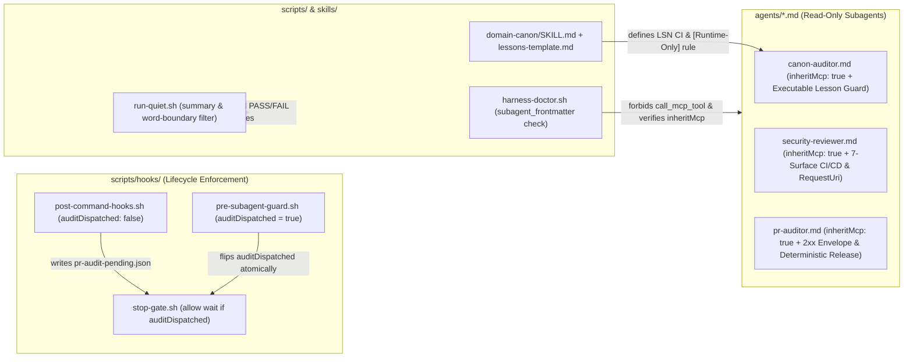
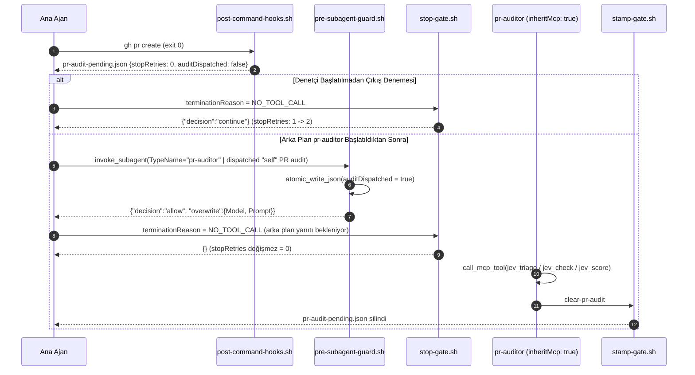

# Pull Request Mühendislik Rehberi: Çalışma Zamanı Sürtünmelerinin Giderilmesi ve Evrensel Denetim Korumaları

## 1. Problem Bağlamı ve Mimari Kararlar

### Çözülen Gerçek Problem ve Kök Bağlam
`alps-agy-harness` eklentisinin gerçek dünya kullanımında üç çalışma zamanı sürtünmesi ve üç evrensel denetim boşluğu tespit edilmiştir:
1. **Özel Alt Ajanlarda `call_mcp_tool` Executor Çökmesi (P0):** `agents/{canon-auditor,security-reviewer,pr-auditor}.md` frontmatter `tools:` listesinde yer alan `call_mcp_tool` adı Antigravity alt ajan yükleyicisi tarafından yerleşik araç (`builtin: true`) olarak çözülmeye çalışıldığından `unknown component: tool "call_mcp_tool" not found in registry` hatasıyla `invoke_subagent` çağrısını anında çökertiyordu. Canlı `GetAllPlugins` RPC ve `agy` ikili doğrulamaları, Antigravity'nin yalnızca `inheritMcp: true` frontmatter anahtarını `customizationDiscovery.mcp.inheritUser: true` olarak çözümlediğini ve `call_mcp_tool`, `list_resources`, `read_resource` ile `<mcp_servers>` (`jev` dahil) erişimini yerleşik olarak bağladığını kanıtladı.
2. **`stop-gate.sh` ile Asenkron `pr-auditor` Yarış Durumu (P1):** `gh pr create` sonrası `post-command-hooks.sh` tarafından yazılan `pr-audit-pending.json`, denetçi alt ajanın arka planda başlatılıp başlatılmadığını izlemiyordu. Ana ajan `pr-auditor` yanıtını beklemek için turunu `NO_TOOL_CALL` ile sonlandırdığında `stop-gate.sh`, iki kez üst üste `decision: "continue"` dönerek `stopRetries` kotasını erken tüketiyordu.
3. **`run-quiet.sh` Uyarı Sayacı Yalancı Pozitifleri (P2):** `grep -Ec 'warning|WARN|CS[0-9]{4}|TS[0-9]{4}'` ifadesi, iç içe `run-quiet.sh` çağrılarının ürettiği `✅ PASS [...] (..., warnings: 0 ...)` özet satırlarını, `warnings_disabled` gibi tanımlayıcıları ve `TS-1050` gibi tireli iş kodlarını gerçek derleyici uyarısı sayıyordu.
4. **Üç Evrensel Denetim Boşluğu:** `docs/canon/lessons.md` kayıtlarının pasif kaynak dosya referansıyla bırakılıp PR CI test kapısına bağlanmaması (*Executable Lesson Guard*), `security-reviewer.md` denetiminde CI/CD iş akışı tedarik zinciri ile runner izolasyonunun ve `RequestUri` sorgu parametresi sır sızıntısının eksik kalması, `pr-auditor.md` Boyut 4 içinde HTTP `2xx` gövde içi hata zarflarının ve havuz kaynaklarının deterministik iadesinin açıkça zorunlu tutulmaması.

### Seçilen Mimari Yaklaşım ve Gerekçesi
- **Etkilenen Katmanlar:** Subagent Definitions (`agents/`), Lifecycle Hooks (`scripts/hooks/`), Utilities (`scripts/`), Domain Canon Skill & Template (`skills/domain-canon/`) ve Harness Verification Suites (`tests/`).
- **Yaklaşım Özeti:** `agents/*.md` frontmatter tanımları doğrudan Antigravity'nin yerel `inheritMcp: true` şemasına taşındı ve `scripts/harness-doctor.sh` üzerinden sürekli doğrulanabilir kılındı; böylece `pre-subagent-guard.sh` içinde kırılgan `TypeName: "self"` yeniden yazımına ihtiyaç kalmadı (yine de PR denetimi için bilinçli dispatch edilen `self` çağrıları `auditDispatched` bayrağıyla tam desteklendi). `pr-audit-pending.json` durum nesnesine `auditDispatched` boolean alanı eklenerek asenkron `NO_TOOL_CALL` bekleme turu ile unutulmuş PR denetimi deterministik olarak ayrıştırıldı. Tüm kurallar ve şablonlar yüzde yüz dil/ürün/sağlayıcı bağımsız evrensel ifadelerle güncellendi ve `rules/AGENTS.md` (`8,172` bayt `< 8,192`) sınırına hiç dokunulmadı.

### Değerlendirilen Alternatifler ve Ödünleşimler (Trade-offs)

| Yaklaşım / Seçenek | Avantajlar | Dezavantajlar / Riskler | Karar |
| :--- | :--- | :--- | :--- |
| **Seçenek A (Uygulanan): `inheritMcp: true` Yerel Şema + `auditDispatched` Durum Bayrağı** | Özel `agents/*.md` kimlikleri, yazma araçlarından (`write_file`, `edit_file`) salt-okunur izolasyonu ve `jev` MCP erişimi yerel Antigravity çalışma zamanında sıfır yamayla korunur; `stop-gate.sh` yarış durumu tek atomik boolean alanla çözülür. | Eski `pr-audit-pending.json` dosyalarında `auditDispatched` alanı bulunmayabilir. (`(.auditDispatched // false) == true` ile geriye dönük tam uyumluluk sağlandı.) | **Seçildi** |
| **Seçenek B: `pre-subagent-guard.sh` ile Tüm Denetçileri `TypeName: "self"` Olarak Yeniden Yazma** | Eski `tools:` şeması geçiştirilebilirdi. | Özel alt ajanların salt-okunur araç kısıtını kaldırır, sistem promptunu enjeksiyonla büyütür ve Antigravity alt ajan kimliğini gizlerdi. | Elendi |

---

## 2. Mimari ve Veri Akışı Diyagramları

### Katman ve Bileşen Bağımlılık Haritası

### Asenkron `pr-auditor` Dispatch ve `stop-gate.sh` Durum Geçiş Sırası

---

## 3. Dosya Bazlı Değişiklik Analizi

`git diff --name-status origin/main..HEAD` çıktısındaki (`docs/walkthroughs/*` hariç) **tüm 15 güncellenen dosya** aşağıda eksiksiz detaylandırılmıştır:

### `agents/canon-auditor.md` — [GÜNCELLENDİ] (`Subagent Definition`)
- **Ne Değişti / Ne Üretildi?:** YAML frontmatter içindeki `tools:` dizisinden geçersiz `call_mcp_tool` girdisi çıkarılarak geçerli `tools: [read_file, run_command, manage_task, send_message]` listesine geçildi ve `inheritMcp: true` alanı eklendi; ayrıca `description` alanı *executable lessons* kapsamını yansıtacak biçimde güncellendi. Step 2 madde 3 (`docs/canon/lessons.md`) altına **Executable Lesson Guard** maddesi eklenerek statik veya davranışsal olarak test edilebilir her `LSN-*` kaydının hem koruyucu otomatik testi hem de bu testin PR CI kapısında çalıştığını belgelemesi zorunlu kılındı; dış ağ, donanım veya bulut çalışma zamanı davranışları için yalnızca açık `[Runtime-Only]` muafiyetine izin verildi.
- **Neden Değişti / Neden Üretildi?:** `call_mcp_tool` bileşeni Antigravity alt ajan araç kayıt defterinde bulunmadığı için `invoke_subagent` çağrısında executor oluşturma çökmesini ortadan kaldırmak ve `lessons.md` kayıtlarının pasif dokümantasyon yerine yürütülebilir test + PR CI güvencesine bağlanmasını zorlamak için güncellendi.

### `agents/security-reviewer.md` — [GÜNCELLENDİ] (`Subagent Definition`)
- **Ne Değişti / Ne Üretildi?:** Frontmatter `inheritMcp: true` ile güncellenip `call_mcp_tool` geçersiz araç adı `tools:` listesinden kaldırıldı. Step 1 diff tarama listesine CI/CD iş akışı dosyaları eklendi; Step 2 başlığı **Mandatory 7-Surface Deep Security Inspection** olarak genişletilip Yüzey 1 içindeki sağlayıcı adı evrenselleştirildi, Yüzey 3 altına dış HTTP istemci hatalarında ve `ProblemDetails` yanıtlarında `?api_key=`, `?token=`, `?key=`, `?access_token=`, `?sig=` parametreleri taşıyan ham `RequestUri` / URL loglama yasağı eklendi ve yeni **7. CI/CD Workflow & Runner Isolation** yüzeyi (`pull_request` / `pull_request_target` -> `self-hosted` yasağı, 40 karakter commit SHA sabitleme, `run:` içinde `${{ ... }}` kabuk enjeksiyonu yasağı, kalıcı runner `clean` hijyeni ile `always()` içinde geçici anahtar/Keychain temizliği) tanımlandı; rapor özet şablonuna da yeni yüzey satırı eklendi.
- **Neden Değişti / Neden Üretildi?:** Güvenlik alt ajanının `jev_triage` / `jev_score` MCP araçlarına çökmeden erişmesini sağlamak, URL sorgu parametrelerindeki gizli anahtarların hata loglarına sızmasını kapatmak ve CI/CD tedarik zinciri ile runner izolasyonunu zorunlu denetim kapsamına almak için güncellendi.

### `agents/pr-auditor.md` — [GÜNCELLENDİ] (`Subagent Definition`)
- **Ne Değişti / Ne Üretildi?:** Frontmatter `inheritMcp: true` ve `tools: [read_file, run_command, manage_task, send_message]` şemasına taşındı (`call_mcp_tool` kaldırıldı). Boyut 4 (*Silent Failure & Error Handling Analysis*) altına iki yeni kontrol maddesi eklendi: üçüncü parti HTTP entegrasyonlarında yalnızca HTTP `2xx` (`200 OK`) durum koduna güvenmeyip gövde içi mantıksal hata zarflarının (*error envelopes*) doğrulanması ve kısıtlı bağlantı havuzu veya sunucusuz (CPU-throttled) ortamlarda fiziksel bağlantı/kaynakların `finally` / `await using` / `using` / `defer` ile deterministik iade edilip yanıt sonrası sahipsiz arka plan görevlerine güvenilmemesi.
- **Neden Değişti / Neden Üretildi?:** `pr-auditor` başlatma çökmesini gidermek ve HTTP 200 dönüp gövdede hata bildiren dış servis entegrasyonları ile kapsam sonuna kadar tutulan havuz bağlantı sızıntılarını PR incelemelerinde yakalamak için güncellendi.

### `scripts/harness-doctor.sh` — [GÜNCELLENDİ] (`Environment Diagnostics CLI`)
- **Ne Değişti / Ne Üretildi?:** `harness_root` yolu çözülerek Python teşhis bloğuna geçirildi ve Grup 2 (`plugins`) içine `subagent_frontmatter` denetimi eklendi; eklenti kökü, çalışma alanı `.agents/agents`, `.agents/plugins/*/agents` ve küresel `config_dir/plugins/*/agents` altındaki tüm benzersiz `agents/*.md` YAML frontmatter blokları ayrıştırılarak `tools:` içinde `call_mcp_tool` bulunması ve `canon-auditor.md` / `security-reviewer.md` / `pr-auditor.md` dosyalarında `inheritMcp: true` eksikliği deterministik `FAIL` ve `Fix:` yönergesiyle raporlanır hale getirildi.
- **Neden Değişti / Neden Üretildi?:** Geçersiz alt ajan frontmatter yapılandırmalarının sessizce canlı oturuma sızmadan `./scripts/harness-doctor.sh` çalıştırıldığında hemen yakalanması için güncellendi.

### `scripts/hooks/post-command-hooks.sh` — [GÜNCELLENDİ] (`PostToolUse Lifecycle Hook`)
- **Ne Değişti / Ne Üretildi?:** Başarılı `gh pr create` sonrasında `.harness/state/<branch-slug>/pr-audit-pending.json` dosyasına yazılan başlangıç JSON yükü `{prUrl: $url, stopRetries: 0, auditDispatched: false}` şeklinde güncellendi.
- **Neden Değişti / Neden Üretildi?:** PR oluşturulduğu anda `pr-auditor` alt ajanının henüz başlatılmadığını atomik durum dosyasında açıkça işaretlemek için güncellendi.

### `scripts/hooks/pre-subagent-guard.sh` — [GÜNCELLENDİ] (`PreToolUse Subagent Lock Hook`)
- **Ne Değişti / Ne Üretildi?:** `.toolCall.args.Prompt` alanı `orig_prompt` olarak okundu; aktif dalın `pr-audit-pending.json` dosyası mevcutken `.auditDispatched` değerini atomik olarak `true` yapan `mark_pr_audit_dispatched_if_pending` ve `TypeName: "self"` çağrısının PR denetimi niyeti taşıyıp taşımadığını (`Role` ve `Prompt` üzerinden) belirleyen `is_self_pr_audit_invocation` yardımcıları eklendi. `pr-auditor)` dalında doğrudan, `*)` dalında ise `subagent-dispatch.json` doğrulaması geçip `consumed = true` yazıldıktan hemen sonra `TypeName == "self"` PR denetim çağrılarında bayrak `true` yapılır.
- **Neden Değişti / Neden Üretildi?:** Ana ajan arka planda `pr-auditor` (veya dispatch doğrulamasından geçmiş PR denetim amaçlı `self`) alt ajanını başlattığı anda `stop-gate.sh` kancasının bu durumu deterministik olarak görebilmesini sağlamak için güncellendi.

### `scripts/hooks/stop-gate.sh` — [GÜNCELLENDİ] (`Stop Continuation Gate Hook`)
- **Ne Değişti / Ne Üretildi?:** `pr-audit-pending.json` dosyası mevcutken `stopRetries` sayacını okumadan veya artırmadan önce `jq -e '(.auditDispatched // false) == true' "$pending_file"` kontrolü eklendi; koşul doğruysa doğrudan `{}` dönülerek temiz çıkış/bekleme sağlanırken `false` veya eksik alan durumunda mevcut 2 kez `decision: "continue"` ve 3. denemede `{}` kaçış davranışı korundu.
- **Neden Değişti / Neden Üretildi?:** Arka planda çalışan `pr-auditor` yanıtını bekleyen ana ajanın tur sonunda `stop-gate.sh` tarafından gereksiz yere bloklanıp `stopRetries` hakkının erken tüketilmesini önlemek için güncellendi.

### `scripts/run-quiet.sh` — [GÜNCELLENDİ] (`Context Shield Utility`)
- **Ne Değişti / Ne Üretildi?:** Başarılı çıkış (`rc -eq 0`) dalındaki uyarı sayacı komutu `warning_count="$({ grep -Ev '^(✅ PASS \[|❌ FAIL \[)' "$log_file" 2>/dev/null || true; } | { grep -Ec '\b(warning|WARN)\b|\b(CS|TS)[0-9]{4}\b' || true; })"` biçiminde güncellendi.
- **Neden Değişti / Neden Üretildi?:** İç içe `run-quiet.sh` çağrılarının ürettiği özet satırlarını hariç tutup kelime sınırları (`\b...\b`) uygulayarak `warnings: 0`, `warnings_disabled` veya `TS-1050` gibi yalancı pozitif uyarı sayımlarını ve `pipefail` çıkış hatalarını engellemek için güncellendi.

### `skills/domain-canon/SKILL.md` — [GÜNCELLENDİ] (`Domain Canon Skill`)
- **Ne Değişti / Ne Üretildi?:** Bölüm 1.3 (`docs/canon/lessons.md`) altına **Yürütülebilir Ders Koruması (`Executable Lesson Guard`)** maddesi eklenerek statik veya davranışsal test edilebilir her `LSN-*` kaydının hem otomatik testi hem de PR CI kapısını belgelemesi gerektiği, yalnızca dış ağ/donanım/bulut çalışma zamanına özgü davranışlar için açık `[Runtime-Only]` muafiyetinin kabul edileceği tanımlandı.
- **Neden Değişti / Neden Üretildi?:** Alan kanonu oluşturma veya ders ekleme sürecinde geliştirici ve ajanlara pasif ders kaydı yerine CI kapısına bağlı koruyucu test zorunluluğunu doğrudan öğretmek için güncellendi.

### `skills/domain-canon/templates/lessons-template.md` — [GÜNCELLENDİ] (`Domain Canon Template`)
- **Ne Değişti / Ne Üretildi?:** Üst uyarı bloğu ve `## Yeni Ders Ekleme Kılavuzu` bölümlerine **Executable Lesson Guard** ve `[Runtime-Only]` muafiyet kuralları eklendi; ders tablosunun son sütunu `Koruyucu Test & PR CI Kapısı` olarak güncellenip örnek `LSN-001..003` satırlarından belirli ürün/sağlayıcı/çerçeve isimleri (`RevenueCat` vb.) temizlenerek iki otomatik test + PR CI kapısı örneği ve bir `[Runtime-Only]` örneği sağlandı; sonundaki `## Teknik Terimler Sözlüğü` tablosuna `Executable Lesson Guard` tanımı eklendi.
- **Neden Değişti / Neden Üretildi?:** Her projeye kopyalanan ders şablonunun sıfır ürün sızıntısıyla evrensel kalmasını sağlamak ve yeni eklenen her `LSN-*` dersini varsayılan olarak PR CI testine bağlamak için güncellendi.

### `tests/test-rules-and-agents.sh` — [GÜNCELLENDİ] (`Contract Tests`)
- **Ne Değişti / Ne Üretildi?:** `assert_subagent_frontmatter` yardımcısı 6 alanlı şemayı (`inheritMcp: true` ve `tools: [read_file, run_command, manage_task, send_message]`) doğrulayıp `call_mcp_tool` dizgesini açıkça yasaklayacak şekilde güncellendi; `test_subagents_frontmatter_and_audit_contracts` içine Madde 4 (`Executable Lesson Guard`, `[Runtime-Only]`, `PR CI`), Madde 5 (`Mandatory 7-Surface`, `7. **CI/CD Workflow & Runner Isolation:**`, `pull_request_target`, `self-hosted`, `40-character`, `${{`, `always()`, `RequestUri`, `?api_key=`, `?token=`, `?key=`) ve Madde 6 (`2xx`, `envelope`, `finally`, `await using`, `defer`) sözleşme kontrolleri eklendi.
- **Neden Değişti / Neden Üretildi?:** Üç özel denetçi ajanın frontmatter şeması ile yeni evrensel denetim kurallarında gelecekte regresyon oluşmasını TDD ile engellemek için güncellendi.

### `tests/test-command-hooks.sh` — [GÜNCELLENDİ] (`Command Hook Tests`)
- **Ne Değişti / Ne Üretildi?:** `test_post_command_sets_pr_audit_flag_and_triggers_graphify_on_merge` içine `gh pr create` sonrası yazılan `pr-audit-pending.json` dosyasında `.auditDispatched` alanının başlangıçta `false` olduğunu doğrulayan `assert_json_field` kontrolü eklendi.
- **Neden Değişti / Neden Üretildi?:** `post-command-hooks.sh` tarafından oluşturulan durum sözleşmesinin `auditDispatched: false` alanını eksiksiz ürettiğini garanti altına almak için güncellendi.

### `tests/test-subagent-and-stop-hooks.sh` — [GÜNCELLENDİ] (`Subagent & Stop Hook Tests`)
- **Ne Değişti / Ne Üretildi?:** `test_stop_gate_blocks_twice_then_releases_and_clears` içinde denetçi başlatılmadığında `.auditDispatched` alanının `false` kalarak 2 kez `continue` ürettiği doğrulandı; ayrıca `pr-auditor` ve dispatch edilmiş `self` PR denetçisi çağrılarının `auditDispatched=true` yapıp `stop-gate.sh` üzerinden `stopRetries` artmadan anında `{}` döndüğünü, alakasız veya kayıtsız `self` çağrılarının ise bayrağı değiştirmediğini kanıtlayan `test_stop_gate_allows_async_wait_when_pr_auditor_dispatched` testi eklendi.
- **Neden Değişti / Neden Üretildi?:** Asenkron `pr-auditor` yarış durumu düzeltmesinin hem pozitif hem negatif dallarda yan etkisiz çalıştığını kanıtlamak için güncellendi.

### `tests/test-utilities.sh` — [GÜNCELLENDİ] (`Utility & Doctor Tests`)
- **Ne Değişti / Ne Üretildi?:** İç içe `run-quiet.sh` özet satırları, tireli iş kodları (`TS-1050`, `CS-2040`) ve `warnings_disabled` ile `warnings: 0` döndüğünü, gerçek uyarılarla ise `warnings: 2` döndüğünü doğrulayan `test_run_quiet_nested_summary_and_hyphenated_codes_zero_warnings` testi ile `harness-doctor.sh` içindeki `subagent_frontmatter` kontrolünün sağlıklı durumda `OK`, `call_mcp_tool` veya eksik `inheritMcp: true` durumunda `FAIL` döndüğünü kanıtlayan `test_harness_doctor_validates_subagent_frontmatter_and_forbids_call_mcp_tool` testi eklendi.
- **Neden Değişti / Neden Üretildi?:** Uyarı sayacı yalancı pozitif düzeltmesini ve `harness-doctor.sh` alt ajan şema bekçisini otomatik regresyon korumasına almak için güncellendi.

### `tests/test-plugin-bundle.sh` — [GÜNCELLENDİ] (`Bundle & Template Contract Tests`)
- **Ne Değişti / Ne Üretildi?:** `test_templates_and_readme_glossary_and_mermaid_contracts` içine `lessons-template.md` ve `skills/domain-canon/SKILL.md` dosyalarının `Executable Lesson Guard` ile `[Runtime-Only]` kurallarını içerdiğini ve `lessons-template.md` içinde hiçbir belirli sağlayıcı adının (`RevenueCat`) geçmediğini doğrulayan sözleşme kontrolleri eklendi.
- **Neden Değişti / Neden Üretildi?:** Yürütülebilir ders korumasının ve sıfır ürün/sağlayıcı sızıntısı kısıtının eklenti paketi düzeyinde kalıcı olarak denetlenmesi için güncellendi.

---

## 4. Kritik İş Mantığı, Kenar Durumlar (Edge Cases) ve Hata Yönetimi

| Senaryo / Kenar Durum | Sistemin Davranışı ve Korunan Kural (Invariant) | Üretilen Yanıt / Çıktı |
| :--- | :--- | :--- |
| **Geriye Dönük `pr-audit-pending.json`:** `auditDispatched` alanı olmayan eski bir durum dosyası | `stop-gate.sh`, `(.auditDispatched // false) == true` ifadesiyle eksik alanı `false` kabul eder ve mevcut 2 kez bloklama güvenlik ağını korur. | `{"decision":"continue",...}` (max 2 kez) |
| **Kayıtsız veya Alakasız `self` Alt Ajanı:** PR denetimi dışındaki bir `self` veya reddedilmiş çağrı | `pre-subagent-guard.sh`, `auditDispatched = true` güncellemesini yalnızca `subagent-dispatch.json` doğrulaması geçtikten sonra ve PR denetim niyeti eşleşirse uygular. | `auditDispatched` `false` kalır |
| **Boş Log veya Sıfır Uyarı + `set -euo pipefail`:** `grep -Ev` ya da `grep -Ec` çıkış kodu `1` dönmesi | Pipeline blokları `{ ... || true; }` ile sarılıdır; sıfır eşleşmede çift `0\n0` veya erken `pipefail` çökmesi yaşanmaz. | `warnings: 0` |
| **Özel Ajanlarda Yazma Araçlarının Eksikliği (`inheritMcp: true` ile):** | `tools: [read_file, run_command, manage_task, send_message]` listesi yazma araçlarını dışarıda bırakırken `inheritMcp: true` MCP dispatcher araçlarını otomatik ekler. | Salt-okunur + tam `jev` MCP erişimi |

---

## 5. Somut Doğrulama Kanıtları

### Test Senaryoları ve Kanıtlanan Davranışlar

| Doğrulama Adımı | Kanıtladığı Davranış veya Sözleşme | Gerçek Çıktı |
| :--- | :--- | :--- |
| **TDD RED Aşaması (`./scripts/run-quiet.sh red-suite -- ./tests/run-all.sh`)** | Değişiklik öncesinde 5 test paketindeki yeni sözleşme ve davranış testlerinin beklenen hatalarla kırmızıya düştüğünü kanıtlar. | `exit: 1` — `3 passed, 5 failed, 8 total` (`.harness/logs/last.log`) |
| **TDD GREEN Aşaması (`./scripts/run-quiet.sh green-suite -- ./tests/run-all.sh`)** | Tüm 8 test paketinde toplam 55/55 birim ve entegrasyon testinin uyarısız geçtiğini kanıtlar (`7+5+9+3+3+12+8+8`). | `✅ PASS [green-suite] (süre: 37.2s, warnings: 0 — log: .harness/logs/last.log)` |
| **Ortam Sağlığı (`./scripts/harness-doctor.sh`)** | 8 MCP, `TYPESAFE_API_KEY`, CLI araçları ve 4 alt ajan tanımında (`subagent_frontmatter`) sıfır `call_mcp_tool` / tam `inheritMcp: true` doğrulaması. | `Summary: 29 checks (26 OK, 2 WARN, 1 INFO, 0 FAIL)` — `✅ Result: ALL MANDATORY CHECKS HEALTHY` |
| **Eklenti Şema Kilidi (`agy plugin validate --strict .`)** | Antigravity resmi katı manifest ve şema doğrulamasından sıfır uyarı/hata ile geçtiğini kanıtlar. | `skills 11 · agents 3 · rules 5 · hooks 1 · mcpServers 0 · sidecars 0` — `✔ Validation passed` |
| **Boyut Sınırları (`wc -c rules/*.md agents/*.md skills/*/SKILL.md`)** | `rules/AGENTS.md` için `8,192` bayt, diğer tüm kural/ajan/skill dosyaları için `24,000` bayt üst sınırının aşılmadığını kanıtlar. | `rules/AGENTS.md`: `8172` bayt; diğer dosyalar `2834`–`11524` bayt arası |
| **Canlı `invoke_subagent` + `jev_models` Doğrulaması** | İzole geçici `.agents/plugins/alps-agy-harness` kurulumunda `agy --dangerously-skip-permissions -p` ile her 3 denetçinin çökmeden başladığını ve canlı `jev_models` MCP çağrısını çalıştırdığını kanıtlar. | `canon-auditor`, `security-reviewer`, `pr-auditor` tümü hatasız yanıt döndü (`active_model: jev-latest`, `jev-preview`). |

---

## 6. Kapsam Dışı (`docs/parking-lot.md`) ve Operasyonel Notlar

- **Kapsam Dışı Bırakılanlar (`docs/parking-lot.md`):** Yok — yalnızca istenen 3 çalışma zamanı hatası ve 3 evrensel denetim boşluğu kapsam içinde kapatıldı; mevcut `rules/AGENTS.md` (`8172/8192` bayt) dokunulmadan korundu.
- **Operasyonel Notlar:** Küresel veya proje bazlı kurulumlarda (`~/.gemini/config/plugins/alps-agy-harness` veya `.agents/plugins/alps-agy-harness`) değişikliklerin etkinleşmesi için dal birleştirildikten sonra güncel kaynak çekilip yeni Antigravity oturumu başlatılmalıdır.

---

## Teknik Terimler Sözlüğü

| Terim | Açıklama |
| :--- | :--- |
| **`auditDispatched`** | `pr-audit-pending.json` içinde `pr-auditor` alt ajanının arka planda başlatılıp başlatılmadığını izleyen ve `stop-gate.sh` yarış durumunu önleyen atomik boolean bayrağı. |
| **Executable Lesson Guard** | `docs/canon/lessons.md` içindeki statik veya davranışsal olarak test edilebilir her `LSN-*` kuralının hem otomatik teste hem de PR CI iş akışı kapısına bağlanmasını zorlayan denetim kuralı. |
| **Executor Construction** | Antigravity çalışma zamanının bir ajan tanımındaki araç ve MCP bileşenlerini kayıt defterinden çözümleyip yürütücü örneğini oluşturma aşaması. |
| **`inheritMcp: true`** | Antigravity özel alt ajan frontmatter şemasında oturumun MCP sunucularını (`jev` vb.) ve `call_mcp_tool` dağıtıcısını alt ajana miras bırakan yapılandırma anahtarı. |
| **`[Runtime-Only]` Exemption** | Yalnızca dış ağ, donanım veya bulut çalışma zamanına bağlı olduğu için CI ortamında deterministik test edilemeyen `LSN-*` dersleri için açık gerekçeli muafiyet etiketi. |
| **Runner Isolation** | CI/CD iş akışlarında güvenilmeyen `pull_request` / `pull_request_target` tetikleyicilerinin kendi kendine barındırılan (`self-hosted`) koşuculardan ve gizli anahtarlardan yalıtılması ilkesi. |
