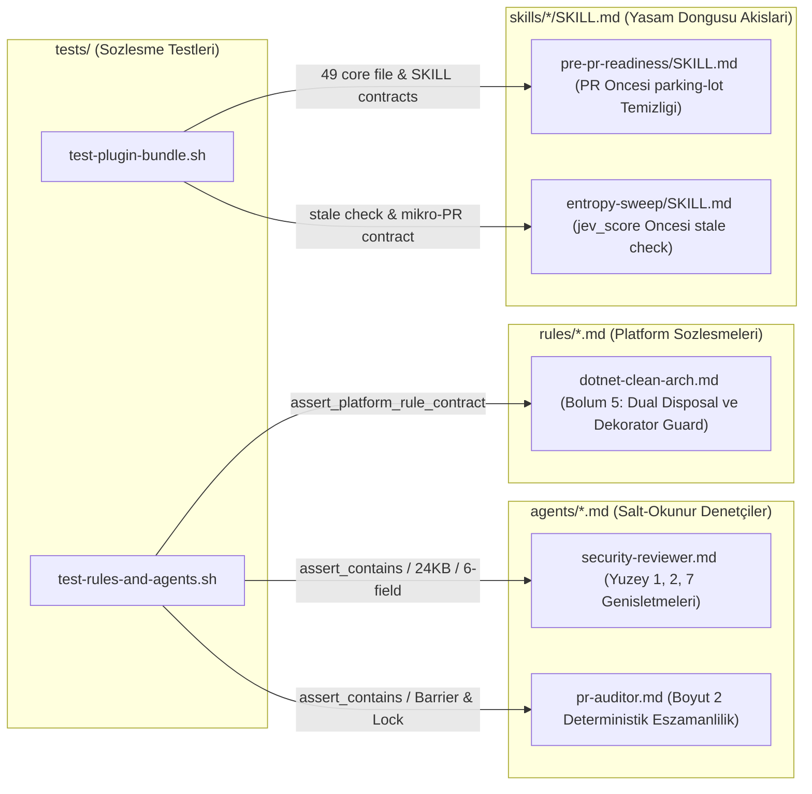
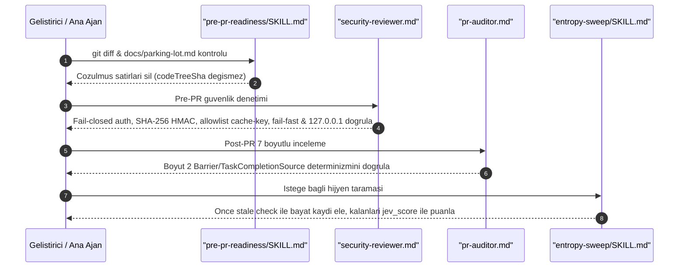

# Pull Request Mühendislik Rehberi: Evrensel Güvenlik, .NET DI Yaşam Döngüsü, Eşzamanlılık Testi ve Otopark Hijyeni Kuralları

---

## 1. Problem Bağlamı ve Mimari Kararlar

### Çözülen Gerçek Problem ve Kök Bağlam
`alps-agy-harness` eklentisinin farklı dil ve çalışma zamanı yığınlarındaki gerçek saha kullanımından türetilen dört evrensel denetim ve hijyen boşluğu tespit edilmiştir:
1. **Güvenlik Denetçisi Eksikleri (`agents/security-reviewer.md`):** Mevcut 7 güvenlik yüzeyi, kimlik doğrulama middleware/filtrelerinin eşleşmeyen alt rotalarda sessizce *fail-open* geçiş vermesini, sabit zamanlı sır karşılaştırması öncesinde özet uzunluğu bilgisinin sızmasını, anonim önbellek uç noktalarında kontrolsüz anahtar kardinalitesi üzerinden önbellek tahliyesi (*eviction DoS*) saldırılarını ve `Production` açılışında güvensiz taşıma/emülatör bayrakları ile yerel `docker-compose*.yml` konteynerlerinin `0.0.0.0` arayüzüne bağlanmasını açıkça sorgulamıyordu.
2. **.NET DI Yaşam Döngüsü ve Dekoratör Kayıt Hataları (`rules/dotnet-clean-arch.md`):** `IServiceProvider.CreateScope()` kullanan senkron kapsamlarda yalnızca `IAsyncDisposable` uygulayan `Scoped`/`Transient` bileşenlerin imha sırasında `InvalidOperationException` fırlatması, bunu önlemeye çalışırken senkron `Dispose()` içinde `.GetAwaiter().GetResult()` (*sync-over-async*) kilitlenmelerine düşülmesi ve `IServiceCollection` dekoratör uzantılarının önkoşul kayıt yokluğunu veya kayıt sırası ezilmesini sessizce geçiştirmesi tekrarlanan bir kök nedendi.
3. **Yarış Durumu Testlerinde Yanıltıcı Doğrulama (`agents/pr-auditor.md`):** Eşzamanlılık ve satır/kaynak kilidi (`FOR UPDATE`, `SKIP LOCKED`, mutex/semaphore) testlerinin anında dönen sahte nesnelerle veya rastgele `sleep` gecikmeleriyle yazılması, testlerin deterministik çakışma üretmemesine ve sahte güven yaratmasına yol açıyordu.
4. **Bayat `docs/parking-lot.md` Kayıtlarının Birikmesi (`skills/pre-pr-readiness/SKILL.md`, `skills/entropy-sweep/SKILL.md`):** Bir PR içinde veya daha önceki PR'larda fiilen çözülmüş teknik borç maddeleri `docs/parking-lot.md` dosyasından düşülmediği için hem PR sonrası otopark kirleniyor hem de `entropy-sweep` akışında bayat maddeler gereksiz yere `jev_score` puanlamasına giriyordu.

### Seçilen Mimari Yaklaşım ve Gerekçesi
- **Etkilenen Katmanlar:** Subagent Tanımları (`agents/`), Platform Kuralları (`rules/`), Yaşam Döngüsü Skill'leri (`skills/`) ve Sözleşme Testleri (`tests/`).
- **Yaklaşım Özeti:** PR #3 ile gelen 6 alanlı alt ajan YAML şeması (`inheritMcp: true`, `tools: [read_file, run_command, manage_task, send_message]`) ve `Mandatory 7-Surface Deep Security Inspection` omurgası birebir korunarak dört yeni güvenlik kuralı Yüzey 1, Yüzey 2 ve Yüzey 7'nin ilgili alt başlıklarına yerleştirildi; böylece hem mevcut test sözleşmeleri hem de Antigravity eklenti çalışma zamanı bütünlüğü korundu. Tüm eklemeler `Anti-Overengineering` / `Rule of Three` ilkeleriyle uyumlu tutulup erken mikro-optimizasyon kuralı (reflection önbelleklemesi veya test kanal havuzlaması gibi) kapsam dışı bırakıldı. Çekirdek eklenti dosya sayısı `49`, `rules/AGENTS.md` boyutu (`8,172` bayt `< 8,192`) ve `rules/dotnet-clean-arch.md` `globs:` satırı değişmeden korundu.

### Değerlendirilen Alternatifler ve Ödünleşimler (Trade-offs)

| Yaklaşım / Seçenek | Avantajlar | Dezavantajlar / Riskler | Karar |
| :--- | :--- | :--- | :--- |
| **Seçenek A (Uygulanan): Mevcut 7 Yüzey + 6 Alanlı Şema İçinde Evrensel Kurallar** | Antigravity'nin doğruladığı `inheritMcp: true` şeması bozulmaz; mevcut `49` dosyalık paket sınırı ve `test-rules-and-agents.sh` yüzey sözleşmeleri kırılmadan yeni güvenlik/DI/test/hijyen kontrolleri entegre edilir. | `security-reviewer.md` içindeki Yüzey 7 çalışma zamanı taşıma ve `docker-compose*.yml` yerel port hijyenini birlikte kapsar. | **Seçildi** |
| **Seçenek B: Yeni 8. Yüzey Açmak ve 5 Satırlı Eski Frontmatter'a Dönmek** | İstek metnindeki eski taslak numaralandırmasıyla birebir örtüşürdü. | PR #3 ile çözülen `call_mcp_tool` P0 çökmesini veya Yüzey 7 sözleşme testlerini geriye döndürürdü. | Elendi |

---

## 2. Mimari ve Veri Akışı Diyagramları

### Evrensel Denetim, Platform Kuralı ve Hijyen Bileşen Haritası


### `docs/parking-lot.md` Hijyen ve Eşzamanlılık/Güvenlik Doğrulama Akışı


---

## 3. Dosya Bazlı Değişiklik Analizi

`git diff --name-status origin/main..HEAD` çıktısındaki (`docs/walkthroughs/*` ve `docs/parking-lot.md` hariç) **tüm güncellenen 7 dosya** aşağıda detaylandırılmıştır:

### `agents/security-reviewer.md` — [GÜNCELLENDİ] (`Subagent Definition`)
- **Ne Değişti / Ne Üretildi?:**
  `Step 1` madde 3'e değişiklik halinde doğrudan okunacak dosyalar arasına `docker-compose*.yml` yerel konteyner tanımları eklendi. `Step 2` altında Yüzey 1 içine *Fail-Closed Auth Middleware/Filter/Guard* (eşleşmeyen alt rotalarda sessiz `next()` *fail-open* geçiş yasağı, açık muafiyet dışında varsayılan `401`/`403`) ve *Length-Hiding Constant-Time Secret Comparison* (`FixedTimeEquals`, `timingSafeEqual`, `hmac.compare_digest` öncesi `SHA-256` veya HMAC özet normalizasyonu); Yüzey 2 içine *Anonymous Endpoint Cache-Key Cardinality Guard* (serbest metin rota/sorgu yerine katı `allowlist` / desen kısıtı); Yüzey 7 altına ise `(e) Production Insecure-Transport Fail-Fast` (`Insecure`, `rejectUnauthorized: false`, `InsecureSkipVerify`, yerel emülatör/auth bypass reddi) ile `(f) Local Container Loopback Binding` (`docker-compose*.yml` portlarında `127.0.0.1:` zorunluluğu ve `Minor` kalibrasyon) maddeleri eklendi.
  ```markdown
  - **Fail-Closed Auth Middleware/Filter/Guard:** ... never silently fall through via `next()` (fail-open) ... default to `401`/`403`.
  - **Length-Hiding Constant-Time Secret Comparison:** ... normalized via `SHA-256` or HMAC prior to `FixedTimeEquals` / `timingSafeEqual` / `hmac.compare_digest`.
  - **(e) Production Insecure-Transport Fail-Fast:** ... `Insecure`, `rejectUnauthorized: false`, `InsecureSkipVerify` ...
  - **(f) Local Container Loopback Binding (`docker-compose*.yml`):** ... bind to loopback `127.0.0.1:` ...
  ```
- **Neden Değişti / Neden Üretildi?:**
  Auth middleware sızıntıları, zamanlama saldırıları, önbellek tahliyesi DoS riskleri ve `Production`/yerel geliştirme ortamları arasındaki güvensiz yapılandırma sapmalarını tüm proje yığınlarından bağımsız tek bir Pre-PR güvenlik kapısında yakalamak için eklendi.

### `rules/dotnet-clean-arch.md` — [GÜNCELLENDİ] (`Platform Rule`)
- **Ne Değişti / Ne Üretildi?:**
  Mevcut `globs:` frontmatter satırı ve 1–4 arası bölümler korunarak dosyanın sonuna `## 5. DI Lifetime, Dual Disposal & Registration Safety` bölümü eklendi. Bu bölüm iki bağlayıcı kural içerir: `IServiceProvider.CreateScope()` senkron imhasında `InvalidOperationException` oluşmasını engellemek üzere `Scoped`/`Transient` `IAsyncDisposable` altyapı bileşenlerinin gerektiğinde `IDisposable` da uygulaması ancak `Dispose()` içinde kesinlikle `DisposeAsync().AsTask().GetAwaiter().GetResult()` veya `.Result` (*sync-over-async*) çağırmadan alt kaynakların doğal senkron `Dispose()` metodunu çağırması; ayrıca `IServiceCollection` dekoratör uzantılarının önkoşul servis kaydını açıkça doğrulayıp yoksa anlamlı `InvalidOperationException` fırlatarak sessiz ezilmeyi önlemesi.
- **Neden Değişti / Neden Üretildi?:**
  `.NET` DI konteynerinde yalnızca asenkron imha edilebilir servislerin senkron kapsamda patlamasını, bunu gidermeye çalışırken oluşan thread-pool kilitlenmelerini ve kayıt sırası hatalarından kaynaklanan sessiz dekoratör atlamalarını önlemek için eklendi.

### `agents/pr-auditor.md` — [GÜNCELLENDİ] (`Subagent Definition`)
- **Ne Değişti / Ne Üretildi?:**
  Boyut 2 (*Test Coverage & Behavioral Rigor*) altına **Deterministic Concurrency Testing** maddesi eklendi. Yarış durumu, iyimser eşzamanlılık veya `FOR UPDATE`, `SKIP LOCKED`, mutex/semaphore kilitlemesi doğrulayan testlerde anında dönen senkron sahte nesnelerin ve rastgele `sleep` gecikmelerinin reddedilmesi; paralel çalışanların kritik bölgeye eşzamanlı girdiğini kanıtlayan deterministik senkronizasyon bariyerlerinin (`Barrier`, `TaskCompletionSource`, `CountDownLatch`, sınırlı kanallar) zorunlu tutulması tanımlandı.
- **Neden Değişti / Neden Üretildi?:**
  Zamanlamaya bağlı şans eseri geçen (*flaky*) eşzamanlılık testlerinin gerçek kilitlenme ve yarış hatalarını gizlemesini Post-PR incelemesinde sistematik olarak yakalamak için eklendi.

### `skills/pre-pr-readiness/SKILL.md` — [GÜNCELLENDİ] (`Lifecycle Skill`)
- **Ne Değişti / Ne Üretildi?:**
  `### Adım 2` akışına `2. **Bayat Otopark Kayıtlarını Temizleyin (\`docs/parking-lot.md\`):**` adımı eklendi ve sonraki maddeler 3–5 olarak yeniden numaralandırıldı. Yeni adım, PR rehberi commit edilmeden önce mevcut dal farkının (`git diff <base>..HEAD`) `docs/parking-lot.md` içindeki herhangi bir maddeyi zaten çözüp çözmediğinin denetlenmesini, çözülmüş satırların PR öncesi silinmesini ve `codeTreeSha` hesabı `docs/parking-lot.md` dosyasını dışarıda bıraktığı için mevcut `canon`/`security` damgalarının bozulmayacağını açıklar.
- **Neden Değişti / Neden Üretildi?:**
  Bir özellik veya hata düzeltme dalında fiilen kapanmış borç kayıtlarının `docs/parking-lot.md` içinde artakalıp sonraki turlarda yanlış sinyal üretmesini önlemek için eklendi.

### `skills/entropy-sweep/SKILL.md` — [GÜNCELLENDİ] (`Lifecycle Skill`)
- **Ne Değişti / Ne Üretildi?:**
  `## 1` altındaki `docs/parking-lot.md` kaynağına ve `## 2. \`jev_score\` ile ROI Puanlaması` başlığına **Güncellik Kontrolü (`stale check`)** şartı eklendi. Aday maddelerin `jev_score` puanlamasına girmeden önce güncel kod tabanında ve git geçmişinde doğrulanması, önceki PR'larda çözülmüş veya geçerliliğini yitirmiş satırların yeni `mikro-PR` açmadan doğrudan temizlenecekler listesine ayrılması kurala bağlandı.
- **Neden Değişti / Neden Üretildi?:**
  Eski PR'larda zaten kapanmış otopark maddelerinin `jev_score` kotası tüketmesini ve boş yere yeni mikro-PR açılması yönünde öneri üretilmesini engellemek için eklendi.

### `tests/test-rules-and-agents.sh` — [GÜNCELLENDİ] (`Verification Suite`)
- **Ne Değişti / Ne Üretildi?:**
  `test_platform_rules_valid_glob_frontmatter_and_under_24kb` içinde `dotnet-clean-arch.md` için 8 yeni DI yaşam döngüsü jetonu (`Dual Disposal`, `IAsyncDisposable`, `IDisposable`, `CreateScope`, `GetAwaiter().GetResult()`, `Explicit Decorator Prerequisite Guard`, `IServiceCollection`, `InvalidOperationException`); `test_subagents_frontmatter_and_audit_contracts` içinde `security-reviewer.md` için 13 yeni güvenlik kontratı ve `pr-auditor.md` Boyut 2 için 6 yeni deterministik eşzamanlılık testi anahtar ifadesi (`assert_contains`) eklendi.
- **Neden Değişti / Neden Üretildi?:**
  Altı maddelik TDD kırmızı-yeşil döngüsünde eklenen evrensel kuralların sonraki değişikliklerde kazara silinmesini veya özetlenerek anlam yitirmesini regresyon kapısıyla engellemek için eklendi.

### `tests/test-plugin-bundle.sh` — [GÜNCELLENDİ] (`Verification Suite`)
- **Ne Değişti / Neden Üretildi?:**
  `test_all_eleven_skills_frontmatter_and_folder_match` içine `# 3b` bloku eklenerek `skills/pre-pr-readiness/SKILL.md` dosyasında `docs/parking-lot.md`, `git diff`, `codeTreeSha` ve `çözülmüş` anahtarları; `skills/entropy-sweep/SKILL.md` dosyasında ise `docs/parking-lot.md`, `stale check`, `jev_score` ve `mikro-PR` ifadeleri doğrulandı. Çekirdek paket dosya sayısının `49` olarak kaldığı denetlenmeye devam edildi.
- **Neden Değişti / Neden Üretildi?:**
  Otopark bayat kayıt temizliği kurallarının `SKILL.md` dosyalarında kalıcı olarak doğrulanması için eklendi.

---

## 4. Kritik İş Mantığı, Kenar Durumlar (Edge Cases) ve Hata Yönetimi

| Senaryo / Kenar Durum | Sistemin Davranışı ve Korunan Kural (Invariant) | Üretilen Hata / Yanıt Sözleşmesi |
| :--- | :--- | :--- |
| **Grup Auth Middleware'inde Eşleşmeyen Alt Rota:** Yeni eklenen uç nokta açık public muafiyet listesinde değil | `Fail-Closed Auth` gereği `next()` ile sessiz *fail-open* geçiş yasaklanır | Varsayılan `401` / `403` reddi (Denetim bulgusu) |
| **Farklı Uzunlukta API Anahtarı Karşılaştırması:** İstemci imzası ham uzunluk üzerinden kıyaslanmaya çalışılır | Sabit zamanlı karşılaştırma öncesi `SHA-256` veya HMAC özetine normalize edilir | Zamanlama ile uzunluk sızıntısı engellenir |
| **Anonim Uç Noktada Serbest Rota/Sorgu Anahtarlı Cache:** Saldırgan sonsuz anahtar üretir | Anahtar üretimi katı `allowlist` / desen kısıtına bağlanır | Önbellek tahliyesi (*eviction DoS*) önlenir |
| **Senkron DI Scope'ta `IAsyncDisposable` İmhası:** `CreateScope()` senkron `Dispose()` tetikler | Altyapı bileşeni *sync-over-async* (`.GetAwaiter().GetResult()`) çağırmadan `IDisposable` uygular | Container `InvalidOperationException` ve deadlock engellenir |
| **PR Açılışı Sırasında `docs/parking-lot.md` Temizliği:** `canon`/`security` damgaları zaten alınmışken otopark satırı silinir | `codeTreeSha` hesabı `docs/parking-lot.md` dosyasını dışarıda tutar | Mevcut damgalar geçersiz kalmaz (`codeTreeSha` değişmez) |

---

## 5. Somut Doğrulama Kanıtları

### Test Senaryoları ve Kanıtlanan Davranışlar

| Test Dosyası / Senaryo | Kanıtladığı İş Kuralı veya Mimari Sınır | Sonuç |
| :--- | :--- | :--- |
| `tests/test-rules-and-agents.sh` (`test_platform_rules_valid_glob_frontmatter_and_under_24kb`) | `rules/dotnet-clean-arch.md` `globs:` korumasını, `< 24KB` sınırını ve DI Dual Disposal / Decorator Prerequisite Guard sözleşmelerini doğrular | `PASS` |
| `tests/test-rules-and-agents.sh` (`test_subagents_frontmatter_and_audit_contracts`) | `agents/*.md` 6 alanlı (`inheritMcp: true`) şemayı, `security-reviewer.md` yeni güvenlik kurallarını ve `pr-auditor.md` `Deterministic Concurrency Testing` kontratını doğrular | `PASS` |
| `tests/test-plugin-bundle.sh` (`test_all_eleven_skills_frontmatter_and_folder_match`) | `pre-pr-readiness` ve `entropy-sweep` içindeki `docs/parking-lot.md` temizlik/bayatlık kurallarını ve `49` çekirdek dosya sınırını doğrular | `PASS` |
| `tests/run-all.sh` (8 paket, 55 test) | Tüm hook, manifest, yardımcı betik, ortak kütüphane ve sözleşme testlerinin regresyonsuz geçtiğini doğrular | `PASS` (`8/8`) |

### Çalıştırılan Komutlar ve Çıktı Özetleri
- **RED Fazı (TDD İlk Adım):**
  - Komut: `./scripts/run-quiet.sh harness-tests -- ./tests/run-all.sh`
  - Gerçek Çıktı Özeti: `❌ FAIL [harness-tests] (exit: 1 — log: .harness/logs/last.log)` — `Overall Result: 6 passed, 2 failed, 8 total` (yalnızca `test-plugin-bundle.sh` ve `test-rules-and-agents.sh` yeni eklenen kontrat ifadelerini bulamadığı için fail verdi).
- **GREEN Fazı (Tam Paket Test Koşusu):**
  - Komut: `./scripts/run-quiet.sh harness-tests -- ./tests/run-all.sh`
  - Gerçek Çıktı Özeti: `✅ PASS [harness-tests] (süre: 41.2s, warnings: 0 — log: .harness/logs/last.log)` — `Overall Result: 8 passed, 0 failed, 8 total` (toplam 55/55 test geçti).
- **Sağlık & Eklenti Paket Doğrulaması:**
  - `./scripts/harness-doctor.sh` -> `Summary: 29 checks (26 OK, 2 WARN, 1 INFO, 0 FAIL)` (`✅ Result: ALL MANDATORY CHECKS HEALTHY`)
  - `agy plugin validate --strict /Volumes/SDCARD/Projects/alps-agy-harness` -> `skills 11 · agents 3 · rules 5 · hooks 1 · mcpServers 0 · sidecars 0` -> `✔ Validation passed`
- **Boyut ve Koruma Kontrolleri (`wc -c`, `git diff`):**
  - `rules/AGENTS.md`: `8172` bayt (`< 8192`, `git diff origin/main -- rules/AGENTS.md` boş)
  - `rules/dotnet-clean-arch.md`: `8040` bayt, `agents/security-reviewer.md`: `12613` bayt, `agents/pr-auditor.md`: `11802` bayt, `skills/pre-pr-readiness/SKILL.md`: `6808` bayt, `skills/entropy-sweep/SKILL.md`: `3903` bayt (tümü `< 24000` bayt).

---

## 6. Kapsam Dışı (`docs/parking-lot.md`) ve Operasyonel Notlar

- `Anti-Overengineering` ve `Rule of Three` ilkeleriyle çelişen erken mikro-optimizasyon kuralları (reflection önbelleklemesi, test kanal havuzlaması vb.) kapsam dışı bırakılmıştır.
- `rules/AGENTS.md` dosyasına ve `agents/*.md` içindeki 6 alanlı (`inheritMcp: true`) şemaya dokunulmamıştır.

---

## Teknik Terimler Sözlüğü

| Terim | Açıklama |
| :--- | :--- |
| **Fail-Closed Auth** | Açık muafiyet listesinde yer almayan eşleşmemiş veya yeni eklenen rotalara sessiz geçiş (`next()`) yerine varsayılan `401`/`403` reddi uygulayan kimlik doğrulama ilkesi |
| **Length-Hiding Constant-Time Comparison** | Sabit zamanlı karşılaştırma öncesi girdi uzunluğu sızıntısını gidermek için aday ve beklenen sırrı `SHA-256` veya HMAC özetine dönüştürme tekniği |
| **Cache-Key Cardinality Guard** | Anonim uç noktalarda serbest sorgu/rota metinlerinden sınırsız önbellek anahtarı üretilerek bellek/tahliye DoS oluşmasını önleyen `allowlist` kısıtı |
| **Dual Disposal (`IAsyncDisposable` + `IDisposable`)** | DI konteynerinde senkron kapsam imhası sırasında hata atmaması ve `sync-over-async` kilitlenmesine düşmemesi için her iki imha arayüzünün doğal yollarla uygulanması |
| **Sync-Over-Async** | Senkron `Dispose()` içinde `.GetAwaiter().GetResult()` veya `.Result` çağrılarak thread havuzu kilitlenmesine yol açabilen anti-desen |
| **Deterministic Concurrency Barrier** | `Barrier`, `TaskCompletionSource` veya `CountDownLatch` kullanarak paralel görevlerin kritik bölgeye eşzamanlı girişini zamanlamaya dayanmadan kanıtlayan test senkronizasyonu |
| **Stale Check (`docs/parking-lot.md`)** | Otopark teknik borç kayıtlarının kod tabanında zaten çözülüp çözülmediğini `jev_score` puanlaması ve PR öncesi doğrulayan güncellik kontrolü |
