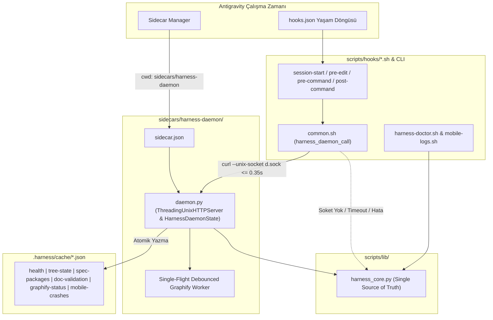
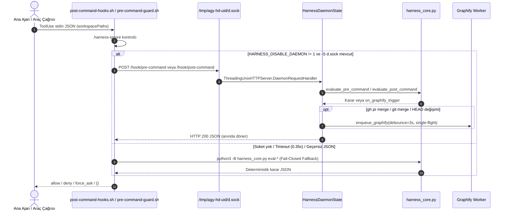

# Pull Request Mühendislik Rehberi: Arka Plan Daemon Sidecar (`harness-daemon`, `v1.1.0`)

---

## 1. Problem Bağlamı ve Mimari Kararlar

### Çözülen Gerçek Problem ve Kök Bağlam
`alps-agy-harness` eklentisinin önceki `v1.0.0` sürümünde tüm yaşam döngüsü kontrolleri araç çağrısı anında senkron ve soğuk süreç başlatarak çalışıyordu:
1. `scripts/hooks/post-command-hooks.sh` içinde `gh pr merge` veya `main` üzerinde `git merge`/`git pull` çalıştırıldığında `graphify --update --no-viz` kanca içinde senkron koşuyor, `30` saniyelik hook timeout riski yaratıyor ve çalışma dallarındaki ara commit'lerde bilgi grafiği bayat kalıyordu.
2. `scripts/harness-doctor.sh` tüm CLI, MCP, eklenti ve mobil kontrollerini yaptığı için `scripts/hooks/session-start.sh` açılışında çalıştırılamıyor, oturum başında yalnız `gh`/`jq` kontrolü yapılabiliyordu.
3. Her `run_command` çağrısında `common.sh` ve `pre-command-guard.sh` ayrı soğuk `python3` süreçleri başlatıyor; `codeTreeSha` damga bayatlaması ve eksik walkthrough hataları ancak `gh pr create` kapısında fark ediliyordu.
4. iOS Simulator `.ips`/`.crash` raporları yalnızca `scripts/mobile-logs.sh` elle çağrıldığında analiz ediliyordu.

### Seçilen Mimari Yaklaşım ve Gerekçesi
- **Etkilenen Bileşenler ve Katmanlar:** `sidecars/harness-daemon/` (Antigravity Sidecar süreci ve HTTP/Unix-Socket sunucusu), `scripts/lib/harness_core.py` (paylaşımlı deterministik çekirdek — *Single Source of Truth*), `scripts/hooks/*.sh` (istemci kancaları ve fail-closed fallback), `scripts/harness-doctor.sh` & `scripts/mobile-logs.sh` (teşhis araçları) ve `tests/` (regresyon ve yeni sidecar testleri).
- **Yaklaşım Özeti:** Harici `pip`/`npm` bağımlılığı olmayan Python 3 (`stdlib`) arka plan daemon'ı (`daemon.py`), hem kendisinin hem de yerel fallback kancalarının doğrudan paylaştığı `scripts/lib/harness_core.py` çekirdeğini kullanır. Kancalar tek `curl --unix-socket` çağrısıyla (~`30 ms`) `/tmp/agy-hd-<uid>/d.sock` üzerinden sıcak yanıt alır; daemon kapalı, zaman aşımında veya hatalı yanıt verdiğinde tüm kancalar sessizce yerel `harness_core.py` fallback yoluna düşerek asla fail-open bırakmaz.

### Değerlendirilen Alternatifler ve Ödünleşimler (Trade-offs)

| Yaklaşım / Seçenek | Avantajlar | Dezavantajlar / Riskler | Karar |
| :--- | :--- | :--- | :--- |
| **Seçenek 1 (Uygulanan): Python 3 (`stdlib`) Daemon + Ortak `harness_core.py` + Unix Socket + `.harness/cache/`** | Tek doğruluk kaynağı ile sıfır mantık sapması; sıfır dış paket; `curl --unix-socket` ile soğuk `python3` başlatma yükünün kalkması; fail-closed fallback garantisi. | Harici FSEvents paketi olmadığı için arka plan izleme `1.5s` hedefli `mtime` yoklaması ve push-on-hook geçersizleştirmesiyle yapılır. | **Seçildi** |
| **Seçenek 2: Node.js (`>= 20`) Daemon + Native `fs.watch`** | Milisaniyelik native FSEvents dosya olayı izleme ve yerleşik `swarm_board` ile aynı runtime. | Mevcut 5 Python ayrıştırıcısının JS'de baştan yazılmasını ve sürekli çift dilde eşitlik bakımını gerektirir. | Elendi |
| **Seçenek 3: Soketsiz Yalnızca Dosya Önbelleği Daemon'ı** | En yalın süreç modeli (HTTP/soket gerektirmez). | Her terminal komutundaki soğuk `python3` başlatma gecikmesini ortadan kaldırmaz. | Elendi |

---

## 2. Mimari ve Veri Akışı Diyagramları

### Bileşen Bağımlılık ve İletişim Haritası

### Sıcak Kanca Değerlendirmesi ve Asenkron `graphify` Akışı

---

## 3. Dosya Bazlı Değişiklik Analizi

`git diff --name-status origin/main..HEAD` çıktısındaki (`docs/walkthroughs/*` ve `docs/parking-lot.md` hariç) **19 dosyanın tamamı** aşağıda detaylandırılmıştır:

### `.gitignore` — [GÜNCELLENDİ] (`Kök Konfigürasyon`)
- **Ne Değişti / Ne Üretildi?:** Mevcut `.harness/`, `.worktrees/`, `.superpowers/`, `*.tmp` ve `.DS_Store` satırları korunarak dosya sonuna `__pycache__/` ve `*.pyc` desenleri eklendi.
- **Neden Değişti / Neden Üretildi?:** `scripts/lib/harness_core.py` ve `daemon.py` modülleri içe aktarıldığında oluşabilecek Python bytecode önbelleklerinin `git status` ve eklenti dosya sayısı sayacını kirletmesini önlemek için eklendi.

### `README.md` — [GÜNCELLENDİ] (`Dokümantasyon`)
- **Ne Değişti / Ne Üretildi?:** Harness mimarisi maddelerine `v1.1.0` arka plan daemon sidecar'ı (`sidecars/harness-daemon/`, `HARNESS_DISABLE_DAEMON=1`) eklendi; Bileşenler Özeti tablosuna `sidecars/harness-daemon/` ve `scripts/lib/harness_core.py` satırları işlendi ve `## Teknik Terimler Sözlüğü` tablosuna `Sidecar (harness-daemon)` tanımı eklendi.
- **Neden Değişti / Neden Üretildi?:** Geliştiricilerin ve ekip üyelerinin arka plan sidecar mekanizmasını, kapatma bayrağını (`HARNESS_DISABLE_DAEMON=1`) ve yeni modül sorumluluklarını kurulum rehberinde doğrudan görebilmesi için güncellendi.

### `docs/superpowers/plans/2026-11-19-harness-daemon-sidecar.md` — [ÜRETİLDİ] (`Yaşam Döngüsü Planı`)
- **Ne Değişti / Ne Üretildi?:** Dosya sayısı bütçesi (`4` yeni çekirdek + `13` güncellenen dosya + `3` yaşam döngüsü dokümanı), açık `allowedFiles` kapsam listesi, `Global Constraints`, sıralı uygulama/doğrulama adımları ve son sözlük tablosunu içeren Türkçe uygulama planı oluşturuldu.
- **Neden Değişti / Neden Üretildi?:** `harness-orchestrator` ve `superpowers:writing-plans` sözleşmesi gereği uygulama sırasında kapsam kaymasını (*scope creep*) önlemek ve `canon-auditor` için deterministik `allowedFiles` sınırını tanımlamak amacıyla üretildi.

### `docs/superpowers/specs/2026-11-19-harness-daemon-sidecar-design.md` — [ÜRETİLDİ] (`Tasarım Dokümanı`)
- **Ne Değişti / Ne Üretildi?:** Mevcut kanca darboğazları, ADR-01 (Python 3 stdlib + ortak çekirdek), ADR-02 (commit/merge/pull ile debounced `graphify`), ADR-03 (macOS 104-bayt uyumlu güvenli soket yolu `/tmp/agy-hd-<uid>/d.sock`), HTTP-over-Unix-Socket API sözleşmesi, 6 `.harness/cache/*.json` şeması, disk önbelleği zehirlenmesine karşı güven sınırları ve 12 senaryoyu kapsayan doğrulama planı tanımlandı.
- **Neden Değişti / Neden Üretildi?:** Mimari kararların, builder-check doğrulaması sonrası alınan `[Builder Call]` iyileştirmelerinin (`fcntl.flock` pasif standby, IPC ikili izolasyonu, iOS bundle ID eşleştirmesi) ve güvenlik değişmezlerinin kalıcı kanıtı olarak oluşturuldu.

### `plugin.json` — [GÜNCELLENDİ] (`Eklenti Manifestosu`)
- **Ne Değişti / Ne Üretildi?:** `"version"` alanı `"1.0.0"` değerinden `"1.1.0"` değerine yükseltildi ve `"description"` metni `"background daemon sidecar"` ifadesini içerecek şekilde güncellendi; izin verilen üst düzey anahtar kümesi korundu.
- **Neden Değişti / Neden Üretildi?:** Kullanıcının sürümü `1.1` (`1.1.0` SemVer) seviyesine çıkarma talebi ve `tests/test-manifest.sh` katı manifesto anahtar doğrulaması gereği güncellendi.

### `scripts/harness-doctor.sh` — [GÜNCELLENDİ] (`Ortam Teşhis CLI`)
- **Ne Değişti / Neden Üretildi?:** Betik içindeki gömülü 500 satırlık Python bloğu kaldırılarak CLI argüman çözümlemesinden sonra doğrudan `python3 -B "$SCRIPT_DIR/lib/harness_core.py" doctor --workspace "$workspace" [--json]` çağrısına bağlandı.
- **Neden Değişti / Neden Üretildi?:** Hem terminal CLI hem de daemon'ın 300 saniyelik `health.json` yenileme döngüsünün birebir aynı kontrol mantığını ve sıfır-sızıntılı `TYPESAFE_API_KEY` kurallarını kullanmasını (*Single Source of Truth*) sağlamak için güncellendi.

### `scripts/hooks/common.sh` — [GÜNCELLENDİ] (`Paylaşımlı Kanca Kütüphanesi`)
- **Ne Değişti / Ne Üretildi?:** `harness_core_python()`, `harness_daemon_socket_path()`, `harness_is_safe_daemon_socket()` (istemci tarafında soket üst dizini için GNU `stat -c '%a'` ardından BSD `stat -f '%Lp'` ile `0700` / UID / non-symlink ve soket dosyası için non-symlink / `-S` / UID kontrolü) ve `harness_daemon_call()` IPC yardımcıları eklendi; `harness_validate_walkthrough()` ile `harness_parse_command_segments()` fonksiyonları `python3 -B "$(harness_core_python)"` alt komutlarına delege edildi.
- **Neden Değişti / Neden Üretildi?:** Tüm kancaların paylaşımlı `/tmp` ortamında ve Linux/macOS uyumlu ortamda soket ele geçirme saldırılarına kapalı tek fail-closed IPC çağrı mekanizmasını kullanmasını ve ayrıştırma kodunun tek merkezde toplanmasını sağlamak için güncellendi.

### `scripts/hooks/post-command-hooks.sh` — [GÜNCELLENDİ] (`PostToolUse Kancası`)
- **Ne Değişti / Ne Üretildi?:** Betik başlığı `gh pr create` sonrası `pr-audit-pending.json` işaretlemesini ve asenkron `graphify` kuyruklamasını belgeleyecek biçimde güncellendi; çalışma alanı yoksayılmamışsa ve `HARNESS_GRAPHIFY_BIN` override'ı verilmemişse `/hook/post-command` çağrısıyla anında `{}` döner, aksi hâlde `harness_core.py eval-post-command` senkron yoluna düşer.
- **Neden Değişti / Neden Üretildi?:** `gh pr merge` ve `git merge`/`pull` sonrası 30 saniyeye varabilen senkron `graphify` beklemesini ortadan kaldırırken doğrudan `HARNESS_GRAPHIFY_BIN` mock'u kullanan mevcut birim testleriyle tam uyumluluğu korumak için güncellendi.

### `scripts/hooks/pre-command-guard.sh` — [GÜNCELLENDİ] (`PreToolUse Komut Kapısı`)
- **Ne Değişti / Ne Üretildi?:** 450 satırlık gömülü bash/python denetim kodu yerine `harness_daemon_call "/hook/pre-command"` sıcak yolu ve yanıt `.decision` şema doğrulaması eklendi; başarısızlık veya timeout durumunda `harness_core.py eval-pre-command` üzerinden fail-closed yerel değerlendirme yapılır.
- **Neden Değişti / Neden Üretildi?:** Her terminal komutunda yaşanan çoklu soğuk `python3` başlatmalarını tek soket çağrısına indirgemek ve ön-indekslenmiş `spec-packages.json` / `doc-validation.json` önbelleklerini kullanmak için güncellendi.

### `scripts/hooks/pre-edit-guard.sh` — [GÜNCELLENDİ] (`PreToolUse Dosya Kapısı`)
- **Ne Değişti / Ne Üretildi?:** `write_file`/`edit_file` kuralları için `/hook/pre-edit` sıcak soket çağrısı ve `.decision` doğrulaması eklendi; erişilemeyen/hatalı soket durumunda `harness_core.py eval-pre-edit` yedeğine düşer.
- **Neden Değişti / Neden Üretildi?:** `main` kilidi, doküman sözlük kapısı ve tehlikeli kod desenlerini daemon ile fallback arasında birebir aynı Python motorundan (`_resolve_rel_path` macOS çift `/` ve `..` traversal korumalı) geçirmek için güncellendi.

### `scripts/hooks/session-start.sh` — [GÜNCELLENDİ] (`SessionStart Kancası`)
- **Ne Değişti / Ne Üretildi?:** İstemci `HARNESS_CHECK_BINS` ikililerini ve whitespace karakterlerinden arındırılmış (`trimmed_key`) yalnız boolean `envKeyPresent` ipucunu hazırlayıp `/hook/session-start` uç noktasına iletir; geçerli `injectSteps` yanıtı alınamazsa `harness_core.py eval-session-start` üzerinden `.harness/cache/*.json` önbelleklerini okuyarak oturum bağlamını oluşturur (opsiyonel `HARNESS_AUTO_START_DAEMON=1` destekli).
- **Neden Değişti / Neden Üretildi?:** Oturum başında boşluk karakterli sahte ortam anahtarı yanlış-pozitiflerini önleyerek doktor hataları, bayat `codeTreeSha` damgaları, arka plan `graphify` durumu ve taze iOS `.ips` crash özetlerinin sıfır gecikmeyle modele sunulması için güncellendi.

### `scripts/lib/harness_core.py` — [ÜRETİLDİ] (`Paylaşımlı Çekirdek Kütüphane`)
- **Ne Değişti / Ne Üretildi?:** `sys.dont_write_bytecode = True` ayarlı sıfır bağımlılıklı modül oluşturuldu; `is_safe_socket_path()`, `probe_daemon_health()`, `parse_command_segments()`, `extract_install_packages()`, `build_spec_package_index()`, `has_glossary_section()`, `validate_walkthrough()`, `build_doc_validation_cache()`, `compute_code_tree_sha()`, `compute_tree_and_stamp_state()`, `verify_pr_stamps()` (disk önbelleğine güvenmeyip daima canlı Git ağacı hesaplayan), `evaluate_pre_edit()`, `evaluate_pre_command()`, `evaluate_post_command()`, `build_session_start_payload()`, `extract_ios_bundle_identifiers()`, `parse_ios_crash_report()`, `run_doctor_checks()` (`_safe_cmd_run` 10s, `_run_git` 15s ve `run_sync_graphify` 120s zaman aşımı korumalı) ve 8 CLI alt komutu (`parse-segments`, `validate-walkthrough`, `eval-pre-command`, `eval-pre-edit`, `eval-post-command`, `eval-session-start`, `doctor`, `parse-ios-crash`) uygulandı.
- **Neden Değişti / Neden Üretildi?:** `daemon.py` ile tüm kabuk kancaları arasında tek doğruluk kaynağı kurmak, soğuk fallback (`eval-pre-command`) ve PR kapısında `.harness/cache/*.json` disk önbelleği zehirlenmesini sıfırlamak, askıda alt süreç riskini sınırlamak ve macOS `TMPDIR` çift `/` + `..` traversal + istemci soket güvenliği açıklarını tek merkezde çözmek amacıyla üretildi.

### `scripts/mobile-logs.sh` — [GÜNCELLENDİ] (`Mobil Teşhis Betiği`)
- **Ne Değişti / Ne Üretildi?:** iOS `.ips`/`.crash` dosyalarını okuyan 116 satırlık satır içi Python bloğu kaldırılarak `python3 -B "$SCRIPT_DIR/lib/harness_core.py" parse-ios-crash --diag-dir "$diag_dir" --bundle-id "$bundle_id"` çağrısına bağlandı; tüm CLI bayrakları ve Android akışı korundu.
- **Neden Değişti / Neden Üretildi?:** iOS crash özetleme biçiminin elle çalıştırılan `mobile-logs.sh` çıktısı ile daemon'ın arka plan `mobile-crashes.json` izleyicisi arasında birebir uyumlu kalması için güncellendi.

### `sidecars/harness-daemon/daemon.py` — [ÜRETİLDİ] (`Sidecar Daemon Süreci`)
- **Ne Değişti / Ne Üretildi?:** `PLUGIN_ROOT` yolunu `cwd` bağımsız çözen, başlangıçta `TYPESAFE_API_KEY` anahtarını yalnızca `bool` olarak yakalayıp `os.environ` içinden temizleyen (`envKeyPresent` açık `false` değeriyle geçersiz kılınabilir), GUI `launchd` için tek seferlik login shell `PATH` zenginleştirmesi yapan, kilit (`fcntl.flock`) alımından önce ve hemen sonra `/tmp/agy-hd-<uid>/d.sock` (`0700`/`0600` UID + non-symlink; kilit sonrası soket hâlâ canlıysa temiz çıkış yapan) doğrulaması yapan `5.0s` soket zaman aşımlı `ThreadingUnixHTTPServer`, TTL evict eden çoklu çalışma alanı kaydı (`workspaces.json`), bağlı git worktree (`_resolve_git_dirs` ile `gitdir:`/`commondir`) izleyen hedefli `1.5s` watcher, yalnız RAM üzerinden tohumlanan önbellekler (`get_caches(..., allow_disk_hydration=False)` ile `/hook/pre-command` yolunda disk önbelleği zehirlenmesine kapalı), single-flight debounced `graphify` worker ve temiz `SIGTERM` kapanışı içeren daemon yazıldı.
- **Neden Değişti / Neden Üretildi?:** Antigravity Sidecar Manager tarafından yönetilen sürekli arka plan servisi olarak Spec'teki tüm ön-hesaplama, bağlı worktree izleme, asenkron kuyruk, TOCTOU ile disk zehirlenmesine kapalı güvenlik sınırları ve sıfır-gecikme hedeflerini gerçekleştirmek üzere üretildi.

### `sidecars/harness-daemon/sidecar.json` — [ÜRETİLDİ] (`Sidecar Manifestosu`)
- **Ne Değişti / Ne Üretildi?:** `"display_name": "Alps Harness Daemon"`, `"command": "python3"`, `"args": ["daemon.py"]`, `"restart_policy": "always"` alanlarını `snake_case` şemada tanımlayan ve `has_web_ui` içermeyen başsız sidecar manifestosu oluşturuldu.
- **Neden Değişti / Neden Üretildi?:** Antigravity'nin eklenti keşif mekanizmasının `alps-agy-harness` yüklendiğinde arka plan daemon sürecini otomatik tanıyıp yaşam döngüsünü yönetebilmesi için üretildi.

### `skills/harness-doctor/SKILL.md` — [GÜNCELLENDİ] (`Teşhis Skill'i`)
- **Ne Değişti / Ne Üretildi?:** `6. Aktif Çalışma Alanı ve Sidecar Sağlığı` başlığı altına `harness_daemon` (`sidecar.json` bütünlüğü ve canlı Unix socket `/health` durumu: `[OK]` / `[INFO]`) açıklaması eklendi.
- **Neden Değişti / Neden Üretildi?:** `harness-doctor` skill yönergesinin güncellenmiş teşhis çıktılarını ve daemon durum anlamlarını doğru yansıtması için güncellendi.

### `tests/test-manifest.sh` — [GÜNCELLENDİ] (`Manifesto Test Paketi`)
- **Ne Değişti / Ne Üretildi?:** `test_plugin_json_required_fields` içindeki `.version` beklentisi `"1.0.0"` değerinden `"1.1.0"` değerine güncellendi; izin verilen anahtar listesi testi değiştirilmedi.
- **Neden Değişti / Neden Üretildi?:** `plugin.json` sürümünün `1.1.0` olarak artırılmasıyla manifesto test sözleşmesinin senkronize edilmesi için güncellendi.

### `tests/test-plugin-bundle.sh` — [GÜNCELLENDİ] (`Paket Bütünlüğü Testi`)
- **Ne Değişti / Ne Üretildi?:** `test_all_eleven_skills_frontmatter_and_folder_match` içindeki izlenen çekirdek dosya sayısı doğrulaması `49` değerinden `53` değerine (`scripts/lib/harness_core.py`, `sidecars/harness-daemon/sidecar.json`, `sidecars/harness-daemon/daemon.py`, `tests/test-sidecar-daemon.sh` dahil) güncellendi.
- **Neden Değişti / Neden Üretildi?:** Eklenti paketine eklenen 4 yeni çekirdek dosyanın paket bütünlüğü kapısında izlenmesini sağlamak ve yetim dosya kaymasını engellemek için güncellendi.

### `tests/test-sidecar-daemon.sh` — [ÜRETİLDİ] (`Sidecar Daemon Test Paketi`)
- **Ne Değişti / Ne Üretildi?:** Manifest şeması, `0700`/`0600` izinler ve `flock` pasif standby + stale soket kurtarma + `SIGTERM`, daemon açık/kapalı kanca paritesi, asılı/bozuk sokette fail-closed fallback, `0755` soket dizini ve symlink soket istemci reddi (`test_client_refuses_unsafe_socket_dir_and_symlink`), `< 500ms` asenkron `graphify` ve coalescing, aynı-`headOid` sahte `tree-state.json` zehirlenmesinin hem daemon hem `HARNESS_DISABLE_DAEMON=1` altında reddi + geçerli damgalarla `gh pr create` `allow` yolu, spec/doc önbellek yenilemesi, `.harness-ignore` + TTL eviction, koşullu iOS `.ips` vs Android/plain atlaması, sıfır-gizli-anahtar sızıntısı ve `git worktree add` bağlı çalışma alanı izleme (`test_linked_git_worktree_tracking`) kontrollerini içeren 12 otonom test senaryosu yazıldı.
- **Neden Değişti / Neden Üretildi?:** `harness-daemon` yaşam döngüsü, istemci/sunucu soket güvenlik sınırları, disk önbelleği güven sınırı, bağlı worktree takibi, gecikme kazanımı ve yedek yol garantilerini CI/yerel test koşularında deterministik olarak kanıtlamak için üretildi.

---

## 4. Kritik İş Mantığı, Kenar Durumlar (Edge Cases) ve Hata Yönetimi

| Senaryo / Kenar Durum | Sistemin Davranışı ve Korunan Kural (Invariant) | Üretilen Hata / Yanıt Sözleşmesi |
| :--- | :--- | :--- |
| **Soket Yok / Timeout (`0.35s`) / Bozuk JSON** | `common.sh` içindeki `harness_daemon_call` sıfırdan farklı kodla çıkar; `pre-edit-guard.sh` ve `pre-command-guard.sh` **asla** fail-open olmaz, yerel `harness_core.py` Motoruna düşer. | Deterministik `allow` / `deny` / `force_ask` kararı |
| **macOS 104-Bayt `sun_path` & İstemci/Sunucu Soket Güvenliği** | Soket `/tmp/agy-hd-<uid>/d.sock` (~27 bayt) altında açılır; hem sunucu (`daemon.py`) kilit öncesi/sonrası hem de istemciler (`harness_is_safe_daemon_socket`, `is_safe_socket_path`) dizin sahipliğini, `not islink`, `0700` modunu ve soket sahipliğini doğrular. | İhlalde daemon başlangıcı reddeder; istemci bağlantıyı reddedip fail-closed fallback'e düşer |
| **`restart_policy: "always"` Yeniden Başlatma Döngüsü** | İkinci daemon `daemon.lock` (`fcntl.flock`) alamayıp canlı `/health` gördüğünde `exit 0` vermek yerine `5s` aralıklı pasif standby'da bekler. | Sonsuz süreç doğumu önlenir; otomatik devralma korunur |
| **`TYPESAFE_API_KEY` 300s Doktor Yenilemesi** | Başlangıçta yalnızca boolean varlık yakalanıp `os.environ`'dan silinir; `/hook/session-start` yalnızca `envKeyPresent: bool` geçebilir. | `health.json`, `daemon.log` ve stdout'ta sıfır sır |
| **Bayat `tree-state.json` & Sahte Önbellek** | `verify_pr_stamps` ve zorlayıcı `/hook/pre-command` ile soğuk `eval-pre-command` yolları diskteki `.harness/cache/tree-state.json` verisine **asla** güvenmez; her PR kontrolünde canlı `compute_code_tree_sha` çalıştırır. | Eski/sahte damgalı PR `deny` alır |
| **macOS `TMPDIR` Çift `/` & `..` Traversal** | `_resolve_rel_path`, `os.path.normpath` + `os.path.realpath` ile çift `/` ve `/var` -> `/private/var` symlinklerini çözer; `..` kaçışlarını harici/izole sayar. | `main` dalındaki yazımlar doğru yakalanıp `deny` edilir |

---

## 5. Somut Doğrulama Kanıtları

### Test Senaryoları ve Kanıtlanan Davranışlar

| Test Paketi | Test Sayısı ve Kapsamı | Sonuç |
| :--- | :--- | :--- |
| `tests/test-command-hooks.sh` | 7/7: Mobil log akışı, tırnak içi komutlar, context7 paket kapısı, PR-only main, 5 maddeli PR kapısı, derin walkthrough, post-command `pr-audit-pending` + `graphify` | `PASS` |
| `tests/test-edit-and-session-hooks.sh` | 5/5: `main` dalı kilidi (macOS `TMPDIR` dahil), sözlük kapısı, tehlikeli kod desenleri, harici/bypass yolları, `session-start` enjeksiyonu | `PASS` |
| `tests/test-manifest.sh` | 9/9: `plugin.json` `1.1.0` sürümü ve katı üst düzey anahtarlar, `hooks.json` matcher/timeout kontratları, logo, `.gitignore`, `test-helpers` | `PASS` |
| `tests/test-plugin-bundle.sh` | 3/3: 11 skill frontmatter/boyut sınırı, **53 çekirdek dosya sayısı**, şablon/`README` sözlükleri ve uçtan uca yaşam döngüsü | `PASS` |
| `tests/test-rules-and-agents.sh` | 3/3: `AGENTS.md` `< 8 KB`, platform kuralları `< 24 KB`, denetçi alt ajan frontmatter kuralları | `PASS` |
| `tests/test-sidecar-daemon.sh` | 12/12: Sidecar manifest, izinler & standby, parite, timeout/bozuk sokette fail-closed fallback, `0755`/symlink soket istemci reddi, `< 500ms` async `graphify`, aynı-`headOid` sahte önbellek reddi ve PR `allow`, spec/doc önbelleği, TTL eviction, koşullu iOS crash watcher, sıfır sır ve bağlı git worktree izleme | `PASS` |
| `tests/test-stamp-and-common.sh` | 12/12: Dal slug'ları, `codeTreeSha`, güvenlik/canon damgaları, Gemini 4 & `Orchestrator` yönlendirmesi, sözlük & JSON yayıcıları | `PASS` |
| `tests/test-subagent-and-stop-hooks.sh` | 8/8: Alt ajan yönlendirme, `canon-auditor` taban yükseltme, çok satırlı prompt `overwrite`, async `stop-gate` | `PASS` |
| `tests/test-utilities.sh` | 8/8: `run-quiet.sh`, `mobile-logs.sh` (iOS & Android), `harness-doctor.sh` sıfır gizli anahtar ve frontmatter kontrolleri | `PASS` |

### Çalıştırılan Komutlar ve Çıktı Özetleri
- **Tam Test Koşusu:**
  - Komut: `./scripts/run-quiet.sh test-suite -- bash tests/run-all.sh`
  - Çıktı Özeti: `✅ PASS [test-suite] (süre: 75.9s, warnings: 0 — log: .harness/logs/last.log)` (`Overall Result: 9 passed, 0 failed, 9 total` — toplam `67` test geçti, `0` hata).
- **Ortam Sağlığı (`harness-doctor.sh`):**
  - Komut: `./scripts/harness-doctor.sh --workspace . --json | jq '{healthy, daemon: (.checks[] | select(.name=="harness_daemon"))}'`
  - Çıktı Özeti: `"healthy": true`, `harness_daemon`: `status: "INFO"` (`harness-daemon manifest valid (not running; cold fallback active)`).
- **Çekirdek Paket Sayacı:**
  - Komut: `git ls-files -c -o --exclude-standard | grep -Ev "^docs/(superpowers|walkthroughs|canon)/|^docs/parking-lot\.md$" | wc -l`
  - Çıktı: `53` (`__pycache__` sayısı: `0`).

---

## 6. Kapsam Dışı (`docs/parking-lot.md`) ve Operasyonel Notlar

- **Kapsam Dışı Bırakılanlar:** Aux Pane görsel arayüz sidecar'ı (`has_web_ui: true`) ve zamanlanmış `"builtin": "schedule"` `entropy-sweep` sidecar'ı ayrı bir PR olarak bırakılmıştır (`docs/parking-lot.md` üzerinde yeni borç oluşturulmadı).
- **Operasyonel ve Dağıtım Notları:** Antigravity IDE dışı `agy` CLI oturumlarında sıcak daemon isteyen geliştiriciler `HARNESS_AUTO_START_DAEMON=1` ile otomatik başlatma seçebilir veya `python3 sidecars/harness-daemon/daemon.py` ile manuel çalıştırabilir; geçici devre dışı bırakma için `HARNESS_DISABLE_DAEMON=1` kullanılır.

---

## Teknik Terimler Sözlüğü

| Terim | Açıklama |
| :--- | :--- |
| **AF_UNIX (`sun_path` 104-Bayt Limiti)** | macOS çekirdeğinde Unix domain socket dosya yolu uzunluğunu 104 baytla sınırlayan POSIX soket adresi kısıtı. |
| **Atomik Yazma (*Atomic Write*)** | JSON verisinin önce geçici gizli dosyaya yazılıp `os.replace` ile hedef üzerine taşınarak yarım okuma riskinin sıfırlanması. |
| **`codeTreeSha`** | `docs/walkthroughs/*` ve `docs/parking-lot.md` hariç tutularak hesaplanan deterministik Git ağaç özeti. |
| **Fail-Closed Fallback** | Daemon yanıt vermediğinde veya bozuk JSON döndürdüğünde işlemin izinsiz geçmeyip yerel deterministik kancaya devredilmesi garantisi. |
| **Passif Standby (`fcntl.flock`)** | `restart_policy: "always"` altında ikinci daemon örneğinin çıkış `0` ile döngüye girmek yerine danışma kilidi bekleyerek uyku modunda kalması. |
| **Sidecar (`harness-daemon`)** | Antigravity Sidecar Manager tarafından yönetilen, ana ajan bağlamından bağımsız çalışan arka plan önbellekleme ve sıcak kanca servisi. |
| **Single-Flight & Debounce** | Ardışık `graphify` tetiklemelerini 3 saniyelik pencerede birleştirip çalışma alanı başına aynı anda en fazla bir süreç çalıştırma deseni. |
| **Single Source of Truth** | Tüm kural ve ayrıştırma mantığının yalnız `scripts/lib/harness_core.py` içinde tutulup daemon ile yedek kancalar arasında sapmanın önlenmesi. |
| **TTL Eviction** | Kullanılmayan çalışma alanlarının belirlenen süre (`1800` sn) dolduğunda arka plan izleme kaydından otomatik çıkarılması. |
