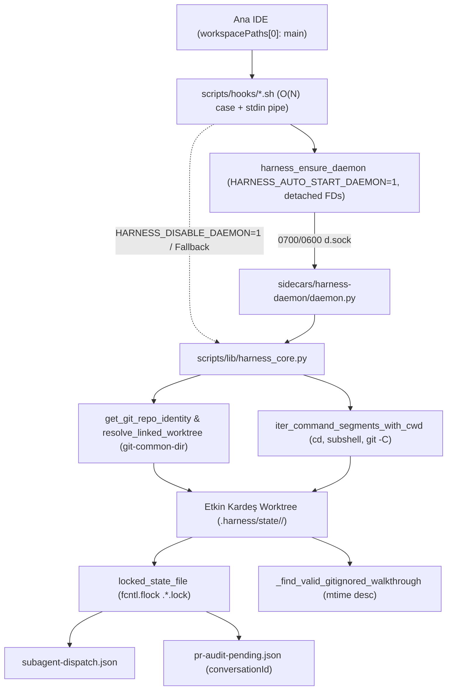
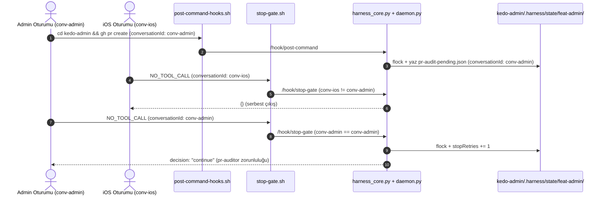

# Pull Request Mühendislik Rehberi: Paralel Git Worktree Çözümlemesi, Bash 3.2 UTF-8 Performansı, Otomatik Daemon Başlatma ve `.gitignore` Walkthrough Desteği (`v1.1.0`)

---

## 1. Problem Bağlamı ve Mimari Kararlar

### Çözülen Gerçek Problem ve Kök Bağlam
`kedo` projesinde ana IDE çalışma alanı `main` üzerinde açıkken 4 kardeş git worktree (`kedo-backend`, `kedo-admin`, `kedo-mobile-ios`, `kedo-mobile-android`) üzerinde paralel SDD oturumları yürütüldüğünde `alps-agy-harness` (`v1.1.0`) tarafında 5 somut üretim darboğazı ve hatası tespit edildi:

1. **macOS `/bin/bash` 3.2 UTF-8 `O(N^3)` Zaman Aşımı (`signal: killed`):** `scripts/hooks/common.sh` içindeki `harness_read_stdin()` ve `harness_classify_parent_model()` (ayrıca `session-start.sh` / `pre-subagent-guard.sh`) içindeki `${...//[[:space:]]/}` parametre genişletmeleri macOS `/bin/bash` 3.2 UTF-8 yerel ayarında `>= 5 KB` çok baytlı/boşluklu `write_file` ve `invoke_subagent` JSON yüklerinde `O(N^3)` karmaşıklığa girerek `15` saniyelik hook zaman aşımını aşıp `SIGKILL` alıyordu.
2. **Workspace Eklentilerinde `harness-daemon` Başlatılmaması:** Proje `.agents/plugins/alps-agy-harness` altında kurulduğunda Antigravity yerleşik sidecar yöneticisi yalnızca global dizinleri taradığı için `daemon.py` hiç başlamıyor; `session-start.sh` yedek başlatıcısı da `HARNESS_AUTO_START_DAEMON:-0` olduğu için devreye girmeyip tüm paralel oturumlar soğuk Python fallback'ine düşüyordu.
3. **Paralel Git Worktree ve Çapraz Dizin (`cd` / `git -C` / Harici `Path`) Körlüğü:** Kancalar yalnızca `HOOK_INPUT.workspacePaths[0]` (`main` kökünü) baz aldığından:
   - `evaluate_pre_edit` kardeş worktree dosyalarını `is_external=True` sayıp dal kilidi, sözlük ve güvenlik taramasını atlıyordu.
   - `evaluate_pre_command` ve `evaluate_post_command` `cd <worktree> && gh pr create` ya da `git -C <worktree> push` komutlarında `main` dalını kontrol edip PR açılışını blokluyor veya damga/`pr-audit-pending.json` dosyalarını yanlış dizinde arıyordu.
   - `pre-subagent-guard.sh` ve `stamp-gate.sh` kardeş worktree'deki `subagent-dispatch.json` kaydını göremiyor, aynı dosya üzerindeki paralel yazım/tüketimlerde yarış koşulu (race condition) oluşuyordu.
   - `stop-gate.sh` `conversationId` ayrımı yapmadığı için bir oturumda açılan PR yüzünden paralel çalışan diğer 3 oturumu durmaya zorluyordu.
4. **`.gitignore` Kapsamındaki Yerel Walkthrough (`LSN-004`):** `docs/walkthroughs/*` bilerek `.gitignore` altında olan projelerde walkthrough dosyaları `git diff` içinde görünmediği için `gh pr create` ve yerel `git merge` kapıları kalıcı olarak bloklanıyordu.
5. **Test İzolasyonu & CWD Bağımsızlığı:** `test-sidecar-daemon.sh` göreceli `scripts/lib` yolu içeriyor ve test yardımcıları otomatik daemon başlatmayı varsayılan olarak kapatmıyordu.

### Seçilen Mimari Yaklaşım ve Gerekçesi
- **Tek Doğruluk Kaynağı (`scripts/lib/harness_core.py`):** Yalnız `pre-edit`/`pre-command`/`post-command`/`session-start` değil, `pre-subagent-guard.sh`, `stop-gate.sh` ve `stamp-gate.sh` durum mutasyonları da ortak Python çekirdeğine taşındı. Böylece hem sıcak daemon (`/hook/pre-subagent`, `/hook/stop-gate`, `/hook/*`) hem soğuk fallback hem de CLI (`dispatch-register`, `context7-register`, `clear-pr-audit`) `fcntl.flock` kilidi ve paylaşılan worktree çözümleme kurallarıyla birebir aynı davranışı sergiler.
- **Sıfır `ARG_MAX` & Doğrusal POSIX Kabuk Borusu:** Kabuk kancalarından tüm `${...//[[:space:]]/}` ifadeleri kaldırılıp doğrusal `O(N)` `case` / `tr` yapısına geçirildi; büyük JSON yükleri `--argjson` veya komut satırı argümanı yerine `stdin` borulamasıyla (`jq`, `curl --data-binary @-`, `harness_core.py`) taşındı.

---

## 2. Mimari ve Veri Akışı Diyagramları

### Paralel Git Worktree Çözümleme ve `fcntl.flock` Durum Mimarisi

### Çoklu Oturum `pr-audit-pending.json` ve `stop-gate` İzolasyon Akışı

---

## 3. Dosya Bazlı Değişiklik Analizi

`git diff --name-status origin/main..HEAD` çıktısındaki (`docs/walkthroughs/*` ve `docs/parking-lot.md` hariç) **19 dosyanın tamamı** aşağıda incelenmiştir:

### `README.md` — [GÜNCELLENDİ] (`Dokümantasyon`)
- **Ne Değişti / Ne Üretildi?:** Bölüm 1'e paralel git worktree (`cd`/`git -C`/`Path`) çözümlemesi, `fcntl.flock` kilidi, `conversationId` izolasyonu ve `.gitignore` kapsamındaki yerel walkthrough desteği eklendi; Bölüm 2 Seçenek B altına `.agents/plugins/` kurulumlarında `HARNESS_AUTO_START_DAEMON=1` ile otomatik ayrık daemon başlatma notu konuldu; Bölüm 8 bileşen tablosu yeni kanca ve sidecar davranışlarıyla güncellendi.
- **Neden Değişti / Neden Üretildi?:** Kullanıcı ve ekiplerin proje bazlı eklenti kurulumlarında sidecar'ın otomatik başladığını, paralel worktree'lerde izole çalıştığını ve son `## Teknik Terimler Sözlüğü` kuralının korunduğunu doğrudan görebilmesi için güncellendi.

### `scripts/hooks/common.sh` — [GÜNCELLENDİ] (`Paylaşımlı Kanca Kütüphanesi`)
- **Ne Değişti / Ne Üretildi?:** `harness_read_stdin()` ve `harness_classify_parent_model()` içindeki `${...//[[:space:]]/}` ifadeleri `O(N)` POSIX `case` kontrolüne çevrildi; `emit_overwrite()` büyük prompt'lar için `--argjson` yerine `stdin` borulamasına alındı; `HARNESS_AUTO_START_DAEMON:-1` varsayılanlı `harness_ensure_daemon()` (güvenli dizin/non-symlink kontrolü, `</dev/null >/dev/null 2>&1 &` ayrık başlatma ve ~`200 ms` `/health` yoklaması) eklendi; `harness_daemon_call()` soket yokken otomatik başlatma, ölü sokette (`rc=7`) tek seferlik kurtarma ve `--data-binary @-` ile `stdin` aktarımı uygulayacak şekilde güncellendi.
- **Neden Değişti / Neden Üretildi?:** macOS `/bin/bash` 3.2 UTF-8 `O(N^3)` kilitlenmesini ve `ARG_MAX` taşmasını kökten kaldırmak ve `.agents/plugins/` kurulumlarında `harness-daemon`'ın hook stdout borusunu kilitlemeden otomatik ayağa kalkmasını sağlamak için güncellendi.

### `scripts/hooks/post-command-hooks.sh` — [GÜNCELLENDİ] (`PostToolUse Kancası`)
- **Ne Değişti / Ne Üretildi?:** Daemon istek yükü (`req_payload`) `jq -nc --argjson orig "$HOOK_INPUT"` yerine `printf '%s\n' "$HOOK_INPUT" | jq -c` ile `stdin` üzerinden oluşturulacak şekilde değiştirildi.
- **Neden Değişti / Neden Üretildi?:** Büyük komut/çıktı JSON yüklerinde kabuk argüman boyutu (`ARG_MAX`) sınırına çarpılmasını önlemek ve `harness_core.py` üzerindeki worktree + `conversationId` destekli `eval-post-command` akışına sorunsuz aktarım sağlamak için güncellendi.

### `scripts/hooks/pre-command-guard.sh` — [GÜNCELLENDİ] (`PreToolUse Komut Kapısı`)
- **Ne Değişti / Ne Üretildi?:** Daemon isteği (`req_payload`) `HOOK_INPUT` değerini komut satırı argümanına koymak yerine `stdin` üzerinden `jq -c` ile inşa edecek şekilde güncellendi.
- **Neden Değişti / Neden Üretildi?:** Uzun `CommandLine` veya ortam yüklerinde `ARG_MAX` hatasını önlemek ve `cd`/`git -C` destekli `evaluate_pre_command` motoruna tam JSON gövdesini kayıpsız iletmek için güncellendi.

### `scripts/hooks/pre-edit-guard.sh` — [GÜNCELLENDİ] (`PreToolUse Dosya Kapısı`)
- **Ne Değişti / Ne Üretildi?:** `req_payload` inşası `printf '%s\n' "$HOOK_INPUT" | jq -c --arg ws "$WORKSPACE_ROOT"` biçiminde `stdin` borulamasına çevrildi.
- **Neden Değişti / Neden Üretildi?:** `>= 100 KB` UTF-8 içerikli `write_file` / `edit_file` yüklerinin `ARG_MAX` sınırına takılmadan daemon veya yerel fallback üzerinden kardeş worktree kurallarına ulaşabilmesi için güncellendi.

### `scripts/hooks/pre-subagent-guard.sh` — [GÜNCELLENDİ] (`PreToolUse Alt Ajan Kapısı`)
- **Ne Değişti / Ne Üretildi?:** Önceden yerel bash/`jq` ile `WORKSPACE_ROOT` altında kilitsiz okuma/yazma yapan 200+ satırlık mantık kaldırılarak önce sıcak daemon `/hook/pre-subagent` uç noktasına, başarısızlıkta ise `python3 -B "$(harness_core_python)" eval-pre-subagent` fallback yoluna bağlandı; `HOOK_INPUT` tüm adımlarda `stdin` üzerinden taşınır.
- **Neden Değişti / Neden Üretildi?:** Eşzamanlı `invoke_subagent` çağrılarında `fcntl.flock` atomikliğini garanti etmek, `Prompt` içi yollar ve `git worktree list --porcelain` üzerinden kardeş worktree `subagent-dispatch.json` keşfini devreye almak ve `${caller_model//[[:space:]]/}` kaynaklı bash 3.2 performans riskini ortadan kaldırmak için güncellendi.

### `scripts/hooks/session-start.sh` — [GÜNCELLENDİ] (`SessionStart Kancası`)
- **Ne Değişti / Ne Üretildi?:** Satır içi `HARNESS_AUTO_START_DAEMON:-0` koşulu yerine `harness_ensure_daemon >/dev/null 2>&1 || true` çağrısı bağlandı; `trimmed_key` boşluk temizliği `${trimmed_key//[[:space:]]/}` yerine `LC_ALL=C tr -d '[:space:]'` ile yapıldı ve `req_payload` `stdin` borulamasına geçirildi.
- **Neden Değişti / Neden Üretildi?:** Workspace eklentisi kurulumlarında oturum başlangıcında `harness-daemon`'ın otomatik başlatılmasını sağlamak ve bash 3.2 parametre genişletmesi kaynaklı olası yavaşlamaları tamamen temizlemek için güncellendi.

### `scripts/hooks/stop-gate.sh` — [GÜNCELLENDİ] (`Stop Devamlılık Kapısı`)
- **Ne Değişti / Ne Üretildi?:** Önceden yalnızca `WORKSPACE_ROOT` dizinine bakan kilitsiz bash/`jq` bloğu kaldırılıp sıcak daemon `/hook/stop-gate` uç noktasına ve `eval-stop-gate` Python fallback yoluna bağlandı.
- **Neden Değişti / Neden Üretildi?:** Paralel oturumlarda `conversationId` ve kardeş git worktree izolasyonu uygulamak ve `pr-audit-pending.json` `stopRetries` artışını `fcntl.flock` altında yarışsız gerçekleştirmek için güncellendi.

### `scripts/lib/harness_core.py` — [GÜNCELLENDİ] (`Paylaşımlı Çekirdek Kütüphane`)
- **Ne Değişti / Ne Üretildi?:** `locked_state_file()` (`fcntl.flock`), `get_git_repo_identity()`, `resolve_linked_worktree()`, `list_linked_worktrees()`, `iter_command_segments_with_cwd()` (alt kabuk `(...)` yığınıyla soldan sağa `cd` takibi), `_parse_git_invocation()` (`-C` / `--work-tree`), `_extract_pkg_target_dir()`, `_find_valid_gitignored_walkthrough()` (`git check-ignore -q docs/walkthroughs/_probe.md` + `mtime_ns` azalan tarama + `validate_walkthrough` & `has_glossary_section`), `dispatch_register()`, `context7_register()`, `clear_pr_audit()`, `evaluate_pre_subagent()`, `evaluate_stop_gate()` ve ilgili 5 yeni CLI alt komutu (`eval-pre-subagent`, `eval-stop-gate`, `dispatch-register`, `context7-register`, `clear-pr-audit`) eklendi; `evaluate_pre_edit`, `evaluate_pre_command`, `evaluate_post_command`, `compute_tree_and_stamp_state` ve `build_session_start_payload` kardeş worktree ve `conversationId` destekleyecek şekilde genişletildi.
- **Neden Değişti / Neden Üretildi?:** Kardeş git worktree'lerdeki tüm `write_file`/`edit_file`, `cd`/`git -C`, `subagent-dispatch.json`, `pr-audit-pending.json` ve `.gitignore` altındaki walkthrough senaryolarını sıcak daemon ile soğuk fallback arasında %100 pariteyle ve yarış koşulsuz yönetmek için güncellendi.

### `scripts/stamp-gate.sh` — [GÜNCELLENDİ] (`Damga ve Dispatch CLI`)
- **Ne Değişti / Ne Üretildi?:** `cmd_context7()`, `cmd_dispatch()` ve `cmd_clear_pr_audit()` içindeki kilitsiz bash/`jq` dosya yazma ve silme blokları kaldırılarak `harness_core.py` içindeki `fcntl.flock` korumalı `context7-register`, `dispatch-register` ve `clear-pr-audit` alt komutlarına yönlendirildi.
- **Neden Değişti / Neden Üretildi?:** Paralel ajan oturumlarının aynı `subagent-dispatch.json` veya `context7-verified.json` dosyasına eşzamanlı yazarken birbirinin kayıtlarını ezmesini (*lost update*) önlemek ve `clear-pr-audit` işleminin kardeş worktree'deki tamamlanmış PR denetim bayrağını da temizleyebilmesini sağlamak için güncellendi.

### `sidecars/harness-daemon/daemon.py` — [GÜNCELLENDİ] (`Sidecar Daemon Süreci`)
- **Ne Değişti / Ne Üretildi?:** `enrich_startup_path()`, soket bağlamadan önce `< 1 ms` koşan `enrich_fast_fallback_path()` ve `watcher_loop()`/işçiler içinde tek seferlik çalışan `ensure_startup_path_enriched()` olarak ikiye ayrıldı; `run_daemon()` içinde `HARNESS_DAEMON_EXIT_ON_LOCK_BUSY=1` bayrağıyla otomatik başlatma kilit yarışında temiz çıkış sağlandı; `DaemonRequestHandler.do_POST` içine `/hook/pre-subagent` ile `/hook/stop-gate` uç noktaları ve `/hook/pre-edit`, `/hook/pre-command`, `/hook/post-command` çağrılarında kardeş worktree otomatik kaydı/önbellek beslemesi eklendi.
- **Neden Değişti / Neden Üretildi?:** Kancalar tarafından ilk kez başlatıldığında login-shell `PATH` sorgusu yüzünden 200 ms soket hazır olma penceresini kaçırmamak, eşzamanlı başlatmalarda gereksiz bekleyen kopya daemon bırakmamak ve tüm kanca tiplerinde sıcak worktree-duyarlı yanıt sunmak için güncellendi.

### `skills/harness-doctor/SKILL.md` — [GÜNCELLENDİ] (`Teşhis Skill'i`)
- **Ne Değişti / Ne Üretildi?:** Bölüm 2 madde 6 altına proje bazlı `.agents/plugins/` kurulumlarında `HARNESS_AUTO_START_DAEMON=1` ile kancaların daemon'ı otomatik başlattığı bilgisi eklendi.
- **Neden Değişti / Neden Üretildi?:** Geliştiricilerin ve ajanların workspace eklentisi modunda sidecar durumunu doğru yorumlayabilmesi için güncellendi.

### `skills/pre-pr-readiness/SKILL.md` — [GÜNCELLENDİ] (`PR Hazırlık Skill'i`)
- **Ne Değişti / Ne Üretildi?:** Adım 2 madde 5 altına `docs/walkthroughs/*` dizini `.gitignore` kapsamında olan depolarda `git add -f` gerekmeksizin en güncel yerel walkthrough dosyasının (`mtime`) doğrulanacağı açıklandı.
- **Neden Değişti / Neden Üretildi?:** `pre-pr-readiness` akışını kullanan ajanların `.gitignore`'lu projelerde gereksiz `git add -f` zorlaması yapmasını önlemek için güncellendi.

### `tests/test-command-hooks.sh` — [GÜNCELLENDİ] (`Komut Kancası Test Paketi`)
- **Ne Değişti / Ne Üretildi?:** `test_cross_worktree_cd_and_git_C_resolution` (kardeş worktree'de `cd`/`git -C` ile `context7` paket kilidi, `git push` ve alt kabuk `(cd ...)` CWD izolasyonu) ve `test_gitignored_local_walkthrough_pr_and_local_merge_gates` (`docs/walkthroughs/*` `.gitignore` altındayken en yeni `mtime` önceliği, eksik sözlük reddi ve geçerli `gh pr create` + yerel `git merge` onayı) testleri eklendi.
- **Neden Değişti / Neden Üretildi?:** Çapraz worktree komut yönlendirmesi ve `LSN-004` yerel walkthrough kapısının tüm hata/başarı sınırlarını deterministik olarak kanıtlamak için eklendi.

### `tests/test-edit-and-session-hooks.sh` — [GÜNCELLENDİ] (`Dosya ve Oturum Kancası Test Paketi`)
- **Ne Değişti / Ne Üretildi?:** `test_large_utf8_multiline_payload_completes_under_2s_on_bin_bash` (`>= 120 KB` Türkçe çok baytlı + çok satırlı `write_file` ve `invoke_subagent` yüklerinin doğrudan `/bin/bash` altında `< 2s` sürdüğünü doğrulayan) ve `test_sibling_git_worktree_pre_edit_enforces_rules_while_unrelated_external_allows` (kardeş worktree'de sözlük/güvenlik denetimi vs alakasız harici git reposunda `allow`) regresyon testleri eklendi.
- **Neden Değişti / Neden Üretildi?:** macOS `/bin/bash` 3.2 `O(N^3)` zaman aşımı regresyonunu ve kardeş worktree `pre-edit` izolasyonunu garanti altına almak için eklendi.

### `tests/test-helpers.sh` — [GÜNCELLENDİ] (`Ortak Test Yardımcıları`)
- **Ne Değişti / Ne Üretildi?:** `export HARNESS_AUTO_START_DAEMON="${HARNESS_AUTO_START_DAEMON:-0}"` tanımı eklendi.
- **Neden Değişti / Neden Üretildi?:** İzolasyon dışı birim/entegrasyon testlerinin kullanıcı genelinde `/tmp/agy-hd-<uid>/d.sock` üzerinde başıboş arka plan daemon'ı başlatmasını engellemek için eklendi.

### `tests/test-sidecar-daemon.sh` — [GÜNCELLENDİ] (`Sidecar Daemon Test Paketi`)
- **Ne Değişti / Ne Üretildi?:** Göreceli `sys.path.insert(0,"scripts/lib")` satırları `$REPO_ROOT/scripts/lib` ile düzeltildi; `test_workspace_plugin_auto_start_daemon_and_fd_isolation` (`HARNESS_AUTO_START_DAEMON=1` ile pipe kilitsiz başlatma, tekillik, `HARNESS_DISABLE_DAEMON=1` saygısı) ve `test_parallel_worktrees_warm_daemon_vs_cold_parity` (`main` + kardeş `kedo-backend` + `kedo-admin` üzerinde sıcak daemon vs soğuk fallback paritesi) testleri eklendi.
- **Neden Değişti / Neden Üretildi?:** Testlerin `/tmp` gibi herhangi bir çalışma dizininden koşabilmesini sağlamak ve workspace eklentisi otomatik başlatma ile sıcak daemon worktree paritesini doğrulamak için güncellendi.

### `tests/test-stamp-and-common.sh` — [GÜNCELLENDİ] (`Ortak Kütüphane ve Damga Test Paketi`)
- **Ne Değişti / Ne Üretildi?:** `test_harness_read_stdin_whitespace_and_large_utf8_on_bin_bash` (`>= 120 KB` yalnız boşluk ve `>= 120 KB` UTF-8 JSON yüklerinin `/bin/bash` 3.2 altında `< 2s` sürede doğru sonuç ürettiğini doğrulayan test) eklendi.
- **Neden Değişti / Neden Üretildi?:** `common.sh` içindeki `harness_read_stdin()` fonksiyonunun doğrusal zamanlı `O(N)` davranışını doğrudan birim düzeyinde kilitlemek için eklendi.

### `tests/test-subagent-and-stop-hooks.sh` — [GÜNCELLENDİ] (`Alt Ajan ve Stop Kancası Test Paketi`)
- **Ne Değişti / Ne Üretildi?:** `test_parallel_subagent_dispatch_locking_and_sibling_worktree_discovery` (8 eşzamanlı `dispatch` yazımı, 8+2 eşzamanlı `pre-subagent-guard` yarışı, `Prompt` içi yol önceliği + `git worktree list --porcelain` keşfi) ve `test_conversation_id_isolated_pr_audit_and_stop_gate` (paralel `conv-admin`/`conv-ios`/`conv-android` serbest kalırken yalnız `conv-backend` durdurulması ve `clear-pr-audit` temizliği) testleri eklendi.
- **Neden Değişti / Neden Üretildi?:** Eşzamanlı `flock` atomikliğini, kardeş worktree `subagent-dispatch` keşfini ve `conversationId` tabanlı `stop-gate` izolasyonunu kanıtlamak için eklendi.

---

## 4. Kritik İş Mantığı, Kenar Durumlar (Edge Cases) ve Hata Yönetimi

| Senaryo / Kenar Durum | Sistemin Davranışı ve Korunan Kural (*Invariant*) | Üretilen Hata / Yanıt Sözleşmesi |
| :--- | :--- | :--- |
| **`>= 120 KB` UTF-8 veya Yalnız Boşluk Girdisi** | `harness_read_stdin()` ve tüm kancalar `case` / `tr` + `stdin` borulaması kullanır; `ARG_MAX` veya `O(N^3)` oluşmaz. | `< 0.2s` içinde valid JSON yanıt |
| **Projeye Gömülü Eklentide Ölü / Eksik Soket** | `harness_ensure_daemon()` güvenli `0700` kontrolü yapıp stdio'dan tamamen ayrık `daemon.py` başlatır; ölü sokette (`rc=7`) tek kez kurtarır. | `~200 ms` içinde sıcak soket veya fail-closed fallback |
| **Kardeş Worktree İçinde Var Olmayan Alt Dizin** | `get_git_repo_identity` en yakın var olan üst dizinden `git-common-dir` ortaklığını doğrular. | Etkin kardeş worktree kuralları uygulanır; alakasız harici dizinler `allow` alır |
| **Çoklu Worktree Alt Kabuk `(cd wt && ...) && git push`** | `iter_command_segments_with_cwd()` alt kabuk `(...)` geçişlerini yığında saklar ve `)` sonrası geri yükler. | Dış `git push` yanlış worktree'ye sızmaz |
| **Aynı `conversationId` ile Birden Fazla Worktree** | `evaluate_stop_gate()` exact eşleşmeler arasında tüketilmiş/limiti dolmuş kayıt gördüğünde `continue` ile diğer worktree'leri tarar; yalnız aktif bekleyen kalmadığında `{}` döner. | Paralel oturumlar izole kalır; eski `conversationId`'siz yükler uyumlu çalışır |
| **`.gitignore` Altındaki Çoklu Yerel Walkthrough** | `_find_valid_gitignored_walkthrough()` `mtime_ns` azalan sırada tarar; geçersiz eski dosyalar varken en yeni geçerli dosya varsa kapıyı açar, yoksa en yeni hatayı döndürür. | Sözlük veya `Ne`/`Neden` eksikse açıklayıcı `deny` |

---

## 5. Somut Doğrulama Kanıtları

| Test Paketi | Test Sayısı ve Kapsamı | Sonuç |
| :--- | :--- | :--- |
| `tests/test-command-hooks.sh` | 9/9: Mevcut 7 test + `cd`/`git -C` worktree çözümlemesi ve `.gitignore` yerel walkthrough PR/merge kapısı | `PASS` |
| `tests/test-edit-and-session-hooks.sh` | 7/7: Mevcut 5 test + `/bin/bash` `>= 120 KB` UTF-8 `< 2s` ve kardeş worktree `pre-edit` kuralları | `PASS` |
| `tests/test-manifest.sh` | 9/9: `plugin.json` `1.1.0`, `hooks.json` ve temizlik yardımcıları | `PASS` |
| `tests/test-plugin-bundle.sh` | 3/3: 11 skill, **53 çekirdek dosya sayısı** ve şablon/`README` sözlükleri | `PASS` |
| `tests/test-rules-and-agents.sh` | 3/3: `AGENTS.md` `< 8 KB`, platform kuralları ve denetçi alt ajan kontratları | `PASS` |
| `tests/test-sidecar-daemon.sh` | 15/15: Mevcut 13 test + `HARNESS_AUTO_START_DAEMON=1` pipe izolasyonu ve paralel worktree sıcak daemon vs soğuk parite | `PASS` |
| `tests/test-stamp-and-common.sh` | 13/13: Mevcut 12 test + `/bin/bash` üzerinde `>= 120 KB` boşluk ve UTF-8 `harness_read_stdin` testi | `PASS` |
| `tests/test-subagent-and-stop-hooks.sh` | 10/10: Mevcut 8 test + 8-işparçacıklı `flock` `subagent-dispatch` yarışı, worktree keşfi ve `conversationId` izolasyonu | `PASS` |
| `tests/test-utilities.sh` | 8/8: `run-quiet.sh`, `mobile-logs.sh` ve `harness-doctor.sh` | `PASS` |

- **CWD Bağımsız Tam Koşu (`/tmp` üzerinden):** `(cd /tmp && /Volumes/SDCARD/Projects/alps-agy-harness/tests/run-all.sh)` -> `Overall Result: 9 passed, 0 failed, 9 total` (`77` test, `0` hata).
- **Depo Kökünden Tam Koşu:** `./scripts/run-quiet.sh full-suite -- ./tests/run-all.sh` -> `✅ PASS [full-suite] (süre: 111.8s, warnings: 0 — log: .harness/logs/last.log)`.
- **Çekirdek Paket Sayacı:** `53` dosya; sıfır başıboş `daemon.py` süreci.

---

## 6. Kapsam Dışı (`docs/parking-lot.md`) ve Operasyonel Notlar

- **Kapsam Dışı:** `plugin.json` sürümü (`1.1.0`) geriye dönük manifesto kontratı gereği korunmuştur.
- **Operasyonel Not:** Canlı Antigravity oturumlarında `HARNESS_AUTO_START_DAEMON=1` varsayılan olarak etkindir; test koşuları `tests/test-helpers.sh` üzerinden varsayılan `0` ile izole edilir ve `HARNESS_DISABLE_DAEMON=1` her ortamda daemon kullanımını tamamen kapatır.

---

## Teknik Terimler Sözlüğü

| Terim | Açıklama |
| :--- | :--- |
| **`ARG_MAX`** | İşletim sisteminin `execve` sırasında komut satırı argümanları ve ortam değişkenleri için izin verdiği azami bayt sınırı. |
| **Advisory File Lock (`fcntl.flock`)** | Aynı dosyaya eşzamanlı erişen süreçlerin kritik okuma-yazma adımlarını sıraya sokan çekirdek düzeyinde danışma dosya kilidi. |
| **`conversationId` İzolasyonu** | Paralel ajan oturumlarında PR sonrası `pr-audit-pending.json` ve `stop-gate.sh` engelinin yalnız PR'ı açan konuşmayla sınırlandırılması. |
| **`git-common-dir`** | Ana depo ve bağlı tüm `git worktree` dizinlerinin paylaştığı ortak `.git` yönetim dizini yolu. |
| **Linked Git Worktree** | Aynı Git nesne ve referans veritabanını paylaşarak aynı anda farklı dalların ayrı klasörlerde açık tutulmasını sağlayan çalışma ağacı. |
| **Sidecar (`harness-daemon`)** | Kancaların arka plan önbellekleme ve sıcak değerlendirme için Unix domain socket üzerinden konuştuğu kalıcı yardımcı süreç. |
| **Walkthrough** | Bir PR'ın mimari kararlarını, değişen tüm dosyaların *Ne*/*Neden* analizlerini ve doğrulama kanıtlarını sunan mühendislik rehberi. |
