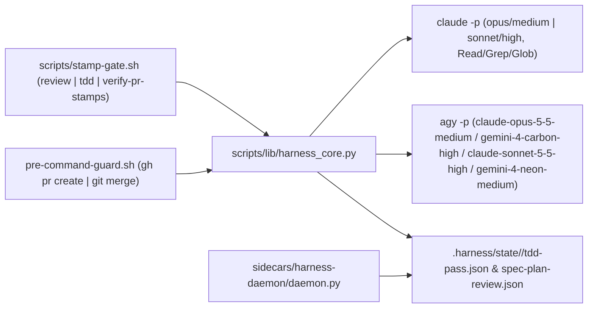
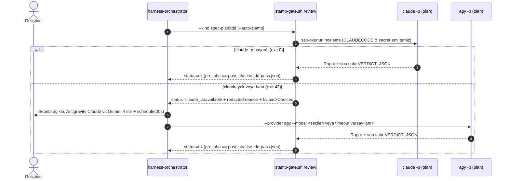

# Pull Request Mühendislik Rehberi: Claude Code CLI (`claude -p`) Spec/Plan İncelemesi, 30 sn Antigravity Fallback ve Fiziksel TDD Kapsam Kapısı

## 1. Problem Bağlamı ve Mimari Kararlar

### Çözülen Gerçek Problem ve Kök Bağlam
`alps-agy-harness` eklentisinde iki önemli mühendislik boşluğu bulunuyordu:
1. **Spec/Plan İnceleme ve TDD Kapsam Denetimi İçin Yerel Claude Pro CLI Eksikliği:** Mevcut alt ajan yönlendirmesi yalnızca Antigravity'nin 4 soyut katmanı (`inherit | flash_lite | flash | pro`) üzerinden çalışıyordu; kullanıcının yerel Claude Pro (`claude -p`) aboneliği ile `opus/medium` (Spec/Plan) ve `sonnet/high` (TDD kapsamı) incelemesi yapılamıyor, hata durumunda da Antigravity'nin kesin model kimliklerine (`claude-opus-5-5-medium`, `gemini-4-carbon-high`, `claude-sonnet-5-5-high`, `gemini-4-neon-medium`) şeffaf bir 30 sn fallback akışıyla geçilemiyordu.
2. **TDD Birim Test Kapsamında Fiziksel PR/Merge Kapısı Eksikliği:** Birim test kapsamı yalnızca süreç disiplinine ve PR sonrası `pr-auditor` incelemesine bırakılmıştı; `gh pr create` ve yerel `git merge` öncesinde `codeTreeSha` kilidine bağlı deterministik bir `tdd-pass.json` kapısı yoktu.

### Seçilen Mimari Yaklaşım ve Ödünleşimler
- **Tek Merkezli Çekirdek (`harness_core.py` + `stamp-gate.sh`):** Yeni çekirdek dosya açmadan (eklenti 53 dosya kilidi ve `rules/AGENTS.md` `< 8192` bayt sınırı korunarak) `stamp-gate.sh review` ve `stamp-gate.sh tdd` komutları eklendi.
- **Sıfır Sessiz Fallback (`exit 42`) + `schedule(30s)`:** `claude -p` (salt-okunur `--permission-mode plan --tools Read,Grep,Glob`) yoksa veya herhangi bir sebeple (auth/kota/ağ/zaman aşımı/exit != 0) başarısız olursa `exit 42` + gizli anahtarları maskelenmiş `reason` ve `fallbackChoices` JSON'ı döner; orkestratör kullanıcıya sebebi açıklayıp 30 sn `schedule` kurar, seçim veya timeout sonunda `agy -p --mode plan` ile devam eder.
- **Kod Değişikliğine Koşullu Sert `tdd-pass.json` Kapısı:** Dal farkında doküman-dışı kod/betik dosyası değiştiğinde veya silindiğinde (`include_deleted=True`) `verify-pr-stamps`, `gh pr create`, yerel `git merge` ve `harness-daemon` taze `tdd-pass.json` (`criticalGaps == 0`, `importantGaps == 0`) şartı arar; salt doküman ve `.gitignore`/`.impeccable/` PR'ları muaftır.

---

## 2. Mimari ve Veri Akışı Diyagramları

### Bileşen ve Kapı Haritası

### İki Aşamalı `claude -p` → 30 sn Fallback → `tdd-pass.json` Akışı

---

## 3. Dosya Bazlı Değişiklik Analizi

### `README.md` — [GÜNCELLENDİ] (`Documentation Layer`)
- **Ne Değişti / Ne Üretildi?:** Başlık `v1.3.0` olarak güncellendi; `§1 Neden "Engineering Harness"?` altına `Impeccable` koşullu UI anti-slop kapısı (`ui-pass.json`), `Antigravity Swarm` (`/swarm`) çoklu ajan orkestrasyon desteği ve yeni `claude -p` / `agy` 30 sn fallback + `tdd-pass.json` özet maddeleri eklendi; `§8 Bileşenler Özeti` tablosundaki `stamp-gate.sh` satırı genişletildi.
- **Neden Değişti / Neden Üretildi?:** Eklentinin `v1.3.0` sürümüne kadar kazanılan tüm temel yeteneklerin (`Impeccable`, `Swarm`, `claude -p` review ve `tdd-pass.json`) giriş bölümünde görünür olması ve `test-plugin-bundle.sh` doküman bütünlüğü kontrollerinin güncel kalması için değiştirildi.

### `plugin.json` — [GÜNCELLENDİ] (`Plugin Manifest Layer`)
- **Ne Değişti / Ne Üretildi?:** Eklenti sürümü `"1.1.0"` değerinden `"1.3.0"` değerine yükseltildi.
- **Neden Değişti / Neden Üretildi?:** Önceki oturumlardaki `Impeccable` UI kapısı, `Antigravity Swarm` / `Gemini 4 Orchestrator` desteği ve bu PR ile eklenen `claude -p` / `agy` review + `tdd-pass.json` sürüm paketini semantik sürümlemede `1.3.0` olarak yayınlamak için güncellendi.

### `tests/test-manifest.sh` — [GÜNCELLENDİ] (`Test Suite Layer`)
- **Ne Değişti / Ne Üretildi?:** `test_plugin_json_required_fields` içindeki `.version` doğrulaması `"1.1.0"` değerinden `"1.3.0"` değerine güncellendi.
- **Neden Değişti / Neden Üretildi?:** Manifesto sürüm kilidi testinin yeni `1.3.0` sürümüyle tutarlı kalması için güncellendi.

### `docs/superpowers/specs/2026-11-26-claude-cli-review-and-tdd-gate-design.md` — [ÜRETİLDİ] (`Specification Layer`)
- **Ne Değişti / Ne Üretildi?:** Birincil `claude -p` (`opus/medium` ve `sonnet/high`, `--permission-mode plan --tools Read,Grep,Glob --output-format text`) ile Antigravity fallback (`agy -p`, `claude-opus-5-5-medium`, `gemini-4-carbon-high`, `claude-sonnet-5-5-high`, `gemini-4-neon-medium`) model matrisini, `exit 42` şeffaf hata sözleşmesini, 30 sn `schedule` zaman aşımı akışını ve 3 ADR kararını içeren tam spesifikasyon üretildi. `tdd-pass.json` JSON şeması, doküman muafiyeti ve `## Teknik Terimler Sözlüğü` tablosu da belgelendi.
- **Neden Değişti / Neden Üretildi?:** Kodlamaya geçmeden önce salt-okunur izolasyon sınırlarını, kullanıcı onaylı sert TDD kapısı kararını ve 53-dosya / 8 KB bütçe kısıtlarını kalıcı mimari referans olarak sabitlemek için oluşturuldu.

### `docs/superpowers/plans/2026-11-26-claude-cli-review-and-tdd-gate.md` — [ÜRETİLDİ] (`Planning Artifacts Layer`)
- **Ne Değişti / Ne Üretildi?:** Çekirdek motor, `stamp-gate.sh`, daemon, kurallar/skill'ler ve 5 test dosyası için 4 görevli uygulama planı, `## Global Constraints` bloğu ve yüksek riskli kenar durumları kilitleyen 5 maddelik `## Review Focus` listesi yazıldı. Doküman zorunlu `## Teknik Terimler Sözlüğü` tablosuyla sonlandırıldı.
- **Neden Değişti / Neden Üretildi?:** Uygulama turlarında kapsam kilidini korumak ve özellikle `exit 42`, fail-closed damgalama ve doküman muafiyeti gibi kritik kenar durumların TDD aşamasında atlanmamasını sağlamak için üretildi.

### `rules/AGENTS.md` — [GÜNCELLENDİ] (`Universal Policy Layer`)
- **Ne Değişti / Ne Üretildi?:** `§10` başlığına `stamp-gate.sh review --kind spec-plan|tdd` birincil `claude -p` kuralları, `exit 42` + 30 sn `schedule` fallback (`claude-opus-5-5-medium`/`gemini-4-carbon-high` ve `claude-sonnet-5-5-high`/`gemini-4-neon-medium`) ve `tdd-pass.json` PR kapısı eklendi. Antigravity'nin `< 8192` bayt kural sınırını korumak için `§3` satırları sıkılaştırıldı ve dosya boyutu `8041` baytta tutuldu.
- **Neden Değişti / Neden Üretildi?:** Her yeni oturumun başında yüklenen evrensel kural dosyasının yeni review ve TDD kapısını bütçe sınırını aşmadan ve mevcut 40+ zorunlu jetonu bozmadan zorunlu kılması için güncellendi.

### `scripts/lib/harness_core.py` — [GÜNCELLENDİ] (`Core Python Engine Layer`)
- **Ne Değişti / Ne Üretildi?:** `REVIEW_PROFILES`, `REVIEW_SCRUB_ENV_KEYS`, `SECRET_REDACT_RE`, `_normalize_rel_path` (`./` önek temizleyici, dotfile'ları bozmaz), `_atomic_write_text` (symlink izlemeden atomik yazım), `requires_tdd_stamp` (`include_deleted=True` ile silme-only kod/test dallarını da kapsar), `_evaluate_tdd_stamp_status`, `tdd_stamp_register` (strict `type(...) is int`, `flock` + atomik JSON) ve `run_external_review` (`claude -p` / `agy -p` `shell=False`, stdin prompt, `CLAUDECODE` + `TYPESAFE_API_KEY` + host token temizliği, `pre_sha == post_sha` yarış koruması, yalnızca son `VERDICT_JSON` ayrıştırıcısı, `exit 42`) eklendi. Ayrıca `compute_tree_and_stamp_state`, `verify_pr_stamps`, yerel `git merge` / `gh pr create` kapıları, `build_session_start_payload` bayat `tdd-pass` bildirimi ve `main()` (`tdd-stamp`, `external-review`) entegre edildi.
- **Neden Değişti / Neden Üretildi?:** Çekirdek eklenti dosya sayısını (`53`) artırmadan tüm inceleme yürütme, gizli anahtar izolasyonu, symlink güvenliği ve fail-closed `tdd-pass.json` doğrulamasını tek Python motorunda toplamak için güncellendi.

### `scripts/stamp-gate.sh` — [GÜNCELLENDİ] (`Gate CLI Layer`)
- **Ne Değişti / Ne Üretildi?:** `cmd_tdd` (`--verdict`, zorunlu `--critical-gaps` ve `--important-gaps`, `--provider`, `--model`, `--effort`, `--file`) ve `cmd_review` (`--kind spec-plan|tdd`, `--provider claude|agy`, `--model`, `--effort`, `--target`, `--auto-stamp`) alt komutları eklendi. Python `argparse` çağrıları `--flag="$val"` biçimine alınarak `-` ile başlayan değerlerin enjeksiyonu engellendi ve `exit 42` çıkış kodu korundu.
- **Neden Değişti / Neden Üretildi?:** Hem orkestratörün hem geliştiricilerin `claude -p` / `agy -p` incelemelerini ve `tdd-pass.json` damgalarını tek deterministik CLI üzerinden çalıştırabilmesi için güncellendi.

### `sidecars/harness-daemon/daemon.py` — [GÜNCELLENDİ] (`Background Daemon Layer`)
- **Ne Değişti / Ne Üretildi?:** `HarnessDaemonState` durum dosyası `mtime` takip listesine `"tdd-pass.json"` eklendi.
- **Neden Değişti / Neden Üretildi?:** Uzun ömürlü arka plan daemon'ının `tdd-pass.json` oluştuğunda veya değiştiğinde `tree-state.json` önbelleğini anında yenilemesi için güncellendi.

### `skills/harness-orchestrator/SKILL.md` — [GÜNCELLENDİ] (`Skill Layer`)
- **Ne Değişti / Ne Üretildi?:** `§10` bölümü eklenerek Spec/Plan (`opus/medium`) ve TDD (`sonnet/high`) incelemelerinin `stamp-gate.sh review` ile çalıştırılması, `exit 42` durumunda `reason` açıklanarak 30 sn `schedule` kurulması ve `agy -p` fallback model eşlemeleri belgelendi.
- **Neden Değişti / Neden Üretildi?:** Ana orkestrasyon becerisinin `claude -p` → 30 sn kullanıcı sorusu → `agy -p` akışını tutarlı biçimde yönetmesi için güncellendi.

### `skills/pre-pr-readiness/SKILL.md` — [GÜNCELLENDİ] (`Skill Layer`)
- **Ne Değişti / Ne Üretildi?:** `Adım 4b` eklenerek kod/betik değişikliği olan dallarda `stamp-gate.sh review --kind tdd --auto-stamp`, `exit 42` fallback adımları ve manuel `stamp-gate.sh tdd --verdict PASS` damgalama sırası tanımlandı.
- **Neden Değişti / Neden Üretildi?:** PR açılışı öncesi kontrol akışının yeni `tdd-pass.json` fiziksel kapısıyla birebir hizalanması için güncellendi.

### `tests/test-command-hooks.sh` — [GÜNCELLENDİ] (`Test Suite Layer`)
- **Ne Değişti / Ne Üretildi?:** Mevcut PR/merge testlerine `tdd-pass.json` damgası eklendi ve yeni `test_tdd_gate_blocks_code_pr_and_merge_but_allows_doc_only` testiyle kod dallarında eksik/FAIL/bayat `tdd-pass.json` reddi (`gh pr create` ve yerel `git merge`) ile salt doküman dalı muafiyeti doğrulandı.
- **Neden Değişti / Neden Üretildi?:** Komut düzeyi `pre-command-guard.sh` kapısının tüm pozitif ve negatif TDD senaryolarında fail-closed çalıştığını kanıtlamak için güncellendi.

### `tests/test-plugin-bundle.sh` — [GÜNCELLENDİ] (`Test Suite Layer`)
- **Ne Değişti / Ne Üretildi?:** `test_end_to_end_simulated_feature_lifecycle` uçtan uca PR akışına `stamp-gate.sh tdd --verdict PASS` adımı eklendi ve çekirdek paket `53` dosya kilidi korundu.
- **Neden Değişti / Neden Üretildi?:** Uçtan uca yaşam döngüsü doğrulamasının yeni TDD PR kapısıyla uyumlu kalması için güncellendi.

### `tests/test-rules-and-agents.sh` — [GÜNCELLENDİ] (`Test Suite Layer`)
- **Ne Değişti / Ne Üretildi?:** `test_agents_md_no_frontmatter_and_under_8kb` sözleşme testine `stamp-gate.sh review`, `tdd-pass.json`, `claude -p`, `gemini-4-carbon-high` ve `gemini-4-neon-medium` jeton kontrolleri eklendi.
- **Neden Değişti / Neden Üretildi?:** Evrensel kural dosyasındaki yeni review ve TDD maddelerinin ileride yanlışlıkla kırpılmasını önlemek için güncellendi.

### `tests/test-sidecar-daemon.sh` — [GÜNCELLENDİ] (`Test Suite Layer`)
- **Ne Değişti / Ne Üretildi?:** Daemon PR kapısı senaryolarına `stamp-gate.sh tdd --verdict PASS` damgaları eklendi ve `tree-state.json` içinde `tddStampStatus == "fresh"` + `tddStampValid == true` takibi doğrulandı.
- **Neden Değişti / Neden Üretildi?:** Sıcak daemon ile soğuk fallback yollarının `tdd-pass.json` tazeliğinde pariteyi koruduğunu kanıtlamak için güncellendi.

### `tests/test-stamp-and-common.sh` — [GÜNCELLENDİ] (`Test Suite Layer`)
- **Ne Değişti / Ne Üretildi?:** Mevcut UI/PR testleri `tdd-pass.json` ile güncellendi ve kapsamlı `test_claude_cli_review_fallback_and_tdd_stamp_gate` testi eklendi: `claude -p` Spec/Plan & TDD, `CLAUDECODE`/`TYPESAFE_API_KEY` temizliği, stdin prompt doğrulaması, `claude` yok/kota/zaman aşımı → `exit 42` + gizli anahtar maskeleme, `agy -p` fallback ve hata yolu, symlink-güvenli rapor yazımı, `--auto-stamp` negatif testleri (FAIL/gaps/bool/malformed/mid-review commit), dotfile muafiyeti ve silme-only kod dalı TDD zorunluluğu test edildi.
- **Neden Değişti / Neden Üretildi?:** Yeni inceleme motoru ve fail-closed TDD kapısının canlı ağ bağımlılığı olmadan tüm kritik ve kenar senaryolarda regresyona karşı güvence altına alınması için güncellendi.

---

## 4. Kritik İş Mantığı, Kenar Durumlar (Edge Cases) ve Hata Yönetimi

| Senaryo / Kenar Durum | Sistemin Davranışı |
| :--- | :--- |
| **`claude` CLI yok veya kota/auth/zaman aşımı hatası** | Sessiz fallback yapmaz; `exit 42` ve maskelenmiş `reason` + `fallbackChoices` (`timeoutSeconds: 30`) döner. |
| **Gizli anahtarlar (`TYPESAFE_API_KEY`, `GITHUB_TOKEN` vb.) ve symlink rapor yolu** | Alt süreç ortamından temizlenir, hata çıktısı `[REDACTED]` ile maskelenir, rapor symlink izlemeden `_atomic_write_text` ile yazılır. |
| **İnceleme sırasında `HEAD` değişimi veya bozuk/boolean `VERDICT_JSON`** | `pre_sha != post_sha`, `bool` değerler, eksik/hatalı son satır veya sıfır dışı açıkta `--auto-stamp` `tdd-pass.json` yazmaz. |
| **Salt doküman / `.gitignore` / `.impeccable/` vs. silme-only kod dalı** | Dotfile/doküman dalları `tdd-pass.json`'dan muaftır; yalnızca kod/test silen dallar `include_deleted=True` ile `tdd-pass.json` gerektirir. |

---

## 5. Somut Doğrulama Kanıtları

| Test Paketi | Doğrulanan Kapsam | Sonuç |
| :--- | :--- | :--- |
| `tests/test-command-hooks.sh` | `tdd-pass.json` PR/yerel merge engeli (eksik/FAIL/bayat) + doküman-only muafiyeti | `13 passed, 0 failed` (`PASS`) |
| `tests/test-edit-and-session-hooks.sh` | `main` kilidi, sözlük kapısı, model emeklilik uyarıları | `12 passed, 0 failed` (`PASS`) |
| `tests/test-manifest.sh` | `hooks.json` ve `plugin.json` şema bütünlüğü | `9 passed, 0 failed` (`PASS`) |
| `tests/test-plugin-bundle.sh` | 53 çekirdek dosya kilidi, 11 skill, uçtan uca PR yaşam döngüsü (`tdd-pass.json` dahil) | `3 passed, 0 failed` (`PASS`) |
| `tests/test-rules-and-agents.sh` | `AGENTS.md` `8041` bayt (`< 8192`) + yeni `claude -p`/`tdd-pass.json` jetonları | `3 passed, 0 failed` (`PASS`) |
| `tests/test-sidecar-daemon.sh` | Sıcak daemon vs soğuk fallback paritesi + `tddStampStatus` önbellek takibi | `18 passed, 0 failed` (`PASS`) |
| `tests/test-stamp-and-common.sh` | `claude -p` / `agy -p` review, `exit 42`, güvenlik/symlink/dotfile/deletion/auto-stamp testleri | `17 passed, 0 failed` (`PASS`) |
| `tests/test-subagent-and-stop-hooks.sh` | Gemini 4 / Orchestrator model kilidi, Swarm & `run_workflow` kapıları | `14 passed, 0 failed` (`PASS`) |
| `tests/test-utilities.sh` | `harness-doctor.sh`, `run-quiet.sh`, `mobile-logs.sh` | `10 passed, 0 failed` (`PASS`) |

- **Komut:** `./scripts/run-quiet.sh full-tests-verify -- bash tests/run-all.sh` (tüm 9 paket, 99 test, `0 failed`).
- **Boyut & Paket Kilidi:** `wc -c rules/AGENTS.md` → `8041` bayt (`< 8192`); çekirdek dosya sayısı → `53`.

---

## 6. Kapsam Dışı (`docs/parking-lot.md`) ve Operasyonel Notlar

- Kapsam dışı bırakılan madde yok; `docs/parking-lot.md` değiştirilmedi.

---

## Teknik Terimler Sözlüğü

| Terim | Açıklama |
| :--- | :--- |
| **`claude -p`** | Claude Code CLI'nin salt-okunur plan modunda tek tur inceleme yapan `--print` modu. |
| **`agy -p`** | Antigravity CLI'nin açık `--model` kimliği ve `--mode plan` ile çalışan `--print` modu. |
| **`tdd-pass.json`** | Kod değişikliği veya silmesi içeren dallarda TDD kapsam denetiminin geçtiğini `codeTreeSha` kilidiyle belgeleyen PR/merge damgası. |
| **Fail-Closed** | Eksik damga, bozuk JSON veya sıfır dışı açık durumunda işlemin varsayılan olarak reddedilmesi ilkesi. |
| **`codeTreeSha`** | Çalışma ağacındaki kod/test dosyalarının özetini temsil eden ve damgaların bayatlamasını önleyen hash. |
