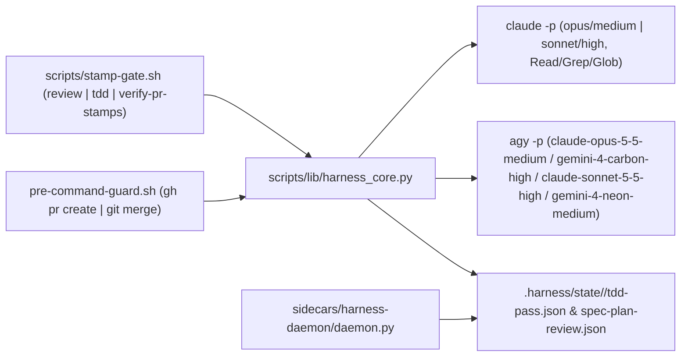
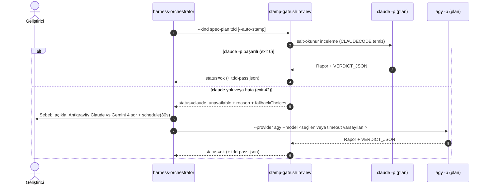

# Pull Request Mühendislik Rehberi: Claude Code CLI (`claude -p`) Spec/Plan İncelemesi, 30 sn Antigravity Fallback ve Fiziksel TDD Kapsam Kapısı

## 1. Problem Bağlamı ve Mimari Kararlar

### Çözülen Gerçek Problem ve Kök Bağlam
`alps-agy-harness` eklentisinde iki önemli mühendislik boşluğu bulunuyordu:
1. **Spec/Plan İnceleme ve TDD Kapsam Denetimi İçin Yerel Claude Pro CLI Eksikliği:** Mevcut alt ajan yönlendirmesi yalnızca Antigravity'nin 4 soyut katmanı (`inherit | flash_lite | flash | pro`) üzerinden çalışıyordu; kullanıcının yerel Claude Pro (`claude -p`) aboneliği ile `opus/medium` (Spec/Plan) ve `sonnet/high` (TDD kapsamı) incelemesi yapılamıyor, hata durumunda da Antigravity'nin kesin model kimliklerine (`claude-opus-5-5-medium`, `gemini-4-carbon-high`, `claude-sonnet-5-5-high`, `gemini-4-neon-medium`) şeffaf bir 30 sn fallback akışıyla geçilemiyordu.
2. **TDD Birim Test Kapsamında Fiziksel PR/Merge Kapısı Eksikliği:** Birim test kapsamı yalnızca süreç disiplinine ve PR sonrası `pr-auditor` incelemesine bırakılmıştı; `gh pr create` ve yerel `git merge` öncesinde `codeTreeSha` kilidine bağlı deterministik bir `tdd-pass.json` kapısı yoktu.

### Seçilen Mimari Yaklaşım ve Ödünleşimler
- **Tek Merkezli Çekirdek (`harness_core.py` + `stamp-gate.sh`):** Yeni çekirdek dosya açmadan (eklenti 53 dosya kilidi ve `rules/AGENTS.md` `< 8192` bayt sınırı korunarak) `stamp-gate.sh review` ve `stamp-gate.sh tdd` komutları eklendi.
- **Sıfır Sessiz Fallback (`exit 42`) + `schedule(30s)`:** `claude -p` (salt-okunur `--permission-mode plan --tools Read,Grep,Glob`) yoksa veya herhangi bir sebeple (auth/kota/ağ/zaman aşımı/exit != 0) başarısız olursa `exit 42` + sebep ve fallback seçeneklerini içeren JSON döner; orkestratör kullanıcıya sebebi açıklayıp 30 sn `schedule` kurar, seçim veya timeout sonunda `agy -p --mode plan` ile devam eder.
- **Kod Değişikliğine Koşullu Sert `tdd-pass.json` Kapısı:** Dal farkında doküman-dışı kod/betik dosyası değiştiğinde `verify-pr-stamps`, `gh pr create`, yerel `git merge` ve `harness-daemon` taze `tdd-pass.json` (`criticalGaps == 0`, `importantGaps == 0`) şartı arar; salt doküman PR'ları muaftır.

---

## 2. Mimari ve Veri Akışı Diyagramları

### Bileşen ve Kapı Haritası

### İki Aşamalı `claude -p` → 30 sn Fallback → `tdd-pass.json` Akışı

---

## 3. Dosya Bazlı Değişiklik Analizi

### `README.md` — [GÜNCELLENDİ] (`Documentation Layer`)
- **Ne Değişti / Ne Üretildi?:** Bileşenler özetindeki `stamp-gate.sh` satırına koşullu `tdd-pass.json` ve `claude -p` / `agy -p` (`review`) yetenekleri eklendi.
- **Neden Değişti / Neden Üretildi?:** Ana referans dokümanın yeni CLI inceleme ve TDD damga yeteneklerini doğru yansıtması için güncellendi.

### `docs/superpowers/specs/2026-11-26-claude-cli-review-and-tdd-gate-design.md` — [ÜRETİLDİ] (`Specification Layer`)
- **Ne Değişti / Ne Üretildi?:** `claude -p` / `agy -p` model matrisi, `exit 42` şeffaf hata sözleşmesi, 30 sn `schedule` fallback protokolü, 3 ADR kararı ve koşullu `tdd-pass.json` PR/merge kapısının tam tasarım spesifikasyonu oluşturuldu.
- **Neden Değişti / Neden Üretildi?:** Uygulama öncesinde mimari kararları, salt-okunur izolasyon kurallarını ve kullanıcı onaylı kapı sınırlarını kayıt altına almak için üretildi.

### `docs/superpowers/plans/2026-11-26-claude-cli-review-and-tdd-gate.md` — [ÜRETİLDİ] (`Planning Artifacts Layer`)
- **Ne Değişti / Ne Üretildi?:** Çekirdek motor, `stamp-gate.sh`, daemon, kurallar/skill'ler ve test paketleri için 4 görevli uygulama planı ile 5 maddelik `## Review Focus` bölümü yazıldı.
- **Neden Değişti / Neden Üretildi?:** Kapsam kilidi ve TDD doğrulama sırasını netleştirmek için üretildi.

### `rules/AGENTS.md` — [GÜNCELLENDİ] (`Universal Policy Layer`)
- **Ne Değişti / Ne Üretildi?:** `§10` başlığına `stamp-gate.sh review` (`claude -p` `opus/medium` & `sonnet/high`), `exit 42` + 30 sn `schedule` fallback (`claude-opus-5-5-medium`/`gemini-4-carbon-high` ve `claude-sonnet-5-5-high`/`gemini-4-neon-medium`) ve `tdd-pass.json` PR kapısı eklendi; `§3` sıkılaştırılarak dosya `8041` baytta (`< 8192` bayt) tutuldu.
- **Neden Değişti / Neden Üretildi?:** Her oturumda yüklenen evrensel kural dosyasının yeni review ve TDD kapısını 8 KB sınırını aşmadan zorunlu kılması için güncellendi.

### `scripts/lib/harness_core.py` — [GÜNCELLENDİ] (`Core Python Engine Layer`)
- **Ne Değişti / Ne Üretildi?:** `REVIEW_PROFILES`, `requires_tdd_stamp`, `_evaluate_tdd_stamp_status`, `tdd_stamp_register`, `run_external_review` (`claude -p` / `agy -p` salt-okunur yürütücü, `CLAUDECODE` temizleme, `exit 42` yapılandırılmış hata, `VERDICT_JSON` ayrıştırıcı ve `--auto-stamp`), `compute_tree_and_stamp_state` / `verify_pr_stamps` / yerel `git merge` `tdd-pass.json` doğrulaması ve `main()` (`tdd-stamp`, `external-review`) alt komutları eklendi.
- **Neden Değişti / Neden Üretildi?:** Tüm review yürütme, fallback hata raporlama ve fail-closed `tdd-pass.json` kapılarını tek kaynak Python motorunda toplamak ve 53 çekirdek dosya sınırını korumak için güncellendi.

### `scripts/stamp-gate.sh` — [GÜNCELLENDİ] (`Gate CLI Layer`)
- **Ne Değişti / Ne Üretildi?:** `cmd_tdd` (`stamp-gate.sh tdd`) ve `cmd_review` (`stamp-gate.sh review`) alt komutları, argüman doğrulamaları ve `usage()` yardımı eklendi.
- **Neden Değişti / Neden Üretildi?:** Orkestratör ve geliştiricilerin tek CLI arayüzü üzerinden `claude -p` / `agy -p` incelemesi ve `tdd-pass.json` damgalaması yapabilmesi için güncellendi.

### `sidecars/harness-daemon/daemon.py` — [GÜNCELLENDİ] (`Background Daemon Layer`)
- **Ne Değişti / Ne Üretildi?:** `HarnessDaemonState` durum dosyası `mtime` izleme listesine `"tdd-pass.json"` eklendi.
- **Neden Değişti / Neden Üretildi?:** Uzun ömürlü yan süreç daemon'ının `tdd-pass.json` değişikliklerinde `tree-state.json` önbelleğini anında yenilemesi için güncellendi.

### `skills/harness-orchestrator/SKILL.md` — [GÜNCELLENDİ] (`Skill Layer`)
- **Ne Değişti / Ne Üretildi?:** `§10` bölümü eklenerek Spec/Plan ve TDD kapsam denetiminin `stamp-gate.sh review` ile çalıştırılması ve `exit 42` durumunda 30 sn `schedule` + `agy -p` fallback protokolü belgelendi.
- **Neden Değişti / Neden Üretildi?:** Ana orkestrasyon skill'inin yeni inceleme ve fallback akışını adım adım yönetmesi için güncellendi.

### `skills/pre-pr-readiness/SKILL.md` — [GÜNCELLENDİ] (`Skill Layer`)
- **Ne Değişti / Ne Üretildi?:** `Adım 4b` eklenerek kod/betik değişikliği olan dallarda `stamp-gate.sh review --kind tdd --auto-stamp` ve `tdd-pass.json` damgalama sırası tanımlandı.
- **Neden Değişti / Neden Üretildi?:** PR açılışı öncesi kontrol listesinin `verify-pr-stamps` ile %100 uyumlu kalması için güncellendi.

### `tests/test-command-hooks.sh` — [GÜNCELLENDİ] (`Test Suite Layer`)
- **Ne Değişti / Ne Üretildi?:** Mevcut PR/merge kapı testlerine `tdd-pass.json` damgaları eklendi ve yeni `test_tdd_gate_blocks_code_pr_and_merge_but_allows_doc_only` testiyle kod dallarında `gh pr create`/yerel `git merge` engeli ile salt doküman dalı muafiyeti doğrulandı.
- **Neden Değişti / Neden Üretildi?:** Yeni fiziksel TDD kapısının pozitif, negatif ve doküman-muafiyeti senaryolarını kanıtlamak için güncellendi.

### `tests/test-plugin-bundle.sh` — [GÜNCELLENDİ] (`Test Suite Layer`)
- **Ne Değişti / Ne Üretildi?:** `test_end_to_end_simulated_feature_lifecycle` uçtan uca PR akışına `stamp-gate.sh tdd --verdict PASS` adımı eklendi (`53` çekirdek dosya kilidi korundu).
- **Neden Değişti / Neden Üretildi?:** Uçtan uca yaşam döngüsü testinin yeni TDD PR kapısıyla uyumlu çalışması için güncellendi.

### `tests/test-rules-and-agents.sh` — [GÜNCELLENDİ] (`Test Suite Layer`)
- **Ne Değişti / Ne Üretildi?:** `test_agents_md_no_frontmatter_and_under_8kb` içine `stamp-gate.sh review`, `tdd-pass.json`, `claude -p`, `gemini-4-carbon-high` ve `gemini-4-neon-medium` jeton doğrulamaları eklendi.
- **Neden Değişti / Neden Üretildi?:** Evrensel kural sözleşmesindeki yeni maddelerin gelecekte yanlışlıkla silinmesini önlemek için güncellendi.

### `tests/test-sidecar-daemon.sh` — [GÜNCELLENDİ] (`Test Suite Layer`)
- **Ne Değişti / Ne Üretildi?:** Daemon PR kapısı senaryolarına `stamp-gate.sh tdd --verdict PASS` damgaları eklendi.
- **Neden Değişti / Neden Üretildi?:** Sıcak daemon ile soğuk fallback yollarının `tdd-pass.json` kapısında pariteyi koruduğunu doğrulamak için güncellendi.

### `tests/test-stamp-and-common.sh` — [GÜNCELLENDİ] (`Test Suite Layer`)
- **Ne Değişti / Ne Üretildi?:** Mevcut UI/PR testleri `tdd-pass.json` ile güncellendi ve yeni `test_claude_cli_review_fallback_and_tdd_stamp_gate` testi eklendi (`claude -p` Spec/Plan & TDD, `CLAUDECODE` temizleme, `claude` yok/quota → `exit 42`, `agy -p` fallback, fail-closed `tdd` damgası, bayat `codeTreeSha` reddi).
- **Neden Değişti / Neden Üretildi?:** Yeni CLI review ve fallback sözleşmesinin canlı ağ çağrısı olmadan sahte ikililerle deterministik olarak doğrulanması için güncellendi.

---

## 4. Kritik İş Mantığı, Kenar Durumlar (Edge Cases) ve Hata Yönetimi

| Senaryo / Kenar Durum | Sistemin Davranışı |
| :--- | :--- |
| **`claude` CLI yok veya kota/auth/zaman aşımı hatası** | Sessiz fallback yapmaz; `exit 42` ve `status: "claude_unavailable"`, `reason`, `fallbackChoices` (`timeoutSeconds: 30`) döner. |
| **`stamp-gate.sh tdd --verdict PASS` + sıfır dışı açık** | Fail-closed reddeder (`exit 1`) ve `tdd-pass.json` yazmaz. |
| **Salt doküman PR'ı (`docs/**`, `*.md`)** | `requires_tdd_stamp` `False` döner; `tdd-pass.json` aranmaz. |
| **Damga sonrası kod/test commit'i** | `codeTreeSha` değişir; `verify-pr-stamps`, `gh pr create` ve yerel `git merge` bayat `tdd-pass.json` damgasını reddeder. |

---

## 5. Somut Doğrulama Kanıtları

- **Tam Test Paketi:** `./scripts/run-quiet.sh full-tests-verify -- bash tests/run-all.sh` → `✅ PASS [full-tests-verify] (süre: 256.0s, warnings: 0)` — **9/9 paket, 99/99 test geçti (`0 failed`)**.
- **Sözleşme Kontrolleri:** `wc -c rules/AGENTS.md` → `8041` bayt (`< 8192`); çekirdek eklenti dosya sayısı → `53` (`PASS`).

---

## 6. Kapsam Dışı (`docs/parking-lot.md`) ve Operasyonel Notlar

- Kapsam dışı bırakılan madde yok; `docs/parking-lot.md` değiştirilmedi.

---

## Teknik Terimler Sözlüğü

| Terim | Açıklama |
| :--- | :--- |
| **`claude -p`** | Claude Code CLI'nin salt-okunur plan modunda tek tur inceleme yapan `--print` modu. |
| **`agy -p`** | Antigravity CLI'nin açık `--model` kimliği ve `--mode plan` ile çalışan `--print` modu. |
| **`tdd-pass.json`** | Kod değişikliği içeren dallarda TDD kapsam denetiminin geçtiğini `codeTreeSha` kilidiyle belgeleyen PR/merge damgası. |
| **Fail-Closed** | Eksik damga veya sıfır dışı açık durumunda işlemin varsayılan olarak reddedilmesi ilkesi. |
| **`codeTreeSha`** | Çalışma ağacındaki kod/test dosyalarının özetini temsil eden ve damgaların bayatlamasını önleyen hash. |
