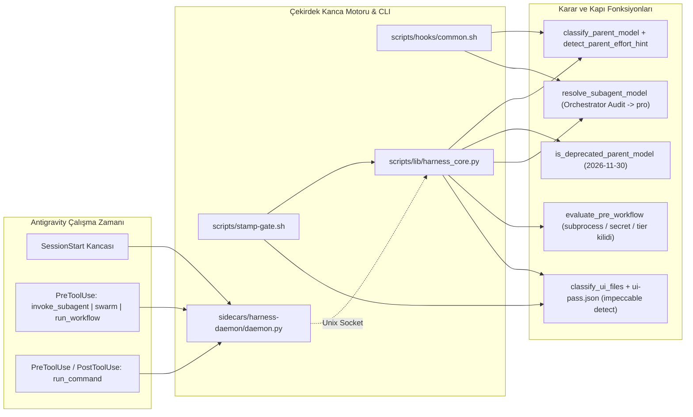
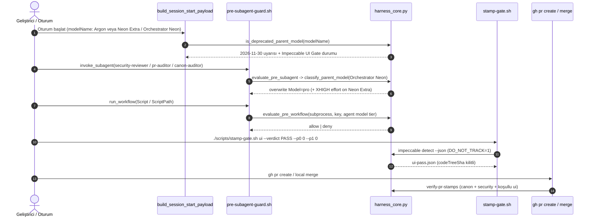

# Pull Request Mühendislik Rehberi: Gemini 4 (5 Katmanlı Orchestrator, Emeklilik Uyarısı & Workflow Koruması) ve Koşullu Impeccable UI Kapısı

## 1. Problem Bağlamı ve Mimari Kararlar

### Çözülen Gerçek Problem ve Kök Bağlam
`alps-agy-harness`, Google Antigravity (`agy`) üzerinde çok platformlu Clean Architecture sınırlarını, `context7` bağımlılık sürüm kilidini, `jev` olasılıksal kalibrasyonunu, `pre-command-guard.sh` / `pre-edit-guard.sh` fiziksel kancalarını ve `canon-auditor` / `security-reviewer` / `pr-auditor` üçlü denetim kapısını çalıştırmaktadır. Ancak iki büyük mimari boşluk birikmişti:
1. **UI/Frontend Görsel Kalite ve Anti-Pattern Boşluğu:** Mevcut kanca zinciri fonksiyonel E2E (`playwright-e2e`) ve ağ/LCP teşhislerini (`chrome-devtools-plugin`) kapsamasına rağmen Web (`.html`, `.tsx`, `.css`, `.scss`, `.component.ts`) ve Native UI (`.xaml`, SwiftUI, Jetpack Compose) katmanlarında yapay zeka şablonlarına özgü estetik kusurları (*AI slop*: düşük kontrast, jenerik tipografi, iç içe kart yığınları, HIG/Material 3 uyumsuzlukları) durduran deterministik bir kapıya sahip değildi. Saf backend/.NET projelerini ise yeni bir zorunlulukla yavaşlatmadan yalnızca UI değişikliği ve `impeccable` (`>= 4.11.0`) kurulumu birlikte mevcut olduğunda sert PR/yerel merge kapısı uygulayan koşullu bir modül gerekiyordu.
2. **Gemini 4 Ekosistem Evrimi, İki Fazlı Orchestrator ve `run_workflow` Güvenlik Körü:** Antigravity'nin yeni model kataloğu `Gemini 4 Neon` (varsayılan, `Extra`/`xhigh` dahil), `Claude Opus 5.5` / `Sonnet 5.5` ayrımını getirirken `Gemini 4 Argon`, `Gemini 3.8 Flash`, `GPT-OSS-120b`, `Claude 4.6` ve `Orchestrator (Argon)` ailelerinin `2026-11-30` tarihinde emekliye ayrılmasını duyurdu. Ayrıca yeni iki fazlı `Orchestrator (Neon)` ve `Orchestrator (Carbon)` mimarisinde Plan modunda `Neon`/`Carbon` çalışırken yürütme turlarında (`tool execution`) kontrol `Hydrogen` alt yürütücüsüne geçmektedir; eski yönlendirme tablosu `Orchestrator` altında denetim ajanlarını (`security-reviewer`, `pr-auditor`, `canon-auditor`) `inherit` ile bırakabildiği için yürütme turunda kritik bir güvenlik veya PR denetiminin `Hydrogen` üzerine düşmesi (*executor downgrade*) riskini taşıyordu. Ek olarak `hooks.json` yalnızca `invoke_subagent|swarm` çağrılarını denetlediğinden, çok ajanlı `run_workflow` Python orkestrasyon betiklerindeki ham `subprocess`/`os.system` kaçışları, gömülü gizli anahtarlar ve geçersiz `agent(model=...)` kademeleri kanca dışında kalıyordu.

### Seçilen Mimari Yaklaşım ve Gerekçesi
- **Etkilenen Bounded Context ve Katmanlar:** `Policy & Contract Layer` (`rules/AGENTS.md`, `rules/*.md`, `skills/*`, `agents/*`), `Hook & Engine Layer` (`hooks.json`, `scripts/hooks/common.sh`, `scripts/stamp-gate.sh`, `scripts/lib/harness_core.py`), `Sidecar Daemon Layer` (`sidecars/harness-daemon/daemon.py`), `Verification & Test Layer` (`tests/test-*.sh`), `Specification & Planning Docs` (`docs/superpowers/*`).
- **Yaklaşım Özeti:** İki fazlı bir entegrasyon uygulandı. İlk adımda UI yüzeyi + `impeccable` algılamasına bağlı deterministik `ui-pass.json` (`codeTreeSha` kilitli) damga kapısı, `.impeccable/` izolasyonu ve `DO_NOT_TRACK=1 IMPECCABLE_LIVE_COPY_AGENT=chat|off` çevre değişkeni zorunluluğu Python çekirdeğine ve `stamp-gate.sh` CLI'a yerleştirildi. İkinci adımda `common.sh` ve `harness_core.py` arasında %100 parite korunarak 14 kanonik aileli (`orchestrator_neon`, `orchestrator_carbon`, `orchestrator_argon`, `frontier_low`, `claude_opus`, `claude_sonnet` dahil) sınıflandırıcı, `Orchestrator` yürütme turu denetim kalkanı (denetimlerin `pro`'ya yükseltilmesi), `Extra`/`xhigh` efor algılaması (`pr-auditor` için `XHIGH`), `SessionStart` emeklilik uyarısı ve `hooks.json` içindeki `invoke_subagent|swarm|run_workflow` statik güvenlik doğrulayıcısı (`evaluate_pre_workflow`) eklendi.

### Değerlendirilen Alternatifler ve Ödünleşimler (Trade-offs)

| Yaklaşım / Seçenek | Avantajlar | Dezavantajlar / Riskler | Karar |
| :--- | :--- | :--- | :--- |
| **Seçenek A (Uygulanan):** Çift koşullu UI kapısı + tam `bash`/`python` pariteli 5 katmanlı sınıflandırıcı + `run_workflow` ön kancası | Saf backend işlerde sıfır sürtünme; UI ve `Orchestrator` yürütme turlarında deterministik fail-closed güvenlik; eklenti çekirdek dosya sayısını (`53`) ve `AGENTS.md` `< 8192` bayt sınırını korur | Sınıflandırma kuralı iki dilde (`common.sh` ve `harness_core.py`) eşzamanlı tutulmalıdır (parite test matrisiyle telafi edildi) | **Seçildi** |
| **Seçenek B:** Tüm UI projelerinde Impeccable olmadan bloklama & yalnızca Python kancasına geçme | Tek kaynak kod; katı küresel UI dayatması | Impeccable kurulu olmayan geliştirici ortamlarında PR bloklanır; daemon yokken Saf POSIX Bash hızlı yolu kaybolur | Elendi |
| **Seçenek C:** `Orchestrator` altında denetim ajanlarını (`security-reviewer`, `pr-auditor`) `inherit` tutma | Ek `pro` yönlendirmesi gerekmez | Yürütme turunda alt yürütücü (`Hydrogen`) üzerinde denetim çalışabilir (`jev_check` `0.67` ile reddedildi) | Elendi |

---

## 2. Mimari ve Veri Akışı Diyagramları

### Bileşen ve Kapı Mimarisi Haritası

### İki Fazlı `Orchestrator`, `run_workflow` ve Koşullu UI Akışı

---

## 3. Dosya Bazlı Değişiklik Analizi

`git diff --name-status origin/main..HEAD` çıktısındaki (bu mühendislik rehberi hariç) tüm 30 dosya aşağıda eksiksiz olarak analiz edilmiştir:

### `README.md` — GÜNCELLENDİ (`Documentation Layer`)
- **Ne Değişti / Ne Üretildi?:** Belge başlığı ile `§1 Neden "Engineering Harness"?`, `§3 Ön Gereksinimler`, `§7 Yaşam Döngüsü / Swarm`, `§8 Bileşenler Özeti` ve `## Teknik Terimler Sözlüğü` bölümleri güncellendi. Yeni iki fazlı `Orchestrator (Neon / Carbon)` Planner/Executor ayrımı, `2026-11-30` tarihinde emekliye ayrılacak modeller (`Argon`, `3.8 Flash`, `GPT-OSS`, `Claude 4.6`), `Extra` (`xhigh`) efor eşlemesi, `invoke_subagent|swarm|run_workflow` matcher genişlemesi ve koşullu `impeccable` UI kapısı (`.impeccable/` ile `DO_NOT_TRACK=1`) dokümana işlendi; sözlüğe `Orchestrator (Two-Phase Planner/Executor)` ve `run_workflow` maddeleri eklendi.
- **Neden Değişti / Neden Üretildi?:** Harness kullanıcılarının hem yeni Gemini 4 / Claude 5.5 yönlendirme kurallarını hem de koşullu UI tasarım kapısının tetiklenme şartlarını tek bir Türkçe referans dokümanda görmesi ve `test-plugin-bundle.sh` sözlük sözleşmesinin korunması gerektiği için güncellendi.

### `agents/canon-auditor.md` — GÜNCELLENDİ (`Subagent Contract Layer`)
- **Ne Değişti / Ne Üretildi?:** Altı satırlık YAML frontmatter (`name`, `description`, `subagent`, `mainAgent`, `inheritMcp`, `tools`) korunarak `§1.1` altındaki model kilidi açıklamaları güncellendi (`tests/test-rules-and-agents.sh` gereği `model:` ön eki yasaktır). Yeni metinde `Neon`/`Carbon`/`Opus 5.5` gibi üst sınıf ebeveynlerde `Model: "inherit"` desteklendiği; ancak iki fazlı `Orchestrator (Neon|Carbon)`, `Hydrogen`, `frontier_low`, `Claude Sonnet 5.5` ve `Flash` altında yürütme düşmesini (*executor downgrade*) önlemek için `pre-subagent-guard.sh` kancasının `canon-auditor` çağrılarını otomatik olarak `pro` (`HIGH`) seviyesine yükselttiği açıklandı.
- **Neden Değişti / Neden Üretildi?:** Mimari ve alan sözlüğü denetimini yürüten `canon-auditor` alt ajanının özellikle iki fazlı `Orchestrator` yürütme turlarında düşük kapasiteli yürütücüye (`Hydrogen`) düşmesini engellemek ve ajan belgeleri ile çalışma zamanı kancası arasında tam sözleşme uyumu kurmak için güncellendi.

### `agents/pr-auditor.md` — GÜNCELLENDİ (`Subagent Contract Layer`)
- **Ne Değişti / Ne Üretildi?:** `pr-auditor` sözleşmesinin `§1.1` bölümü, `Neon`, `Carbon`, `Claude Opus 5.5` (`High`/`Medium`/`Extra`) ebeveynlerinde `inherit` korunurken `Extra`/`xhigh` durumunda efor profilinin `XHIGH` olarak ayarlandığını; buna karşın `Orchestrator (Neon|Carbon)` yürütme turları, `Hydrogen`, `frontier_low`, `Claude Sonnet 5.5` ve `Flash` altında `pro` seviyesine yükseltildiğini belgeleyecek şekilde yenilendi.
- **Neden Değişti / Neden Üretildi?:** PR sonrası 7 boyutlu derin denetimin (`pr-auditor`) hiçbir koşulda `Hydrogen` veya `Sonnet 5.5` gibi bounded-execution modellerine düşmemesini ve `Extra` modda açılan oturumların daha derin akıl yürütme bütçesi almasını sağlamak için değiştirildi.

### `agents/security-reviewer.md` — GÜNCELLENDİ (`Subagent Contract Layer`)
- **Ne Değişti / Ne Üretildi?:** `security-reviewer` dokümanının `§1.1` başlığındaki sabit `MAX` efor ve model kilidi metni; `Neon`/`Carbon`/`Opus 5.5` üzerinde `inherit`, iki fazlı `Orchestrator (Neon|Carbon)` yürütme turları, `Hydrogen`, `frontier_low`, `Claude Sonnet 5.5` ve `Flash` üzerinde ise `pre-subagent-guard.sh` tarafından zorunlu `pro` (`MAX`) yükseltmesi uygulandığını yansıtacak biçimde güncellendi.
- **Neden Değişti / Neden Üretildi?:** Güvenlik açığı taramalarının (`security-pass.json` ön koşulu) `Orchestrator` yürütme turlarında farkında olmadan `Hydrogen` yürütücüsüne devredilmesini engelleyen *executor shield* kuralını alt ajan sözleşmesine yansıtmak için düzenlendi.

### `docs/superpowers/plans/2026-11-26-gemini4-orchestrator-5layer.md` — ÜRETİLDİ (`Planning Artifacts Layer`)
- **Ne Değişti / Ne Üretildi?:** Gemini 4 (5 katmanlı `Orchestrator`, model taksonomisi, emeklilik uyarısı, `Orchestrator` denetim kalkanı ve `run_workflow` kancası) uygulamasının tüm görev kırılımını, dosya listesini (`allowedFiles`), TDD doğrulama adımlarını ve `## Teknik Terimler Sözlüğü` tablosunu içeren Türkçe uygulama planı oluşturuldu.
- **Neden Değişti / Neden Üretildi?:** Uygulama turlarında kapsam kilidi (*scope lock*) sağlamak ve `superpowers:writing-plans` sözleşmesini Türkçe sözlük kuralıyla eksiksiz uygulamak amacıyla üretildi.

### `docs/superpowers/plans/2026-11-26-impeccable-ui-gate.md` — ÜRETİLDİ (`Planning Artifacts Layer`)
- **Ne Değişti / Ne Üretildi?:** Opsiyonel ve koşullu `impeccable` UI kapısı modülünün `harness_core.py`, `stamp-gate.sh`, `daemon.py`, platform kuralları, skill yönergeleri ve test paketlerindeki uygulama adımlarını kapsayan Türkçe plan dokümanı yazıldı.
- **Neden Değişti / Neden Üretildi?:** UI/Frontend odaklı PR ve yerel merge kapılarının backend projelerini bozmadan adım adım doğrulanabilir bir planla inşa edilmesi için oluşturuldu.

### `docs/superpowers/specs/2026-11-26-gemini4-orchestrator-5layer-design.md` — ÜRETİLDİ (`Specification Layer`)
- **Ne Değişti / Ne Üretildi?:** 5 katmanlı mimarinin intent/hedeflerini, Antigravity `agy models` tablosuyla hizalanmış yeni sınıflandırma kurallarını, `jev_check = 0.67` (`yes`) kalibrasyonlu Mimari Karar Kayıtlarını (`ADR-01`..`ADR-03`) ve Türkçe terimler sözlüğünü tanımlayan tasarım dokümanı üretildi.
- **Neden Değişti / Neden Üretildi?:** Yeni model isimleri (`Neon`, `Carbon`, `Hydrogen`, `Claude Opus/Sonnet 5.5`) ile iki fazlı `Orchestrator` davranışının kodlamadan önce kararlara (`ADR`) bağlanması için hazırlandı.

### `docs/superpowers/specs/2026-11-26-impeccable-ui-gate-design.md` — ÜRETİLDİ (`Specification Layer`)
- **Ne Değişti / Ne Üretildi?:** Çift koşullu UI kapısı aktivasyonunu (üretim UI dosyası + `impeccable` kurulumu), `detect` / native HIG-Material3 doğrulama akışını, gizlilik (`DO_NOT_TRACK=1`) kalkanını ve `playwright-e2e` / `chrome-devtools-plugin` rol ayrımını belgeleyen tasarım spesifikasyonu oluşturuldu.
- **Neden Değişti / Neden Üretildi?:** Koşullu UI kapısının hem tasarım ilkelerini hem de fail-closed damga doğrulama sınırlarını kalıcı olarak kayıt altına almak için üretildi.

### `hooks.json` — GÜNCELLENDİ (`Hook Wiring Layer`)
- **Ne Değişti / Ne Üretildi?:** Kök `alps-agy-harness.PreToolUse` dizisindeki üçüncü matcher girişi `"invoke_subagent|swarm"` değerinden `"invoke_subagent|swarm|run_workflow"` değerine güncellenerek tüm `run_workflow` çağrıları `scripts/hooks/pre-subagent-guard.sh` girişine bağlandı.
- **Neden Değişti / Neden Üretildi?:** Antigravity'nin Python tabanlı `run_workflow` orkestrasyon aracının mevcut subagent/swarm güvenlik ve model kademesi denetimlerini atlamadan tek kapıdan geçmesini sağlamak için değiştirildi.

### `rules/AGENTS.md` — GÜNCELLENDİ (`Universal Policy Layer`)
- **Ne Değişti / Ne Üretildi?:** Evrensel ajan sözleşmesi (`7624` bayt, `< 8192` bayt sınırı altında ve tüm zorunlu doğrulama jetonlarını koruyarak) iki fazlı `Orchestrator` Planner (`exit_plan_mode`) ↔ Executor (`enter_plan_mode`) akışı, post-30-Kasım taksonomisi (`frontier_low`, `claude_opus`, `claude_sonnet`, `2026-11-30`), `run_workflow` model kademesi / shell yasağı ve koşullu `impeccable` (`stamp-gate.sh ui` / `ui-pass.json`) kapısıyla güncellendi.
- **Neden Değişti / Neden Üretildi?:** Her yeni oturumun başında yüklenen evrensel kuralların hem UI estetik/erişilebilirlik kapısını hem de Gemini 4 / `Orchestrator` / `run_workflow` kurallarını bütçe sınırını aşmadan eksiksiz tarif etmesi için güncellendi.

### `rules/android-kotlin.md` — GÜNCELLENDİ (`Platform Rule Layer`)
- **Ne Değişti / Ne Üretildi?:** Jetpack Compose (`features`, `ui`) veya `res/layout/*.xml` değiştiğinde `impeccable` kuruluysa `PRODUCT.md` (`android`) üzerinden Material 3 denetimi (`P0=0, P1=0`) ve `stamp-gate.sh ui --verdict PASS --p0 0 --p1 0` zorunluluğunu ekleyen madde eklendi (`globs:` korundu).
- **Neden Değişti / Neden Üretildi?:** Android projelerinde Compose/XML ekran değişikliklerinin otomatik olarak Material 3 UI kalite damgasına bağlanması için eklendi.

### `rules/angular-typescript.md` — GÜNCELLENDİ (`Platform Rule Layer`)
- **Ne Değişti / Ne Üretildi?:** Web UI katmanında `impeccable` (görsel hiyerarşi, tipografi, slop önleme) ile `@playwright/mcp` + `Chrome DevTools` (konsol sıfır hata, 5xx ağ, LCP/bellek) görev ayrımını kuran ve `.html/.css/.scss/.tsx/.component.ts` değişiminde `stamp-gate.sh ui` ile `DO_NOT_TRACK=1 IMPECCABLE_LIVE_COPY_AGENT=chat` kuralını tanımlayan alt bölüm eklendi.
- **Neden Değişti / Neden Üretildi?:** Frontend mühendisliğinde estetik slop taraması ile fonksiyonel E2E/telemetri teşhisinin birbirinin yerine geçmesini önlemek ve net kapı sözleşmesi koymak için güncellendi.

### `rules/dotnet-clean-arch.md` — GÜNCELLENDİ (`Platform Rule Layer`)
- **Ne Değişti / Ne Üretildi?:** `.NET` Clean Architecture kurallarına `.xaml` görünümleri değiştiğinde ve `impeccable` algılandığında `xaml_validate` ile birlikte `P0=0, P1=0` erişilebilirlik/UI uyumu ve `stamp-gate.sh ui` zorunluluğu eklendi.
- **Neden Değişti / Neden Üretildi?:** WPF/MAUI/Avalonia XAML projelerinde arayüz değişikliklerinin diğer platformlarla eşit koşullu UI kapısına tabi olması için güncellendi.

### `rules/ios-swift.md` — GÜNCELLENDİ (`Platform Rule Layer`)
- **Ne Değişti / Ne Üretildi?:** SwiftUI `Features`/`Views` değişikliklerinde `impeccable` algılandığında Apple HIG denetimi için `PRODUCT.md` (`ios`) ve `P0=0, P1=0` `stamp-gate.sh ui` damga kuralı eklendi.
- **Neden Değişti / Neden Üretildi?:** iOS/SwiftUI projelerinde Apple HIG uyumunun PR öncesi deterministik damga ile doğrulanmasını sağlamak için güncellendi.

### `scripts/hooks/common.sh` — GÜNCELLENDİ (`Bash Hook Fast-Path Layer`)
- **Ne Değişti / Ne Üretildi?:** `_harness_is_extra_effort_model`, `harness_detect_parent_effort_hint` (`LOW|MEDIUM|HIGH|XHIGH`) ve `harness_is_deprecated_model` (`Argon`, `3.8 Flash`, `GPT-OSS`, `Claude 4.6`) yardımcıları eklendi; `harness_classify_parent_model` ve `harness_resolve_subagent_model` fonksiyonları `orchestrator_neon`, `orchestrator_carbon`, `orchestrator_argon`, `frontier_low`, `claude_opus`, `claude_sonnet` ailelerini destekleyecek ve `orchestrator*` altında hem `multi_module_integration` hem de `critical_architecture_or_audit` çağrılarını `pro`'ya yükseltecek şekilde güncellendi.
- **Neden Değişti / Neden Üretildi?:** Daemon kapalıyken veya `stamp-gate.sh` saf Bash yolundan çalışırken Python çekirdeği (`harness_core.py`) ile bit-düzeyinde %100 parite sağlamak ve *executor downgrade* açıklarını kapatmak için güncellendi.

### `scripts/lib/harness_core.py` — GÜNCELLENDİ (`Core Python Engine Layer`)
- **Ne Değişti / Ne Üretildi?:** İki ana modül bütünü ve güvenlik sıkılaştırmaları eklendi:
  1. **Impeccable UI Kapısı:** `detect_impeccable` (güvenilir küresel/kullanıcı ikililerini çalışma alanı içi `.agent`/`.agents` betiklerinden önce arar ve çalıştırma biti olmayan betikleri `/bin/sh` ile yürütmez), `detect_ui_workspace`, `classify_ui_files`, `requires_ui_stamp`, `run_impeccable_detect` (`DO_NOT_TRACK=1`, `IMPECCABLE_LIVE_COPY_AGENT=off`, baştaki `-` dosya adı normalizasyonu), `ui_stamp_register` (`ui-stamp` — `--verdict PASS` sırasında `--target` verilse dahi tüm dal farkındaki Web UI dosyalarını tarar), `verify_pr_stamps` + yerel `merge` Kapısı (`scannedWebFiles` eksiksizlik doğrulaması), `.impeccable/` dizini muafiyeti (sır taraması korunarak), `PRODUCT.md`/`DESIGN.md` `main` dalı taslak izni ve `_check_impeccable_live_guard` (`npx -p`, `npm exec`, `pnpm dlx`, `node`, `unset`, `env -u`, `env -i` atlatma koruması).
  2. **Gemini 4 5-Katman & `run_workflow`:** `is_extra_effort_model`, `detect_parent_effort_hint`, `is_deprecated_parent_model`, `ORCHESTRATOR_FAMILIES`, güncellenen `classify_parent_model` / `resolve_subagent_model`, `evaluate_pre_subagent` (`run_workflow` yönlendirmesi + `Extra`->`XHIGH` + `Orchestrator` `pro` denetim kalkanı), `evaluate_pre_workflow` (Python `ast.parse()` tabanlı `SyntaxError` fail-closed kilidi, `subprocess`/`pty`/`shutil`/`commands`/`ctypes`/`importlib`/`os.{system,popen,exec*,spawn*,fork*}`/`asyncio.create_subprocess_*`/`eval`/`exec`/`compile`/`__import__`/`getattr` engeli, özel anahtar taraması, çalışma alanı içi `ScriptPath` sınır & 1 MiB boyut doğrulaması ve statik string literal `agent(model=...)` doğrulaması) ve `build_session_start_payload` (`[MODEL DEPRECATION WARNING]` enjeksiyonu).
- **Neden Değişti / Neden Üretildi?:** Tüm pre-edit, pre-command, pre-subagent, daemon RPC ve SessionStart kararlarının tek merkezli Python motorunda fail-closed ve sıfır harici bağımlılıkla çalışması için güncellendi.

### `scripts/stamp-gate.sh` — GÜNCELLENDİ (`Gate CLI Layer`)
- **Ne Değişti / Ne Üretildi?:** Yeni `stamp-gate.sh ui` alt komutu (`--verdict`, `--p0`, `--p1`, `--target`) ve `verify-pr-stamps` içine koşullu `ui-pass.json` denetimi eklendi (daemon `tree-state.json` önbelleği `ui-pass.json` durumunu otomatik izler; CLI komutu `tree-sha` olarak kalır). Ayrıca `cmd_select_model` JSON çıktısına `parentEffortHint` (`LOW|MEDIUM|HIGH|XHIGH|""`) ve `deprecated` (`true|false`) alanları eklendi.
- **Neden Değişti / Neden Üretildi?:** PR öncesi UI anti-pattern denetiminin SHA-kilitli damga üretmesini sağlamak ve alt ajan/orkestratör çağrıcılarının efor ve emeklilik durumunu CLI çıktısından programatik okuyabilmesini sağlamak için güncellendi.

### `sidecars/harness-daemon/daemon.py` — GÜNCELLENDİ (`Background Daemon Layer`)
- **Ne Değişti / Ne Üretildi?:** `HarnessDaemonState` state/config `mtime` takip listelerine `ui-pass.json`, `cfg_dir/skills/impeccable/SKILL.md` ile proje içi `.agent/skills/impeccable/SKILL.md` ve `.agents/skills/impeccable/SKILL.md` yolları eklendi; böylece `tree-state.json` önbelleği `impeccable` kurulumu veya `ui-pass.json` değişikliklerinde otomatik geçersizleştirilmektedir.
- **Neden Değişti / Neden Üretildi?:** Uzun ömürlü yan süreç daemon'ının UI damgası bayatlamasını (*stale stamp*) ve yeni kurulan `impeccable` skill'ini süreç yeniden başlatılmadan anında algılaması için güncellendi.

### `skills/harness-doctor/SKILL.md` — GÜNCELLENDİ (`Skill Layer`)
- **Ne Değişti / Ne Üretildi?:** Çevre sağlığı kontrol listesine `impeccable_ui` tanısı eklendi: Web/Native UI yüzeyi + Impeccable kuruluysa `[OK]` (sert UI kapısı aktif), UI yüzeyi olup Impeccable yoksa `[WARN]` (`npx impeccable install --scope=global` önerisi, `doctor` exit kodunu kırmadan), UI yüzeyi yoksa `[INFO]` (pasif).
- **Neden Değişti / Neden Üretildi?:** Kullanıcıların projelerinde UI kapısının aktif mi, öneri modunda mı yoksa pasif mi olduğunu `harness-doctor.sh` çıktısında net olarak yorumlayabilmesi için eklendi.

### `skills/harness-orchestrator/SKILL.md` — GÜNCELLENDİ (`Skill Layer`)
- **Ne Değişti / Ne Üretildi?:** `§4` modeli yönlendirme tablosu post-30-Kasım aileleriyle (`Orchestrator Neon/Carbon`, `frontier_low`, `Claude Opus/Sonnet 5.5`, `Extra`/`xhigh`, `2026-11-30` emeklilik uyarısı ve `Orchestrator` `pro` denetim kalkanı) yenilendi; ayrıca `§9` eklenerek iki fazlı Planner/Executor döngüsü (`exit_plan_mode`/`enter_plan_mode`) ve `run_workflow` fan-out (`agent(model=...)` kademe kuralları + `subprocess` yasağı) protokolü yazıldı.
- **Neden Değişti / Neden Üretildi?:** Orkestratör becerisini hem iki fazlı Antigravity çalışma döngüsüne hem de paralel `run_workflow` grafik çalıştırmalarına uyumlu hale getirmek için güncellendi.

### `skills/pre-pr-readiness/SKILL.md` — GÜNCELLENDİ (`Skill Layer`)
- **Ne Değişti / Ne Üretildi?:** `pre-pr-readiness` iş akışına koşullu `Adım 5: UI/Frontend Kalite ve Anti-Pattern Damgası (stamp-gate.sh ui)` eklenerek üretim UI değişikliği + `impeccable` varlığında `P0=0, P1=0` ve `impeccable detect --json` çalıştırma zorunluluğu eklendi.
- **Neden Değişti / Neden Üretildi?:** `gh pr create` öncesinde hangi projelerde `ui-pass.json` damgasının zorunlu olduğunu adım adım netleştirmek için güncellendi.

### `skills/review-pr/SKILL.md` — GÜNCELLENDİ (`Skill Layer`)
- **Ne Değişti / Ne Üretildi?:** `pr-auditor` alt ajan çağrısındaki ebeveyn-duyarlı model seçimi açıklaması `Neon`, `Carbon`, `Claude Opus 5.5`, `Extra` -> `XHIGH` ve `Orchestrator`/`Hydrogen`/`Claude Sonnet 5.5` -> `pro` yükseltmesini yansıtacak biçimde güncellendi.
- **Neden Değişti / Neden Üretildi?:** PR inceleme becerisinin dokümantasyonunu `pre-subagent-guard.sh` çalışma zamanı zorlamasıyla birebir eşleştirmek için güncellendi.

### `tests/test-command-hooks.sh` — GÜNCELLENDİ (`Test Suite Layer`)
- **Ne Değişti / Ne Üretildi?:** `test_conditional_ui_pr_and_local_merge_gates_and_live_mode_guard` testi eklenerek UI+Impeccable yokken/varken `gh pr create` davranışı, eksik veya boş `scannedWebFiles` içeren `ui-pass.json` ile yerel `git merge` engellemesi, temiz damga sonrası `git merge` izni ve `impeccable live` komutunun (`npx -p`, `npm exec`, `pnpm dlx`, `unset`, `env -u`, `env -i` dahil) `DO_NOT_TRACK=1 IMPECCABLE_LIVE_COPY_AGENT=chat|off` olmadan engellenmesi doğrulandı (saf backend atlama ve `exit 2` detector reddi `tests/test-stamp-and-common.sh` içindedir).
- **Neden Değişti / Neden Üretildi?:** Komut seviyesindeki UI kapısı ve gizlilik/ajan kalkanının regresyona karşı otomatik kanıtlanması için eklendi.

### `tests/test-edit-and-session-hooks.sh` — GÜNCELLENDİ (`Test Suite Layer`)
- **Ne Değişti / Ne Üretildi?:** İlk adımda `test_impeccable_workspace_paths_and_session_start_ui_status` (`.impeccable/` ve `PRODUCT.md`/`DESIGN.md` `main` izinleri + sır koruması), ikinci adımda ise `test_session_start_model_deprecation_warnings` eklenerek `2026-11-30`'da emekli olan 5 modelde `[MODEL DEPRECATION WARNING]` görülmesi, güncel modellerde ise uyarı verilmemesi test edildi.
- **Neden Değişti / Neden Üretildi?:** `SessionStart` bilgilendirmelerinin ve düzenleme kancası yol istisnalarının deterministik çalıştığını kanıtlamak için eklendi.

### `tests/test-manifest.sh` — GÜNCELLENDİ (`Test Suite Layer`)
- **Ne Değişti / Ne Üretildi?:** `test_hooks_json_root_wiring` içindeki `PreToolUse` matcher doğrulama dizisi `["write_file|edit_file","run_command","invoke_subagent|swarm|run_workflow"]` olarak güncellendi.
- **Neden Değişti / Neden Üretildi?:** `hooks.json` manifesto değişikliğinin yapı testleriyle uyumlu kalması için güncellendi.

### `tests/test-rules-and-agents.sh` — GÜNCELLENDİ (`Test Suite Layer`)
- **Ne Değişti / Ne Üretildi?:** `rules/AGENTS.md` statik sözleşme testine `impeccable`, `ui-pass.json`, `stamp-gate.sh ui`, `exit_plan_mode`, `run_workflow` ve `2026-11-30` jeton doğrulamaları eklendi; `< 8192` bayt sınırı doğrulaması korundu.
- **Neden Değişti / Neden Üretildi?:** Evrensel kural dosyasındaki kritik yönlendirme ve kapı maddelerinin ileride yanlışlıkla kırpılmasını önlemek için eklendi.

### `tests/test-sidecar-daemon.sh` — GÜNCELLENDİ (`Test Suite Layer`)
- **Ne Değişti / Ne Üretildi?:** `test_daemon_impeccable_parity_and_ui_stamp_tree_state` (daemon `uiStampStatus` takibi) ve `test_daemon_run_workflow_and_deprecation_parity` (`Orchestrator (Argon)` uyarısı ve `run_workflow` geçerli/geçersiz kademe kararlarında sıcak daemon vs `HARNESS_DISABLE_DAEMON=1` paritesi) testleri eklendi.
- **Neden Değişti / Neden Üretildi?:** Arka plan soket sunucusu ile soğuk CLI fallback yolunun her zaman birebir aynı kararı verdiğini garantilemek için eklendi.

### `tests/test-stamp-and-common.sh` — GÜNCELLENDİ (`Test Suite Layer`)
- **Ne Değişti / Ne Üretildi?:** UI `detect`/native damga testleri eklendi; ayrıca `test_gemini4_and_orchestrator_parent_model_classification_and_selector` ve `test_neon_gemini4_and_custom_model_classification_parity` yeni 14 aileye, `detect_parent_effort_hint` & `is_deprecated_parent_model` Bash/Python parite döngülerine ve `select-model` `parentEffortHint` / `deprecated` JSON alanlarına göre güncellendi.
- **Neden Değişti / Neden Üretildi?:** `common.sh` ile `harness_core.py` arasında hiçbir model sınıflandırma veya efor hesaplama kayması olmadığının kanıtlanması için eklendi.

### `tests/test-subagent-and-stop-hooks.sh` — GÜNCELLENDİ (`Test Suite Layer`)
- **Ne Değişti / Ne Üretildi?:** `Orchestrator` `security-reviewer` testi yürütme kalkanına uygun biçimde `pro` bekleyecek şekilde güncellendi ve `test_five_layer_gemini4_orchestrator_deprecation_and_run_workflow` eklendi (`Orchestrator (Neon|Carbon)` denetim `pro` yükseltmesi, `Extra`->`XHIGH`, `Claude Opus 5.5` vs `Sonnet 5.5`, `Carbon Low`, `run_workflow` temiz `Script`/`ScriptPath` vs `subprocess`/`os.system`/geçersiz `model`/özel anahtar reddi).
- **Neden Değişti / Neden Üretildi?:** Alt ajan yönlendirme kalkanının ve yeni `run_workflow` statik güvenlik analizinin tüm pozitif ve negatif senaryolarda kanıtlanması için eklendi.

### `tests/test-utilities.sh` — GÜNCELLENDİ (`Test Suite Layer`)
- **Ne Değişti / Ne Üretildi?:** `test_harness_doctor_impeccable_ui_states` testi eklenerek `harness-doctor.sh` aracının saf backend (`dormant`), UI+Impeccable yok (`advisory` + exit 0) ve UI+Impeccable kurulu (`active` + `ok`) durumlarında doğru rapor ve sıfır çıkış kodu ürettiği doğrulandı.
- **Neden Değişti / Neden Üretildi?:** Kullanıcı ortam teşhis aracının UI kapısı durumlarını yanlış negatif veya sahte hata üretmeden raporladığını doğrulamak için eklendi.

---

## 4. Kritik İş Mantığı, Kenar Durumlar (Edge Cases) ve Hata Yönetimi

| Senaryo / Kenar Durum | Sistemin Davranışı ve Korunan Kural (Invariant) | Üretilen Hata / Yanıt Sözleşmesi |
| :--- | :--- | :--- |
| **`Orchestrator (Neon|Carbon)` yürütme turunda `security-reviewer` / `pr-auditor` / `canon-auditor` çağrısı** | Yürütme turunda aktif uç noktanın `Hydrogen` olması nedeniyle `inherit` yasaklanır; tüm denetim ve çok-modüllü işler deterministik olarak `pro` kademesine yükseltilir | `PreToolUse` `overwrite: { Model: "pro" }` |
| **`run_workflow` betiğinde `subprocess`, `os.system`, geçersiz `model=` veya gömülü sır** | Python çalışma ortamına geçmeden statik inceleme (`evaluate_pre_workflow`) çalışır; okunamayan `ScriptPath` dahil fail-closed reddedilir | `PreToolUse` `decision: "deny"` + İngilizce gerekçe |
| **UI dosyası + `impeccable` algılandığında `detect` bulgusu (`exit 2`) veya damgasız PR/merge** | `impeccable detect --json` bulgu döndürürse `stamp-gate.sh ui` `PASS` yazmaz; damgasız/bayat/eksik `scannedWebFiles` içeren `ui-pass.json` varken `gh pr create` ve yerel `merge` engellenir | `Error: ui stamp rejected...` / `Error: verify-pr-stamps failed...` / `Local merge requires valid ui-pass.json...` (`deny`) |
| **Saf Backend / UI dosyası yokken Impeccable kurulu veya kurulu değil** | `classify_ui_files` boş döner, `ui` damgası talep edilmez ve mevcut PR akışı sıfır sürtünmeyle çalışır | `dormant` (`INFO`) veya UI+yoksa `advisory` (`WARN`, exit `0`) |
| **Test ortamında `HARNESS_CONFIG_DIR` izolasyonu** | Global makine dizinindeki gerçek `~/.agents/skills/impeccable` veya eski socket testlere sızmaz | İzole geçici dizin ve soket kullanımı |

---

## 5. Somut Doğrulama Kanıtları

### Test Senaryoları ve Kanıtlanan Davranışlar

| Test Dosyası / Senaryo | Kanıtladığı İş Kuralı veya Mimari Sınır | Sonuç |
| :--- | :--- | :--- |
| `tests/test-manifest.sh` | `hooks.json` `invoke_subagent\|swarm\|run_workflow` matcher bütünlüğü ve manifesto anahtar kilidi | `9 passed, 0 failed` (`PASS`) |
| `tests/test-rules-and-agents.sh` | `AGENTS.md` `7624` bayt (`< 8192`), tüm zorunlu `AGENTS.md` jeton doğrulamaları ve `agents/*.md` 6 satır frontmatter kilidi | `3 passed, 0 failed` (`PASS`) |
| `tests/test-plugin-bundle.sh` | Çekirdek paket `53` dosya kilidi, Spec/Plan/README Türkçe terimler sözlüğü ve diyagram doğrulaması | `3 passed, 0 failed` (`PASS`) |
| `tests/test-stamp-and-common.sh` | 14 model ailesi, `detect_parent_effort_hint`, `is_deprecated_parent_model` Bash/Python paritesi ve UI damgası | `16 passed, 0 failed` (`PASS`) |
| `tests/test-subagent-and-stop-hooks.sh` | `Orchestrator` `pro` denetim kalkanı, `Extra`->`XHIGH`, `Claude 5.5` ve `run_workflow` allow/deny matrisi | `14 passed, 0 failed` (`PASS`) |
| `tests/test-edit-and-session-hooks.sh` | `2026-11-30` `[MODEL DEPRECATION WARNING]` kapsama testi ve `.impeccable/` yol muafiyetleri | `12 passed, 0 failed` (`PASS`) |
| `tests/test-command-hooks.sh` | Koşullu UI PR/yerel merge kilidi ve `impeccable live` ortam değişkeni koruması | `12 passed, 0 failed` (`PASS`) |
| `tests/test-sidecar-daemon.sh` | Sıcak daemon vs soğuk fallback paritesi (`ui-pass.json`, `Orchestrator (Argon)` uyarısı, `run_workflow`) | `18 passed, 0 failed` (`PASS`) |
| `tests/test-utilities.sh` | `harness-doctor.sh` `active`/`advisory`/`dormant` UI durumları, `run-quiet.sh` ve `mobile-logs.sh` | `10 passed, 0 failed` (`PASS`) |

### Çalıştırılan Komutlar ve Çıktı Özetleri
- **Tam Birim ve Entegrasyon Paketi:**
  - Komut: `./scripts/run-quiet.sh full-tests -- bash tests/run-all.sh`
  - Gerçek Çıktı Özeti: `✅ PASS [full-tests] (süre: 214.6s, warnings: 0 — log: .harness/logs/last.log)` — 9 paket, 97 testin tamamı geçti (`0 failed`).
- **Sözleşme ve Boyut Kontrolleri:**
  - `wc -c rules/AGENTS.md` -> `7624` bayt (`< 8192`).
  - Çekirdek eklenti dosya sayısı -> `53`.

---

## 6. Kapsam Dışı (`docs/parking-lot.md`) ve Operasyonel Notlar

- **Kapsam Dışı Bırakılanlar (`docs/parking-lot.md`):** Yok (`docs/parking-lot.md` dosyası mevcut değil; tüm planlanan kapsam bu PR içinde tamamlandı).
- **Operasyonel ve Dağıtım Notları:**
  - Uzun ömürlü yerel `harness-daemon` çalışan oturumlarda `/tmp/agy-hd-$(id -u)/d.pid` güncellenerek yeni `harness_core.py` yüklenir.
  - `impeccable` entegrasyonu tamamen isteğe bağlıdır; kurulum yapıldığında otomatik olarak algılanır ve `DO_NOT_TRACK=1 IMPECCABLE_LIVE_COPY_AGENT=chat|off` bayraklarını zorunlu tutar.

---

## Teknik Terimler Sözlüğü

| Terim | Açıklama |
| :--- | :--- |
| **Bash/Python Parity** | Hem POSIX `bash` hızlı yolunun (`common.sh`) hem de Python motorunun (`harness_core.py`) tüm girdilerde birebir aynı karar üretmesi ilkesi. |
| **Executor Downgrade** | İki fazlı `Orchestrator` yürütme turlarında (`Hydrogen` aktifken) yüksek muhakeme gerektiren bir denetim alt ajanının `inherit` yoluyla zayıf modele düşmesi riski. |
| **Fail-Closed** | Eksik damga, okunamayan `ScriptPath`, çalışmayan `impeccable detect` veya kural ihlali durumunda işlemin varsayılan olarak reddedilmesi. |
| **Impeccable UI Gate** | Üretim UI dosyası değişikliği ile `impeccable` aracının birlikte algılandığı projelerde `ui-pass.json` (`P0=0, P1=0`) zorunluluğu getiren koşullu PR/merge kapısı. |
| **Two-Phase Orchestrator** | Plan modunda `Neon`/`Carbon`/`Opus 5.5` çalıştırıp yürütme turlarında (`tool execution`) `Hydrogen`/`Sonnet 5.5` yürütücüsüne geçen iki aşamalı Antigravity mimarisi. |
| **`run_workflow` Guard** | Python tabanlı çoklu ajan orkestrasyon betiklerinde `subprocess`/`os.system`, gömülü anahtar ve geçersiz `agent(model=...)` kademelerini engelleyen `PreToolUse` kancası. |
| **`codeTreeSha`** | Çalışma ağacındaki kod/kural dosyalarının mevcut özetini temsil eden ve PR damgalarının (`canon`, `security`, `ui`) bayatlamasını önleyen hash kilidi. |
