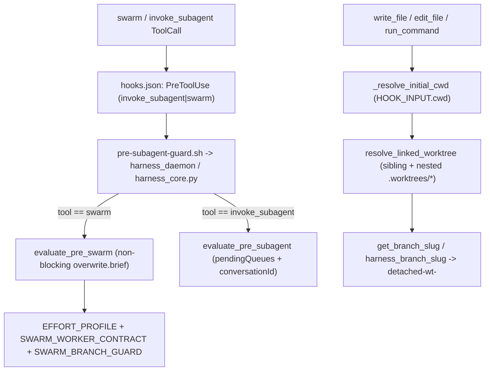
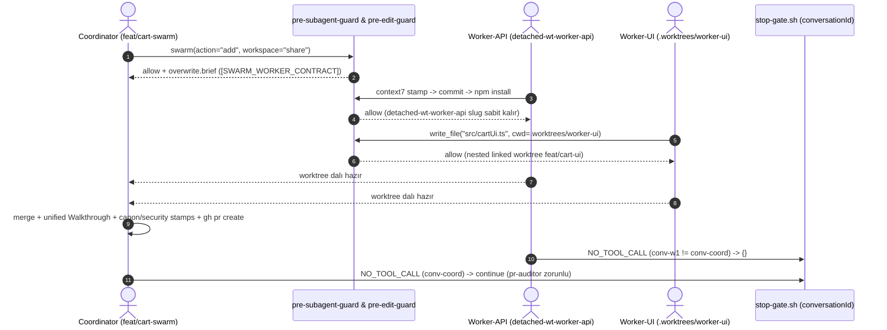

# Pull Request Mühendislik Rehberi: Antigravity Swarm Tam Uyumluluğu (`v1.1.0`)

---

## 1. Problem Bağlamı ve Mimari Kararlar

### Çözülen Gerçek Problem ve Kök Bağlam
`alps-agy-harness` (`v1.1.0`) altyapı katmanında singleton `harness-daemon`, `fcntl.flock` dosya kilitleri, `git-common-dir` tabanlı kardeş worktree çözümlemesi ve `conversationId` izole `stop-gate.sh` desteğine sahip olmasına rağmen, Antigravity'nin native `swarm` aracıyla doğrudan kullanımda beş kritik uyumluluk boşluğu bulunuyordu:
1. **`swarm` Aracı Kanca Körlüğü ve Çifte Orkestrasyon:** `hooks.json` yalnızca `invoke_subagent` çağrılarını yakaladığı için `swarm(action="add")` işçileri `[EFFORT_PROFILE]` başlığı olmadan başlıyor; `rules/AGENTS.md` kuralı yüzünden Swarm işçileri koordinatör görevini yürütmek yerine yeniden `jev_classify`, `brainstorming`, Spec ve `gh pr create` başlatmaya çalışıyordu.
2. **Detached HEAD Altında State Kaybı:** `workspace: "share"` veya `git worktree add --detach` ile açılan işçi worktree'lerinde `get_branch_slug()` ve `harness_branch_slug()` her commit sonrası değişen `detached-<7sha>` klasörü ürettiği için commit öncesi alınan `context7-verified.json` damgaları sonraki commit'te geçersiz kalıyordu.
3. **Paralel Aynı-`Role` Dispatch Çakışması & `HOOK_INPUT.cwd` İhmali:** `subagent-dispatch.json` yalnızca tekil `entries[role]` anahtarı tuttuğundan aynı çalışma ağacında aynı `--role` ile paralel çalışan işçiler birbirinin kaydını ezebiliyordu; ayrıca `evaluate_pre_command`, `evaluate_post_command` ve `evaluate_pre_edit` yük içindeki `HOOK_INPUT.cwd` alanını dikkate almıyor, `evaluate_pre_edit` ise `<workspace>/.worktrees/<ad>` altındaki iç içe linked worktree'leri `is_external=False` sayıp `main` kilidine takıyordu.
4. **Güncel Model Aileleri ve `SessionStart` Guardrail Eksikliği:** `gemini-4-neon-*` ve genel `gemini-4-*` varyantları `custom` sınıfına düşüp `bounded_execution` için eski Flash'a indirgeniyor; `SessionStart` ise korumalı `main`/`master` ve detached HEAD durumlarında yönlendirici uyarı vermiyordu.
5. **Kurulum ve Entegrasyon Rehberi Eksikliği:** `.agents/plugins/` kurulumlarının Swarm çalışma kopyalarında submodule başlatılmadan boş kalabilme riski `harness-doctor` ve `README.md` içinde belgelenmemişti.

### Seçilen Mimari Yaklaşım ve Gerekçesi
- **Bloklamayan Swarm Zenginleştirmesi (`evaluate_pre_swarm`):** `hooks.json` içindeki 3. `PreToolUse` matcher'ı `"invoke_subagent|swarm"` olarak genişletildi. `swarm(action="add")` çağrıları `invoke_subagent` gibi zorunlu `dispatch` engeline takılmadan (sharding `tasks` / `n` akışını bozmamak için) yalnız `overwrite.brief` üzerinden idempotent `[EFFORT_PROFILE]`, `[SWARM_WORKER_CONTRACT]` ve `share`/`branch` modları için `[SWARM_BRANCH_GUARD]` başlıklarını enjekte eder; salt-okunur `canon-auditor`, `security-reviewer` ve `pr-auditor` ise `invoke_subagent` üzerinde kalır.
- **Tek Doğruluk Kaynağı & Bash/Python Paritesi:** Tüm kanca mantığı `scripts/lib/harness_core.py` içinde genişletildi; `detached-wt-<slug>` ve `neon`/`gemini-4-*`/`custom` model sınıflandırması `scripts/hooks/common.sh` ile %100 paritede tutuldu, böylece çekirdek paket `53` dosya sınırında ve `rules/AGENTS.md` `7577` bayt (`< 8192`) sınırında korundu.

---

## 2. Mimari ve Veri Akışı Diyagramları

### Swarm Kanca Yönlendirme, Worktree Çözümleme ve `pendingQueues` Mimarisi

### Çoklu Swarm İşçisi Entegrasyon Dalı ve PR Kapısı Akışı

---

## 3. Dosya Bazlı Değişiklik Analizi

`git diff --name-status origin/main..HEAD` çıktısındaki (`docs/walkthroughs/*` ve `docs/parking-lot.md` hariç) **18 dosyanın tamamı** aşağıda dokümante edilmiştir:

### `README.md` — [GÜNCELLENDİ] (`Dokümantasyon`)
- **Ne Değişti / Ne Üretildi?:** Bölüm 7 altına `### Antigravity Swarm ile Kullanım` alt bölümü eklendi (tek `feat/*` entegrasyon dalı topolojisi, yazıcılar için `workspace: "share"` + alt dal ve okuyucular için `inherit`, `invoke_subagent|swarm` kanca davranışı, `detached-wt-<ad>` kararlı slug ve global kurulum önerisi); Bölüm 8 Bileşenler Özeti tablosundaki `pre-subagent-guard.sh` satırı `invoke_subagent\|swarm` içerecek şekilde güncellendi; `## Teknik Terimler Sözlüğü` tablosuna `Swarm (Antigravity Swarm)` satırı eklendi.
- **Neden Değişti / Neden Üretildi?:** Geliştiricilerin ve ekiplerin Swarm iş akışını `alps-agy-harness` kapılarıyla çakışmadan nasıl kurgulayacağını ve proje bazlı kurulumlarda neden global kurulumun tercih edilmesi gerektiğini açıkça belgelemek için güncellendi.

### `docs/superpowers/plans/2026-11-26-swarm-compatibility.md` — [ÜRETİLDİ] (`SDD Uygulama Planı`)
- **Ne Değişti / Ne Üretildi?:** `Global Constraints`, `allowedFiles` (17 dosya bütçesi), 4 aşamalı SDD görev tanımları (`Task 1`–`Task 4`) ve `## Teknik Terimler Sözlüğü` tablosunu içeren eksiksiz SDD uygulama planı oluşturuldu.
- **Neden Değişti / Neden Üretildi?:** Subagent-Driven Development (`task-brief`, `sdd-workspace`, `review-package`) döngüsünde her görev alt ajanı ve inceleyicisi için tek bağlayıcı gereksinim ve kapsam kaynağı sağlamak amacıyla üretildi.

### `hooks.json` — [GÜNCELLENDİ] (`Kanca Manifestosu`)
- **Ne Değişti / Ne Üretildi?:** `alps-agy-harness.PreToolUse` altındaki 3. kanca grubunun `matcher` alanı `"invoke_subagent"` değerinden `"invoke_subagent|swarm"` değerine genişletildi; hedef betik `./scripts/hooks/pre-subagent-guard.sh` ve `timeout: 15` korundu.
- **Neden Değişti / Neden Üretildi?:** Yeni çekirdek betik dosyası eklemeden (`53` dosya sınırını koruyarak) `swarm` araç çağrılarının da sıcak `harness-daemon` `/hook/pre-subagent` ve soğuk `eval-pre-subagent` hattından geçmesini sağlamak için güncellendi.

### `rules/AGENTS.md` — [GÜNCELLENDİ] (`Evrensel Orkestrasyon Kuralı`)
- **Ne Değişti / Ne Üretildi?:** Bölüm 1–10 metinleri tüm 34 zorunlu test belirteci korunarak sıkıştırıldı (`8172` → `7577` bayt, `< 8192` sınırı altında) ve `## 11. Swarm Coordinator & Worker Mode` bölümü eklendi (Koordinatör entegrasyon dalı + tekil PR/denetim sorumluluğu ve Swarm İşçisi kapsam sınırı).
- **Neden Değişti / Neden Üretildi?:** `always_on` kural dosyası Antigravity'nin 8 KB boyut sınırını aşmadan Swarm işçilerinin koordinatörün yerine geçip gereksiz `jev_classify`/Spec/PR döngüsüne girmesini engellemek için güncellendi.

### `scripts/hooks/common.sh` — [GÜNCELLENDİ] (`Paylaşımlı Kanca Kütüphanesi`)
- **Ne Değişti / Ne Üretildi?:** `_harness_slugify()` ayrıştırıldı ve `harness_branch_slug()` içinde detached HEAD durumundaki linked git worktree'ler için `cd -P --` tabanlı canonical `--git-dir` vs `--git-common-dir` kontrolüyle `detached-wt-<slug>` üretimi eklendi; `_harness_is_low_model_variant()` eklenerek `harness_classify_parent_model()` içine `neon` ile genel `gemini-4` yakalayıcıları ve `harness_resolve_subagent_model()` içine `neon` (`carbon` eşdeğeri) ile `custom` (`bounded_execution -> pro`) yönlendirmeleri eklendi.
- **Neden Değişti / Neden Üretildi?:** Bash kancaları ve `stamp-gate.sh` CLI'ının `scripts/lib/harness_core.py` ile macOS `/bin/bash` 3.2 üzerinde %100 slug ve model ailesi paritesini koruması için güncellendi.

### `scripts/lib/harness_core.py` — [GÜNCELLENDİ] (`Paylaşımlı Çekirdek Kütüphane`)
- **Ne Değişti / Ne Üretildi?:** `get_branch_slug()` içine linked worktree için kararlı `detached-wt-<slug>` mantığı eklendi; `SWARM_WORKER_CONTRACT_HEADER`, `SWARM_BRANCH_GUARD_HEADER` ve non-blocking `evaluate_pre_swarm()` eklendi ve `evaluate_pre_subagent()` içinden `tool_name == "swarm"` yönlendirmesi sağlandı; `dispatch_register()`, `_consume_dispatch_entry()`, `_sync_legacy_dispatch_entry()` ve `_try_consume_optional_dispatch()` ile `pendingQueues` FIFO + `conversationId` affinity kuyruğu kuruldu; `_resolve_initial_cwd()` eklenerek `evaluate_pre_command`, `evaluate_post_command` ve `evaluate_pre_edit` (`HOOK_INPUT.cwd` + iç içe `.worktrees/*` ata taraması) güncellendi; `classify_parent_model()` / `resolve_subagent_model()` içine `neon`/`gemini-4`/`custom` desteği, `build_session_start_payload()` içine `Swarm Worker Mode`, `[BRANCH GUARD]` ve `live_head != "UNBORN"` korumalı `[DETACHED HEAD]` satırları, `run_doctor_checks()` içine ise `INFO` düzeyinde `swarm_install_advisory` eklendi.
- **Neden Değişti / Neden Üretildi?:** Sıcak `harness-daemon` ile soğuk fallback arasında tam eşitlik sağlayarak Swarm'ın paralel worktree, detached HEAD, eşzamanlı dispatch ve model yönlendirme sorunlarını tek merkezde çözmek için güncellendi.

### `scripts/stamp-gate.sh` — [GÜNCELLENDİ] (`Damga ve Dispatch CLI`)
- **Ne Değişti / Ne Üretildi?:** `usage()` ve `cmd_dispatch()` içine `--conversation-id <id>` / `--conversation-id=<id>` (varsayılan `${HARNESS_CONVERSATION_ID:-}`) desteği eklendi ve Python çekirdeğine tire ile başlayan ID'lere karşı güvenli `--conversation-id="$conversation_id"` biçimiyle aktarıldı.
- **Neden Değişti / Neden Üretildi?:** Paralel Swarm işçilerinin aynı `--role` adını kullanırken kendi `conversationId`'lerine bağlı dispatch kayıtları oluşturabilmesini sağlamak için güncellendi.

### `skills/harness-orchestrator/SKILL.md` — [GÜNCELLENDİ] (`Orkestrasyon Skill'i`)
- **Ne Değişti / Ne Üretildi?:** `## 8. Antigravity Swarm Orkestrasyon Modu` bölümü eklendi; tek `feat/<konu>` entegrasyon dalı topolojisi, `workspace: "share"` vs `"inherit"` ayrımı, `pre-subagent-guard.sh` üzerinden non-blocking `overwrite.brief` davranışı ve `swarm` (paralel işçi) vs `invoke_subagent` (salt-okunur denetçiler) görev ayrımı tanımlandı.
- **Neden Değişti / Neden Üretildi?:** Ana orkestrasyon kılavuzunun `swarm` aracıyla hangi durumlarda paralel işçi çıkaracağını ve denetim kapılarını nerede toplayacağını netleştirmek için güncellendi.

### `skills/pre-pr-readiness/SKILL.md` — [GÜNCELLENDİ] (`PR Hazırlık Skill'i`)
- **Ne Değişti / Ne Üretildi?:** Adım 2 altına `Swarm Entegrasyon Dalı Kuralı` callout notu eklendi; çoklu Swarm işçi dallarının önce tek `feat/*` entegrasyon dalında birleştirilip ardından tek bütünleşik Walkthrough + `canon-auditor` + `security-reviewer` çalıştırılması kuralı belgelendi.
- **Neden Değişti / Neden Üretildi?:** İşçi dallarında parça parça veya mükerrer Walkthrough/PR kapısı üretilmesini önleyip tüm diff'i kapsayan tekil PR denetimi sağlamak için güncellendi.

### `tests/test-command-hooks.sh` — [GÜNCELLENDİ] (`Komut Kancası Test Paketi`)
- **Ne Değişti / Ne Üretildi?:** `test_detached_linked_worktree_context7_survives_commit` (detached linked worktree'de yeni commit sonrası `context7` izninin korunması) ve `test_hook_input_cwd_resolves_sibling_worktree_without_cd` (`workspacePaths[0]=main` iken `HOOK_INPUT.cwd` üzerinden kardeş worktree `git push`, `npm install`, `gh pr create`, `post-command-hooks.sh` ve açık `git -C` önceliği) testleri eklendi.
- **Neden Değişti / Neden Üretildi?:** Detached worktree state sürekliliğini ve `HOOK_INPUT.cwd` tabanlı komut/post-command çözümlemesini regresyon testine bağlamak için güncellendi.

### `tests/test-edit-and-session-hooks.sh` — [GÜNCELLENDİ] (`Dosya ve Oturum Kancası Test Paketi`)
- **Ne Değişti / Ne Üretildi?:** `test_hook_input_cwd_relative_edit_in_sibling_worktree` (göreceli `Path` + `HOOK_INPUT.cwd`), `test_nested_git_worktree_pre_edit_enforces_rules` (`<main>/.worktrees/worker-nested` içinde mutlak/göreceli edit, `eval()`, sözlük, `.harness-ignore`, `on_worktree_resolved` ve sıcak `daemon.py` paritesi) ve `test_session_start_swarm_protocol_branch_guard_and_detached_head` (`Swarm Worker Mode`, `[BRANCH GUARD]`, `[DETACHED HEAD]` ve git-dışı dizinde yanlış uyarı verilmemesi) testleri eklendi.
- **Neden Değişti / Neden Üretildi?:** Kardeş ve iç içe `.worktrees/*` senaryolarında `pre-edit-guard` kurallarının atlanmamasını ve `SessionStart` uyarı koşullarını doğrulamak için güncellendi.

### `tests/test-manifest.sh` — [GÜNCELLENDİ] (`Manifest ve Kanca Şeması Test Paketi`)
- **Ne Değişti / Ne Üretildi?:** `test_hooks_json_root_wiring` içindeki beklenen `PreToolUse` matcher dizisi `["write_file|edit_file","run_command","invoke_subagent|swarm"]` olarak güncellendi.
- **Neden Değişti / Neden Üretildi?:** `hooks.json` üzerinde `swarm` aracını da yakalayacak şekilde genişletilen matcher kontratını kilitlemek için güncellendi.

### `tests/test-plugin-bundle.sh` — [GÜNCELLENDİ] (`Paket Bütünlüğü ve Yaşam Döngüsü Test Paketi`)
- **Ne Değişti / Ne Üretildi?:** `skills/pre-pr-readiness/SKILL.md` için `Swarm Entegrasyon Dalı Kuralı` kontrolü, `README.md` için `Antigravity Swarm ile Kullanım`, `invoke_subagent\|swarm` tablo satırı ve `**Swarm (Antigravity Swarm)**` sözlük doğrulamaları eklendi (`53` çekirdek dosya sayacı korundu).
- **Neden Değişti / Neden Üretildi?:** Paket bütünlüğü, doküman sonu sözlük ve dokümantasyon/skill senkronizasyonu güvencelerini Swarm eklemeleri için genişletmek amacıyla güncellendi.

### `tests/test-rules-and-agents.sh` — [GÜNCELLENDİ] (`Kurallar ve Alt Ajanlar Test Paketi`)
- **Ne Değişti / Ne Üretildi?:** `test_agents_md_no_frontmatter_and_under_8kb` içine `rules/AGENTS.md` dosyasının `"Swarm"` ve `workspace: "share"` yönergelerini içerdiğini doğrulayan kontroller eklendi.
- **Neden Değişti / Neden Üretildi?:** `AGENTS.md` `< 8192` bayt sıkıştırmaları sırasında Swarm Coordinator/Worker sözleşmesinin yanlışlıkla silinmesini engellemek için güncellendi.

### `tests/test-sidecar-daemon.sh` — [GÜNCELLENDİ] (`Sidecar Daemon Test Paketi`)
- **Ne Değişti / Ne Üretildi?:** `test_swarm_cwd_detached_and_parallel_dispatch_daemon_vs_cold_parity` testi eklendi; izole `harness-daemon` açıkken ve `HARNESS_DISABLE_DAEMON=1` soğuk fallback modunda `swarm(action="add")`, `HOOK_INPUT.cwd`, `detached-wt-*` ve paralel aynı-`Role` `pendingQueues` yanıtlarının birebir eşitliği doğrulandı.
- **Neden Değişti / Neden Üretildi?:** Yeni eklenen tüm Swarm ve worktree davranışlarının canlı HTTP/Unix soket daemon ile soğuk Python CLI arasında sıfır sapma gösterdiğini kanıtlamak için güncellendi.

### `tests/test-stamp-and-common.sh` — [GÜNCELLENDİ] (`Ortak Kütüphane ve Damga Test Paketi`)
- **Ne Değişti / Ne Üretildi?:** `dispatch` testine tire ile başlayan `--conversation-id "-conv-dash"` sınaması eklendi; `test_detached_head_linked_worktree_stable_slug_across_commits` (ana repo vs linked `--detach` worktree slug paritesi ve commit sonrası `context7` korunumu) ve `test_neon_gemini4_and_custom_model_classification_parity` (`neon`, `gemini-4-*` ile `custom` `bounded_execution -> pro` Bash/Python kombinasyon parite kontrolleri) eklendi.
- **Neden Değişti / Neden Üretildi?:** `common.sh` ve `harness_core.py` arasındaki deterministik slug ve model sınıflandırma/çözümleme eşitliğini tüm kenar durumlarla kilitlemek için güncellendi.

### `tests/test-subagent-and-stop-hooks.sh` — [GÜNCELLENDİ] (`Alt Ajan ve Stop Kancası Test Paketi`)
- **Ne Değişti / Ne Üretildi?:** Mevcut paralel kilitleme testine harici ana makine daemon'ından etkilenmemesi için `HARNESS_DISABLE_DAEMON=1` eklendi; `test_swarm_pre_tool_use_brief_enrichment_and_passthrough` (`status`/`models`/`title`/`model`/`kill` passthrough, `add` + `share`/`inherit` başlık enjeksiyonu, `tasks`/`n` korunumu, UTF-8 idempotency, izole `"swarm"` dispatch tüketimi), `test_parallel_same_role_dispatch_queue_and_conversation_affinity` (FIFO `pendingQueues`, `conversationId` affinity, 3. çağrıda `deny`) ve `test_neon_gemini4_and_custom_parent_model_routing` (`neon`/`custom` yönlendirmesi) eklendi.
- **Neden Değişti / Neden Üretildi?:** `evaluate_pre_swarm` ve `pendingQueues` davranışlarının tüm durum geçişlerini ve geriye dönük `entries[role]` uyumluluğunu uçtan uca doğrulamak için güncellendi.

### `tests/test-utilities.sh` — [GÜNCELLENDİ] (`Araçlar ve Doctor Test Paketi`)
- **Ne Değişti / Ne Üretildi?:** `test_harness_doctor_project_install_emits_swarm_advisory_info` testi eklendi; `.agents/plugins/` ve `.agents/plugins.json` bulunan çalışma alanlarında `swarm_install_advisory` (`INFO`, `healthy: true`, çıkış kodu `0`) üretildiği ve `.harness-ignore` varken bastırıldığı doğrulandı.
- **Neden Değişti / Neden Üretildi?:** Proje bazlı eklenti kurulum uyarısının doktor sağlığını (`healthy: true`) bozmadan doğru koşullarda tetiklendiğini kanıtlamak için güncellendi.

---

## 4. Kritik İş Mantığı, Kenar Durumlar (Edge Cases) ve Hata Yönetimi

| Senaryo / Kenar Durum | Sistemin Davranışı ve Korunan Kural (*Invariant*) | Üretilen Hata / Yanıt Sözleşmesi |
| :--- | :--- | :--- |
| **`swarm(action="add")` vs `status/kill/tasks/n`** | `evaluate_pre_swarm` yalnızca `action == "add"` ve boş olmayan `brief` için çalışır; `overwrite` içinde yalnız `brief` döner, `tasks`/`n`/`model`/`workspace` alanlarına dokunmaz. | `{"decision": "allow"}` veya `{"decision": "allow", "overwrite": {"brief": ...}}` |
| **Detached HEAD: Ana Repo vs Linked Worktree** | `real_git_dir != real_common_dir` ve `parent.name == "worktrees"` ise `detached-wt-<slug>` sabitlenir; ana repo detached HEAD `detached-<7sha>` kalır. | Commit sonrası `context7-verified.json` korunur |
| **İç İçe `.worktrees/<ad>` Altında `write_file`** | `evaluate_pre_edit`, `is_external=False` olsa bile `.git` ata yürüyüşüyle linked worktree kökünü bulur ve `effective_ws` değerini günceller. | Ana repo `main` kilidine takılmaz; işçi dalı kuralları işler |
| **Aynı `--role` ile Paralel `dispatch` & `conversationId`** | `pendingQueues[role]` önce `conversationId == cur_conv` eşleşmesini, yoksa FIFO sırayla en eski tüketilmemiş kaydı tüketir ve `entries[role]` alanını senkronize tutar. | İlk `N` çağrı `allow`; `N+1`. çağrı `deny` |
| **Git-Dışı Dizinde `SessionStart`** | `branch == "HEAD"` kontrolü `live_head != "UNBORN"` şartına bağlıdır; yalnız gerçek git detached HEAD oturumlarında `[DETACHED HEAD]` basılır. | Git-dışı dizinlerde yanlış guardrail uyarısı çıkmaz |

---

## 5. Somut Doğrulama Kanıtları

### Depo Tam Test Paketi (`./scripts/run-quiet.sh full-suite -- ./tests/run-all.sh`)
`✅ PASS [full-suite] (süre: 162.5s, warnings: 0 — log: .harness/logs/last.log)` — **9/9 paket, 89/89 test, 0 hata:**

| Test Paketi | Sonuç | Kapsam |
| :--- | :--- | :--- |
| `tests/test-command-hooks.sh` | `11 passed, 0 failed` | Detached linked worktree `context7`, `HOOK_INPUT.cwd`, walkthrough & PR kapısı |
| `tests/test-edit-and-session-hooks.sh` | `10 passed, 0 failed` | `HOOK_INPUT.cwd` göreceli edit, iç içe `.worktrees/*`, `SessionStart` guardrails |
| `tests/test-manifest.sh` | `9 passed, 0 failed` | `hooks.json` `invoke_subagent\|swarm` matcher, `plugin.json` `1.1.0` |
| `tests/test-plugin-bundle.sh` | `3 passed, 0 failed` | **53 çekirdek dosya**, `README.md` / `SKILL.md` sözlük ve Swarm kontratları |
| `tests/test-rules-and-agents.sh` | `3 passed, 0 failed` | `rules/AGENTS.md` (`7577` bayt `< 8192`), 34+ belirteç, Swarm Worker sözleşmesi |
| `tests/test-sidecar-daemon.sh` | `16 passed, 0 failed` | İzole `daemon.py` vs soğuk fallback paritesi (`swarm add`, `cwd`, `detached-wt`, `pendingQueues`) |
| `tests/test-stamp-and-common.sh` | `15 passed, 0 failed` | `detached-wt-*` & `neon`/`gemini-4`/`custom` Bash/Python paritesi, tireli `conversationId` |
| `tests/test-subagent-and-stop-hooks.sh` | `13 passed, 0 failed` | `evaluate_pre_swarm` idempotency, paralel `pendingQueues`, `HARNESS_DISABLE_DAEMON=1` izolasyonu |
| `tests/test-utilities.sh` | `9 passed, 0 failed` | `swarm_install_advisory` (`INFO`, `healthy: true`), `run-quiet.sh`, `mobile-logs.sh` |

### Harici Scratchpad Uçtan Uca (`E2E`) Doğrulaması (Depo Dışı Geçici `run_e2e.sh`)
- İzole `/tmp/agy-e2e-*.sock` üzerinde canlı `daemon.py` ve `origin.git` uzak deposuna bağlı `mini-shop` projesi üzerinde koşturuldu:
  1. Koordinatör `main` üzerinde `[BRANCH GUARD]` + `Swarm Worker Mode` (`family: neon`) ve `src/index.ts` yazım kilidi doğrulandı.
  2. `feat/cart-swarm` dalında `swarm(action="add", workspace="share", tasks=..., n=2)` sıcak daemon ve soğuk fallback paritesiyle yalnız `overwrite.brief` üretti ve replay'de idempotent kaldı.
  3. Detached sibling `worker-api` (`detached-wt-worker-api`) commit sonrası `context7` damgasını korudu ve `eval()` engellendi; iç içe `.worktrees/worker-ui` (`feat/cart-ui`) `HOOK_INPUT.cwd` üzerinden göreceli `write_file`, `dangerouslySetInnerHTML` reddi ve `git push` izni doğrulandı.
  4. Paralel aynı-`Role` (`"Code Reviewer"`) `pendingQueues` + `conversationId` yakınlığı ve `gemini-4-neon-high` (`pro`) yönlendirmesi doğrulandı.
  5. Koordinatör birleştirmesi, birleşik walkthrough, `canon`/`security` damgaları, `gh pr create` kapısı, `conversationId` izole `stop-gate.sh`, `swarm_install_advisory` (`INFO`, `healthy: true`) ve çıkışta `ZERO_STRAY_E2E_DAEMONS` doğrulandı (`✅ ALL E2E SCRATCHPAD CHECKS PASSED!`).

---

## 6. Kapsam Dışı (`docs/parking-lot.md`) ve Operasyonel Notlar

- **Kapsam Dışı:** `plugin.json` sürümü (`1.1.0`) geriye dönük manifesto kontratı gereği korunmuştur.
- **Operasyonel Not:** `.worktrees/` kullanan hedef projelerde temiz `git status --porcelain` için `.worktrees/` deseninin `.gitignore` içinde yer alması gerekir.

---

## Teknik Terimler Sözlüğü

| Terim | Açıklama |
| :--- | :--- |
| **Antigravity Swarm** | Koordinatör ve ortak mesaj panosu üzerinden paralel çalışan işçi ajanlardan oluşan çoklu ajan yürütme mimarisi. |
| **`conversationId` Affinity** | Aynı `role` kuyruğundan birden fazla `subagent-dispatch` kaydı varken çağıran oturumun `conversationId` değerine öncelik veren eşleştirme kuralı. |
| **`detached-wt-<name>`** | Linked Git worktree içinde detached HEAD durumunda commit değişse bile `.harness/state/` yolunu sabit tutan çalışma ağacı kimlik slug'ı. |
| **`HOOK_INPUT.cwd`** | Antigravity kanca JSON yükünde aracın çalıştığı aktif çalışma dizinini bildiren alan. |
| **`pendingQueues`** | `subagent-dispatch.json` içinde paralel aynı-`Role` çağrılarını `flock` altında FIFO sırayla saklayan kuyruk yapısı. |
| **Walkthrough** | Bir PR'ın mimari kararlarını, değişen tüm dosyaların *Ne*/*Neden* analizlerini ve doğrulama kanıtlarını sunan mühendislik rehberi. |
