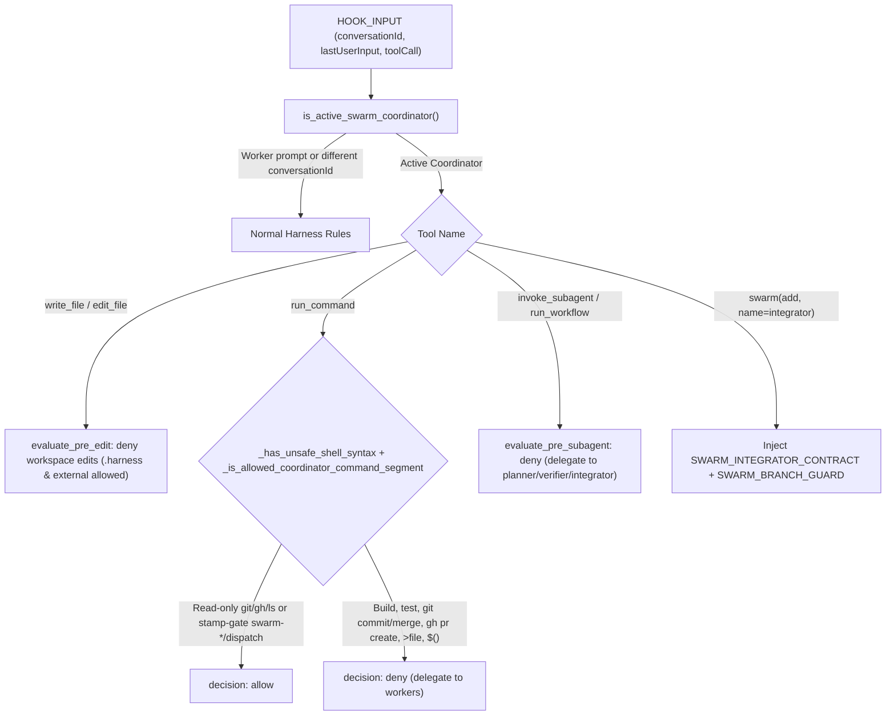

# Pull Request Mühendislik Rehberi: Swarm Coordinator-Only Koruması ve Çift Katmanlı Kota Bekleme / Otomatik Devam (`v1.4.0`)

---

## 1. Problem Bağlamı ve Mimari Kararlar

### Çözülen Gerçek Problem ve Kök Bağlam
`alps-agy-harness` (`v1.3.1`) içinde Swarm uyumluluk temeli bulunsa da iki kritik davranış boşluğu vardı:
1. **Koordinatör Rol Sızıntısı:** `/swarm` ile başlatılan bir oturumda koordinatör ajan fiziksel olarak kısıtlanmadığı için zaman zaman dosya yazabiliyor, test/derleme koşabiliyor, dal birleştirebiliyor veya `invoke_subagent` / `run_workflow` çağırabiliyordu.
2. **5 Saatlik ve Haftalık Kota Kesintileri:** Uzun soluklu Swarm oturumlarında Antigravity'nin 5 saatlik kayan penceresi veya haftalık kotası dolduğunda işçileri öldürmeden ve model değiştirmeden kota yenilenene kadar bekleyip kaldığı yerden devam eden bir kurtarma hattı yoktu.

### Seçilen Mimari Yaklaşım ve Gerekçesi
- **Dal-Bağımsız `swarm-coordinator.json` + Tam İzolasyon (`ADR-01`):** `.harness/state/swarm/swarm-coordinator.json` içinde `conversationId` anahtarlı koordinatör kaydı tutulur. Aktif koordinatör için `evaluate_pre_edit` tüm çalışma alanı yazmalarını reddeder (`.harness/` ve harici UI `plan.json` yolları hariç), `evaluate_pre_command` yalnızca salt-okunur inceleme ve `stamp-gate.sh`/`harness-doctor.sh` koordinasyon komutlarına izin verir (ve `$(...)`/backtick/dosyaya yönlendirme bypass'larını engeller), `evaluate_pre_subagent` ise `invoke_subagent` ve `run_workflow` çağrılarını reddeder. Birleştirme ve PR kapıları uzman `integrator` Swarm işçisine (`[SWARM_INTEGRATOR_CONTRACT]`) devredilir.
- **Saf Bekleme ve Çift Katmanlı Otomatik Devam (`ADR-02` & `ADR-03`):** Kota dolduğunda `swarm(action="model|kill")` çağrıları `force_ask` ile korunur. Katman 1'de koordinatör `swarm(action="models")` -> `stamp-gate.sh swarm-quota pause` -> `schedule` ile bekler. Katman 2'de koordinatörün kendisi `Stop(ERROR)` ile kotaya takılırsa `stop-gate.sh` anlık döngüye girmeden `{}` döner, `swarm-quota-wait.json` yazar ve `harness-daemon`'ı uyandırır. Daemon çalışma alanını TTL temizliğinden muaf tutar ve `nextProbeEpoch` zamanında `agy --conversation <id> --print=...` ile oturumu uyandırır; kota hâlâ doluysa yeni sıfırlama zamanını ayrıştırır veya sınırlı üstel geri çekilme uygular.

---

## 2. Mimari ve Veri Akışı Diyagramları

### Coordinator-Only Fiziksel Kanca Mimarisi


### Çift Katmanlı Kota Bekleme ve Otomatik Devam Akışı
```mermaid
sequenceDiagram
    autonumber
    actor Coord as Swarm Coordinator
    participant Stop as stop-gate.sh
    participant State as .harness/state/swarm/swarm-quota-wait.json
    participant Daemon as harness-daemon (watcher_loop)
    participant Agy as agy --conversation

    Note over Coord: 5h veya haftalik kota doldu (Stop ERROR)
    Coord->>Stop: Stop(terminationReason="ERROR", error="RESOURCE_EXHAUSTED...")
    Stop->>State: record_swarm_quota_pause(window="5h|weekly", nextProbeEpoch)
    Stop->>Daemon: notify_swarm_quota_wait()
    Stop-->>Coord: {} (anlik kota dongusune girmez)
    Note over Daemon: Workspace TTL eviction muaf; sifir token bekleme
    Daemon->>State: status="resuming" (nextProbeEpoch <= now)
    Daemon->>Agy: agy --conversation <id> --print="[SWARM_QUOTA_AUTO_RESUME]..."
    alt Kota hala dolu (429 / quota error)
        Agy-->>Daemon: exit != 0 (quota exhausted)
        Daemon->>State: capped exponential backoff -> status="waiting"
    else Kota acildi
        Agy-->>Daemon: exit 0 -> Coordinator models + swarm-quota resume + @mention workers
        Daemon->>State: status="resumed", attemptCount++
    end
```

---

## 3. Dosya Bazlı Değişiklik Analizi

### `README.md` — [GÜNCELLENDİ] (`Dokümantasyon`)
- **Ne Değişti / Ne Üretildi?:** Başlık sürümü `v1.4.0` olarak güncellendi; `### Antigravity Swarm ile Kullanım` altına Sıkı Coordinator-Only (`swarm-coordinator.json`), `integrator` Swarm işçisi ve 5 Saatlik/Haftalık Saf Bekleme Kota Kurtarma (`swarm-quota-wait.json`, `harness-daemon` `agy --conversation` watchdog) maddeleri eklendi; Bölüm 8 bileşen tablosu ve `## Teknik Terimler Sözlüğü` güncellendi.
- **Neden Değişti / Neden Üretildi?:** Kullanıcıların ve geliştiricilerin Coordinator-Only kurallarını ve uzun soluklu oturumlardaki otomatik kota bekleme/devam akışını doğrudan dokümantasyondan öğrenebilmesi için güncellendi.

### `plugin.json` — [GÜNCELLENDİ] (`Eklenti Manifestosu`)
- **Ne Değişti / Ne Üretildi?:** `version` alanı `"1.3.1"` değerinden `"1.4.0"` değerine yükseltildi.
- **Neden Değişti / Neden Üretildi?:** Yeni Coordinator-Only fiziksel kanca koruması ve çift katmanlı kota kurtarma yeteneği minör sürüm artışı olarak işaretlendi.

### `rules/AGENTS.md` — [GÜNCELLENDİ] (`Evrensel Orkestrasyon Kuralı`)
- **Ne Değişti / Ne Üretildi?:** Bölüm 1–10 metinleri mevcut 47 zorunlu test jetonu korunarak sıkıştırıldı (`7793` bayt `< 8192` sınırı altında); `## 11. Swarm Coordinator-Only, Worker/Integrator & Pure-Wait Quota Recovery` bölümü eklendi.
- **Neden Değişti / Neden Üretildi?:** `always_on` kural dosyasında Antigravity'nin 8 KB sınırını aşmadan koordinatöre mutlak devretme kuralını, `integrator` rolünü ve Saf Bekleme kota kurtarma protokolünü zorunlu kılmak için güncellendi.

### `scripts/lib/harness_core.py` — [GÜNCELLENDİ] (`Paylaşımlı Çekirdek Kütüphane`)
- **Ne Değişti / Ne Üretildi?:** Dal-bağımsız `get_swarm_state_dir()`, `register_swarm_coordinator()`, `is_active_swarm_coordinator()`, `_has_unsafe_shell_syntax_for_coordinator()`, `_check_coordinator_raw_segments()` (`time`/`nohup`/`command`/`builtin` sarmalayıcı atlamaları, `/usr/bin/sudo`/`env -S`, bare assignment ve tehlikeli env atamaları; `evaluate_pre_command` içinde erken çağrım), `_is_trusted_coordinator_exe()` (`..` ve symlink `realpath` doğrulaması), `sort` kümelemeli `-ro`/`-uo`/`--out=`/`--comp*` ve `..` kapanışları, `_extract_stamp_gate_subcmd_and_actions()` & `_evaluate_coordinator_stamp_gate()`, `gün` destekli `parse_quota_reset_epoch()`, `_safe_float()`, `resumingToken` korumalı `attempt_swarm_quota_resume()` ve `swarm-coordinator`/`swarm-quota` CLI alt komutları eklendi.
- **Neden Değişti / Neden Üretildi?:** Sıcak daemon ve soğuk fallback arasında tam eşitlikle sarmalayıcı (`time sudo`/`time env -S`), kümelemeli `sort -ro` ve `..` yol geçişi atlatma açıklarını kapatmak ve kota otomatik devam durum makinesini yarış koşullarından arındırmak için güncellendi.

### `scripts/stamp-gate.sh` — [GÜNCELLENDİ] (`Damga ve Durum CLI`)
- **Ne Değişti / Ne Üretildi?:** `usage()` ve hata mesajlarında `attempt-resume` belgelendi; `cmd_swarm_coordinator()` ve `cmd_swarm_quota()` alt komutları eklendi (`pause`, `resume`, `status`, `clear`, `attempt-resume`), yinelenen/çakışan `--action` bayraklarını (`--action` ve `--action=`) reddetme eklendi ve `pause` sonrası `--workspace` yolu `pwd -P` ile çözümlenerek `/event/swarm-quota-wait` bildirimi gönderildi.
- **Neden Değişti / Neden Üretildi?:** Koordinatörün oturum içi kota durumunu Bash 3.2 uyumlu CLI üzerinden kaydetmesi, çakışan `--action` enjeksiyonunu CLI tarafında da durdurması ve göreceli yollarda arka plan daemon bekleyicisini anında kurması için güncellendi.

### `sidecars/harness-daemon/daemon.py` — [GÜNCELLENDİ] (`Arka Plan Sidecar Daemon`)
- **Ne Değişti / Ne Üretildi?:** `HarnessDaemonState` içine `_quota_resume_inflight`, `_watcher_cycles`, `watcher_cycle_count()`, `active_quota_wait_count()`, `notify_swarm_quota_wait()` ve `_run_swarm_quota_resume()` (başarılı `resumed` sonrasında `lastSeenAt` yenilemesiyle) eklendi; `_load_registry()` ve `watcher_loop()` aktif kota beklemesi olan çalışma alanlarını TTL temizliğinden muaf tutacak, bozuk kota durumlarında `try/except` + `_safe_float` ile çökmeyecek ve bayat `"resuming"` durumlarını `stale_threshold` sonrasında kurtaracak şekilde güncellendi; `GET /health` (`quotaWaits`, `watcherCycles`), `POST /hook/stop-gate` ve `POST /event/swarm-quota-wait` eklendi.
- **Neden Değişti / Neden Üretildi?:** Koordinatörün kendi kotası dolup `Stop(ERROR)` ile durduğu senaryoda sıfır token harcayarak 5 saatlik/7 günlük pencereleri bekleyip oturumu otomatik devam ettirmek ve izleme döngüsünün ilerleyişini `watcherCycles` üzerinden deterministik gözlemlemek için güncellendi.

### `skills/harness-orchestrator/SKILL.md` — [GÜNCELLENDİ] (`Orkestrasyon Skill'i`)
- **Ne Değişti / Ne Üretildi?:** `## 8. Antigravity Swarm Orkestrasyon Modu (Coordinator-Only & Kota Kurtarma)` bölümü sıkı Coordinator-Only kuralları, uzman işçi rolleri (`planner`, `implementer-*`, `verifier`, `integrator`) ve Çift Katmanlı Saf Bekleme Kota Kurtarma protokolüyle yenilendi.
- **Neden Değişti / Neden Üretildi?:** Orkestratör ajana `/swarm` başlatıldığında hangi rolleri nasıl dağıtacağını ve 5 saatlik/haftalık kota sınırında hangi adımları izleyeceğini net tanımlamak için güncellendi.

### `skills/pre-pr-readiness/SKILL.md` — [GÜNCELLENDİ] (`PR Hazırlık Skill'i`)
- **Ne Değişti / Ne Üretildi?:** `Swarm Entegrasyon Dalı Kuralı` callout notu birleştirme, Walkthrough, `canon-auditor`, `security-reviewer`, `tdd-pass`, `ui-pass`, `gh pr create` ve `pr-auditor` adımlarının koordinatör yerine uzman `integrator` Swarm işçisi tarafından yürütüleceğini belirtecek şekilde güncellendi.
- **Neden Değişti / Neden Üretildi?:** Tam izolasyonlu Coordinator-Only modeliyle `pre-pr-readiness` iş akışının çelişmesini önlemek için güncellendi.

### `docs/superpowers/specs/2026-11-26-swarm-coordinator-isolation-and-quota-resume-design.md` — [ÜRETİLDİ] (`Tasarım Spesifikasyonu`)
- **Ne Değişti / Ne Üretildi?:** Problem tanımı, hedefler, ADR-01/ADR-02/ADR-03 kararları (`jev_check`: `0.76`), durum dosyası şemaları ve CLI sözleşmelerini içeren tasarım dokümanı oluşturuldu.
- **Neden Değişti / Neden Üretildi?:** Uygulama öncesinde mimari kararları, güvenlik sınırlarını ve `53` dosya / `< 8192` bayt kısıtlarını kayıt altına almak için üretildi.

### `docs/superpowers/plans/2026-11-26-swarm-coordinator-isolation-and-quota-resume.md` — [ÜRETİLDİ] (`Uygulama Planı`)
- **Ne Değişti / Ne Üretildi?:** `Global Constraints`, `allowedFiles` kapsam listesi, 5 aşamalı görev listesi ve doğrulama odağını içeren uygulama planı oluşturuldu.
- **Neden Değişti / Neden Üretildi?:** Çok adımlı geliştirme sırasında kapsam disiplinini ve doğrulama kriterlerini sabitlemek için üretildi.

### `tests/test-command-hooks.sh` — [GÜNCELLENDİ] (`Komut Kancası Testleri`)
- **Ne Değişti / Ne Üretildi?:** `test_swarm_coordinator_only_command_allowlist_and_bypass_guards` testi genişletildi (`swarm-coordinator on`, `swarm-quota pause`, `dispatch`, `select-model`, `tree-sha`, `verify-pr-stamps`, tırnaklı `grep '>'`, `/usr/bin/cat` ve zararsız `env FOO=bar git status` izinleri; `time`/`nohup`/`command`/`builtin` + `sudo`/`env -S`/tehlikeli env kombinasyonları, `sort -ro`/`-uo`/`--out=`/`--compress-program=`, `/usr/bin/../../tmp/x/cat`, `swarm-quota attempt-resume`, bozuk tırnak, `>&2file`, `find -execdir/-ok/-okdir/-fprint0/-fprintf/-fls`, `git --config-env/--exec-path`, `gh auth/issue/repo`, `--action`/`--action=` çakışma geçersiz kılmaları ve `resuming` durumunda erken `resume` `force_ask` kontrolü).
- **Neden Değişti / Neden Üretildi?:** `pre-command-guard.sh` üzerinden koordinatör izin listesinin, sarmalayıcı/kümeleme/`..` atlatma kapanışlarının ve tüm yasak bayrak dallarının mutasyonlara karşı kilitlenmesi için güncellendi.

### `tests/test-edit-and-session-hooks.sh` — [GÜNCELLENDİ] (`Dosya ve Oturum Testleri`)
- **Ne Değişti / Ne Üretildi?:** `test_swarm_coordinator_only_pre_edit_and_session_start` testi genişletildi (düz metinde yanlış pozitif olmaması, `/swarm` ve `title` ile koordinatör yazma reddi, `.harness/state/swarm/*` hedeflerinin koordinatöre kapatılması, harici UI `plan.json` izni, bağlı worktree ve `explicitlyDisabled` geçersiz kılması, `__default__` anahtarı ve bozuk JSON dayanıklılığı).
- **Neden Değişti / Neden Üretildi?:** `pre-edit-guard.sh` ve `session-start.sh` davranışlarını tüm sınır durumlarıyla ve kendini devre dışı bırakma girişimlerine karşı doğrulamak için güncellendi.

### `tests/test-helpers.sh` — [GÜNCELLENDİ] (`Ortak Test Yardımcıları`)
- **Ne Değişti / Ne Üretildi?:** Test süreçlerinin dış Antigravity ajan oturumunun `HARNESS_CONVERSATION_ID`, `ANTIGRAVITY_CONVERSATION_ID` ve `ANTIGRAVITY_SOURCE_METADATA` ortam değişkenlerini devralmaması için başlangıçta temizleme (`unset`) eklendi.
- **Neden Değişti / Neden Üretildi?:** Canlı bir Antigravity sohbeti içinde `./tests/run-all.sh` koşulurken `--conversation-id` verilmeyen birim testlerinin ana sohbet kimliğinden izole kalmasını sağlamak için güncellendi.

### `tests/test-manifest.sh` — [GÜNCELLENDİ] (`Manifesto Testleri`)
- **Ne Değişti / Ne Üretildi?:** `test_plugin_json_required_fields` içindeki beklenen sürüm `"1.4.0"` olarak güncellendi.
- **Neden Değişti / Neden Üretildi?:** `plugin.json` sürüm artışını manifesto test sözleşmesiyle eşitlemek için güncellendi.

### `tests/test-plugin-bundle.sh` — [GÜNCELLENDİ] (`Paket Bütünlüğü Testleri`)
- **Ne Değişti / Ne Üretildi?:** `README.md` içinde `Coordinator-Only` ve `swarm-quota-wait.json`, `skills/pre-pr-readiness/SKILL.md` içinde `integrator` kontrolleri eklendi (`53` çekirdek dosya sayacı korundu).
- **Neden Değişti / Neden Üretildi?:** Yeni dokümantasyon ve skill sözleşmelerinin çekirdek paket bütünlüğü testiyle doğrulanması için güncellendi.

### `tests/test-rules-and-agents.sh` — [GÜNCELLENDİ] (`Kurallar Testleri`)
- **Ne Değişti / Ne Üretildi?:** `rules/AGENTS.md` için `Coordinator-Only`, `integrator`, `swarm-quota`, `quota_resets` ve `schedule` jeton kontrolleri eklendi.
- **Neden Değişti / Neden Üretildi?:** `< 8192` bayt sıkıştırmaları sırasında yeni Swarm koordinatör ve kota kurallarının silinmemesini garanti altına almak için güncellendi.

### `tests/test-sidecar-daemon.sh` — [GÜNCELLENDİ] (`Sidecar Daemon Testleri`)
- **Ne Değişti / Ne Üretildi?:** `test_daemon_swarm_coordinator_parity_and_quota_auto_resume_watchdog` testi genişletildi (`HARNESS_DISABLE_DAEMON=1` yalıtımlı CLI adımları, `watcherCycles` deterministik döngü sayacı ile bayat eşiği aşan tekilleştirme kanıtı, `resumed` sonrası `workspaces.json` `lastSeenAt` yenileme ve kalıcılık doğrulaması, bayat `"resuming"` ve bozuk `nextProbeEpoch` dayanıklılığı, `.harness-ignore`/`400` yanıtları ve 30s poll aralığında `/event/swarm-quota-wait` + `/hook/stop-gate` anlık `quotaWaits` tetiklemesi).
- **Neden Değişti / Ne Üretildi?:** Arka plan kota bekleyicisinin gerçek bir izole daemon süreci altında uyku tabanlı kırılganlık olmadan deterministik çalıştığını, `lastSeenAt` koruduğunu ve anlık tetikleme yaptığını uçtan uca kanıtlamak için güncellendi.

### `tests/test-stamp-and-common.sh` — [GÜNCELLENDİ] (`Damga CLI Testleri`)
- **Ne Değişti / Ne Üretildi?:** `test_stamp_gate_swarm_coordinator_and_swarm_quota_cli` (`HARNESS_DISABLE_DAEMON=1` ile izole) testi genişletildi (`--action` çakışma reddi, `HARNESS_CONVERSATION_ID`/`ANTIGRAVITY_CONVERSATION_ID` ortam değişkeni yedekleri, erken `attempt-resume` engeli, açık sıfırlama + sınırlı üstel geri çekilme epok hesaplaması, aktif beklemede yeniden `pause` kalıtımı, stdout kota hatası reddi, tekil `is_quota_exhausted_error` & pencere/saat dilimi/Türkçe süre testleri, `OSError` dalı ve `threading.Barrier` ile eşzamanlı `attempt_swarm_quota_resume` / `register_swarm_coordinator` kilit testleri).
- **Neden Değişti / Ne Üretildi?:** `stamp-gate.sh` CLI sözleşmesini, `attempt_swarm_quota_resume` zamanlama/geri çekilme matematiğini ve dosya kilidi eşzamanlılığını mutasyonlara karşı kilitlemek için güncellendi.

### `tests/test-subagent-and-stop-hooks.sh` — [GÜNCELLENDİ] (`Alt Ajan ve Stop Testleri`)
- **Ne Değişti / Ne Üretildi?:** `test_swarm_coordinator_blocks_subagent_workflow_and_enforces_integrator_and_pure_wait` ve `test_stop_gate_detects_coordinator_quota_error_without_looping` testleri genişletildi (`swarm(add)` ile otomatik koordinatör kaydı, `off` sonrası yeniden açılmama, işçi `title`/bağlı worktree dışlamaları, `release`/`pr-shepherd`/`integrator-2` rolleri ve boş `conversationId` ile `force_ask`).
- **Neden Değişti / Neden Üretildi?:** Alt ajan delegasyon sınırlarını, otomatik koordinatör kayıt yaşam döngüsünü ve `Stop` kancası kota tespitini tam kapsamlı doğrulamak için güncellendi.

---

## 4. Kritik İş Mantığı, Kenar Durumlar (Edge Cases) ve Hata Yönetimi

| Senaryo / Kenar Durum | Sistemin Davranışı ve Korunan Kural (*Invariant*) | Üretilen Yanıt / Durum |
| :--- | :--- | :--- |
| **Düz metinde `"swarm"` kelimesi** | Yalnızca `/swarm` slash komutu (`SWARM_SLASH_CMD_RE`) veya `swarm-coordinator.json` kaydı koordinatör sayılır. | Normal görevlerde yanlış pozitif `deny` oluşmaz |
| **Çakışan `--action` bayrak enjeksiyonu** | `_extract_stamp_gate_subcmd_and_actions` tüm eylem jetonlarını toplar (`> 1` -> `deny`); `stamp-gate.sh` de yinelenen `--action` bayrağında exit `1` verir. | `status --action off/clear/resume` bypass'ı çalışmaz |
| **Sarmalayıcı, kümeleme ve `..` yol geçişi** | `_check_coordinator_raw_segments` `time`/`nohup`/`command`/`builtin` sarmalayıcılarını geçip iç `sudo`/`env -S`/tehlikeli env yakalar; `sort` `-o`/`-ro`/`--out=`/`--comp*` engeller; `_is_trusted_coordinator_exe` `..` ve `realpath` denetler. | `time sudo`, `time env -S`, `sort -ro` ve `/usr/bin/../../tmp/...` engellenir |
| **Koordinatör `.harness/state/swarm/*` yazması** | `evaluate_pre_edit` içindeki `is_active_swarm_coordinator` kontrolü `.harness/` muafiyetinden önce çalışır; `stamp-gate.sh` kendini kapatma komutları engellenir. | Koordinatör kendi koruma dosyasını silemez veya değiştiremez |
| **Uçuş içi yeniden pause & bayat `resuming`** | `attempt_swarm_quota_resume` benzersiz `resumingToken` ve kilit kullanır; `watcher_loop` `stale_threshold` aşımında bayat durumu devralır ve `resumed` sonrasında `lastSeenAt` yenilenir. | Uzun prob sırasında yeni `pause`/`clear` ezilmez; eşzamanlı prob yalnızca 1 `agy` başlatır |
| **Haftalık beklemelerde daemon ömrü** | `has_active_swarm_quota_wait(ws)` True iken `_load_registry` ve `watcher_loop` TTL eviction atlar; `_safe_float` bozuk epoklarda çökmeyi önler. | 5 saatlik / 7 günlük beklemelerde kayıt silinmez |

---

## 5. Somut Doğrulama Kanıtları

1. **Tam Depo Test Paketi (`./scripts/run-quiet.sh full-tests -- ./tests/run-all.sh`):**
   `✅ PASS [full-tests] (süre: 354.8s, warnings: 0 — log: .harness/logs/last.log)` — **9/9 paket, 108/108 test, 0 hata:**
   - `tests/test-command-hooks.sh`: `14 passed, 0 failed`
   - `tests/test-edit-and-session-hooks.sh`: `14 passed, 0 failed`
   - `tests/test-manifest.sh`: `9 passed, 0 failed`
   - `tests/test-plugin-bundle.sh`: `3 passed, 0 failed` (`53` çekirdek dosya korundu)
   - `tests/test-rules-and-agents.sh`: `3 passed, 0 failed` (`rules/AGENTS.md` `7793` bayt `< 8192`)
   - `tests/test-sidecar-daemon.sh`: `19 passed, 0 failed`
   - `tests/test-stamp-and-common.sh`: `18 passed, 0 failed`
   - `tests/test-subagent-and-stop-hooks.sh`: `17 passed, 0 failed`
   - `tests/test-utilities.sh`: `11 passed, 0 failed`
2. **Sertleştirme Sonrası Sözdizimi Kontrolü (`py_compile` & `bash -n`):**
   `python3 -m py_compile scripts/lib/harness_core.py sidecars/harness-daemon/daemon.py && bash -n scripts/stamp-gate.sh` sıfır hata ile geçti.

---

## 6. Kapsam Dışı (`docs/parking-lot.md`) ve Operasyonel Notlar

- **Operasyonel Not:** Canlı `harness-daemon` sürecinin yeni `swarm-quota-wait` özelliklerini kullanması için eklenti güncellemesi sonrası arka plan daemon yeniden başlatılmalıdır (aksi halde önceki sürüm soketi devralana kadar mevcut soğuk fallback kancaları koruma sağlar).

---

## Teknik Terimler Sözlüğü

| Terim | Açıklama |
| :--- | :--- |
| **Coordinator-Only Modu** | Swarm koordinatörünün dosya düzenleme, derleme/test ve git mutasyonu yapmasının fiziksel kancalarla engellenip yalnızca koordinasyona ayrıldığı çalışma modu. |
| **Integrator Worker** | Swarm işçilerinin dallarını tek `feat/*` entegrasyon dalında birleştirip `pre-pr-readiness`, `gh pr create` ve `pr-auditor` kapılarını yürüten uzman işçi rolü. |
| **Pure-Wait Quota Policy** | 5 saatlik veya haftalık kota dolduğunda işçileri öldürmeden ve model değiştirmeden kota yenilenene kadar bekleyen politika. |
| **Capped Exponential Backoff** | Devam denemesi hâlâ kota hatası aldığında bekleme süresini üst sınır (`MAX_BACKOFF`) ile sınırlayarak katlayan yeniden deneme stratejisi. |
| **Walkthrough** | Bir PR'ın mimari kararlarını, değişen tüm dosyaların *Ne*/*Neden* analizlerini ve doğrulama kanıtlarını sunan mühendislik rehberi. |
