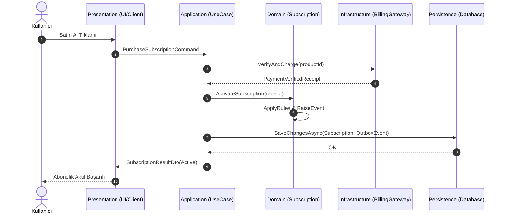
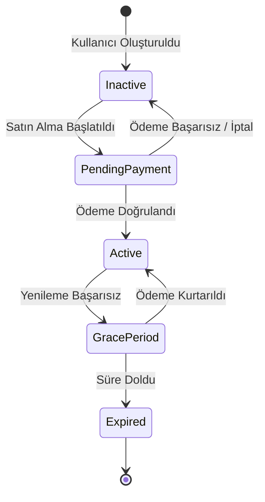

# Alan Kanonu: Kanonik İş Akışları (Domain Flows)

Bu doküman, sistemdeki kritik iş süreçlerinin değişmez kurallarını (*invariants*), adım sıralamasını ve hata telafi mantığını tanımlar. Başka bir özellik veya değişiklik burada tanımlanan adımların sırasını değiştiremez veya adımları atlayamaz.

---

## FLW-001: [Akış Başlığı - Örnek: Abonelik Satın Alma ve Yetkilendirme]

### 1. Akış Özeti ve Tetikleyici
- **Akış Kimliği:** `FLW-001`
- **Sorumlu Bounded Context:** `Subscriptions & Entitlements`
- **Tetikleyici (Trigger):** Kullanıcı mobil veya web arayüzünde "Satın Al" butonuna tıklar.
- **Ön Koşullar (Pre-conditions):**
  1. Kullanıcı kimliği doğrulanmış (`Authenticated`) olmalıdır.
  2. Kullanıcının mevcut aktif aynı seviye aboneliği bulunmamalıdır.

### 2. Sıralı Zorunlu Adımlar (Ordered Execution Steps)
1. **İstek Alınır ve Valide Edilir:** Presentation katmanı DTO'yu alır; ürün kimliği ve kullanıcı kimliği doğrulanır.
2. **Kanonik İş Kuralı Kontrolü:** Application use-case handler domain repository üzerinden mevcut abonelik durumunu sorgular.
3. **Ödeme Sağlayıcı Çağrısı:** `BillingGateway` adaptörü dış servisi (RevenueCat / Stripe) çağırır.
4. **Domain Event Yayınlanır:** `SubscriptionPurchasedDomainEvent` üretilir ve veri tabanı işlemiyle atomik kaydedilir (Outbox deseni).
5. **Yetki Güncellenir:** Müşterinin `Entitlement` kaydı bellek içi önbellekte ve kalıcı depoda yenilenir.
6. **İstemciye Yanıt:** Güncel yetki durumu DTO'su istemciye döndürülür.

### 3. Değişmez Kurallar (Invariants)
- **Asla İstemciye Güvenme:** İstemciden gelen "satın alma başarılı" makbuzuna doğrudan güvenilmez; sunucu tarafı veya `BillingGateway` yetki doğrulaması zorunludur.
- **Atomik Durum Değişimi:** Kullanıcı abonelik durumu ve faturalandırma kaydı tek bir işlem veya outbox mekanizması ile güncellenmelidir.

### 4. Akış Diyagramı (Sequence Diagram)

### 5. Durum Makinesi (State Diagram)

### 6. Hata Yolları ve Telafi Aksiyonları (Failure Paths)
- **Ödeme Başarısız Olduğunda:** Kullanıcıya anlaşılır hata mesajı gösterilir; `Domain` üzerinde abonelik durumu değiştirilmez.
- **Ağ Kesintisi:** İstemci `Idempotency-Key` başlığıyla isteği güvenle tekrar deneyebilir.

---

## Teknik Terimler Sözlüğü

| Terim | Açıklama |
| :--- | :--- |
| **Domain Event** | Alan katmanında gerçekleşen ve sistemin diğer bölümlerinin haberdar olması gereken önemli bir iş olayını temsil eden değişmez nesne. |
| **Invariants (Değişmez Kurallar)** | Bir iş modelinin veya akışın her an geçerli olmak zorunda olduğu tutarlılık kuralları bütünü. |
| **Outbox Deseni** | Veritabanı durum değişikliği ile buna bağlı olayların aynı yerel veritabanı işleminde atomik kaydedilip asenkron iletilmesini sağlayan dayanıklılık deseni. |
| **Sequence Diagram** | Bileşenler arasındaki zaman sırasına göre dizilmiş mesajlaşma ve metot çağrılarını görselleştiren UML diyagramı. |
| **State Machine (Durum Makinesi)** | Bir varlığın alabileceği sonlu durumları ve bu durumlar arasındaki geçerli geçiş kurallarını belirten model. |
