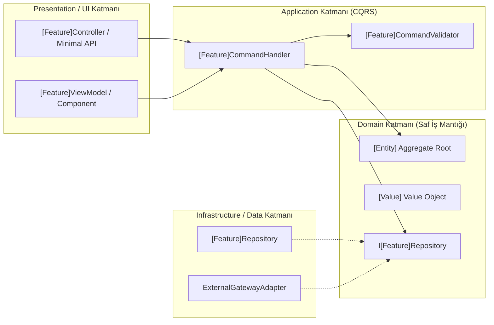
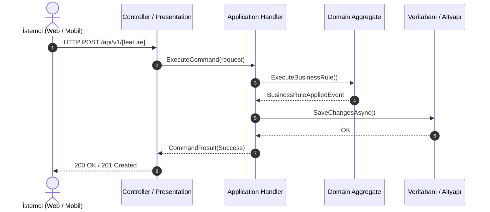
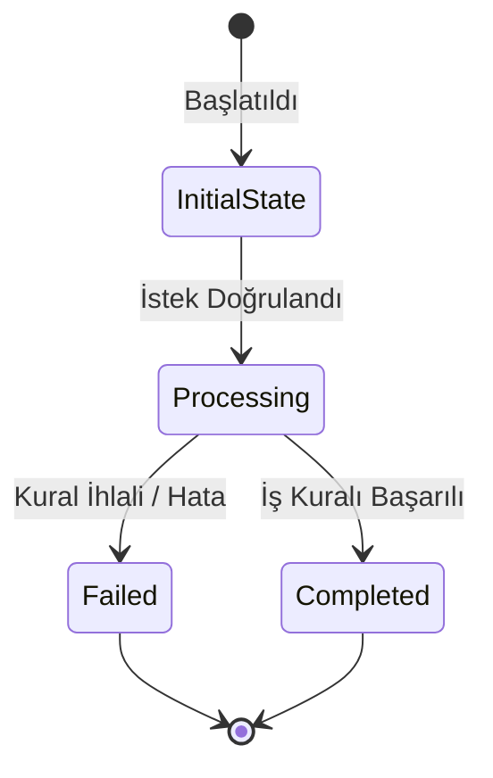

# Pull Request Görsel Rehberi: [Özellik / Düzeltme Başlığı]

Bu doküman, bu PR ile yapılan değişikliklerin amacını, mimari katman dağılımını, veri akışını ve doğrulama adımlarını yeni katılan bir geliştiricinin kolayca anlayabileceği sadelikte açıklar.

---

## 1. İş Amacı ve Mimari Özet

### Neyi ve Neden Değiştirdik?
- **İş Problemi / İhtiyaç:** [Kullanıcının veya sistemin karşılaştığı temel problem]
- **Çözüm Özeti:** [Mimariyi bozmadan uygulanan yalın çözüm yaklaşımı]
- **Etkilenen Bounded Context:** [Ör. Subscriptions, Catalog, Identity]

---

## 2. Katman ve Modül Değişiklik Haritası

Aşağıdaki diyagram, bu PR kapsamında değiştirilen veya yeni eklenen bileşenlerin Clean Architecture katmanlarındaki yerleşimini ve bağımlılık yönünü gösterir:

---

## 3. Veri ve Durum Akışı Diyagramları

### Uçtan Uca İstek ve Yanıt Akışı

### Durum Değişimi veya Yaşam Döngüsü

---

## 4. Doğrulama Kanıtları

- **Birim ve Entegrasyon Testleri:** `run-quiet.sh` üzerinden tüm testler sıfır hata ile geçti.
- **Mimari Fitness Testi:** Katman sınırları (`NetArchTest` / `Sheriff` / `Konsist`) denetlendi; katman sızıntısı yok.
- **Konsol ve Çalışma Zamanı Teşhisi:** Sıfır konsol hatası (`pageerror`, `console.error`) ve mobil log temizliği doğrulandı.
- **Denetim Damgaları:**
  - `canon-pass.json`: `PASS` (Glossary, Flows ve Clean Arch tam uyumlu)
  - `security-pass.json`: `PASS` (0 Critical, 0 Important güvenlik bulgusu)

---

## 5. Kapsam Dışı Bırakılanlar

- **V2 Otopark Maddeleri (`docs/parking-lot.md`):**
  - [İleride ele alınacak performans iyileştirmesi veya ikincil özellik]
- **Riskler ve Dikkat Edilecek Noktalar:**
  - [Önemli çalışma zamanı ön koşulu veya ortam değişkeni gereksinimi]

---

## Teknik Terimler Sözlüğü

| Terim | Açıklama |
| :--- | :--- |
| **Clean Architecture** | İş kurallarını veritabanı, UI ve dış kütüphanelerden bağımsız kılan, bağımlılıkların içe doğru baktığı yazılım mimarisi. |
| **Command & Query (CQRS)** | Durum değiştiren komutlar ile yalnızca veri okuyan sorguların modellerini ve işleyicilerini birbirinden ayıran desen. |
| **Flowchart** | Bileşenlerin ve katmanların birbirine olan bağımlılık yönlerini gösteren yönlendirilmiş akış diyagramı. |
| **Sequence Diagram** | İstemci ile sunucu bileşenleri arasındaki mesajlaşma ve çağrı sırasını adım adım gösteren diyagram. |
| **Value Object** | Kimliği olmayan, taşıdığı değerlerle tanımlanan ve değiştirilemez (*immutable*) DDD nesnesi. |
