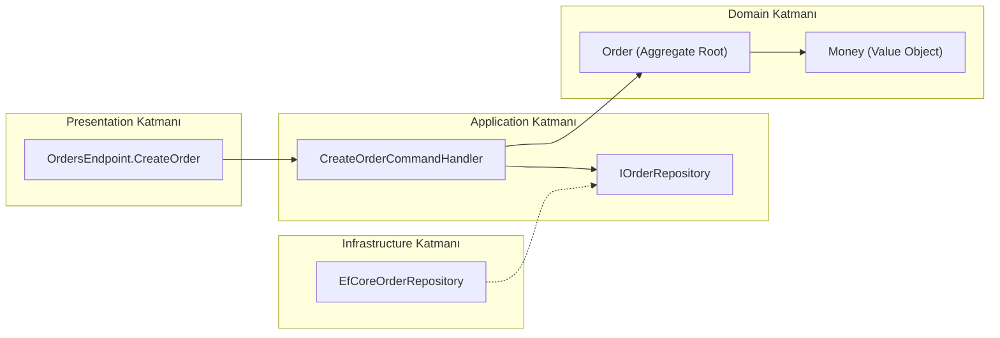
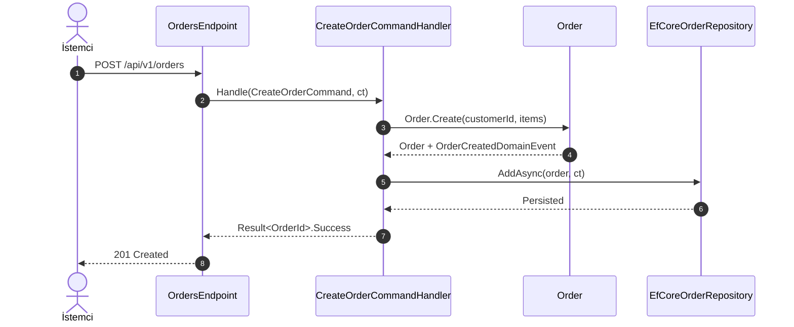

# Pull Request Mühendislik Rehberi: [Özellik / Düzeltme Başlığı]

> [!IMPORTANT]
> **Yazar / Ajan Kuralı (Yüzeysel Özet Yasağı):** Bu doküman, okuyucunun IDE'yi açmasına gerek kalmadan yapılan işi uçtan uca ve derinlemesine anlayabilmesini sağlayan kapsamlı bir mühendislik rehberidir. Tek satırlık yüzeysel madde özetleri, jenerik yer tutucu diyagram düğümleri ve atlanmış dosyalar `pre-command-guard.sh`, `canon-auditor` ve `pr-auditor` tarafından **PR engelleyici hata** olarak reddedilir. Yazıma başlamadan önce tüm köşeli parantez yer tutucularını gerçek proje bilgileriyle değiştirin ve bu uyarı kutusunu kaldırın.

---

## 1. Problem Bağlamı ve Mimari Kararlar

### Çözülen Gerçek Problem ve Kök Bağlam
[Gerçek problemi ve kök bağlamı açıklayın: Kullanıcı veya sistem hangi somut darboğaz, hata veya iş ihtiyacıyla karşılaşıyordu? Mevcut kod tabanında bu akış neden yetersiz kalıyordu?]

### Seçilen Mimari Yaklaşım ve Gerekçesi
- **Etkilenen Bounded Context ve Katmanlar:** [`Domain`, `Application`, `Infrastructure`, `Presentation` — etkilenen somut modüller]
- **Yaklaşım Özeti:** [ Katman sınırlarını (Clean Architecture) ve kanonik akışları bozmadan seçilen çözümün teknik mekanizmasını çok cümleli olarak açıklayın.]

### Değerlendirilen Alternatifler ve Ödünleşimler (Trade-offs)

| Yaklaşım / Seçenek | Avantajlar | Dezavantajlar / Riskler | Karar |
| :--- | :--- | :--- | :--- |
| **Seçenek A (Uygulanan):** [Seçilen desen/mimari] | [Somut teknik kazanım] | [Kabul edilen ödünleşim] | **Seçildi** |
| **Seçenek B:** [Alternatif yaklaşım] | [Kazanım] | [Neden elendiği — ör. katman sızıntısı / YAGNI ihlali] | Elendi |

---

## 2. Mimari ve Veri Akışı Diyagramları

> [!NOTE]
> Diyagramlarda `[Feature]Controller` veya `A --> B` gibi jenerik yer tutucu adlar **kesinlikle yasaktır**; yalnızca projedeki gerçek sınıf, arayüz, modül, metod ve olay adlarını kullanın.

### Katman ve Bileşen Bağımlılık Haritası


### Uçtan Uca Çağrı ve Veri Akışı


---

## 3. Dosya Bazlı Değişiklik Analizi

`git diff --name-status <base>..HEAD` çıktısındaki (`docs/walkthroughs/*` ve `docs/parking-lot.md` hariç) **her bir üretilen, güncellenen ve silinen dosya** aşağıda eksiksiz olarak detaylandırılmıştır:

### `<dosya/tam/yolu>` — [ÜRETİLDİ | GÜNCELLENDİ | SİLİNDİ] (`<Mimari Katman>`)
- **Ne Değişti / Ne Üretildi?:** [Eklenen veya değiştirilen sınıfları, metod imzalarını, veri modellerini, durum geçişlerini ve kritik iş mantığını somut teknik detaylarla açıklayın. Tek cümlelik özet yasaktır; kritik dönüşümler için aşağıda kısa kod kesiti paylaşın.]
  ```text
  // Gerekiyorsa kritik imza veya kural kesiti (10-15 satırı aşmadan odaklanmış kesit)
  ```
- **Neden Değişti / Neden Üretildi?:** [Bu dosyadaki değişikliği zorunlu kılan iş kuralını (Invariant), Clean Architecture katman sınırını, dış sözleşmeyi (API/DB contract) veya hata kök nedenini açıklayın.]

---

## 4. Kritik İş Mantığı, Kenar Durumlar (Edge Cases) ve Hata Yönetimi

| Senaryo / Kenar Durum | Sistemin Davranışı ve Korunan Kural (Invariant) | Üretilen Hata / Yanıt Sözleşmesi |
| :--- | :--- | :--- |
| **Boş / Geçersiz Girdi:** [Ör. negatif tutar veya boş kalem listesi] | [Domain veya Validator katmanında erken reddedilir; veritabanına erişilmez] | [`DomainValidationException` -> `400 ProblemDetails (RFC 7807)`] |
| **Eşzamanlılık / Tekrarlanan İstek (Idempotency):** [Ör. aynı `IdempotencyKey` ile çift gönderim] | [Benzersiz anahtar kısıtı ile mükerrer kayıt engellenir] | [`409 Conflict ProblemDetails`] |
| **Dış Servis / Altyapı Hatası:** [Ör. zaman aşımı veya bağlantı kopması] | [Hata yutulmaz (`CancellationToken` korunur); işlem atomik olarak geri alınır] | [`503 Service Unavailable ProblemDetails`] |

---

## 5. Somut Doğrulama Kanıtları

> "Tüm testler geçti" gibi yuvarlak ifadeler yasaktır; her doğrulama adımı somut test dosyası, komut ve gerçek çıktı özetiyle kanıtlanmalıdır.

### Test Senaryoları ve Kanıtlanan Davranışlar

| Test Dosyası / Senaryo | Kanıtladığı İş Kuralı veya Mimari Sınır | Sonuç |
| :--- | :--- | :--- |
| `[tests/Domain.Tests/...]` | [Ör. Geçersiz durum geçişinde `Order` aggregate'inin hata fırlattığını kanıtlar] | `PASS` |
| `[tests/Architecture.Tests/...]` | [Ör. `Domain` katmanının `Infrastructure` ve SDK bağımlılığı içermediğini kanıtlar] | `PASS` |

### Çalıştırılan Komutlar ve Çıktı Özetleri
- **Birim / Entegrasyon / Fitness Testleri:**
  - Komut: `./scripts/run-quiet.sh test-suite -- <gerçek-test-komutu>`
  - Gerçek Çıktı Özeti: `[Ör. [PASS] test-suite (4.2s) — 42 passed, 0 failed]`
- **Web / Mobil Çalışma Zamanı Teşhisi (İlgiliyse):**
  - Komut / Araç: `[playwright-e2e sıfır konsol hatası / ./scripts/mobile-logs.sh --platform ios|android]`
  - Gerçek Çıktı Özeti: `[0 pageerror, 0 console.error, 0 fatal crash]`
- **Denetim Damgaları (`verify-pr-stamps`):**
  - `canon-pass.json`: `PASS` (`codeTreeSha` eşleşti; Glossary, Flows ve Clean Architecture doğrulandı)
  - `security-pass.json`: `PASS` (`Critical: 0`, `Important: 0`)

---

## 6. Kapsam Dışı (`docs/parking-lot.md`) ve Operasyonel Notlar

- **Kapsam Dışı Bırakılanlar (`docs/parking-lot.md`):**
  - [Bu PR'ın kapsamını şişirmemek için bilinçli olarak `docs/parking-lot.md` dosyasına kaydedilen iyileştirme maddeleri veya "Yok"]
- **Operasyonel ve Dağıtım Notları:**
  - [Veritabanı migrasyonu, yeni ortam değişkeni, özellik bayrağı veya geriye dönük uyumluluk notları]

---

## Teknik Terimler Sözlüğü

| Terim | Açıklama |
| :--- | :--- |
| **Aggregate Root** | İş kurallarının bütünlüğünü (invariants) koruyan ve dış katmanların yalnızca kendisi üzerinden işlem yapabildiği kök DDD varlığı. |
| **Bounded Context** | Belirli bir iş alanı modelinin ve ortak dilin (*Ubiquitous Language*) tutarlı sınırlar içinde geçerli olduğu mimari bağlam. |
| **Clean Architecture** | İş kurallarını veritabanı, UI ve dış kütüphanelerden bağımsız kılan, bağımlılıkların kesin olarak içe doğru baktığı yazılım mimarisi. |
| **Idempotency** | Aynı isteğin birden fazla kez uygulanmasının sistem durumunda tek bir uygulamadan farklı yan etki üretmemesi özelliği. |
| **RFC 7807 (ProblemDetails)** | HTTP API hata yanıtlarını makine ve insan tarafından okunabilir standart JSON şemasıyla sunan iletişim sözleşmesi. |
| **Trade-off (Ödünleşim)** | Bir mimari karar alınırken kazanılan nitelik karşılığında bilinçli olarak feragat edilen alternatif avantaj veya kabul edilen maliyet. |
